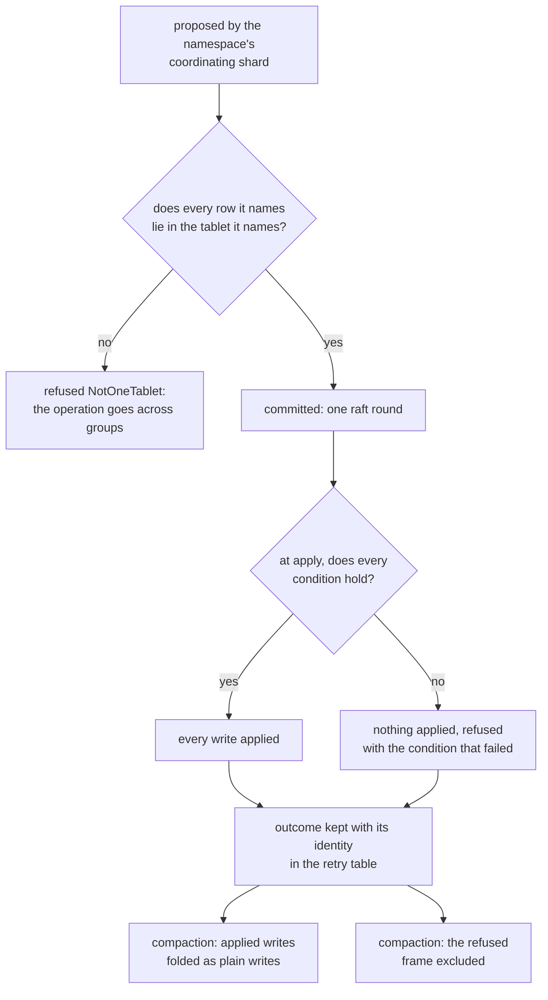

# W30. A command of several writes in one tablet

## Context

A create is three facts that have to appear together: a name in a directory, the file it names, and
the directory's changed times. Shoal changes one row at a time, and a crash between two rows of a
create would leave a name for no file or a file no name reaches. The decision of 2026-10-26 rejected
transactions across partitions in the engine ([overview](overview.md#decisions-taken-on-2026-10-26)),
so the capability the namespace needs is the narrowest that makes its common operations atomic: **a
command of several writes, all in one tablet, applied all or nothing**. This page is that command, why
it is a tablet's and not a group's, and the one rule about compaction that has to be fixed before any
such command is in a WAL.

## What exists today

- **Every write names exactly one row**: an insert, a delete, an update or a conditional of one key
  (`shoal-proto/src/shared/queries/unsorted.rs:16-31`), and a bundle is "a batch, not a transaction"
  ([introduction](../../introduction.md)). P6 promises nothing across tablets
  ([C13](../../distributed/protocol.md#the-contract)).
- **A write is a command applied in committed order** by every replica's `apply`
  ([F40](../../features/replication.md)).
- **A condition is an equality on filter fields**, `Absent` or `Matches`
  (`shoal-proto/src/shared/queries/condition.rs:19-27`), judged at apply against the state every earlier
  committed command left, and its refusal kept with the write's identity in the retry table
  ([F68](../../features/conditional-writes.md#where-the-condition-is-judged)).
- **The compactor judges every conditional again**, against the partition it is folding, and a sorted
  batch holding one is folded whole ([F68](../../features/conditional-writes.md#where-the-condition-is-judged)).
- **A refused stripe commit's frame is excluded from compaction** (`ShardWal::exclude`), "honoured by
  every pass and every re-merge of a repair's tail until the checkpoint passes it"
  ([F88](../../features/recovery-and-moves.md#every-stripe-commit-claims-an-epoch)).
- **A group holds many tablets**: one group a table and replica set
  (`shoal-proto/src/shared/identity.rs:290`), so every tablet of a table placed on the same members shares
  one. **A tablet split** is designed to be survived and scheduled by nothing
  ([open issues](../../distributed/open-issues.md)).

## The design

### The command

A **namespace command** carries, for one tablet it names:

- **conditions** on any row of the tablet, including rows it does not write: absent, present, or equal
  on a field, as F68's are;
- **writes** to rows of one or more partitions of the tablet: inserts, updates and deletes.

At apply, every replica judges every condition against the state every earlier committed command left,
then applies every write, or none if any condition fails. One raft round for the whole of it.

### One tablet, not one group

Every tablet of a table placed on the same members shares a group today, so a command across two of
them would be atomic today. It would stop being so the day one of them moves to other members, or a
split deals two halves of one tablet to two groups. **The tablet is what moves and splits whole**,
so the command is confined to one, and checked against it when it is proposed: a command naming a row
whose key does not lie in its tablet is refused `NotOneTablet` by name, and the namespace takes the
operation across groups instead ([W33](cross-group-operations.md)). A command proposed against a
tablet that has since split is refused as any write to a moved tablet is, and planned again.

The namespace keeps its common operations eligible by where it places its rows: a file's entry and its
inode row in one tablet, a directory's entries and its content part in another
([W31](namespace.md#keys-that-place-themselves)).

### Decided once, at apply

F68's compactor judges each conditional write again against the one partition it folds. A namespace
command's conditions name rows of other partitions, which a fold of one partition cannot see. So:

- **its outcome is decided once, at apply**, applied or refused, and kept with its identity in the
  retry table, so a retry is answered with the first outcome, as F68's refusals are;
- **a refused command's frame is excluded from compaction**, by `ShardWal::exclude`, as F88's refused
  stripe commits are;
- **an applied command's writes are folded as plain writes**, never judged again.

The third has a gain beside its correctness: a plain write can join an F61 fragment, so a create into
a directory no longer folds the directory's partition whole at compaction, as a sorted conditional
write does today ([F68](../../features/conditional-writes.md#limitations)).

### Where it is used

Only by the namespace's coordinator at first, as an internal query on generated tables, never by a
client. A table that does not use it runs exactly as it did: its reads check nothing new and its
compaction judges nothing new. A client's form, a bundle marked atomic whose writes lie in one tablet,
is optional later, for any table that wants a partition's rows changed together.

## Alternatives rejected

**Transactions across partitions in the engine.** Decided against on 2026-10-26: a general transaction
needs intents every read of a table that uses it must check, a timestamp or an order across groups, and
a recovery of abandoned ones, and the filesystem would wait for all of it. Its common case, a create,
would be two rounds where this is one, unless it built this command as its fast path too.

**A command confined to a group.** Atomic today, and broken by the first move of one of its tablets.

**One row for a file's entry, its inode and its directory's times.** CephFS embeds a file's inode in its
entry ([W29](prior-art.md#cephfs)); a directory's times and link count would still be another row, and
a cross-directory rename would move the inode, its stable number with it.

**Judging the command again at compaction.** Impossible: a fold of one partition cannot see the rows of
another a condition names.

**A bundle made atomic.** A bundle spans tablets and nodes, which is what one-tablet atomicity avoids.

## What it costs

A command kind in the WAL, which is a persisted format; a check of every row against its tablet at
proposal; retry-table entries for its outcomes; exclusions for its refusals; a WAL frame the sum of its
rows.

## What it breaks

Nothing for a table that does not use it.

## Invariants to uphold

- **A namespace command names rows of one tablet only**, checked when it is proposed.
- **Every condition is judged before any write**, and the writes are applied all or none.
- **Its outcome is decided once, at apply**, and kept with its identity.
- **A refused command's frame is excluded from compaction; an applied one's writes fold as plain
  writes.**
- **No other table's read, write or compaction path changes.**

## Prerequisites

None: this page is [W28](prerequisites.md#a-command-of-several-writes-in-one-tablet)'s row.

## How it would be measured

A command of N writes against N single writes, its latency and its WAL bytes, and a directory's
compaction with commands against conditional writes ([X32](spikes.md#x32-metadata-operations-priced));
every F68 and F61 test unchanged.

## Acceptance tests

| Test | Gate | Proves |
| --- | --- | --- |
| `a_command_applies_all_its_writes_or_none` | M35 | A command whose last condition fails applies nothing, on every replica |
| `a_command_judges_a_row_it_does_not_write` | M35 | A condition on a row of another partition of the tablet refuses the command |
| `a_command_across_tablets_is_refused_by_name` | M35 | A command naming a row of another tablet is refused `NotOneTablet` before it is proposed |
| `a_refused_command_is_excluded_from_compaction` | M35 | A refused command's frame is never folded into an archive |
| `an_applied_commands_writes_fold_as_plain_writes` | M35 | Compaction folds an applied command's writes without judging its conditions, and they join fragments |
| `a_retried_command_is_answered_with_its_first_outcome` | M35 | A command retried under its identity after the row changed gets the outcome it first had |
| `every_conditional_write_test_passes_unchanged` | M35 | F68's and F61's tests pass on the engine with commands in it |

## Related

[F68](../../features/conditional-writes.md), whose conditions this extends; [F88](../../features/recovery-and-moves.md)
for exclusion from compaction; [W31](namespace.md) for the layout that keeps operations eligible;
[W33](cross-group-operations.md) for those that are not.
