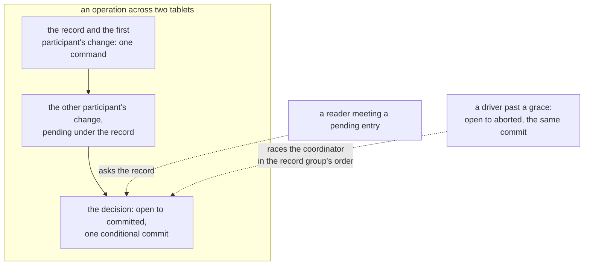

# W41. The contract and the questions

## Context

A file tree is changed by many mounts at once while its tablets move, its coordinators crash, its mounts
die or are cut off, and its files are written by whoever holds their write leases. What it promises has to
be written down as properties a history can be checked against, before a frame or a row format is built,
as the cluster's contract was ([C13](../../distributed/protocol.md#the-contract)), the object store's
([S18](../../object-storage/contract.md#the-contract)), the scans' ([W13](../scans/contract.md#the-contract))
and the volumes' ([W27](../volumes/contract.md#the-contract)). This page states the file tree's contract,
how it behaves under each failure, the questions still open with the gate each blocks, the decision record,
and the acceptance index.

## What exists today

- **A tablet group's contract, P1–P6**, which every tablet of the namespace keeps: commands applied in one
  order on every copy, `One` and `Quorum`, and nothing across tablets.
- **The volumes' contract, P27–P35**, which binds a file's bytes on the lane unchanged, with a file's writer
  number in a volume's place ([W27](../volumes/contract.md#the-contract)).

## The design

### Decisions taken and directions preferred

| Decision | Status |
| --- | --- |
| Operations across directories by the filesystem's own protocol, not the engine's transactions | Taken 2026-10-26 ([overview](overview.md#decisions-taken-on-2026-10-26)) |
| A file's bytes on the volumes' lane, under a write lease; small files inline | Taken 2026-10-26 |
| A pool's write protocol is its policy; a tree's files bind an attached pool | Taken 2026-10-26 |
| A file's right to write is the write lease | Taken 2026-10-26 |
| Volumes are built first | Taken 2026-10-26 |
| Operation records decided by one conditional commit | Preferred ([Q53](#questions-to-answer)) |
| A file's inode co-located with its entry by minted prefixes | Preferred ([Q54](#questions-to-answer)) |
| Close-to-open, caches bounded in time; read leases later | Preferred ([W35](mounts-and-locks.md#what-a-mount-caches)) |
| The namespace on the table shards, in a queue of its own | Preferred ([Q58](#questions-to-answer)) |
| Many writers to one file at once | Excluded from these gates: a write lease is one mount's |

### The contract

`P` numbers continue the volumes' and are never reused. P1–P6 bind every tablet of the namespace and P27–P35
a file's bytes; P36–P44 are what a file tree adds, each beside the violation that breaks it.

| # | Property | Binds | The violation | Owning tests |
| --- | --- | --- | --- | --- |
| P36 | **Namespace atomicity.** Every operation takes effect whole, at one command or at one record's decision, as every later operation sees it; a renamed name is at its old place or its new one, never both and never neither | [W30](atomic-commands.md), [W32](one-tablet-operations.md), [W33](cross-group-operations.md) | A rename seen at both names; an entry naming an inode that does not exist | `a_command_applies_all_its_writes_or_none` (M35), `a_create_is_one_command` (M36), `a_rename_between_directories_is_seen_whole_or_not_at_all` (M37), `a_driver_abort_and_a_late_commit_decide_once` (M37) |
| P37 | **It stays a tree.** Whenever no operation record is open, every entry is reachable from the root by one path, no directory is its own ancestor, and every link count equals the entries that name its inode | [W33](cross-group-operations.md) | A cycle from two concurrent renames; a link count wrong after a crashed `link` | `two_crossing_directory_renames_never_make_a_cycle` (M37), `a_hard_link_keeps_the_link_count_exact` (M37), `a_crash_mid_operation_leaves_no_half` (M37) |
| P38 | **`rmdir` removes only empty directories**, and nothing is created in one once its removal began | [W33](cross-group-operations.md#rmdir) | A file left in a removed directory | `an_rmdir_racing_a_create_leaves_one_of_them` (M37), `a_create_in_a_directory_being_removed_is_refused` (M37) |
| P39 | **Close-to-open.** An open that begins after a close or an fsync completed sees that close's size and every byte it made durable | [W34](file-data.md#what-a-reader-sees) | A reader served a stale position the writer had excluded | `an_open_after_a_close_sees_all_of_it` (M38), `a_close_waits_for_every_write` (M38) |
| P40 | **One write lease holder at a time.** At most one mount writes a file's bytes, and a holder whose lease was called back or revoked has every later write and close refused | [W34](file-data.md#the-write-lease), [W35](mounts-and-locks.md#a-call-back) | Two mounts' writes interleaved after a revoke | `a_holder_that_does_not_release_is_revoked` (M38), `a_close_after_a_revoke_is_refused` (M38), `conflicting_locks_are_never_both_held` (M39) |
| P41 | **An unlinked file keeps its bytes while a live mount holds it open** | [W35](mounts-and-locks.md#held-inodes) | Bytes reclaimed under a reader | `an_open_unlinked_file_keeps_its_bytes` (M38) |
| P42 | **A listing returns each entry once.** A listing resumed by a cookie, across a part's split, returns every entry live throughout exactly once | [W31](namespace.md#readdir) | An entry skipped or repeated after a split | `readdir_cookies_survive_a_part_split` (M36), `a_page_never_ends_inside_a_run_of_one_hash` (M36) |
| P43 | **Names are exact.** Two names whose hashes collide are two entries, and a lookup answers only the name asked | [W31](namespace.md#names) | A lookup answering another name | `two_names_with_one_hash_are_two_entries` (M36), `a_name_is_its_bytes` (M36) |
| P44 | **What is not promised.** Coherence between mounts beyond close-to-open; a cached name or attribute fresher than its bound; atomicity across files beyond a rename; mmap coherence across mounts; a file written by several mounts at once in any order but turns; and every write of a mount ended before it flushed. This is P6's twin, and P35's | every operation | An oracle, an API or a test that treats a mount's cache as current, or two mounts' writes as interleaved | `the_tree_oracle_promises_nothing_beyond_close_to_open` (M35) |

**Isolation is a budget, not a property.** What a file tree may cost the queries beside it is a number,
stated on [W37](isolation.md#the-budget) and judged on the lab at every gate from M36.

### How a file tree behaves when something fails

| Condition | Required behaviour |
| --- | --- |
| A coordinator dies mid-operation | Its record is decided by a driver past a grace, aborted unless committed, then finalized |
| A reader meets a pending entry | It asks the record by a strong read, and sees the operation whole or not at all |
| A tablet's group loses its leader | Its operations wait for the next; every other tablet's go on |
| A mount dies | Past a grace its row's leader ends it by a commit, bars it in every group, revokes its write leases, releases its locks, and lets its held inodes go |
| A mount is cut off but running | The same; its later commands are refused `MountEnded`, and what it had not flushed is lost and reported |
| A write lease's holder does not answer a call-back | Past a grace its lease is revoked by a commit that raises the file's writer number |
| A part passes its bound | It is split into two by one command |
| Two mounts create one name | One is answered `Exists` |
| A directory is renamed into its own descendant | Refused `EINVAL` under the rename row |
| An `rmdir` races a create | The create is refused `Removing`, or the `rmdir` `NotEmpty` |
| The pool is full | A write that needs space is refused `NoSpace` |

### Questions to answer

`Q` numbers continue the volumes'. Each names the gate it blocks, the evidence that settles it, and the
direction preferred until then.

| # | Question | Gate | Evidence | Preferred |
| --- | --- | --- | --- | --- |
| Q53 | How is an operation across groups made atomic and recovered? | Before M37 | [X31](spikes.md#x31-the-namespaces-model) | A record beside one participant, pending changes, one conditional commit a driver may race ([W33](cross-group-operations.md)) |
| Q54 | Is a file's inode co-located with its entry by minted prefixes, or kept in its directory's part by the sort key? | Before M36 | [X32](spikes.md#x32-metadata-operations-priced) | Minted prefixes, unless co-location buys under 30% ([W31](namespace.md#keys-that-place-themselves)) |
| Q55 | What bounds a directory part, and when does it split? | Before M36 | [X33](spikes.md#x33-a-directory-parts-size) | A few thousand entries ([W31](namespace.md#directory-parts)) |
| Q56 | Is a write lease kept past a close, and what bounds a call-back? | Before M38 | [X35](spikes.md#x35-a-call-back-priced) | Released at close; a dirty cap a file ([W35](mounts-and-locks.md#a-call-back)) |
| Q57 | How is an unlinked file held while another mount has it open: by asking the mounts, or by recording opens? | Before M37 | X31, X32 | The unlinking mount's hold, and the other mounts asked before reclamation ([W35](mounts-and-locks.md#held-inodes)) |
| Q58 | Does the namespace stay on the table shards, or move to executors of its own? | A default before M36; asked again at M39 | X32 | On the shards, in its queue, under its limits and cap ([W37](isolation.md#executors-of-its-own)) |
| Q59 | Which FUSE transport, and does the daemon's client stay tokio's? | Before M39 | [X34](spikes.md#x34-fuse-classic-and-over-io_uring) | FUSE over io_uring where the kernel has it; tokio unless X34 says ([W36](fuse.md#the-transport)) |
| Q60 | Does a grant of `all` include volume sets and file trees? | At M31 and M37, with the user | — | Open, as the scans' Q39 is: including them widens every `all` granted before |
| Q61 | Who enforces a file's mode bits: the host's kernel, trusting a mount within its grant, or the coordinating shard? | Before M36 | Design | The kernel's `default_permissions` ([W35](mounts-and-locks.md#grants)) |

### Decision record

#### The plan drawn, and five decisions taken with the user (2026-10-26)

The user asked for the performance tradeoffs of the first two before choosing, and they were given as below.

| Decision | Evidence |
| --- | --- |
| **The filesystem's own namespace protocol** | Given: one round for the common operations against two for a transaction without a one-tablet fast path; about two rounds across groups either way, a transaction's needing timestamps besides; creates in one directory ordered in one log against conflicting on its attributes; nothing on any other table's path against intents every reader of a table that used them would check; the filesystem now against waiting for the engine's transactions. JuiceFS's create took 1,209 µs on TiKV and 570 µs on Redis ([W29](prior-art.md#juicefs)) |
| **A file's bytes on the volumes' lane, under a write lease** | Given: about 2 ms a small write in place on the lab against the object store's 10.3 to 12.8 ms; reads straight from holders against two strong reads; no table shard a write against a raft round and the coordinator's byte work there; one writer a file at a time, turns by call-back, against many writers by commits; the volumes built first |
| **A pool's write protocol is its policy** | The volumes' decision ([W27](../volumes/contract.md#decision-record)), which a tree's files share |
| **The write lease** | The user's choice of name, over custody and a write right, kept apart from F100's leader lease |
| **Volumes first** | Follows from the second |

#### The first draft reviewed (2026-10-26)

A review of the first draft made these corrections before the pages were written; each is an alternative
rejected on its page and an unsafe setting of the model ([W40](model.md#the-settings)).

| Correction | Where |
| --- | --- |
| A command confined to one tablet, not one group, since a split or a move deals tablets apart | [W30](atomic-commands.md#one-tablet-not-one-group) |
| A command decided once at apply, its refusal excluded from compaction, its writes folded plain | [W30](atomic-commands.md#decided-once-at-apply) |
| Keys minted with a supplied hash, since gxhash's collisions are undetected and cannot place a file by its entry | [W31](namespace.md#keys-that-place-themselves) |
| A directory's parent pointer in its access part, and its content part made lazily | [W31](namespace.md#a-directorys-two-parts) |
| `rmdir`'s removing mark, and creates conditioned on a live directory | [W33](cross-group-operations.md#rmdir) |
| No fact records a read open, so an unlinked file's other holders are asked | [W35](mounts-and-locks.md#held-inodes) |
| A listing's sort key the name's hash and then its bytes | [W31](namespace.md#readdir) |

And one found while the pages were written: **a namespace's resident rows capped a shard**, since a `find`
would otherwise evict every table's hot set ([W37](isolation.md#memory)).

### The acceptance index

Every test the pages name, by the gate that owns it. These tables join `shoal-bench/tests/acceptance_tables.rs`
at the volumes' [M29](../volumes/milestones.md#m29-the-harness), which learns M29 to M39.

| Gate | Tests | On |
| --- | --- | --- |
| M35 | `a_command_applies_all_its_writes_or_none`, `a_command_judges_a_row_it_does_not_write`, `a_command_across_tablets_is_refused_by_name`, `a_refused_command_is_excluded_from_compaction`, `an_applied_commands_writes_fold_as_plain_writes`, `a_retried_command_is_answered_with_its_first_outcome`, `every_conditional_write_test_passes_unchanged`, `namespace_keys_never_collide`, `every_namespace_schedule_replays_to_its_verdict`, `the_safe_namespace_policy_breaks_no_property`, `every_namespace_rule_is_needed`, `the_tree_oracle_promises_nothing_beyond_close_to_open` | [W30](atomic-commands.md#acceptance-tests), [W31](namespace.md#acceptance-tests), [W40](model.md#acceptance-tests), this page |
| M36 | `an_inode_number_is_never_reused`, `a_files_entry_and_inode_share_a_tablet`, `two_names_with_one_hash_are_two_entries`, `a_name_is_its_bytes`, `a_part_past_its_bound_splits_in_one_command`, `readdir_cookies_survive_a_part_split`, `a_page_never_ends_inside_a_run_of_one_hash`, `a_directorys_stat_reads_both_parts`, `a_create_is_one_command`, `an_exclusive_create_of_a_taken_name_is_refused`, `an_unlink_of_a_home_inode_is_one_command`, `a_rename_inside_a_directory_is_one_command`, `a_retried_create_is_answered_with_its_first_outcome`, `a_namespace_storm_beside_the_reference_cell_holds_its_budget`, `a_find_over_a_large_tree_evicts_no_other_tables_rows`, `the_namespace_queue_sheds_past_its_count_by_name`, `a_namespace_kind_times_every_operation`, `an_mdtest_hard_arm_reports_its_one_group` | W31, [W32](one-tablet-operations.md#acceptance-tests), [W37](isolation.md#acceptance-tests), [W39](performance.md#acceptance-tests) |
| M37 | `a_create_in_a_directory_being_removed_is_refused`, `an_operation_needing_two_groups_is_never_two_commands`, `a_rename_between_directories_is_seen_whole_or_not_at_all`, `a_driver_abort_and_a_late_commit_decide_once`, `a_crash_mid_operation_leaves_no_half`, `two_crossing_directory_renames_never_make_a_cycle`, `an_rmdir_racing_a_create_leaves_one_of_them`, `a_hard_link_keeps_the_link_count_exact`, `a_pending_name_refuses_another_operation`, `an_ended_mount_is_barred_before_its_locks_are_released`, `a_mount_past_its_grace_is_ended_by_a_commit`, `a_mounts_limit_holds_against_its_tree`, `a_tree_beside_a_cluster_holds_its_budget` | W32, [W33](cross-group-operations.md#acceptance-tests), [W35](mounts-and-locks.md#acceptance-tests), W37 |
| M38 | `a_create_takes_its_write_lease_in_its_command`, `a_small_file_is_two_commits`, `a_file_past_the_threshold_flips_once`, `an_open_after_a_close_sees_all_of_it`, `a_close_waits_for_every_write`, `a_close_after_a_revoke_is_refused`, `a_truncate_zeros_its_tail_and_discards_past_it`, `appends_from_two_mounts_lose_nothing`, `a_call_back_flushes_before_the_lease_moves`, `a_holder_that_does_not_release_is_revoked`, `an_open_unlinked_file_keeps_its_bytes`, `a_call_back_storm_event_is_cut_at_its_marks` | [W34](file-data.md#acceptance-tests), W35, W39 |
| M39 | `conflicting_locks_are_never_both_held`, `a_blocked_lock_is_woken_by_a_push`, `a_mount_passes_pjdfstest_but_its_listed_exceptions`, `an_open_to_write_takes_the_lease_before_returning`, `a_call_back_writes_back_the_kernels_dirty_pages`, `readdirplus_fills_attributes_in_one_pass`, `cached_attributes_expire_within_their_bound`, `a_killed_daemon_is_ended_and_its_mount_remade`, `a_mount_arm_says_whether_its_caches_were_on` | W35, [W36](fuse.md#acceptance-tests), W39 |

## Alternatives rejected

**POSIX's coherence between mounts at first**: a lease on every read as well as every write, recalled on every
change, which is CephFS's capabilities and their storms ([W29](prior-art.md#cephfs)). Read leases are optional
and later.

**Isolation as a property**: a budget, judged at gates.

**Atomicity across files**: no filesystem promises it beyond a rename.

## What it costs

Nine properties, each owned by tests, and every gate held to them.

## What it breaks

Nothing. P1–P35 bind as they did.

## Invariants to uphold

- **Every property has at least one owning test**, named before its gate starts.
- **A property a later design contradicts is changed with a recorded cause**, the model first.

## Prerequisites

None of its own.

## How it would be measured

P36–P43 by the model's oracles first ([W40](model.md)), then by the tests above; the budget beside them by
[W39](performance.md).

## Acceptance tests

| Test | Gate | Proves |
| --- | --- | --- |
| `the_tree_oracle_promises_nothing_beyond_close_to_open` | M35 | The fixture's tree oracle checks P36 to P43 and treats no mount's cache as current, so no test can lean on what P44 withholds |

## Related

[The volumes' W27](../volumes/contract.md), whose contract binds a file's bytes; [W13](../scans/contract.md),
[S18](../../object-storage/contract.md) and [C13](../../distributed/protocol.md); [W40](model.md); [the
milestones](milestones.md).
