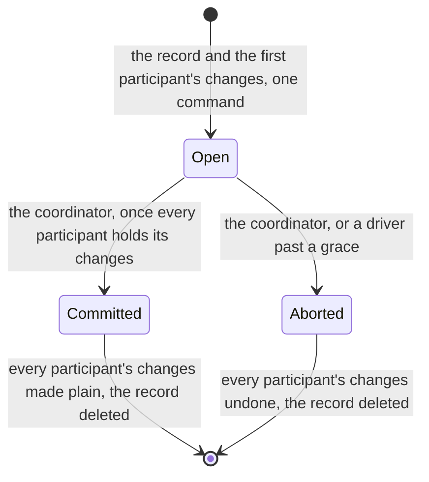
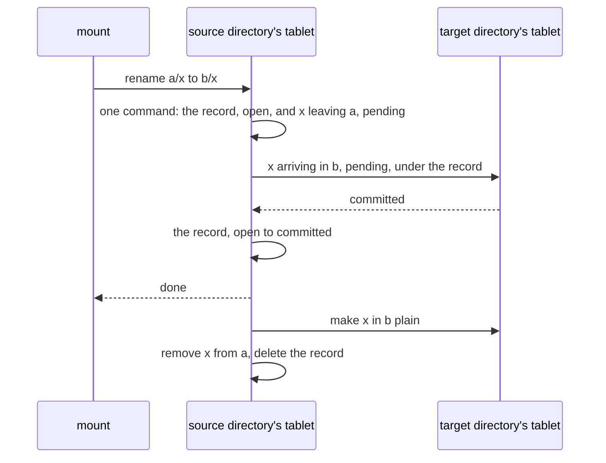

# W33. Operations across groups: records, renames and cycles

## Context

A few operations cannot fit one tablet however the rows are laid out: an `rmdir`, whose directory's
entries are in its own tablet and whose entry is in its parent's; a rename between directories; a hard
link, and the unlink of one; any operation on a file renamed away from where it was born. R35 asks
them to be atomic and to keep the namespace a tree with exact link counts through any crash, and the
decision of 2026-10-26 rules out the engine's transactions. This page is the filesystem's own protocol
for them: a record of the operation beside one of its tablets, changes held pending at the others, one
commit that decides, and a reader that asks the record.

## What exists today

- **Nothing is atomic across tablets** ([P6](../../distributed/protocol.md#the-contract)).
- **The object store settles what a writer left by a committed fact.** A stage its stager abandoned is
  decided from its row ([F86](../../features/replicated-pools.md#deciding-what-a-stager-left)), and S7's
  no-op races a slow coordinator in the row's own order, whichever commits first deciding
  ([S7](../../object-storage/write-path.md#small-writes)).
- **A retry is answered by its identity** from a group's retry table
  ([replication](../../distributed/replication.md)).
- **Linux serializes renames between directories** of one filesystem by a mutex of its superblock,
  `s_vfs_rename_mutex` (**recalled**), which is what keeps two renames from making a cycle together.

## The design

### The operation record

An operation across groups is written as **an operation record**: a row in the tablet of one of its
participants, naming every participant and every change at each, and a state, **open**, **committed**
or **aborted**. The record is written in the same command as that participant's own changes, so it
costs no round of its own, as a transaction's primary key is in Percolator's design (**recalled**).

**The decision is one conditional commit on the record**, open to committed or open to aborted, and it
never changes after. A coordinator that is slow and a driver that gives up on it race in the record
group's order, and whichever commits first decides, as S7's no-op races a slow writer. A timer prompts
the driver; the commit decides ([R7](../../distributed/overview.md#what-is-asked-of-it)).

### Pending entries

At every other participant, one namespace command writes that participant's changes as **pending**:

- **a pending entry names its record**, by its id and its tablet, and **holds its name**: a create of
  that name is refused `Pending` by name and retried, and no second operation may take it;
- **a pending arrival is invisible, and a pending departure still visible**, until the decision. A
  reader that meets either asks the record, by a strong read: committed, and it sees the operation done;
  open or aborted, and it sees it not done. So a renamed name is at its old place or its new one, never
  both and never neither ([P36](contract.md#the-contract));
- **a participant's link count and times change with its pending entry** and are undone with it.

After the decision, each participant's changes are made plain, or undone, by one command each,
asynchronously; the record is deleted only once every participant is finalized.

### A rename between directories

- **Its participants** are the distinct tablets among the source directory's, the target's, the moved
  inode's when it is a directory, whose parent pointer moves ([W31](namespace.md#a-directorys-two-parts)),
  and a replaced file's inode's.
- **Its critical path is two rounds**: the record with the first participant's changes, the others'
  pending changes in parallel, then the decision. On the lab that is about 10.6 ms, two row commits; on
  europa's Optane about 1.3 ms. Finalizing is off the path.
- **A file renamed away from its birth directory keeps its inode row there**, so a later unlink or
  link of it is across groups too ([W31](namespace.md#inode-numbers)).

### The rename row, and cycles

A rename of a directory into another directory must never make it its own ancestor, and two such
renames, each checked alone, can make a cycle together. So **renames of directories between directories
are serialized a tree at a time by its rename row**, a row in the tree's own tablet:

1. the operation takes the rename row, a conditional commit naming its record;
2. it walks the target's ancestors by their parent pointers, reading access parts up to the root, which
   no other directory's rename can change meanwhile, and refuses `EINVAL` by name if the source is among
   them;
3. it runs as any operation across groups;
4. it releases the rename row only once every participant is finalized.

A file's rename never takes it, since a file cannot be an ancestor. This is Linux's own rule for one
filesystem, kept for a tree ([W29](prior-art.md)), and it caps a tree's renames of directories across
directories at one at a time, which is rare work.

### rmdir

An `rmdir` is an operation across two groups, the directory's own content tablet and its parent's:

- **at the directory's tablet**, a `removing` mark on its content row, conditioned on its entry count
  being zero and its row being live or absent, after which every create in it is refused `Removing`
  ([P38](contract.md#the-contract));
- **at the parent's tablet**, the record and the removal of the directory's entry and inode row, pending,
  and the parent's link count lowered;
- **the decision**, then the content row's removal.

An `rmdir` aborted, by a crash or a driver, clears its mark, and the directory is as it was.

### Hard links, and unlinking one

A hard link is **a remote entry**: a second entry naming an inode whose row is elsewhere. A `link` is
the new entry in the target directory's tablet and the inode's link count raised in its own, an
operation across two groups unless both are one tablet; an unlink of a remote entry is the same in
reverse, and at a link count of zero the inode is held while a mount has it open and retired otherwise
([W35](mounts-and-locks.md#held-inodes)). CephFS's remote entries carry the same cost
([W29](prior-art.md#cephfs)).

### The driver

Every shard runs a driver over the records its groups lead, as each runs a recovery task over its
placement groups ([F88](../../features/recovery-and-moves.md#rebuilding-a-stale-position)): a record open
past a grace is aborted by a conditional commit; a decided one is finalized at every participant and
deleted. It runs in the namespace queue at a pace of its own ([W37](isolation.md#the-namespace-queue)).

## Alternatives rejected

**Transactions across partitions in the engine**, decided against on 2026-10-26: intents every reader of
a table that used them would check, an order across groups, and a create's two rounds where it is one
([W30](atomic-commands.md#alternatives-rejected)).

**A coordinator group of its own**, a tree's transaction log: a third group and a round more for every
operation, where the record beside a participant costs neither.

**Presumed abort by a time alone**: a coordinator that wrote its decision late would be overruled by a
clock. Here the driver's abort is a commit that races the coordinator's in one order.

**One lock for every rename.** Files' renames, the common case, do not need it.

**Two one-tablet commands in a row, without a record.** A crash between them leaves half a rename, with
nothing to say which half or how to finish it.

## What it costs

- An operation record and a pending change at every participant but one, and a strong read for a reader
  that meets one while it is open.
- Two rounds on the critical path, about 10.6 ms on the lab.
- One directory rename between directories at a time in a tree.
- A driver on every shard.

## What it breaks

Nothing.

## Invariants to uphold

- **Every pending change names its record**, and holds its name until it is decided.
- **A record's decision is one conditional commit and never changes.**
- **A record is deleted only once every participant is finalized.**
- **A reader resolves a pending entry by the record's committed state**, and sees the operation whole or
  not at all.
- **A rename of a directory between directories holds the tree's rename row** from before its ancestor
  walk until every participant is finalized.
- **The namespace is a tree, and every link count exact, whenever no record is open.**

## Prerequisites

[W30](atomic-commands.md)'s command; [W31](namespace.md)'s parent pointers and layout; the namespace
queue of [W28](prerequisites.md#a-namespace-queue-on-table-shards-and-limits-a-tree-and-a-mount).

## How it would be measured

The model first: every crash and race of records, drivers, renames, `rmdir`s and links, against the tree
and link count properties ([X31](spikes.md#x31-the-namespaces-model)); then a rename's and an `rmdir`'s
latency on the lab ([X32](spikes.md#x32-metadata-operations-priced)).

## Acceptance tests

| Test | Gate | Proves |
| --- | --- | --- |
| `a_rename_between_directories_is_seen_whole_or_not_at_all` | M37 | A reader during a rename sees the name in one place, never both or neither |
| `a_driver_abort_and_a_late_commit_decide_once` | M37 | A coordinator's commit after a driver's abort is refused, and every participant is undone |
| `a_crash_mid_operation_leaves_no_half` | M37 | A coordinator killed at every step leaves the operation done or undone at every participant |
| `two_crossing_directory_renames_never_make_a_cycle` | M37 | Renames of `a` into `b/x` and `b` into `a/y` at once: one is refused `EINVAL` |
| `an_rmdir_racing_a_create_leaves_one_of_them` | M37 | The create is refused `Removing`, or the `rmdir` refused `NotEmpty` |
| `a_hard_link_keeps_the_link_count_exact` | M37 | `link` and unlink of a remote entry move the inode's link count with the entries, through crashes |
| `a_pending_name_refuses_another_operation` | M37 | A create of a name a rename holds pending is refused `Pending` and succeeds after the decision |

## Related

[W30](atomic-commands.md) for the one-tablet commands each participant's change is; [W32](one-tablet-operations.md)
for the operations that need none of this; [W40](model.md) for what checks it first; [W29](prior-art.md)
for how CephFS and JuiceFS do the same.
