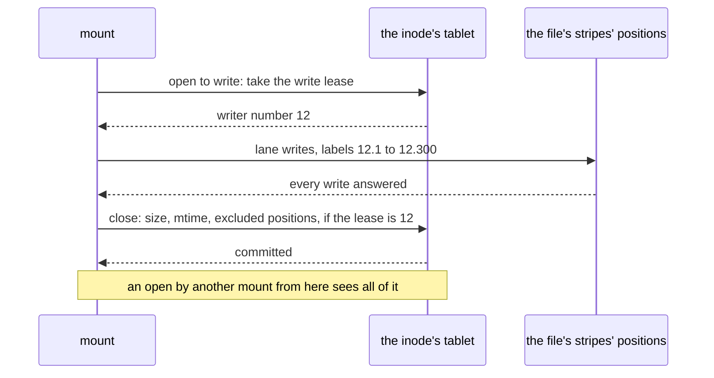

# W34. A file's bytes under its write lease

## Context

R38 asks for a file's bytes written at a volume's speed by one write lease's holder at a time, and a
small file created, written and closed in two commits. The decision of 2026-10-26 put a file's bytes on
the [volumes' writer lane](../volumes/writer-lane.md) under a **write lease**, one mount at a time, and
kept small files inline. A file is then a small volume with a name: one writer, numbered writes, blocks
labelled at their holders. What is new is what a volume does not have: other mounts that open it, a
size and an mtime other readers must see, a file that grows from inline to striped, truncation, and
appends from more than one mount. This page is each of those.

## What exists today

- **Nothing of the lane is built**; it is the volumes plan's ([W17](../volumes/writer-lane.md)), and this
  plan's file data waits on its [M32](../volumes/milestones.md#m32-placement-under-a-writer).
- **A small object lives in its row**, up to its pool's inline threshold, 16 KiB by default, and an
  object that grows past it moves to stripes once and never back
  (`shoal-core/src/server/shard/objects/write.rs:128-145`).
- **A write in place through the object store** took 10.3 to 12.8 ms at 4 KiB on the lab
  ([F86](../../features/replicated-pools.md#performance)), and it moves neither `content_version` nor
  `modified_ms` ([W14's found on the way](../volumes/prerequisites.md#found-on-the-way)).
- **`ObjectFile` buffers writes** up to a mebibyte and sends them as one write in place, and fixes its
  size when it is opened (`shoal-client/src/client/objects.rs:545-559`, `:826`): no coherence between
  clients.

## The design

### A file's data entry

A regular file's inode row holds its data's entry ([W31](namespace.md#rows)):

| Field | Holds |
| --- | --- |
| `size` | The bytes the last close or fsync made durable |
| `inline` | The file's bytes, while it is at or under its pool's inline threshold |
| `writer` | The file's writer number, raised by every write lease granted, as a volume's is ([W18](../volumes/attach-and-takeover.md)) |
| `lease` | The mount holding the write lease, or none |
| `tracts` | For a file past one stripe, a bitmap of 256 tracts, a volume's tracts in small ([volumes' W16](../volumes/volumes-and-rows.md#tracts)) |
| `excluded` | The positions the last writer's tenure marked missed, for an opener to avoid ([below](#what-a-reader-sees)) |

A striped file's stripes are a lane's: placed by `hash(consumer, inode number, stripe)` on the tree's
attached pool, cut by its geometry, 1 MiB stripes of 4 KiB blocks by default, each block labelled by the
file's writer number and the write's number.

### The write lease

- **A mount takes the write lease by one commit** in the inode's tablet, conditioned on there being none,
  raising the file's writer number. **A create takes it in the same command**
  ([W32](one-tablet-operations.md#the-operations)), so a file made to be written costs nothing more.
- **Only the holder writes the file's bytes**, on the lane with the file's writer number, straight to its
  stripes' positions, as a volume's writer does, and the same acknowledgement and missed marks hold
  ([volumes' W17](../volumes/writer-lane.md#the-acknowledgement)).
- **Another mount that wants to write calls it back** ([W35](mounts-and-locks.md#a-call-back)): the holder
  flushes and releases, a commit, and the asker takes it, another.
- **Holders and groups bar a file's writers only after a forced revoke**, when a holder did not answer a
  call-back and its lease was taken by a commit that raised the writer number. A cooperative release
  leaves nothing to bar: the old holder flushed and stopped. So a slice keeps bars for the few files ever
  revoked by force, not for every file.
- **A forced revoke reconciles the file's dirty tracts**, or every stripe of a file under one tract, by the
  volumes' first touch ([W18](../volumes/attach-and-takeover.md#first-touch)).

### Writes

The mount's daemon buffers a file's writes under its write lease, as the kernel's writeback cache lets it
([W36](fuse.md#the-kernels-caches)), and sends them as lane writes of whole blocks. A write into a clean
tract of a large file first marks the tract, a commit, as a volume's writer does; a file under one tract
needs no mark beyond its lease. **A sequential write streams whole stripes**, with no read before it, at
what the host's link carries: `r` copies leave the host, unless large writes are forwarded
([volumes' W17](../volumes/writer-lane.md#forwarding-large-writes-optional)).

### Inline files

- **A file stays inline while it is at or under the threshold**, its bytes in its inode row.
- **A small file's create, write and close is two commits**: the create, with the write lease; the close,
  with its bytes, its size and its mtime. About 10.6 ms on the lab and 1.3 ms on europa's Optane, at two
  row commits' figures ([W32](one-tablet-operations.md#what-each-costs)). A small file costs no object put
  and no stripe, which is where JuiceFS and Lustre without Data on MDT pay most ([W29](prior-art.md)).
- **A file that grows past the threshold** is written to the lane whole while its holder keeps the
  lease, and flipped from inline to striped by one commit with its size. A crash before the flip leaves
  the inline bytes authoritative and the stripes named by nothing, which reclamation removes; a file never
  goes back to inline.

### Close and fsync

**A close or an fsync waits for every lane write it sent to be answered**, a FLUSH of every position first
under write-back, **then commits the inode row**: the size, the mtime and ctime, the inline bytes for an
inline file, and the positions its writes marked missed, conditioned on the lease still being this
mount's. **mtime is the inode row's, committed at a close or an fsync**, never a commit a write; the
writer's own `stat` sees its own times at once.

### What a reader sees

**Close-to-open**, the contract JuiceFS keeps by default ([W29](prior-art.md#juicefs)): a mount that opens
a file reads its inode row at `Quorum`, its size, its entry and its excluded positions, and then sees every
byte the last close or fsync made durable, reading blocks from current positions that are not excluded
([P39](contract.md#the-contract)). While a writer is writing and has not closed, a reader sees any mix of
the blocks written so far, each block whole, cut at the committed size; nothing more is promised
([P44](contract.md#the-contract)).

### Truncate

A truncate takes the write lease. The holder writes labelled zeros over the tail of the stripe the cut
falls in, discards every stripe past it, moving their allocation counts
([volumes' W19](../volumes/lane-chunks.md#the-allocation-count)), and commits the size. With one writer
this is simpler than the object store's floors, which a truncate needs among many writers
([F86](../../features/replicated-pools.md)).

### Appends

An `O_APPEND` write from the mount that holds the write lease appends at the size it knows, which no other
mount can move meanwhile. Appends from several mounts are correct and slow: the write lease moves between
them at every turn, each turn a flush, a release and an acquire. NFS promises less for them
(**recalled**); small appends done as namespace commands into an inline tail are optional, later.

### Holes, O_DIRECT and mmap

- **A hole is absent blocks**, read as zeros without a device read; seeking to data or to a hole reads the
  labels' absence, optional.
- **O_DIRECT** bypasses the daemon's buffering: each aligned write is a lane write and each read a lane
  read.
- **mmap is coherent within one mount**, through its kernel's page cache. A shared writable mapping's
  pages are written back under the write lease; across mounts only close-to-open holds, after `msync` and
  `close`. A call-back must make the kernel write back a file's dirty mapped pages before the release;
  whether FUSE's inode invalidation does is **recalled** and is [X34](spikes.md#x34-fuse-classic-and-over-io_uring)'s
  to test. A mapping's stores never flushed by a mount whose lease was revoked by force are lost, and
  reported.

## Alternatives rejected

**A file as a bucket's object**: built today and safe for many writers, at 10.3 to 12.8 ms a small write in
place on the lab, with a raft round and the coordinator's byte work on a table shard every write. Decided
against on 2026-10-26.

**JuiceFS's immutable slices**: a metadata commit every flush and compaction for ever after, some of it on
a write's path ([W29](prior-art.md#juicefs)). The lane writes in place, labelled.

**An mtime committed every write**: a commit a write, the cost the lane exists to avoid.

**A write lease a byte range**, as Lustre's extent locks allow ([W29](prior-art.md#lustre)): many writers
into one shared file, at the price of a lock manager. Later, if shared-file writes are asked for.

**Bars for every file on every slice**: millions of records for a protection only a forced revoke needs.

## What it costs

- A commit to take a write lease, unless a create takes it; a commit at every close or fsync.
- A call-back's flush and two commits whenever a second mount wants to write.
- A tract mark for each clean tract a large file's writer reaches.
- `r` copies of every byte from the writer's host.

## What it breaks

Nothing.

## Invariants to uphold

- **Only the write lease's holder writes a file's bytes**, under the file's writer number.
- **A close or an fsync commits only after every write it covers is answered**, and only while the lease
  is still its mount's.
- **An inline file becomes striped once, by one commit**, and never goes back.
- **An opener reads the inode row at `Quorum`** and avoids the positions it names excluded.
- **A file's writers are barred at holders only after a forced revoke.**

## Prerequisites

The volumes' lane, through its [M32](../volumes/milestones.md#m32-placement-under-a-writer);
[W35](mounts-and-locks.md)'s mounts and call-backs.

## How it would be measured

A small file's create, write and close; a large file's sequential and random writes on the lane against a
volume's; a call-back's cost at 0 to 256 MiB dirty ([X35](spikes.md#x35-a-call-back-priced),
[W39](performance.md)).

## Acceptance tests

| Test | Gate | Proves |
| --- | --- | --- |
| `a_create_takes_its_write_lease_in_its_command` | M38 | A file created to be written needs no second commit before its first write |
| `a_small_file_is_two_commits` | M38 | A small file's create, write and close commits twice and touches no stripe |
| `a_file_past_the_threshold_flips_once` | M38 | A file grown past the inline threshold is striped by one commit, and a crash before it leaves the inline bytes |
| `an_open_after_a_close_sees_all_of_it` | M38 | A second mount opening after a close reads every byte and the size that close committed |
| `a_close_waits_for_every_write` | M38 | A close commits only once every lane write it covers is answered |
| `a_close_after_a_revoke_is_refused` | M38 | A mount whose lease was revoked by force has its close refused and its later writes barred |
| `a_truncate_zeros_its_tail_and_discards_past_it` | M38 | A truncate leaves zeros past the cut in its stripe and no stripe past it |
| `appends_from_two_mounts_lose_nothing` | M38 | Two mounts appending in turn leave every byte once, at the sizes their leases saw |

## Related

[The volumes' W17](../volumes/writer-lane.md) and [W18](../volumes/attach-and-takeover.md), whose lane and bars
this reuses; [W35](mounts-and-locks.md) for call-backs; [W36](fuse.md) for the kernel's caches;
[W29](prior-art.md) for JuiceFS's slices and Lustre's Data on MDT.
