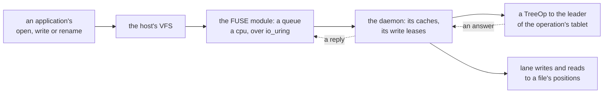

# W36. The mount on a host: FUSE first

## Context

R34 asks for a tree mounted on Linux hosts through FUSE by many mounts at once. A FUSE mount is a
daemon on the host that the kernel hands every operation on the mount to, and how it is driven decides
much of what a filesystem costs: every operation a round trip between the kernel and the daemon, and
the kernel's caches deciding how many reach the daemon at all. This page is the daemon, the transport,
the kernel's caches and how they meet write leases, and the other ways onto a host this plan records and
does not build first.

## What exists today

- **No mount of any kind.** A schema's own program runs every command that connects
  ([F63](../../features/shoaladm.md)), and the client is tokio's ([api/client](../../api/client.md)).
- **FUSE's write modes.** Write-through is the default; the writeback cache "assumes that all changes ...
  go through the FUSE kernel module" and is "generally not suitable for network filesystems"
  ([fuse-io.rst](https://github.com/torvalds/linux/blob/master/Documentation/filesystems/fuse/fuse-io.rst)).
  SeaweedFS's mount keeps it off, "at risk of data loss on crash" ([W29](prior-art.md#seaweedfs)).
- **FUSE over io_uring**, since 6.14: a queue a core, with notifications and interrupts still through
  `/dev/fuse` ([fuse-io-uring.rst](https://github.com/torvalds/linux/blob/master/Documentation/filesystems/fuse/fuse-io-uring.rst),
  [6.14](https://kernelnewbies.org/Linux_6.14)); its RFC reported up to 3.58 times on direct reads and 2.86
  times on creates ([LWN](https://lwn.net/Articles/976031/)). FUSE has been measured at a loss "as high as
  -83%" and up to 31% more cpu on its worst workloads ([FAST '17](https://www.usenix.org/conference/fast17/technical-sessions/presentation/vangoor)).
- **FUSE passthrough**, since 6.9, does the I/O on a local backing file without the trip to userspace, and
  needs `CAP_SYS_ADMIN` ([passthrough](https://github.com/torvalds/linux/blob/master/Documentation/filesystems/fuse/fuse-passthrough.rst)).
- **europa's kernel**, 7.0.0-38, has fuse built in (`/proc/filesystems`, read on 2026-10-26).

## The design

### The daemon

`shoaladm tree mount <tree> <dir>` runs the schema's program, which registers the mount
([W35](mounts-and-locks.md#a-mount)), opens `/dev/fuse`, mounts at the directory, and serves until it is
unmounted:

- **A namespace operation is one `TreeOp`** to the tablet its command lands in ([W32](one-tablet-operations.md)),
  or the start of one across groups ([W33](cross-group-operations.md)).
- **A file's bytes travel the lane** under its write lease ([W34](file-data.md)).
- **A push is answered at once**: a call-back flushes the file and releases it, a lock's release wakes its
  waiter ([W35](mounts-and-locks.md#the-pushes)).
- **Its buffers are preallocated**, as a ublk server's are ([volumes' W22](../volumes/host-device.md#memory-and-the-writeback-deadlock)),
  since writing back a mount's pages can be what frees the host's memory.

### The transport

**FUSE over io_uring where the host's kernel has it**, a ring a cpu queue fetching and committing requests
as a ublk server's do; the classic reads and writes of `/dev/fuse` otherwise. Which, and whether the
daemon's client stays tokio's beside its queues' threads, is [Q59](contract.md#questions-to-answer), by
[X34](spikes.md#x34-fuse-classic-and-over-io_uring), the volumes' Q49 asked again for FUSE.

### The kernel's caches

| Setting | Value | Why |
| --- | --- | --- |
| `entry_timeout`, `attr_timeout` | A second by default | The bounded cache times of [W35](mounts-and-locks.md#what-a-mount-caches), JuiceFS's default |
| Negative entries | Cached for the same | A build's misses answered locally |
| `FOPEN_KEEP_CACHE` | At an open that finds the file's size and mtime unchanged | Close-to-open keeps what is still right |
| `READDIRPLUS` | On | An entry and its attributes in one pass, one tablet's rows ([W31](namespace.md#readdir)) |
| `max_write`, `max_pages` | 1 MiB, a stripe | A request never spans two stripes' positions |
| Writeback cache | On, under the rule below | Small writes gathered into blocks by the kernel |

**The writeback cache is safe only under a write lease.** It is a mount's, not a file's, so the rule is
the daemon's: **every open to write takes the file's write lease before it returns**
([W34](file-data.md#the-write-lease)), so no write the kernel buffers is for a file the mount may not
write. **A call-back writes the kernel's dirty pages of the file back** before the release, by asking the
kernel to invalidate the file's pages; that an invalidation writes dirty pages back first is **recalled**,
and X34 tests it, with shared writable mappings among them. If it does not, the writeback cache stays
off and the daemon gathers writes itself.

### What a host needs

Linux with FUSE, and with FUSE over io_uring enabled where it is to be used; the schema's program built for
the host's cpu, as [F63](../../features/shoaladm.md) builds a node's; and the right to mount, root's or a
user's through `fusermount3`, with `allow_other` for a mount many users share.

### Other ways onto a host

| Way | Status | Why |
| --- | --- | --- |
| **FUSE** | **First** | Every Linux host, one daemon, and a fault in it is its own |
| virtiofs | Optional | A virtual machine's guest through its host's daemon, FUSE over virtqueues ([virtiofs](https://github.com/torvalds/linux/blob/master/Documentation/filesystems/virtiofs.rst)) |
| An NFS gateway | Optional, later | Hosts that run neither FUSE nor the schema's program, NFSv4.1 through a userspace server as Ceph's Ganesha does; pNFS is not planned, Ganesha's having needed a Ceph library never merged ([Ganesha](https://github.com/nfs-ganesha/nfs-ganesha/wiki/Fsalsupport)) |
| FUSE passthrough | Rejected | It needs a local backing file, which a tree's files are not |
| A kernel client | Rejected | CephFS's documentation says its kernel client "will always give better performance" ([W29](prior-art.md#cephfs)); it is a module out of tree, built for every kernel, and a crash in the host's kernel |

## Alternatives rejected

**A kernel client first**: the fastest way onto a host, and the dearest to keep.

**NFS first**: a gateway between every host and the cluster, two hops for every operation.

**The writeback cache with no write lease**: the kernel buffering writes the mount may not send, and losing
them when another mount writes first; SeaweedFS's "at risk".

**Write-through with no cache at all**: every 4 KiB write a lane write, every `stat` a round trip; a build
would spend its time waiting.

## What it costs

- FUSE's trip between the kernel and the daemon on every operation the caches do not answer, less over
  io_uring.
- A daemon a mount on the host, its buffers locked, its threads a cpu.
- Cached names and attributes up to a second stale for other mounts' changes.

## What it breaks

Nothing.

## Invariants to uphold

- **Every open to write takes the file's write lease before it returns.**
- **A call-back writes the kernel's dirty pages back before the release**, or the writeback cache is off.
- **Every cache time is bounded**, and an open revalidates.
- **No request spans two stripes.**
- **The daemon's buffers are preallocated.**

## Prerequisites

[W35](mounts-and-locks.md)'s mounts and pushes; [W34](file-data.md)'s write leases.

## How it would be measured

FUSE classic against over io_uring, the writeback cache on and off, an invalidation's writeback of dirty and
mapped pages, and a small file's create, write and close end to end ([X34](spikes.md#x34-fuse-classic-and-over-io_uring));
every arm of [W39](performance.md) through a mount.

## Acceptance tests

| Test | Gate | Proves |
| --- | --- | --- |
| `a_mount_passes_pjdfstest_but_its_listed_exceptions` | M39 | The POSIX conformance suite passes on a mount, every failure on the page's list of what is not promised |
| `an_open_to_write_takes_the_lease_before_returning` | M39 | No write reaches the kernel's cache for a file whose lease the mount does not hold |
| `a_call_back_writes_back_the_kernels_dirty_pages` | M39 | A second mount granted the lease reads every byte the first wrote through its page cache |
| `readdirplus_fills_attributes_in_one_pass` | M39 | A listing of a directory's files reads their attributes from one tablet |
| `cached_attributes_expire_within_their_bound` | M39 | A change by one mount is seen by another within the cache's time, and at once at an open |
| `a_killed_daemon_is_ended_and_its_mount_remade` | M39 | A daemon killed with leases held is ended, its leases revoked, and a new daemon mounts the tree |

## Related

[W35](mounts-and-locks.md) for mounts and pushes; [W34](file-data.md) for the write lease the writeback cache
rests on; [the volumes' W22](../volumes/host-device.md), whose ublk server is this daemon's neighbour;
[W29](prior-art.md) for SeaweedFS's mount and CephFS's clients.
