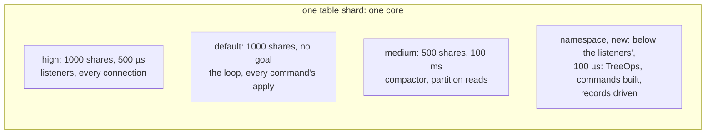
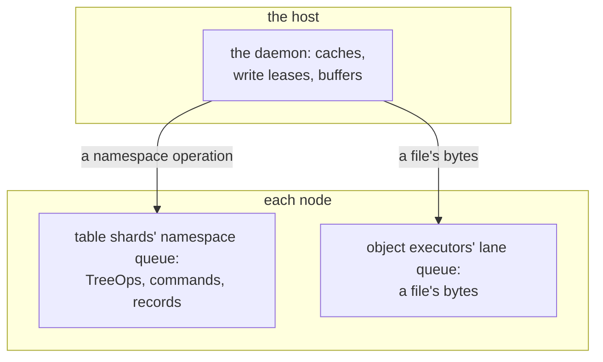

# W37. Not slowing other queries

## Context

R40 is the requirement every page answers to, and it is harder here than for volumes. A volume's bytes
never touch a table shard; a file tree's metadata is a table, on the same shards as every other
table, sharing their loops, their WAL and its group commit, their memory and its eviction. An `untar`
of a kernel's source is some seventy thousand creates; a `find` over a large tree reads every inode. A
file's bytes are the lane's and kept off the shards as a volume's are
([volumes' W23](../volumes/isolation.md)). This page is the budget, and the queue, the admission, the
limits and the memory cap that hold a namespace's work to it.

## What exists today

- **A table shard has two queues of its own**: a high one, 1,000 shares and a 500 µs goal, for its
  listeners and connections, and a medium one, 500 shares and 100 ms, for the compactor, the loader and
  every get's partition read; its loop runs in glommio's default queue, 1,000 shares and no goal
  (`shoal-core/src/server/shard.rs:3241-3251`).
- **One WAL a shard**: one write and one `fdatasync` a batch covers every group on it
  (`shoal-core/src/server/wal/mod.rs:1291-1297`), the commit delay bounded by the last batch's write and
  sync since [F98](../../features/commit-delay-bounded-by-the-sync.md).
- **Admission sheds writes by name**: past a group's pending bytes, `Shedding`, and the leader's gate
  sheds a write waiting past a quarter of its budget ([replication](../../distributed/replication.md)).
- **Memory is rows**: a shard past its budget evicts forty percent of its resident rows, of every table,
  and a node past `node_memory` has every shard do so (`shoal-core/src/server/shard.rs:6869-6872`); the
  book has met memory that was not rows squeezing rows out
  ([Resolved #191](../../appendix/resolved/raft-channels-preallocated.md)).
- **The scans' class** is a queue, a memory budget, an admission count and a device ceiling of its own, and
  its budget the reference cell within `max(1.10 × alone, alone + 0.1 ms)` ([W7](../scans/isolation.md#the-budget)).

## The design

### The budget

Stated before the work, and judged on the lab before any host may mount a tree. **Beside a file tree's
metadata load at its default limits, a storm of creates, of `stat`s, of listings and an `untar`, the
workload grid's reference cell, `grid/unsorted/r50/1024`, keeps its read p99 and its write p99 within
`max(1.10 × alone, alone + 0.1 ms)`** at the median over rounds, with the intervals overlapping, on titan,
hyperion and europa. And:

- **no eviction of another table's rows caused by the namespace**, read from F104's counters
  ([F104](../../features/memory-in-a-capture.md));
- **no step of namespace work on a shard's loop longer than 100 µs**;
- **a file's bytes held to the volumes' budget** ([volumes' W23](../volumes/isolation.md#the-budget));
- **the tree's own rates and latencies reported beside it**, so the limits' price is a number too.

It is the scans' budget and the volumes', and the hardest of the three to hold, since a namespace's
commands are table writes. The numbers are hypotheses until [X32](spikes.md#x32-metadata-operations-priced)
sets them; [Q58](contract.md#questions-to-answer) asks whether the namespace needs executors of its own to
hold them.

### The namespace queue

**A namespace's work runs in a queue of its own on each table shard**: a `TreeOp`'s coordination, its
command's building, an operation record's driver, at a 100 µs goal and below the listeners' shares, every
loop yielding each 64 KiB of work ([W28](prerequisites.md#a-namespace-queue-on-table-shards-and-limits-a-tree-and-a-mount)).
A namespace command's apply is a few rows on the loop, as every table's is.

### Admission and limits

- **A count of namespace commands in flight a shard, and a memory draw of its own**, past either refused
  `Shedding` by name; the mount backs off and asks again.
- **A tree's limit**, operations a second a node, so all of a tree's mounts together cost a node at most
  that.
- **A mount's limit**, so one host's `untar` cannot take its tree's whole.
- **Both kept at the coordinating shard**, token buckets beside the queue.

### Memory

A namespace's partitions are resident as any table's, and **a `find` over a large tree would make every
inode resident and push every other table's hot rows out**: the failure the Scans plan's rule against
changing what is resident exists to prevent ([W7](../scans/isolation.md#memory)). So **a namespace's resident
rows are capped a shard**, a share of `resources.memory`, and past its cap its own partitions are evicted,
never another table's ([W28](prerequisites.md#a-cap-on-a-tables-resident-rows)). A directory part kept small
is what makes evicting one cheap ([W31](namespace.md#directory-parts)).

### The WAL

A namespace's commands share each shard's WAL and its group commit with every table's writes, which is
both their cost and their gain: a storm adds bytes to every batch and waits on the same syncs, and a batch
of creates costs one sync where many tables' writes are. F98's delay is bounded by the last sync, so a fast
device barely waits. What a storm costs the cell's write p99 is the budget's to judge; a tree's archives can
be moved to a device of their own by `storage.tables` ([S4](../../object-storage/pools-and-devices.md#alternatives-rejected)),
and its WAL cannot.

### Reads

A lookup and a `stat` cached by the mount cost nothing; one that is not is a table read, at `One` from a
local copy where the mount's node holds one and from a follower otherwise, so a hot directory's reads spread
off its leader, and at `Quorum` for an open's revalidation ([W35](mounts-and-locks.md#what-a-mount-caches)).

### Executors of its own

The strongest isolation is X9's for object work: **the namespace's tablets on executors apart from the
table shards'**, with cores and a WAL of their own. It would hold the budget by construction and give a tree
its own capacity, and it needs what Shoal does not have, a table's tablets placed on executors of their own,
and costs cores before anything says they are needed. **Preferred: on the table shards with the queue,
admission, limits and cap above**, and [Q58](contract.md#questions-to-answer) asked again at M39 with X32's
figures, as the scans asked theirs ([Q37](../scans/contract.md#questions-to-answer)).

### Where each operation runs

### What an operator sets

A tree's and a mount's limits; the namespace queue's count; the resident cap; the mounts' cache times.

## Alternatives rejected

**Namespace work in the medium queue, unlimited**: every get's partition read behind an `untar`'s creates.

**Executors of its own first**: cores given up before a measurement says they are needed, and a placement
of tablets on executors Shoal does not have.

**No resident cap**: one `find` evicts every table's hot set.

**A metadata server process**: a cache that is the truth, on one core ([W29](prior-art.md#cephfs)).

## What it costs

A queue, a count, a memory draw and two token buckets a shard; a resident cap a shard; a tree's speed held
to its limits by design.

## What it breaks

Nothing for other tables, whose queues and memory keep what they had, less what the cap grants a namespace.

## Invariants to uphold

- **Every namespace command is built and driven in the namespace queue**, admitted by its count.
- **A tree's and a mount's limits are kept at the coordinating shard.**
- **A namespace never evicts another table's rows**; past its cap it evicts its own.
- **No file byte runs on a table shard.**

## Prerequisites

[W28](prerequisites.md)'s namespace queue and limits and its cap on a table's resident rows.

## How it would be measured

X9's method with a namespace in place of the object load: the reference cell alone, then beside create,
`stat`, listing and `untar` storms at rising rates, with and without the queue and the limits, and with a
`find` over a tree larger than the cap; evictions by cause from F104's counters ([X32](spikes.md#x32-metadata-operations-priced)).

## Acceptance tests

| Test | Gate | Proves |
| --- | --- | --- |
| `a_namespace_storm_beside_the_reference_cell_holds_its_budget` | M36 | The cell's read and write p99 beside a create storm at the default limits stay within the budget |
| `a_find_over_a_large_tree_evicts_no_other_tables_rows` | M36 | A walk of every inode past the cap evicts only the namespace's partitions |
| `the_namespace_queue_sheds_past_its_count_by_name` | M36 | Commands past the count are refused `Shedding` and the mount's retries are answered |
| `a_mounts_limit_holds_against_its_tree` | M37 | One mount's `untar` is held to its limit while another mount of the tree is served |
| `a_tree_beside_a_cluster_holds_its_budget` | M37 | The budget on the lab's three nodes with three mounts working |

## Related

[W7](../scans/isolation.md) and [the volumes' W23](../volumes/isolation.md), whose budgets this keeps;
[X9](../../object-storage/table-latency.md) for what executors of their own bought object work; [W39](performance.md)
for how it is judged.
