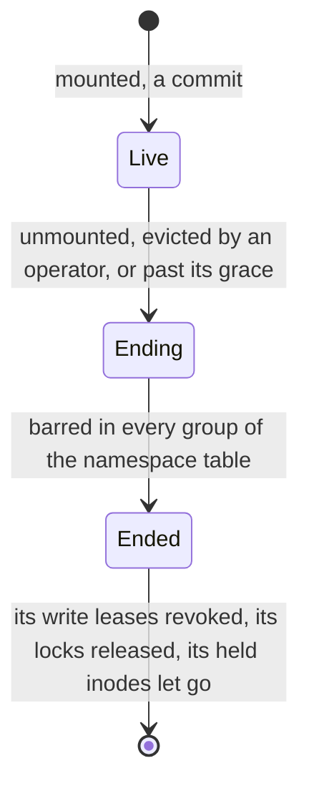
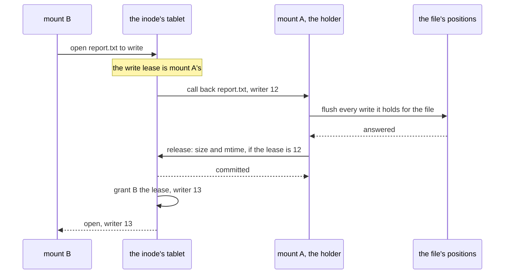

# W35. Mounts, call-backs, locks and open files

## Context

A file's write lease is a mount's, and so is a lock and an open file, and each must be given up when
the mount goes and never while it might still act. R37 asks what one mount sees of another's changes,
and R39 for locks that hold across mounts and are released when a mount ends. A volume needed none of
this: its writer is its row's, barred by number ([volumes' W18](../volumes/attach-and-takeover.md)). A
file tree has many mounts at once, each holding a little of everything. This page is what a mount is,
how a write lease is called back, where locks live, what happens to a file unlinked while it is open,
and what a mount may cache.

## What exists today

- **A client is a principal and nothing more**: authenticated by name ([F12](../../features/authentication.md)),
  granted per table and bucket ([F77](../../features/authorization.md)), with no registration the cluster
  keeps.
- **The only push is topology**: a subscribed client is sent every map version
  ([tablet map](../../distributed/tablet-map.md)).
- **CephFS ends a client by a timer and a blocklist**: one that does not release caps within 60 s is
  reported, and past 300 s is evicted and blocklisted, its unflushed data lost
  ([W29](prior-art.md#cephfs)). **JuiceFS** heartbeats a session, cleans up an expired one from another
  client, keeps a file unlinked while open as "Sustained" and keeps locks as rows
  ([W29](prior-art.md#juicefs)).

## The design

### A mount

A mount is a row of `HomeMounts` ([W31](namespace.md#the-declaration)): its id, minted once; its
principal, host and process; read-only or read-write; and its state.

- **It is registered by a commit** when the daemon mounts ([W28](prerequisites.md#client-registrations)).
- **Whether it is alive is held in memory** at its row's leader, from the traffic of its connections, and
  shown; it is never committed.
- **It ends by a commit**: an unmount; an operator's `shoaladm tree evict <mount>`; or the row's leader
  past a grace of silence, a timer that causes a commit, which R7 allows. Whatever ends it, the commit
  decides, never the timer.
- **An ended mount is barred before anything of it is let go.** Every group of the namespace table records
  the mount barred, as a takeover bars a volume's writer in every group of its stripe table
  ([volumes' W18](../volumes/attach-and-takeover.md#the-three-bars)), so a late command of it, a lock taken
  or a write lease asked for, is refused by name, `MountEnded`. Only then are its write leases revoked by
  force, its locks released and its held inodes let go.

### Grants

`trees:` beside `tables:`, `buckets:` and `volumes:` in a principal's grants: `read` to mount read-only,
`write` to mount to write. A mount is confined to the tree its grant names; confining one to a subtree,
an export's root, is optional and later, since checking an inode's ancestry on every operation is a walk
of parent pointers.

**Who enforces a file's mode bits** is [Q61](contract.md#questions-to-answer). Preferred: the host's kernel,
FUSE's `default_permissions` over the attributes the daemon fetched, with the daemon passing its caller's
user and group for ownership on a create, and the cluster trusting a mount within its grant, as an NFS
server trusts its client's word (**recalled**); the alternative is the coordinating shard checking every
operation against the caller's credentials, which a daemon that lies about them would defeat anyway.

### A call-back

- **A call-back is a push** to the holder ([W28](prerequisites.md#server-pushes-beyond-topology)), which
  flushes the file's buffered writes, the kernel's dirty pages of it first ([W36](fuse.md#the-kernels-caches)),
  and releases: a commit like a close's.
- **Its time is bounded** by a cap on the dirty bytes a holder may keep a file, a setting, so a release
  takes at most what flushing that much takes ([X35](spikes.md#x35-a-call-back-priced)).
- **A holder that does not release within a grace is revoked by force**: a commit raising the file's
  writer number, which bars the old one at the file's stripes' holders and groups
  ([W34](file-data.md#the-write-lease)). Its later writes and its close are refused, and what it had not
  flushed is lost and reported.
- **Two mounts writing one file take turns**, each turn a call-back: correct, and slow for a file both
  write at once ([W38](tradeoffs.md)).

### Locks

`flock` and POSIX byte-range locks are **rows in the inode's partition** ([W31](namespace.md#rows)), keyed
by their owner, the mount and FUSE's lock owner, as JuiceFS keeps them:

- **taking one is one command in the inode's tablet**, conditioned on no conflicting row, splitting and
  merging ranges as POSIX asks; releasing one deletes it;
- **a blocking request** (`F_SETLKW`) waits for a push when the conflicting lock is released, and asks again;
- **a mount's locks are released only after it is barred**, so no lock is held for a mount that can no longer
  release it and none is taken by one that is gone ([P40](contract.md#the-contract)).

### Held inodes

A file unlinked while a mount has it open keeps its bytes until it is closed. No fact records that a mount
has a file open to read, so at a link count of zero ([Q57](contract.md#questions-to-answer)):

- **the unlinking mount records a hold** in the inode row for its own opens, as JuiceFS's session keeps a
  "Sustained" inode, and drops it at its last close;
- **every other mount is asked**, by a push, before the inode's bytes are reclaimed: past the grace a retired
  object waits ([F92](../../features/reclamation-and-device-lifecycle.md#a-retired-object)), the reclaimer asks
  every live mount whether it holds the inode open, and reclaims once every live mount has said no and every
  other is barred.

The alternative is a row an open, a commit every open, which [X32](spikes.md#x32-metadata-operations-priced)
prices.

### What a mount caches

| What | For how long | Made fresh by |
| --- | --- | --- |
| An entry, and a name's absence | A bounded time, a second by default, as JuiceFS's | An open revalidates the path's last entry at `Quorum` |
| An inode's attributes | The same | An open reads the inode row at `Quorum`; a write lease's holder's own are exact |
| A file's pages | Until an open finds its size or mtime moved | Close-to-open ([W34](file-data.md#what-a-reader-sees)) |
| A file's writes | While its mount holds the write lease | A close, an fsync or a call-back |

Read leases, a mount's right to cache a file or a directory until it is called back, would make these exact;
they are optional and later ([W28](prerequisites.md#optional)).

### The pushes

| Push | Sent to | When |
| --- | --- | --- |
| `CallBack` | A write lease's holder | Another mount asks to write the file |
| `LockFree` | A mount waiting on a lock | The conflicting lock is released |
| `HoldQuery` | Every live mount | An unlinked inode's reclamation is due |
| `MountEnded` | The mount itself | It was ended, so it fails its I/O at once |

## Alternatives rejected

**A mount renewed by a commit**: a commit every few seconds for every mount of every host.

**A mount's liveness decided by a time**: a mount wrongly called dead would have its write leases taken while
it still writes. A grace prompts the commit that ends it, and the bars make the end safe.

**Call-backs by polling**: a mount waiting to write would wait for the holder's next poll, a time deciding
who writes.

**CephFS's capabilities for everything**: a lock manager over every inode at once, and recall storms when a
server's cache is full ([W29](prior-art.md#cephfs)). A write lease is one fact a file, and the rest is cached
for a bounded time.

**A lock server**: locks are rows beside their inode, in its group, as any other fact of the file is.

## What it costs

- A commit for every mount and unmount, and a commit in every group of the namespace table for every mount that
  ends.
- A push and a release for every call-back, and a forced revoke past its grace.
- A command for every lock taken and released.
- A question to every live mount before an unlinked file's bytes are reclaimed.

## What it breaks

Nothing.

## Invariants to uphold

- **A mount's end is a commit**, and it is barred in every group before its leases, locks and holds are let go.
- **A write lease is called back before another mount writes**, and revoked only by a commit that raises the
  file's writer number.
- **Two mounts never hold conflicting locks on one range.**
- **An unlinked inode's bytes are kept while a live mount holds it open.**
- **A cache is bounded in time**, and an open revalidates.

## Prerequisites

[W28](prerequisites.md)'s client registrations, server pushes and grants for file trees.

## How it would be measured

A call-back's time by dirty bytes, and a ping-pong between two mounts ([X35](spikes.md#x35-a-call-back-priced));
a mount killed with leases and locks held, in the fixture ([W39](performance.md)).

## Acceptance tests

| Test | Gate | Proves |
| --- | --- | --- |
| `an_ended_mount_is_barred_before_its_locks_are_released` | M37 | A lock request from a mount being ended is refused in every group before its locks go |
| `a_mount_past_its_grace_is_ended_by_a_commit` | M37 | A mount gone silent is ended by its row's leader, and its own late commands are refused `MountEnded` |
| `a_call_back_flushes_before_the_lease_moves` | M38 | Every write the holder made is read back by the mount granted the lease after it |
| `a_holder_that_does_not_release_is_revoked` | M38 | Past the grace the lease moves by a commit, and the old holder's writes are refused |
| `conflicting_locks_are_never_both_held` | M39 | Two mounts racing for overlapping byte ranges get one each in turn |
| `a_blocked_lock_is_woken_by_a_push` | M39 | `F_SETLKW` returns once the conflicting lock is released, without polling |
| `an_open_unlinked_file_keeps_its_bytes` | M38 | A file unlinked by one mount while another reads it is read to its end, and reclaimed after the last close |

## Related

[W34](file-data.md) for what a write lease protects; [the volumes' W18](../volumes/attach-and-takeover.md) for
the bars this reuses; [W36](fuse.md) for the kernel's side of a call-back; [W29](prior-art.md) for CephFS's
sessions and JuiceFS's.
