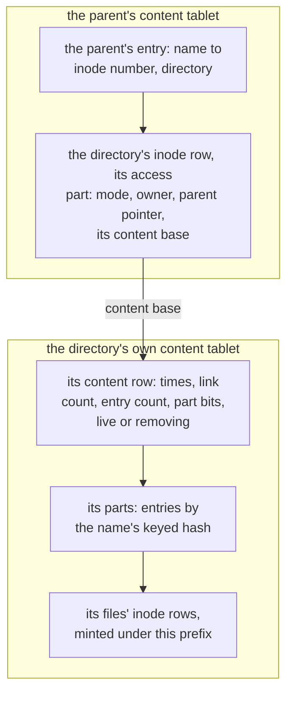

# W31. The namespace table, directories and readdir

## Context

R36 asks for metadata that scales with the cluster, with no metadata server, a directory's operations
served by its tablet's group, and a large directory split. R35 asks that the common operations be
atomic, which [W30](atomic-commands.md)'s command makes possible only where every row an operation
touches lies in one tablet. So this page is where the namespace's rows are put: what a file tree
declares, how its keys place themselves, what an inode number is, how a directory is split into the
part its parent keeps and the part it keeps, how a large directory is cut into parts, and how `readdir`
pages through one.

## What exists today

- **A bucket generates its tables** from a schema field, refused to every client at the front door
  ([F79](../../features/bucket-schema.md)); an `ObjectMeta` row keeps a small object's bytes inline, up to
  its pool's threshold, 16 KiB by default (`shoal-proto/src/shared/objects.rs:73`).
- **A sorted table is a `BTreeMap` a partition**, a cold partition read whole and evicted whole
  ([table types](../../tables/table-types.md), [sort-key ranges](../../features/sort-key-ranges.md#limitations)).
- **Sort keys are `String` alone** (`shoal-proto/src/shared/traits.rs:31`).
- **A partition key is a gxhash** of its fields (`shoal-derive/src/traits/partition_key.rs:75-99`), its
  tablet the hash's top twelve bits, split later by one bit more (`shoal-proto/src/shared/placement.rs:14-19`);
  two keys that collide share a partition undetected ([partitioning](../../architecture/partitioning.md)).
  `ObjectMeta` keeps a path whole and its row a list for that reason ([S3](../../object-storage/objects.md)).
- **A tablet group commits about 4,900 small rows a second** ([S18](../../object-storage/contract.md)).

## The design

### The declaration

```rust
/// The marker for the lab's home directories
pub struct Home;

#[shoal::db]
pub struct Lab {
    /// The posters bucket
    pub posters: Bucket<Posters>,
    /// The virtual machine disks
    pub disks: Volumes<VmDisks>,
    /// The home directories
    pub home: FileTree<Home>,
}
```

`#[shoal::db]` recognizes `FileTree` in the first segment of the type's name and generates, all refused
to every client at the front door:

| Table | Kind | Holds |
| --- | --- | --- |
| `HomeNamespace` | Persistent sorted, its keys placing themselves, its sort keys a hash and bytes | Inode rows, directory parts and their entries, content rows, extended attributes, locks, operation records, the rename row, counters |
| `HomeMounts` | Persistent unsorted | One row a mount ([W35](mounts-and-locks.md#a-mount)) |
| `HomeStripeMeta` | Persistent unsorted | No row a write: its groups keep the placement state of the files' stripes, as a volume set's do ([volumes' W16](../volumes/volumes-and-rows.md#the-declaration)) |

A tree's files bind an attached pool, as a volume set does ([volumes' W16](../volumes/volumes-and-rows.md#attached-pools)):

```yaml
storage:
  trees:
    Home: {pool: blocks}            # an attached pool; its inline threshold is the tree's
```

### Keys that place themselves

Every partition key of the namespace table is **minted, never hashed from what a user wrote**, and its
64 bits are its own placement hash ([W28](prerequisites.md#partition-keys-with-a-supplied-hash)):

| Bits | Holds |
| --- | --- |
| 20, the top | **The prefix**: the place it lives. The top twelve are its tablet today; the eight below keep its neighbours with it through splits down to 2^20 tablets |
| 2 | **The kind**: an inode, a directory part, an operation record, or a tree's own row |
| 42 | **The number**, from the prefix's counter |

Two keys never collide, since no two mints give one number under one prefix and kind, and a key never
moves, since its prefix is part of it. **Numbers are minted from blocks**: a coordinating shard
reserves a block of numbers from its prefix's counter row, which lives in the prefix's own tablet, by
one command a block, and mints from it locally. A crash loses the rest of a block, which costs nothing
but numbers.

### Inode numbers

A file's or a directory's **inode number** is its inode partition's key: a prefix, the inode kind, a
number. It is the file's `st_ino` and its FUSE node id, stable for its life and never reused.

**It is minted under the prefix of the directory its entry is made in**, so a new file's inode row
lands in the same tablet as its entry, and its create is one command ([W32](one-tablet-operations.md)).
A file renamed into another directory keeps its number and its row where it was born; its entry moves,
and from then on its entry and its inode are in two tablets ([W33](cross-group-operations.md)). That
is the price of a number that never changes, and of finding an inode by its number with one read and
no backtrace, which CephFS keeps an xattr on a data object for ([W29](prior-art.md#cephfs)).

### A directory's two parts



InfiniFS's split, in rows ([W29](prior-art.md#infinifs)):

- **The access part** is the directory's inode row, in its parent's content tablet: its mode, owner and
  group, its parent pointer, and its **content base**, the prefix and number its parts are minted at.
  What a path's resolution needs is all here, beside the entry that leads to it.
- **The content part** is in the directory's own content tablet, chosen at its `mkdir` by a draw, so
  directories spread over every tablet: its content row, with its times, its link count, its entry
  count, how many parts it has and whether it is live or being removed; its parts; and its files'
  inode rows.
- **A `mkdir` is one command in the parent's tablet**: the new directory's entry, its inode row, and the
  parent's link count and times. The new directory's content row is made lazily, by its first create;
  absent, it reads as empty, with a link count of two and the times of its inode row.
- **A directory's `stat` is two reads**, its inode row and its content row, in two groups and in
  parallel; `ctime` is kept in both, and a `stat` answers the later.

### Rows

| Partition | Sort key | Row |
| --- | --- | --- |
| An inode | `(0, "")` | The inode row: type, mode, owner and group, link count for a file, size, times, the data's entry (inline bytes, or its stripes' allocation counts and its writer number), its write lease, a symlink's target ([W34](file-data.md)) |
| | `(1, name)` | An extended attribute, a few KiB at most and 64 KiB an inode in all |
| | `(2, owner)` | A lock ([W35](mounts-and-locks.md#locks)) |
| A directory part | `(0, "")`, in part 0 | The content row |
| | `(hash, name)` | An entry: the name's keyed hash, the name's bytes, the inode number and its type, and a pending operation if one holds it ([W33](cross-group-operations.md#pending-entries)) |
| An operation record | `(0, "")` | An operation across groups and its decision ([W33](cross-group-operations.md)) |
| The tree's own | `(0, "")` and more | The counters, the root's inode number, the rename row ([W33](cross-group-operations.md#the-rename-row-and-cycles)) |

An inode row stays near a kibibyte beside its inline bytes, which are at most the pool's threshold.

### Directory parts

A directory's entries are split into **parts** by the leading bits of each name's keyed hash: none at a
`mkdir`, one more bit when a part passes its bound. **All of a directory's parts share its content
prefix**, so they are one tablet's, and a rename inside a directory is one command whatever parts its
two names are in.

- **A part's bound** keeps it small, since a cold sorted partition is read whole: a few thousand entries,
  set by [X33](spikes.md#x33-a-directory-parts-size) ([Q55](contract.md#questions-to-answer)). CephFS splits
  a fragment at 10,000 ([W29](prior-art.md#cephfs)).
- **A split is one command in the content tablet**: the part's entries written into its two halves, its
  row deleted and the content row's part bits moved, all or nothing.
- **A directory too hot for one group** stays in one tablet in these gates; spreading its parts over
  tablets is optional, and would make a rename inside it cross groups ([W28](prerequisites.md#optional)).

### Names

A name is bytes, not UTF-8: up to 255 of them, never a `/` or a NUL. Its **keyed hash** is a 64-bit hash
under a secret the tree keeps, so names crafted to pile into one part cannot be. **Two names with one
hash are two entries**, since the sort key holds the name's bytes after its hash, and a lookup compares
the bytes ([P43](contract.md#the-contract)). Sort keys of a hash and bytes are
[W28](prerequisites.md#sort-keys-of-a-hash-and-bytes)'s row.

### readdir

**A cookie is a name's keyed hash**, which FUSE's 63-bit offset carries. A page reads a directory's
entries in hash order, part after part in the order of their bits, which is hash order too, from one
applied index of the content tablet.

- **A page never ends inside a run of equal hashes**, so the cookie that resumes it is unambiguous.
- **A part's split changes no hash**, so a cookie handed out before a split resumes after it, and every
  entry live throughout is returned once ([P42](contract.md#the-contract)).
- **`readdirplus`**, an entry with its attributes, reads the inode rows beside the entries: one tablet's,
  for every file created in the directory, and one more read for each that was renamed into it.

## Alternatives rejected

**Inodes in a table of their own, keyed by number.** Every create two groups, an entry in one and an
inode in another, and two commits in order with an orphan between them on a crash.

**An inode embedded in its entry, as CephFS's primary entry.** A rename moves the inode and every
attribute with it; a hard link needs a remote entry and a way back to the inode, which CephFS's
backtraces are.

**Keys hashed from names, paths or numbers.** Collisions are undetected, and nothing could place a file
beside its entry.

**Entries keyed by path**, as an object store's paths are. A directory's rename rewrites every key below
it.

**A directory in one partition however large.** A cold directory of a million entries read whole for
every lookup.

**Names as `String` sort keys.** POSIX names are bytes; an escaped string would be the persisted format
for ever.

**The owner in the sort key instead of minted prefixes**: every file's inode row inside its directory's
part, no supplied hashes needed. Parts grow by every inode, and an inode moves with its entry on a
rename. Kept as [Q54](contract.md#questions-to-answer)'s alternative, settled by
[X32](spikes.md#x32-metadata-operations-priced).

## What it costs

- A counter row a prefix, and a block's reservation now and then.
- A directory's `stat` is two reads.
- A renamed file's inode stays in its birth tablet, and its later operations cross groups.
- A hot directory is one tablet's group, about 4,900 commits a second on the lab.
- A content base in every directory's inode row.

## What it breaks

Nothing: the namespace table is generated, and no other table's keys change.

## Invariants to uphold

- **Every namespace key is minted and never hashed from user data**; two keys never collide and a key
  never moves.
- **An inode number is stable for its file's life and never reused.**
- **A file's inode row is created in its entry's tablet.**
- **A directory's parts share its content prefix** unless it is spread.
- **A name is its bytes**, and two names with one hash are two entries.
- **A cookie is a name's hash**, and survives a split.

## Prerequisites

[W28](prerequisites.md)'s command in one tablet, partition keys with a supplied hash, and sort keys of a
hash and bytes.

## How it would be measured

A create, a lookup, a `stat` and a `readdirplus` with co-location and with the owner in the sort key
([X32](spikes.md#x32-metadata-operations-priced)); cold lookups and creates by a part's size
([X33](spikes.md#x33-a-directory-parts-size)).

## Acceptance tests

| Test | Gate | Proves |
| --- | --- | --- |
| `namespace_keys_never_collide` | M35 | Keys minted under every prefix and kind, across reserved blocks and crashes, are distinct |
| `an_inode_number_is_never_reused` | M36 | A file removed and a file created after it never share a number |
| `a_files_entry_and_inode_share_a_tablet` | M36 | Every file created in a directory has its inode row in its entry's tablet |
| `two_names_with_one_hash_are_two_entries` | M36 | Names whose hashes collide are both listed and both looked up exactly |
| `a_name_is_its_bytes` | M36 | A name that is not UTF-8 is created, listed and looked up byte for byte |
| `a_part_past_its_bound_splits_in_one_command` | M36 | A part that passes its bound is two parts after one command, and no entry is lost or doubled |
| `readdir_cookies_survive_a_part_split` | M36 | A listing resumed by a cookie handed out before a split returns every entry once |
| `a_page_never_ends_inside_a_run_of_one_hash` | M36 | A page of entries with colliding hashes ends after the run |
| `a_directorys_stat_reads_both_parts` | M36 | A directory's mode comes from its inode row and its times and link count from its content row |

## Related

[W30](atomic-commands.md) for the command this layout serves; [W32](one-tablet-operations.md) and
[W33](cross-group-operations.md) for what is done with it; [W29](prior-art.md) for CephFS's fragments and
InfiniFS's split; [F79](../../features/bucket-schema.md) for generated tables.
