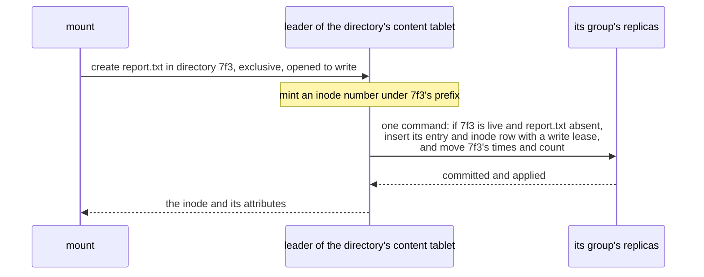

# W32. Operations in one tablet

## Context

Most of what a filesystem is asked is a lookup, a `stat`, a create, an unlink, a `chmod` or a rename
inside one directory, and R35 asks each to be atomic. [W31](namespace.md) placed a file's entry, its
inode row and its directory's content row in one tablet so that each of these can be one
[namespace command](atomic-commands.md): one raft round in one group. This page is how an operation
reaches that group, what each common operation's command is, what it costs, and what is refused by
name.

## What exists today

- **An object operation is a task on the coordinating shard**, which reads and writes its bucket's rows
  through the shard's metadata client; one `ObjectOp` frame, answered by one `ObjectAnswer`
  ([F80](../../features/object-wire.md)).
- **A client routes by topology**: a write to its group's preferred leader, a read at `One` to a holder
  ([F74](../../features/client-routing.md)).
- **A row commit takes 5.3 ms at the median on the lab** for one row at one in flight, the 970 EVO's WAL
  ([group commit delay](../../object-storage/store-optimizations/group-commit-delay.md)), and 0.64 ms on
  europa's Optane over loopback ([F98](../../features/commit-delay-bounded-by-the-sync.md#performance)); a
  strong 4 KiB read 0.48 ms on average ([strong reads](../../object-storage/store-optimizations/strong-reads.md)).
  A tablet group commits about 4,900 small rows a second ([S18](../../object-storage/contract.md)).

## The design

### An operation is an intent

A mount does not read and write rows itself, as a JuiceFS client does against its engine
([W29](prior-art.md#juicefs)). **It asks for the operation**, in one `TreeOp` frame on the client wire,
of the node leading the tablet its command lands in, which the route table names from the directory's
content prefix. The coordinating shard checks the principal's grant and the mount's confinement
([W35](mounts-and-locks.md#grants)), builds one namespace command, proposes it in that tablet's group
and answers. Lustre's intents are the model: an operation asked for and done where its state is, in one
exchange ([W29](prior-art.md#lustre)).

### The operations

| Operation | Its command, in the directory's content tablet | Refused, by name |
| --- | --- | --- |
| **create**, a file, a symlink, a device or a fifo | If the directory is live and the name absent: insert the entry and the inode row, minted under the directory's prefix, with a write lease for the mount when it opens to write ([W34](file-data.md#the-write-lease)); move the content row's times and count, making it if absent | `Exists` when the name is taken (EEXIST); `Removing` when the directory is being removed (ENOENT) |
| **mkdir** | The same in the parent's tablet, the inode row a directory's with a content base drawn for it, and the parent's link count raised; the new directory's content row is made by its first create | As create |
| **unlink** of a file whose inode is in this tablet | If the entry names the inode and is not pending: delete the entry, lower the inode's link count, move the content row's times and count; at a link count of zero the inode is held while a mount has it open, retired otherwise ([W35](mounts-and-locks.md#held-inodes)) | `Missing` (ENOENT); `IsDirectory` (EISDIR) |
| **rename** inside a directory | If the source entry names its inode and is not pending, and the target is absent or a file whose inode is in this tablet: delete the source, write the target, lower a replaced file's link count, move the times. A directory renamed inside its parent moves only its entry, since its inode row is in this tablet too | `Missing`; `NotEmpty` for a directory target that has entries; `NotOneTablet` when a replaced file's inode is elsewhere, which goes [across groups](cross-group-operations.md) |
| **setattr**: `chmod`, `chown`, `utimes` | In the inode's own tablet, which its number names: change the row and its `ctime` | `Missing` |
| **lookup** | A read of one entry in the part its name's hash selects | — |
| **getattr** | A read of the inode row its number names; for a directory, its content row too ([W31](namespace.md#a-directorys-two-parts)) | — |
| **readdir** | Pages of a directory's entries in hash order ([W31](namespace.md#readdir)) | — |

Every write operation is retried by the mount under one identity, so a retry after an unknown outcome
is answered with the first outcome from the group's retry table, as F68's conditional writes are
([F68](../../features/conditional-writes.md)).

### What each costs

| Operation | Commits | Groups | On the lab (970 EVO) | On europa's Optane |
| --- | --- | --- | --- | --- |
| create, mkdir, unlink, rename inside a directory | One | One | About 5.3 ms at the median, as a row commit | About 0.64 ms |
| setattr | One | One | The same | The same |
| lookup, getattr at `One` | None | One holder | A local read where a mount's node holds a copy, else a round trip | The same |
| lookup, getattr at `Quorum` | None | One leader | About 0.48 ms, a strong read | Less |
| A small file's create, write and close | Two: the create, then the close with its inline bytes ([W34](file-data.md#inline-files)) | One | About 10.6 ms | About 1.3 ms |

The lab's figures are table writes' and reads' measured today, not the namespace's, which X32 measures
on what is built ([X32](spikes.md#x32-metadata-operations-priced)). JuiceFS's create on TiKV, three Raft
copies as Shoal keeps, took 1,209 µs ([W29](prior-art.md#juicefs)).

### What it does not cost

**No operation here touches a second group**, and none waits for a second commit. An operation that
would, because a replaced file or an unlinked one has its inode elsewhere, is refused `NotOneTablet` when
its command is proposed, and taken across groups as a whole ([W33](cross-group-operations.md)): never as
two one-tablet commands in a row pretending to be one.

### How fast one directory goes

A directory's creates are its tablet group's: about 4,900 commits a second on the lab, all of them in one
group's log, and a tree's creates in many directories spread over every tablet. A single directory hotter
than that waits for spreading, optional ([W28](prerequisites.md#optional)), or for creates a mount does
ahead under a lease on its directory, optional too, as CephFS's kernel client does
([W29](prior-art.md#cephfs)).

## Alternatives rejected

**The client runs each operation itself**, reading and writing rows as JuiceFS's client does: two round
trips at least, a read and a conditional write, and every client able to write any row of the namespace.

**A metadata server process**, as CephFS's: a cache that is the truth and a core it cannot leave
([W29](prior-art.md#cephfs)). A tablet group is already a replicated state machine, on every node.

**A create as two commits in order**, inode then entry: an orphan between them on every crash, and two
rounds.

## What it costs

One `TreeOp` frame kind and its answer; a coordinating task a shard, as an object operation's; a block of
inode numbers a coordinator; one raft round an operation.

## What it breaks

Nothing.

## Invariants to uphold

- **A create's entry and inode appear together**, in one command; no entry ever names an inode that does
  not exist.
- **An operation is one command, or it goes across groups whole**; never two commands in a row.
- **A write operation is retried under one identity** and answered with its first outcome.
- **A refusal is by name**, and each name maps to one errno.

## Prerequisites

[W30](atomic-commands.md)'s command; [W31](namespace.md)'s layout; [W28](prerequisites.md)'s namespace
queue, its grants and its bench kinds.

## How it would be measured

Each operation's latency and rate at depths one and thirty-two, in one directory and in many, and a tree's
untar, on the lab ([X32](spikes.md#x32-metadata-operations-priced), [W39](performance.md)).

## Acceptance tests

| Test | Gate | Proves |
| --- | --- | --- |
| `a_create_is_one_command` | M36 | A create commits once, in one group, with its entry, inode and directory's times |
| `an_exclusive_create_of_a_taken_name_is_refused` | M36 | `O_EXCL` on a name that exists answers `Exists` and changes nothing |
| `a_create_in_a_directory_being_removed_is_refused` | M37 | A create racing an `rmdir` that began is refused `Removing` |
| `an_unlink_of_a_home_inode_is_one_command` | M36 | An unlink of a file created in its directory commits once and lowers its link count |
| `a_rename_inside_a_directory_is_one_command` | M36 | A rename between two parts of one directory commits once, and a reader sees one name or the other |
| `an_operation_needing_two_groups_is_never_two_commands` | M37 | A rename replacing a file whose inode is elsewhere is refused `NotOneTablet` and taken across groups |
| `a_retried_create_is_answered_with_its_first_outcome` | M36 | A create retried after an unknown outcome answers as it first did |

## Related

[W30](atomic-commands.md) and [W31](namespace.md), which this stands on; [W33](cross-group-operations.md)
for the operations that do not fit one tablet; [W34](file-data.md) for what a create's write lease is;
[F80](../../features/object-wire.md), whose operation frames these follow.
