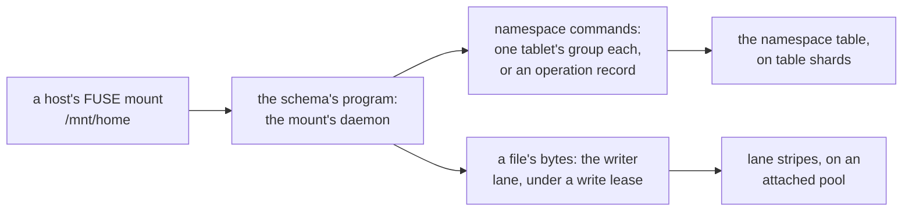
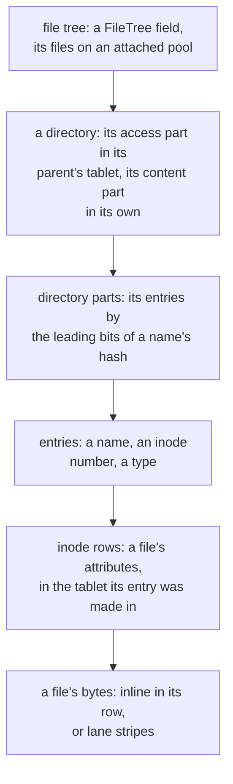
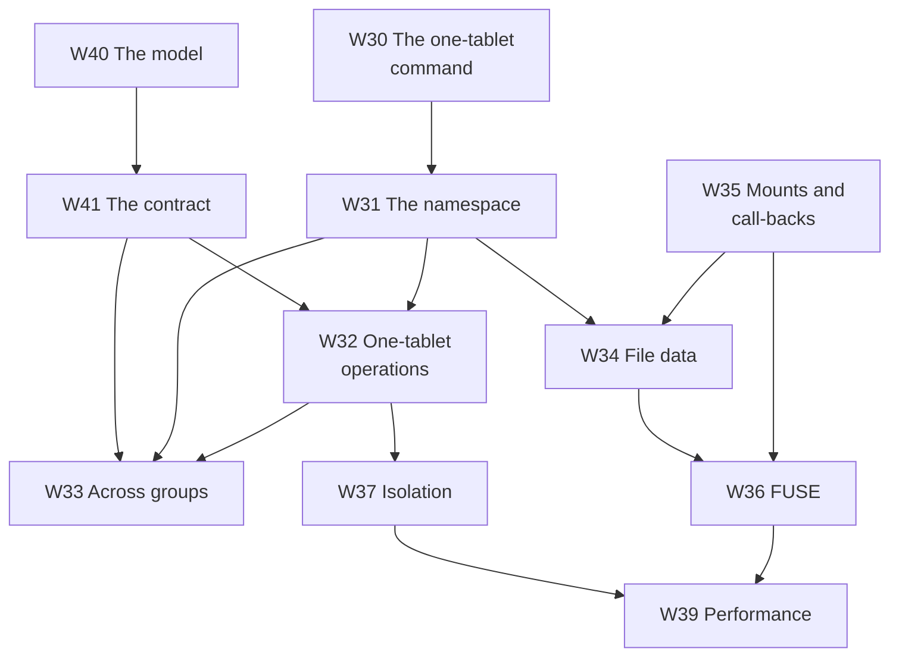

# A network filesystem

**Nothing in this subchapter is built.** These pages plan a POSIX filesystem for Shoal: a tree of
files and directories that many Linux hosts mount at once, in the manner of CephFS, Lustre, JuiceFS
and GlusterFS, whose metadata scales with the cluster and whose files are written at a block
volume's speed, without slowing the queries that run beside it. The `W` pages are design records, in
the shape the object storage part's `S` pages took and the [Scans](../scans/overview.md) and
[block volumes](../volumes/overview.md) plans kept. [W28](prerequisites.md) is what has to exist
first; the [spikes](spikes.md) are what has to be measured before a gate can be trusted; the
[milestones](milestones.md) are an order of work; and [What's left to do](whats-left-todo.md) draws
all of it. A file's bytes travel the [volumes' writer lane](../volumes/writer-lane.md), so this plan
follows that one.

## The question this plan was asked

Whether Shoal can offer a network filesystem, in the manner of CephFS, Lustre, JuiceFS or GlusterFS,
where performance is critical and the database's other queries keep their latency; with Ceph and
SeaweedFS for inspiration and every tradeoff written down.

**Yes, and Shoal's tables are most of a metadata service already.** CephFS keeps its namespace in
metadata servers that journal into RADOS, and its documentation warns that each "cannot exploit many
cores"; JuiceFS keeps its in an external store, TiKV or Redis, a network hop from its data
([W29](prior-art.md)). Shoal has a replicated, partitioned store on every node: a directory's
entries are a sorted partition, a file's attributes a row, and 4,096 tablets spread both over every
node with no server of their own. What it lacks is what a filesystem needs beyond a table: a change
of several rows that is atomic, so a create's entry and its file appear together; an order that
keeps a file's entry and attributes in one tablet, so the common operations are one commit; a
protocol for the few that cross tablets, a rename between directories above all; and a way to tell
a mount its cache is stale. And a file's bytes need a path faster than an object's write in place,
which the writer lane is.

## What is being asked for

| # | Requirement | Where it is met |
| --- | --- | --- |
| R34 | A file tree is declared in the `#[shoal::db]` struct, bound to an attached pool for its files' bytes, and mounted on Linux hosts through FUSE by many mounts at once | [W31](namespace.md), [W36](fuse.md) |
| R35 | Every namespace operation is atomic, and the namespace stays a tree with exact link counts through any crash | [W30](atomic-commands.md), [W32](one-tablet-operations.md), [W33](cross-group-operations.md) |
| R36 | Metadata scales with the cluster: no metadata server; a directory's operations are served by its tablet's group; a large directory splits | [W31](namespace.md) |
| R37 | What a mount sees of another's changes is stated: close-to-open, and caches bounded in time | [W34](file-data.md), [W35](mounts-and-locks.md) |
| R38 | A file's bytes are written at a volume's speed by one write lease's holder at a time, and a small file's create, write and close is two commits | [W34](file-data.md) |
| R39 | `flock` and byte-range locks hold across mounts, and are released when a mount ends or is barred | [W35](mounts-and-locks.md) |
| R40 | File-tree work never slows table queries past a budget stated before it is built, and is held to per-tree and per-mount limits | [W37](isolation.md), [W39](performance.md) |
| R41 | File trees are benchmarkable with `shoaladm bench`, judged by budgets, and compared where the lab can with CephFS and JuiceFS | [W39](performance.md) |

`R` numbers continue [block volumes'](../volumes/overview.md#what-is-being-asked-for) R27–R33, and R7
is inherited whole: nothing outside the Shoal processes coordinates a file tree, and no clock decides
anything safety rests on ([R7](../../distributed/overview.md#what-is-asked-of-it)). R40 is the one
every page answers to, and it is harder here than for volumes: a namespace's commands are table
writes, on the shards the other tables use.

## Decisions taken on 2026-10-26

Taken with the user while this subchapter and the volumes' were planned. The user asked for the
performance tradeoffs of each before choosing, and they are recorded on
[W41](contract.md#decision-record) and [W38](tradeoffs.md).

| Decision | Taken | Where it lands |
| --- | --- | --- |
| How operations across directories are made atomic | **The filesystem's own namespace protocol**, confined to its generated tables: most operations one command in one tablet, the few that cross tablets an operation record decided by a commit. Not transactions across partitions in the engine, which every table that used them would pay for on its reads | [W30](atomic-commands.md), [W33](cross-group-operations.md) |
| Where a file's bytes are written | **On the volumes' writer lane, under a write lease**: one mount at a time writes a file, straight to its stripes' positions; the lease is called back when another mount wants it. Small files stay inline in their inode row | [W34](file-data.md) |
| Whether a file tree shares a pool with buckets | **A pool's write protocol is its policy** ([volumes](../volumes/overview.md#decisions-taken-on-2026-10-26)): a file tree's files bind an attached pool, beside volume sets and apart from buckets | [W31](namespace.md#the-declaration) |
| What a file's exclusive right to write is called | **The write lease**, always written in full, never bare "lease", which is a leader's ([F100](../../features/lease-reads.md)) | Every page |
| Which is built first | **Volumes**, whose lane a file's bytes travel | [Milestones](milestones.md) |

## Vocabulary

Chosen against the words the book already uses, the volumes' among them. `fragment` is the
storage engine's, so a large directory's partitions are its **parts**; `lease` is a leader's;
`fence` a truncate's; `session` a read token's; and `inode` and `mount` are POSIX's and mean what
POSIX says. Where a page describes CephFS or Lustre it uses their words, and says so.

| Term | Meaning |
| --- | --- |
| File tree | A field of the `#[shoal::db]` struct, `home: FileTree<Home>`: a namespace and its files, bound to an attached pool for the files' bytes. `Filesystem` is not used, beside the storage engine's `FileSystem` |
| Mount | A host's registration with a file tree: a FUSE daemon, known to the cluster by name, renewed in memory, ended by a commit, and barred once ended |
| Inode number | A file's or directory's identity: 64 bits, minted with its home tablet's prefix bits, stable for its life, and never reused |
| Inode row | A file's attributes and its data's entry, in its home tablet |
| Entry | A name in a directory, naming an inode number and its type |
| Access part | A directory's entry, mode, owner and parent pointer, in its parent directory's tablet |
| Content part | A directory's entries, times, link count and entry count, in its own tablet |
| Directory part | One of the partitions a directory's entries are split over, by the leading bits of each name's keyed hash |
| Namespace command | A command of several writes in one tablet, applied all or nothing ([W30](atomic-commands.md)) |
| Operation record | The committed record of an operation across tablets, beside one of them, whose decision settles every pending entry it names |
| Pending entry | An entry an operation across tablets wrote and has not yet decided, which names its record and holds its name |
| Rename row | A tree's one row that serializes renames of directories across directories |
| Write lease | A mount's exclusive right to write a file's bytes, granted in its inode row |
| Call-back | A push asking a mount to give up a write lease: it flushes and releases |
| Held inode | An inode no entry names that a mount still holds open |
| Namespace queue | The task queue on a table shard where namespace commands run, apart from other tables' queries |

## The constraint every page inherits

**Other queries keep their latency.** A file's bytes run on object executors, as a volume's do. A
namespace's commands do not: they are table writes, on the table shards, beside every other table's.
So they run in a queue of their own with an admission of their own, a tree and a mount are held to
limits, and what a file tree may cost the queries beside it is a number stated before it is built
([W37](isolation.md#the-budget)). Whether the namespace's tablets need executors of their own is a
question with a gate ([Q58](contract.md#questions-to-answer)).

**Nothing changes for a table that does not ask.** The engine gains four capabilities for the
namespace: a command of several writes in one tablet, partition keys whose hash the schema supplies,
sort keys of a hash and bytes, and a cap on a table's resident rows ([W28](prerequisites.md)). A
table that uses none of them runs exactly as it did, its reads checking no intent, its compaction
judging nothing new, and its rows evicted as they were.

**One writer a file at a time.** A file's bytes are written by the mount that holds its write lease,
on the volumes' lane, and every promise about them rests on it.

**Safety by committed facts, never by a clock.** A timer may prompt a commit, an operation record
aborted or a mount expired, but no operation is decided because of a time
([R7](../../distributed/overview.md#what-is-asked-of-it)).

**A claim is checked where it can be.** A statement about Shoal cites a file and a line read on
2026-10-26. A statement about another system cites the page or source it was read from, and one that
was not read is marked as **recalled**.

## The hierarchy

## The chapter

| # | Page | Purpose |
| --- | --- | --- |
| W28 | [What has to exist first](prerequisites.md) | The gaps in Shoal today, each labelled required or optional |
| W29 | [Lessons from CephFS, Lustre, JuiceFS, GlusterFS, SeaweedFS and InfiniFS](prior-art.md) | What is taken from each and what is not, every fact with its source |
| W30 | [A command of several writes in one tablet](atomic-commands.md) | The engine capability every one-tablet operation stands on |
| W31 | [The namespace table, directories and readdir](namespace.md) | The declaration, the keys, inode numbers, the two parts, directory parts, cookies |
| W32 | [Operations in one tablet](one-tablet-operations.md) | create, unlink, mkdir, setattr and a rename inside a directory |
| W33 | [Operations across groups: records, renames and cycles](cross-group-operations.md) | rmdir, a rename between directories, a hard link |
| W34 | [A file's bytes under its write lease](file-data.md) | Inline files, lane stripes, close-to-open, truncate, append |
| W35 | [Mounts, call-backs, locks and open files](mounts-and-locks.md) | Registrations, pushes, locks as rows, held inodes |
| W36 | [The mount on a host: FUSE first](fuse.md) | FUSE over io_uring, the kernel's caches, the schema's program |
| W37 | [Not slowing other queries](isolation.md) | The budget, the namespace queue, the limits |
| W38 | [Tradeoffs, and when not to use the filesystem](tradeoffs.md) | What every choice cost, and what a file tree costs a user |
| W39 | [Performance, and the benchmarks that judge it](performance.md) | The arms, the figures and the budgets |
| W40 | [The namespace's model](model.md) | What `shoal-model` must check before the protocol is built |
| W41 | [The contract and the questions](contract.md) | P36–P44, Q53–Q61, the decision record and the acceptance index |
| — | [Exploratory spikes](spikes.md) | X31–X36: what has to be measured first |
| — | [Milestones](milestones.md) | M35–M39 |
| — | [What's left to do](whats-left-todo.md) | All of it, drawn |

## The dependency graph

An arrow points from a page to a page whose design leans on it. Hard edges only.

| Edge | Why |
| --- | --- |
| W40 → W41 | What the model checks is what the contract may promise |
| W41 → W32, W33 | Each operation is written to the contract's atomicity and tree properties |
| W30 → W31 | The namespace's layout exists to make operations one command |
| W31 → W32, W33, W34 | Where rows lie decides which operations are one tablet's and where a file's attributes are |
| W32 → W33 | An operation across groups is one-tablet commands and a decision |
| W35 → W34, W36 | A write lease is held by a mount and called back by a push; FUSE is a mount |
| W32, W37 → W39 | The budget is judged beside the namespace's commands |

## How a W page is written

[W28](prerequisites.md) is a list and has its own shape. Every page after it keeps the sections the
object storage part's design pages kept: **Context**, **What exists today**, **The design**,
**Alternatives rejected**, **What it costs**, **What it breaks**, **Invariants to uphold**,
**Prerequisites**, **How it would be measured**, **Acceptance tests** and **Related**. Where a question
is open, *The design* gives the options, names a preferred direction, and the question carries its
gate on [W41](contract.md#questions-to-answer). An acceptance table names tests that do not exist yet,
each against a provisional gate; they join `shoal-bench/tests/acceptance_tables.rs` at the volumes'
[M29](../volumes/milestones.md#m29-the-harness), which learns M29 to M39.

## What this subchapter is not

It is not a kernel filesystem: a host mounts it through FUSE, and an NFS gateway for hosts that cannot
is optional and later ([W36](fuse.md)). It is not coherent between mounts beyond close-to-open at
first: a mount sees another's writes to a file once the writer closes or syncs it, and cached names
and attributes may be a bounded time stale; leases for reading are a later gate. It does not offer
many writers to one file at once: a write lease is one mount's, and concurrent writers take turns
([W34](file-data.md)). It has no snapshots, quotas or ACLs at first, each recorded where it would go.
And it is not a metadata server: every directory's operations are its tablet group's, on whatever
node leads it.

## Related

[W28](prerequisites.md) and [W41](contract.md) first for the work; [W31](namespace.md) for the idea.
[Block volumes](../volumes/overview.md), whose lane a file's bytes travel; [F79](../../features/bucket-schema.md)
for how a schema field generates tables; [the todo that reserved this work](../../appendix/todos.md#storage-pools-for-a-file-system-and-block-volumes).
