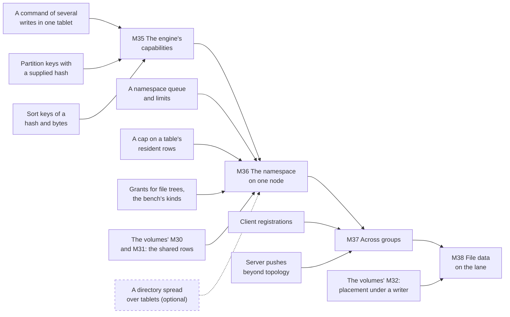

# W28. What has to exist first

**Nothing on this page is built.** It is the list of what Shoal has to gain before a file tree can be
mounted, in one place, so that no page after it rediscovers a gap and no milestone starts on top of
one.

A prerequisite here is a **gap in Shoal as it is today**: work that lands in a change of its own,
before any filesystem code, and is worth having without a filesystem. What the filesystem itself has
to do is not a prerequisite, however hard it is. The namespace's layout, its operations, operation
records, write leases and the FUSE daemon are the filesystem's own work, on [W31](namespace.md) to
[W36](fuse.md) and in the [milestones](milestones.md). Neither are the volumes' gates this plan waits
on; they are another plan's milestones, named in [the order](#the-order).

## The rule the labels follow

Every row is labelled, and the label follows the rule [S1](../../object-storage/prerequisites.md#the-rule-the-labels-follow)
set and [W1](../scans/prerequisites.md#the-rule-the-labels-follow) and [W14](../volumes/prerequisites.md#the-rule-the-labels-follow)
kept:

- **Required**: built without it, the feature would be incorrect or unsafe, or would later need
  rework to a format that is persisted or a protocol that is on the wire.
- **Optional**: it can be added later without changing anything already built, or it is needed only
  under a design answer that has not been chosen.

**"Unsafe" includes the promise R40 makes to the queries beside a file tree**, and it bites harder
here than for volumes: a namespace's commands are table writes, so an item without which they would
crowd every other table's writes is required.

**Where it stands (2026-10-26).** None of the thirteen required rows is started. Five are shared with
[block volumes](../volumes/prerequisites.md) and land with its gates; eight are the filesystem's.

## Required, shared with block volumes

Each is designed on the volumes' page named, and lands at the volumes' gate, before any gate of this
plan.

| Row | Why the filesystem needs it | Designed on | Lands |
| --- | --- | --- | --- |
| **Bindings for consumers other than buckets, and a pool's write policy** | A file tree's files bind an attached pool | [W14](../volumes/prerequisites.md#bindings-for-consumers-other-than-buckets-and-a-pools-write-policy) | [M30](../volumes/milestones.md#m30-the-lane-on-one-node) |
| **A client lane to object executors** | A mount writes and reads a file's stripes on it, as a volume's writer does | [W14](../volumes/prerequisites.md#a-client-lane-to-object-executors) | M30 |
| **A lane queue with admission on object executors** | A file's lane work runs there | [W14](../volumes/prerequisites.md#a-lane-queue-with-admission-on-object-executors) | M30 |
| **A node ceiling on client-lane bytes** | Item 244, as for volumes | [W14](../volumes/prerequisites.md#a-node-ceiling-on-client-lane-bytes) | [M31](../volumes/milestones.md#m31-across-nodes) |
| **The bench's block kinds and volume events** | The lane's arms, which file data's arms extend | [W14](../volumes/prerequisites.md#the-benchs-block-kinds-and-volume-events) | [M29](../volumes/milestones.md#m29-the-harness) |

## Required, the filesystem's

### A command of several writes in one tablet

**What.** A command that carries several writes, to rows of one or more partitions of **one tablet**,
with conditions on any row of that tablet, including rows it does not write, applied all or nothing in
committed order, its outcome decided once at apply ([W30](atomic-commands.md)).

**Why it is required.** Every write names exactly one row today
(`shoal-proto/src/shared/queries/unsorted.rs:16-31`), and a bundle is a batch, not a transaction
([introduction](../../introduction.md)). A create is an entry and an inode and its directory's times;
without one command for them a crash leaves an entry with no inode, or the reverse, and every reader
would have to repair what it found. And the compactor re-judges every conditional write against the
one partition it folds ([F68](../../features/conditional-writes.md#where-the-condition-is-judged)), which
a condition on another partition's row breaks: the rule for what is kept at compaction has to be fixed
before any such command is in a WAL, so it is a persisted format's rule.

**What else gains.** Any table that wants several rows of one partition or one tablet changed together,
an order and its lines say, which it may ask for and no table that does not is touched.

**Lands** at the start of [M35](milestones.md#m35-the-engines-capabilities). Designed on
[W30](atomic-commands.md).

### Partition keys with a supplied hash

**What.** A generated table's partition key may supply its own placement hash instead of gxhash's, laid
out so that two keys never collide, and so that a file's inode row is placed in the tablet its entry
was made in ([W31](namespace.md#keys-that-place-themselves)).

**Why it is required.** Every key is hashed by gxhash today (`shoal-proto/src/shared/objects.rs:152-160`),
and a collision between two partition keys is not detected: in a sorted table they share a tree, in an
unsorted one the later row overwrites the earlier ([partitioning](../../architecture/partitioning.md)). A
namespace keyed by inode numbers and directory parts would meet that at a few billion files. And a
file's entry and inode could not be placed together, so every create would cross two groups. A
partition's key is persisted in every archive, so its hashing is fixed before the first row.

**What else gains.** The Scans plan's declared order, which places a partition by its leading fields
([W8](../scans/declared-order.md)); this is a narrower form of the same lever.

**Lands** at the start of M35. Designed on [W31](namespace.md).

### Sort keys of a hash and bytes

**What.** A sorted table's sort key may be a `(u64, bytes)` pair, ordered by the integer and then the
bytes.

**Why it is required.** Sort keys are `String` alone today (`shoal-proto/src/shared/traits.rs:31`,
[todos](../../appendix/todos.md)), and a POSIX name is bytes, not UTF-8. A directory's entries are read in
the order of their names' hash so that a `readdir` cookie is that hash ([W31](namespace.md#readdir)).
An escaped `String` would work, and would be the persisted key format of every entry for ever.

**What else gains.** Every sorted table that wanted an integer sort key, which the todo asks for.

**Lands** at the start of M35. Designed on [W31](namespace.md).

### A namespace queue on table shards, and limits a tree and a mount

**What.** A queue on each table shard for namespace commands, below its listeners' and beside its loop,
with an admission count and a memory draw of its own, and limits a file tree and a mount names,
operations a second, kept at the coordinating shard ([W37](isolation.md#the-namespace-queue)).

**Why it is required.** A namespace's commands share a shard's WAL, its group commit and its loop with
every other table's writes. An `untar` of a kernel's source is some seventy thousand creates; without a
queue and a limit of their own they would sit in front of every other table's commit on the shards they
reach. Under R40 that is unsafe.

**What else gains.** The Scans plan's scan class is the same shape for reads ([W7](../scans/isolation.md#cpu)).

**Lands** at the start of [M36](milestones.md#m36-the-namespace-on-one-node). Designed on
[W37](isolation.md).

### A cap on a table's resident rows

**What.** A share of a shard's `resources.memory` one table's resident partitions may take, past which
that table's own partitions are evicted first and never another table's. The namespace table names one
([W37](isolation.md#memory)).

**Why it is required.** A shard past its budget evicts forty percent of its resident rows, of every table
at once (`shoal-core/src/server/shard.rs:6869-6872`). A `find` or a `du` over a large tree makes every inode
it reads resident, as any get makes its partition resident, so without a cap one walk of a tree would evict
every other table's hot set, which R40 forbids. The Scans plan avoids the same failure by never making a
scanned partition resident ([W7](../scans/isolation.md#memory)); a namespace's lookups have to make theirs
resident to be fast, so their share is bounded instead.

**What else gains.** Any table an operator wants kept from crowding the rest: a log, a cache, a tenant's.

**Lands** at the start of M36. Designed on [W37](isolation.md#memory).

### Client registrations

**What.** A client process the cluster knows by name: registered by a commit, renewed by its lanes'
traffic and held in memory at the registration's leader, ended by a commit when it leaves or when an
operator or a timer asks, and **barred** once ended, every door refusing it by name
([W35](mounts-and-locks.md#a-mount)).

**Why it is required.** A write lease, a lock and an open file are a mount's, and each must be released
when the mount is gone, and never while it may still act: a mount whose write lease was taken from it
must have every later write refused. That is a fact every holder and every shard checks, persisted and
on the wire. Volumes do not need it, since a volume's attachment is its row and its writer is barred by
number ([W18](../volumes/attach-and-takeover.md)).

**What else gains.** Any client the cluster should be able to name, count and refuse: a misbehaving one
removed by an operator, a client's own limits.

**Lands** at the start of [M37](milestones.md#m37-across-groups). Designed on
[W35](mounts-and-locks.md).

### Server pushes beyond topology

**What.** A frame a node sends a client unasked, beside the topology frame a subscribed client already
receives ([tablet map](../../distributed/tablet-map.md)): a call-back of a write lease, a lock waited
for and now free, an invalidation of what a mount caches.

**Why it is required.** A write lease is called back when another mount wants the file
([W35](mounts-and-locks.md#a-call-back)); without a push the other mount would wait for the holder to
ask, or for a time, which would make a time decide who writes. A frame type is wire protocol.

**What else gains.** A barred volume writer told at once ([W18](../volumes/attach-and-takeover.md)); any
later watch on rows.

**Lands** at the start of M37. Designed on [W35](mounts-and-locks.md).

### Grants for file trees, and the bench's filesystem kinds

**What.** A `trees:` entry beside `tables:`, `buckets:` and `volumes:` in a principal's grants: `read`
to mount read-only, `write` to mount to write. And `shoal-loadgen` kinds for a namespace's operations,
create, stat, unlink, rename and readdir at chosen widths and depths, for small files written whole and
read back, and for a file's I/O, with events appended to `EventKind` (`shoal-loadgen/src/spec.rs:196`):
a mount killed, a call-back storm.

**Why it is required.** Grants are committed and an unknown key is refused
(`shoal-proto/src/shared/grants.rs:414-428`); every gate is judged by a measurement
([F69](../../features/driver-operation-kinds.md)'s precedent).

**Lands** at the start of M36. Designed on [W35](mounts-and-locks.md#grants) and
[W39](performance.md#what-the-driver-gains).

## Optional

| Item | Why optional | What it would add |
| --- | --- | --- |
| **Read leases**, a mount's right to cache a file or a directory until it is called back | Close-to-open and caches bounded in time are the first gates' promise ([W35](mounts-and-locks.md)) | Coherence between mounts beyond close-to-open, and caches that never expire while nothing changes |
| **Creates done ahead by a mount**, under a lease on its directory | Each create is one commit ([W32](one-tablet-operations.md)) | An `untar` at a local disk's speed, as CephFS's asynchronous creates gave ([W29](prior-art.md#cephfs)) |
| **A directory spread over tablets** | A directory's parts stay in one tablet by default ([W31](namespace.md#directory-parts)) | A single hot directory's creates past one group's rate |
| **An NFS gateway** | FUSE is the mount ([W36](fuse.md)) | Hosts that cannot run FUSE or the schema's program |
| **Snapshots of a tree, quotas, ACLs** | None of the first gates needs them | What CephFS's snapshots, quotas and ACLs give |
| **The Scans plan's walk for a tree's checks** | A tree's own checks walk its tablets ([F87](../../features/tablet-walk.md)) | A `fsck` and a quota recount in the scan class, beside the foreground |
| **Archived seeks for a sorted condition** | A directory part is kept small ([W31](namespace.md#directory-parts)) | A large part judged without reading it whole, should X33 ask |

## What the lab needs

Nothing fitted. FUSE on all three hosts: europa's 7.0.0-38 kernel has fuse built in (`/proc/filesystems`,
read on 2026-10-26); whether its FUSE over io_uring is enabled is [X34](spikes.md#x34-fuse-classic-and-over-io_uring)'s
first check. CephFS and JuiceFS on the lab, as references, are optional, by X14's method of recording
every host change ([X36](spikes.md#x36-cephfs-juicefs-and-infinifs-read-at-the-source)).

## Found on the way

Nothing new beyond [W14's](../volumes/prerequisites.md#found-on-the-way), two of which matter here: an
append retried after an unknown outcome may claim a second region, which is why O_APPEND is taken under
a write lease ([W34](file-data.md#appends)); and a write in place moves neither `content_version` nor
`modified_ms`, which is why a file's mtime is the inode row's and committed at close
([W34](file-data.md#close-and-fsync)).

## The order

Each required row lands at the start of the first gate that needs it. An arrow points from a row to
the gate that requires it; dashed is *helps*.

## Related

[W14](../volumes/prerequisites.md), which holds five of these rows; [S1](../../object-storage/prerequisites.md)
and [W1](../scans/prerequisites.md), whose rule this keeps; [the milestones](milestones.md) for where
each lands; [What's left to do](whats-left-todo.md) for all of it drawn.
