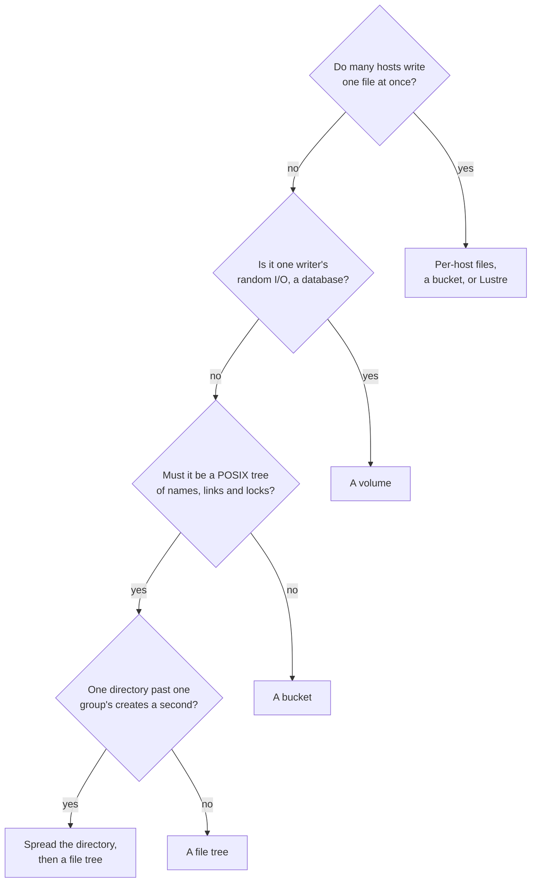

# W38. Tradeoffs, and when not to use the filesystem

## Context

Every choice on these pages bought something and cost something, and a file tree is itself a tool
with a price its user pays. This page puts both in one place: what a file tree costs the person who
mounts it and when not to mount one, and each design choice beside what it cost and what its
alternative would have. Each row points to the page that argues it. Three of the choices were the
user's on 2026-10-26, made after the performance tradeoffs below were laid out
([W41](contract.md#decision-record)).

## What exists today

No file tree. A bucket's objects are reached by path with no directories, rename, links or locks
([object storage](../../object-storage/overview.md#what-this-part-is-not)); a block volume is planned
beside this ([volumes](../volumes/overview.md)).

## The design

### What a file tree costs the person who mounts it

1. **Close-to-open, not coherence.** A mount sees another's writes to a file once the writer closes or
   syncs it, and names and attributes it cached may be up to a second stale ([W35](mounts-and-locks.md#what-a-mount-caches)).
2. **One writer a file at a time.** Several mounts writing one file take turns, each turn a call-back,
   a flush and two commits; an HPC job writing one shared file from many hosts is slow
   ([W34](file-data.md#appends)).
3. **A hot directory is one tablet's group**: about 4,900 creates a second on the lab, however large
   the cluster, until spreading a directory is built ([W31](namespace.md#directory-parts)).
4. **Every metadata write is a table write**: about 5.3 ms at the median on the lab's 970 EVO WAL and
   0.64 ms on europa's Optane. An `untar` of seventy thousand files one at a time is about six minutes on
   the lab; in many directories at once it is parallel, and creates done ahead by a mount, optional, would
   make it local ([W32](one-tablet-operations.md#what-each-costs)).
5. **A small file costs two commits**, its create and its close, and no stripe ([W34](file-data.md#inline-files)).
6. **A file renamed between directories keeps its inode where it was born**, so its later unlinks and links
   cross groups, two rounds instead of one ([W31](namespace.md#inode-numbers)).
7. **Renames of directories between directories go one at a time in a tree** ([W33](cross-group-operations.md#the-rename-row-and-cycles)).
8. **FUSE stands between every uncached operation and the cluster**, a trip between the kernel and the
   daemon, less over io_uring ([W36](fuse.md)).
9. **mmap is coherent within one mount only.**
10. **An evicted mount loses what it had not flushed**, as CephFS's does ([W35](mounts-and-locks.md#a-call-back)).
11. **The writer's host link carries every copy** of a file's bytes, as a volume's writer's does
    ([volumes' W24](../volumes/tradeoffs.md)).
12. **No snapshots, quotas or ACLs at first** ([W28](prerequisites.md#optional)).

### When not to use the filesystem

- **For one file written by many hosts at once.** Write a file a host, or use a bucket, or Lustre.
- **For a database's files.** One writer and random writes: a [volume](../volumes/overview.md), formatted by
  the host, without FUSE or a namespace between.
- **For a directory that must take more creates a second than one group commits.** Spread the files over
  several directories.
- **For small files created one at a time on consumer SSDs, where each must be fast.** Every create is a
  table write's latency; a local disk, or a volume, is faster.
- **For data reached by name from many clients that need no POSIX.** A bucket is simpler and cheaper.

### When to use a file tree

Home directories; a dataset many hosts read and one host at a time writes; build trees and their outputs;
training data and a checkpoint a host; logs a host; anything a program expects to find by path, with
directories, renames and locks, on more hosts than one.

### The decisions, and the tradeoffs they were made on

These were laid out to the user on 2026-10-26 before each was chosen.

| Decision | Chosen | What it buys | What it costs | The alternative, and its cost |
| --- | --- | --- | --- | --- |
| How operations across directories are atomic | The filesystem's own protocol | One round for the common operations; nothing on any other table's path; no aborts among a directory's creates | Usable only by the filesystem; two rounds for the rare operations across groups; a rename row a tree | Engine-wide transactions: any table could use them; two rounds for a create unless a one-tablet fast path were built too; timestamps across groups; a directory's attributes conflicting under concurrent creates; shared engine paths every table would be measured again on; the filesystem waiting for all of it |
| Where a file's bytes go | The volumes' lane, under a write lease | About 2 ms a small write in place on the lab where the object store's took 10.3 to 12.8; reads straight from holders; no table shard a write | One writer a file at a time, and a call-back for every turn; the filesystem waits for the volumes' M32 | The object store's committed stripes: built today and safe for many writers; 10.3 to 12.8 ms a small write in place, two strong reads a read, a raft round and the coordinator's byte work on a table shard every write |
| Whether a tree's files share a pool with buckets | A pool's write protocol is its policy | Every driver dispatches on its pool | A second pool beside a bucket's | Mixed pools: drivers asking every stripe's kind |
| What a file's right to write is called | The write lease | The industry's word | Kept apart from F100's leader lease in every page's words | Custody, or a write right |

### What each design choice cost

| Choice | What it buys | What it costs | The alternative, and its cost |
| --- | --- | --- | --- |
| A command of several writes in one tablet ([W30](atomic-commands.md)) | A create, an unlink, a rename inside a directory, one round | A command kind in the WAL; eligibility checked at proposal | One row a fact: a crash between rows of one operation |
| Decided once at apply ([W30](atomic-commands.md#decided-once-at-apply)) | Conditions on any row of the tablet; plain folds at compaction | Refused frames excluded from compaction | Judging again at compaction: impossible across partitions |
| Minted keys with a home prefix ([W31](namespace.md#keys-that-place-themselves)) | No collision ever; a file beside its entry; an inode found by its number | A counter a prefix; supplied hashes in the engine | gxhash's keys: collisions undetected, nothing placed together |
| A directory's access and content parts ([W31](namespace.md#a-directorys-two-parts)) | A directory's own creates are its tablet's; directories spread | A directory's `stat` is two reads | One row a directory: its parent's tablet takes every create below it |
| Parts in one tablet ([W31](namespace.md#directory-parts)) | Renames inside a directory one round | A hot directory one group's rate | Parts spread: renames inside a directory across groups |
| Operation records ([W33](cross-group-operations.md)) | Cross-group operations whole, decided by a commit, no clock | Two rounds; a pending entry's reader asks the record | A coordinator group: a third group and a round more |
| A rename row a tree ([W33](cross-group-operations.md#the-rename-row-and-cycles)) | No cycle, ever | Directory renames between directories one at a time | Checking ancestry without it: a cycle from two renames together |
| Write leases on the lane ([W34](file-data.md)) | A file written at a volume's speed | A call-back a turn for several writers | Many writers by commits: 10 ms a small write |
| Close-to-open with bounded caches ([W35](mounts-and-locks.md#what-a-mount-caches)) | No server state for readers; caches that need no recall | Up to a second stale between mounts | Read leases now: exact caches, a recall for every change |
| Registrations ended by commits and barred ([W35](mounts-and-locks.md#a-mount)) | A mount's leases and locks released safely, no clock deciding | A commit a group when a mount ends | A clock: a live mount's leases taken while it writes |
| A resident cap ([W37](isolation.md#memory)) | A `find` never evicts another table's rows | A tree's working set held to a share of memory | No cap: one walk evicts every table's hot set |
| FUSE first ([W36](fuse.md)) | Every Linux host, a fault the daemon's own | A trip a request between kernel and daemon | A kernel client: faster, and a module to keep for every kernel |

## Alternatives rejected

A page that listed costs without the alternative beside each: a cost means nothing next to nothing.

## What it costs

Nothing of its own; this page is a summary.

## What it breaks

Nothing.

## Invariants to uphold

- **Every choice above has its cost written beside it**, here and on its page; a choice whose cost is found
  later is added, not left to be rediscovered.

## Prerequisites

None.

## How it would be measured

Each cost above that is a number is measured where its page says: operations and their rounds by
[X32](spikes.md#x32-metadata-operations-priced), a part's size by [X33](spikes.md#x33-a-directory-parts-size),
FUSE by [X34](spikes.md#x34-fuse-classic-and-over-io_uring), call-backs by [X35](spikes.md#x35-a-call-back-priced),
and the budget by [W39](performance.md).

## Acceptance tests

None of its own; every row's test is on its page.

## Related

[W33](cross-group-operations.md) and [W34](file-data.md), where the largest of these are argued; [W29](prior-art.md)
for how CephFS, Lustre and JuiceFS made the same choices; [the volumes' W24](../volumes/tradeoffs.md) for a
volume's.
