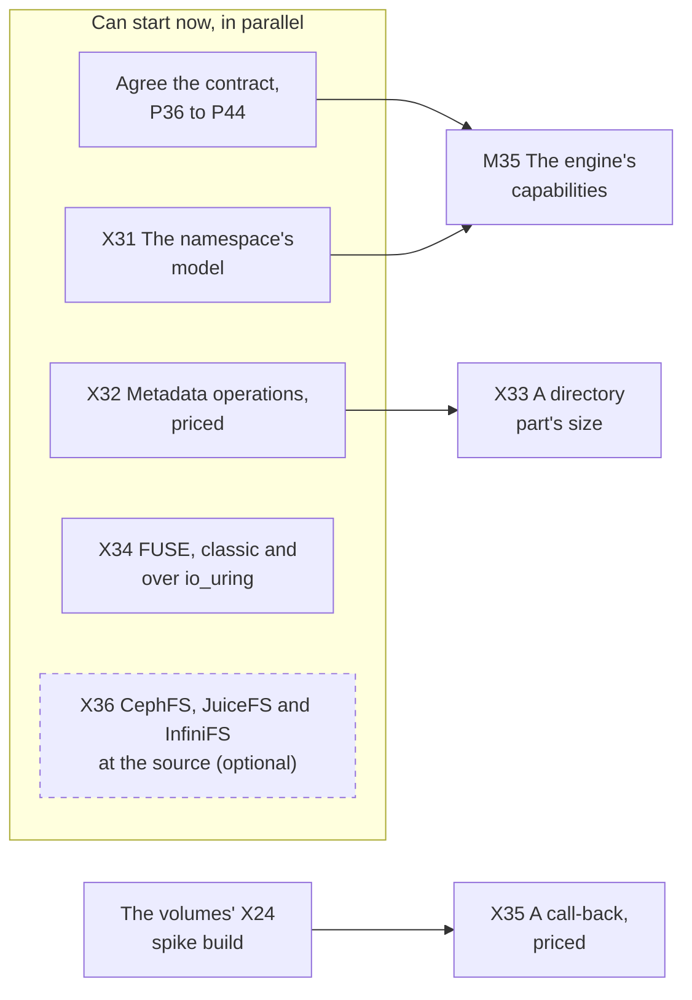
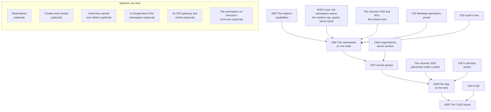

# What's left to do

**The order of the work, drawn.** The pages before this one say what has to be done and why; this one says in
what order, on two diagrams: the work up to the first gate, and the gates after it, with the volumes' gates this
plan waits on drawn where it waits. As of 2026-10-26, when this plan was drawn, nothing on either diagram is done.

**How to read them.**

- An arrow points from a piece of work to what requires it. Things on one level, with no arrow between them, can
  be done in parallel.
- A green box with a ✅ is done.
- A box titled *(optional)*, with a dashed border, can be left out without anything built having to change; a
  dashed arrow means *helps*, not *requires*. Each one's reason is on the page that lists it.
- A box beside a gate lands no later than the start of that gate, and nothing stops it landing sooner
  ([W28](prerequisites.md#the-order)).

The full list of what each gate requires is on [the milestones page](milestones.md#the-gates-at-a-glance); the
diagrams draw an arrow only where no longer path already implies it.

## Before the first gate

Everything in the first box can start now. X33 reuses X32's spike build, and X35 the volumes' X24's.

X36 feeds no gate. It reads CephFS's, JuiceFS's and InfiniFS's namespace paths at pinned releases and, if run,
measures CephFS and JuiceFS on the lab beside a file tree; [W29](prior-art.md) marks what it would confirm.

## The gates

The chain is the claim [the milestones page](milestones.md#the-order-is-a-claim) argues for: the model before any
code, the engine before the namespace, one tablet before many, the namespace before the bytes and the volumes'
lane before a file's, the mount last. M35 to M37 can run beside the volumes' gates; only M38 waits on them. The
rest of the optional work, write leases on a byte range, snapshots, quotas and ACLs, is on
[the milestones page](milestones.md#optional-any-time); it changes no box here.

## Keeping it current

**Whoever finishes a piece of work turns its box green in the same change**, with a ✅ at the start of its label
and `:::done` after it, as the object storage part's boxes were turned
([its page](../../object-storage/whats-left-todo.md#keeping-it-current)). A volumes' box drawn here is turned when
the volumes' own is. A piece of work that is added, split or dropped is added, split or dropped here too, and an
optional one says *(optional)* in its title. The conventions are `CLAUDE.md`'s, under *Planning Docs*.

## Related

[W28](prerequisites.md) for the rows the gates begin with; [Spikes](spikes.md) for what has to report first;
[Milestones](milestones.md) for what each gate delivers; [W41](contract.md) for the questions and the record; [the
volumes' What's left to do](../volumes/whats-left-todo.md) for the plan this one follows.
