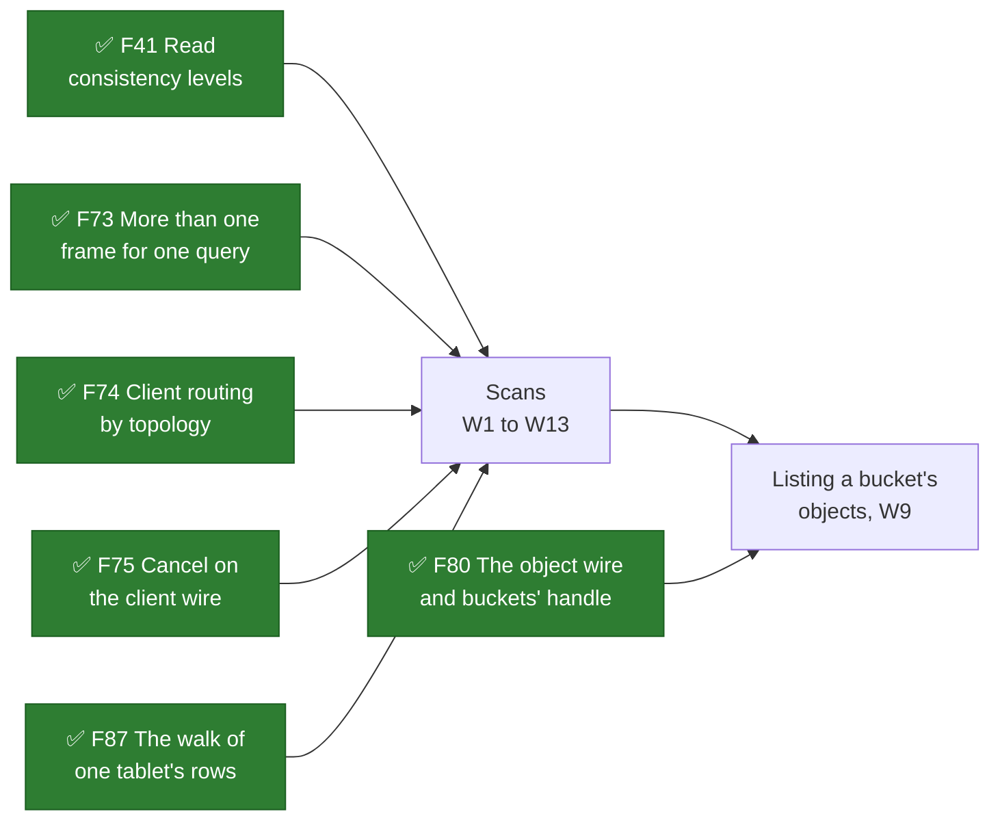
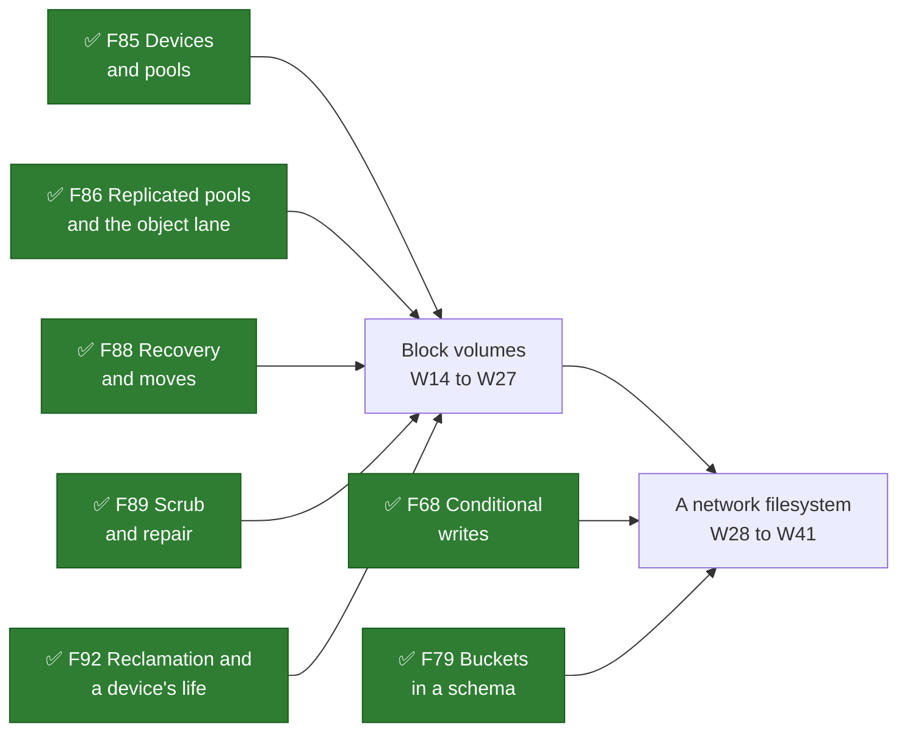

# Future Work

**Nothing in this part is built.** It holds plans for features Shoal does not have yet, a subchapter
each, written before any of their code so that the design, its costs and the order of its work can be
argued with while they are still cheap to change. [Direction](../direction/overview.md) is the other
forward-looking part of the book, and it records directions; this part records plans, each with the
gates that would deliver it.

## The plans

| Feature | Pages | Status |
| --- | --- | --- |
| [Scans](scans/overview.md), and listing a bucket's objects | W1–W13; spikes X16–X22; milestones M22–M28 | Planned on 2026-10-25; its contract agreed on 2026-10-29. Built: the bench's scan kind and event (F115), the admission class (F116), the scan class (F117), the scan budget (F118), the scan pacing (F119). Spikes: X16 measured, X20 read and run. No gate set |
| [Block volumes](volumes/overview.md), a host's block device on a writer lane | W14–W27; spikes X23–X30; milestones M29–M34 | Planned on 2026-10-26. Nothing built, no spike run, no gate set |
| [A network filesystem](filesystem/overview.md), mounted through FUSE | W28–W41; spikes X31–X36; milestones M35–M39 | Planned on 2026-10-26, after block volumes, whose lane its files' bytes travel. Nothing built, no spike run, no gate set |

Scans stand on what is built: the walk of one tablet's rows is a scan's engine on a tablet, the read
levels are what a page is served at, the route table is what a client's driver reads, streams carry a
long answer and `Cancel` stops one; a listing adds the object wire's buckets.

Block volumes stand on the object store's devices, placement, lane handoff, recovery, scrub and
reclamation, and add a write path with no commit a write: one writer numbers its writes and sends each
to its stripe's holders. A network filesystem writes its files' bytes on that lane under a write lease,
keeps its namespace in generated tables as a bucket keeps its metadata, conditions its changes as F68's
writes are conditioned, and adds a command of several writes in one tablet.

## How a plan here is written

Each plan keeps the shape the object storage part's plan took, and the rules `CLAUDE.md` gives every
planning doc:

- **An overview** with what is asked for, numbered as requirements; the decisions taken with the user,
  dated; a vocabulary checked against the book's; the constraint every page inherits; the chapter; and
  its dependency graph.
- **A page of prerequisites first**, each labelled required or optional by one stated rule, with why.
  Nothing required is skipped to reach a gate sooner.
- **Design pages lettered `W`**, each with the sections Context, What exists today, The design,
  Alternatives rejected, What it costs, What it breaks, Invariants to uphold, Prerequisites, How it
  would be measured, Acceptance tests and Related. Where a question is open the page names a preferred
  direction and the question carries its gate.
- **A contract and its questions**: numbered properties, each beside the violation that breaks it and
  the tests that own it; questions, each with the gate it blocks and the evidence that settles it; and
  the decision record.
- **Spikes**, each saying in advance what result would change the design; **milestones**, each with
  what it waits on, what lands first, what it delivers and what proves it; and **a page that draws all
  of it** as mermaid, done boxes green, optional ones dashed.

A statement about Shoal cites a file and a line read on the day it was written; a statement about
another system cites where it was read, or says it was recalled.

## Numbering

`W` pages are numbered once across this part and never reused: Scans has W1 to W13 and W42, ~~and the next plan
begins at W14~~ Block volumes W14 to W27 and A network filesystem W28 to W41, and the next plan begins at
~~W42~~ W43, Scans having taken W42 on 2026-10-29. Everything else continues the book's own sequences, so a number names one thing in this book:
requirements from R19, contract properties from P20, questions from Q33, spikes from X16 and milestones
from M22 were Scans'; from R27, P27, Q43, X23 and M29 Block volumes'; from R34, P36, Q53, X31 and M35 A
network filesystem's; Scans then took Q62 and X37; and the next are R42, P45, ~~Q62, X37~~ Q63, X38 and M40. When a plan's work ships, `F` pages say
what was built and what it cost, and the `W` pages stay the design record, as the object storage part's
`S` pages did.

## When a plan leaves this part

Once a plan's first gate is set, its subchapter may move to a part of its own, as Object Storage has
one; its pages keep their numbers wherever they go. A plan dropped is struck through here with its
reason, never deleted.

## Related

[Object Storage](../object-storage/overview.md), the worked example of a plan and its delivery;
[What's left to do](../object-storage/whats-left-todo.md) there, the diagram this part's diagrams
follow; [Direction](../direction/overview.md); [TODOs and Unbuilt Work](../appendix/todos.md), where
work not yet planned is filed.
