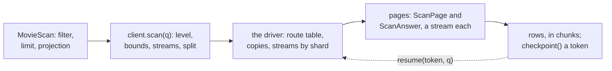

# W10. The client, SHQL, the schema and grants

## Context

What a caller writes to scan a table, list a bucket, resume either, and split one over workers; what
SHQL and `shoalctl` gain; what a schema declares; what a principal must be granted; and what a node
counts. Everything below is a proposal for the gate named beside it.

## What exists today

- **A get is a generated struct** with its partition keys, an optional filter of the table's own
  filter type, a limit and a projection, built with `.limit(n)` and `.projection::<P>()` and sent with
  `send` or `send_one` ([Derive Macros](../../api/derive-macros.md#get-and-exists),
  [F2](../../features/projections.md)). A filter is a set of values for each `#[shoal(filter)]`
  field, the fields joined by `AND` ([Query Execution](../../tables/query-execution.md)).
- **`SendOptions`** names a read level, a deadline, tokens and an identity ([The Client](../../api/client.md)).
- **A bucket's handle** puts, gets, reads at an offset, stats, deletes and opens
  ([F80](../../features/object-wire.md)).
- **SHQL is `SELECT`**, and its `WHERE` must name the partition key ([SHQL](../../api/shql.md)).
- **Grants are two privileges**, `read` and `write`, written as a list of names, on a table, a bucket
  or `*`, committed on a cluster and changed by `grant` and `revoke` (`shoal-proto/src/shared/grants.rs:119-129`;
  [F77](../../features/authorization.md)).
- **A node's figures** are its `NodeStats`, read by `shoaladm stats` and kept in a bench capture
  ([F52](../../features/cluster-stats.md), [F104](../../features/memory-in-a-capture.md)).

## The design

### The client

The derive generates a scan beside each get: **`MovieScan`**, a get without keys, carrying the same
filter, limit and projection. The client drives it:

```rust
// every released movie's summary, read from followers a page at a time; `released` is a
// MovieFilter built exactly as a get's filter is
let scan = MovieScan::new()
    .filter(released)
    .projection::<MovieSummary>();
let mut rows = client.scan(scan).level(ReadLevel::One).start().await?;
// hand each summary on as its chunk arrives, in no order across tablets
while let Some(summary) = rows.next().await {
    index.add(summary?);
}
```

| On `client.scan(...)` | Means |
| --- | --- |
| `.level(ReadLevel)` | `One` or `Quorum`, the table's read policy unless named ([C6](../../distributed/reads.md)) |
| `.page(rows, bytes, work)` | A page's bounds ([W4](cursor-and-pages.md#bounds-and-short-pages)) |
| `.streams_per_shard(n)` | Up to two unless named; a shard's admission has the last word ([W6](distribution.md#streams)) |
| `.split(n)` | The scan cut into `n` parts over disjoint tablet ranges, each started by a worker of its own |
| `.tablets(set)` | One part, over a tablet range a caller names |
| `.start()` | Begins: rows with `.next()`, or whole pages with `.next_page()` |

A running scan's **`checkpoint()`** is its resume token ([W4](cursor-and-pages.md#the-cursor-and-the-resume-token)),
bytes a caller can store; **`client.resume(token, scan)`** carries on from it, from any client, after
anything but a schema change of its table. Dropping a scan cancels its pages in flight
([F75](../../features/client-cancel.md)). A limit on a scan stops the driver once that many rows are
handed out. Every refusal a driver cannot route around ends the scan with the refusal by name.

**A table with a declared order** ([W8](declared-order.md)) generates its placement and order types,
and its scan takes them:

```rust
// one sensor's days 100 to 199, in day order
let days = ReadingScan::under(ReadingPlacement { sensor: 7 })
    .from(ReadingOrder { day: 100 })
    .to(ReadingOrder { day: 200 });
let mut readings = client.scan(days).level(ReadLevel::Quorum).start().await?;
```

**A bucket lists** through its handle ([W9](bucket-listing.md)):

```rust
// every live poster, as path, size, ETag, modified time and content type
let mut listing = client.bucket::<Posters>().list().start().await?;
while let Some(object) = listing.next().await {
    let object = object?;
    println!("{} {} {}", object.path, object.size, object.etag);
}
```



### SHQL and shoalctl

```sql
SCAN Movie WHERE status = 'Released' LIMIT 100
```

`SCAN` is a statement of its own. Its `WHERE` names filter fields only, a get's filters; a partition
key in it is refused, since a key named is a get. `SELECT` keeps its mandatory partition key, so a
query that forgets one is still an error and never quietly a scan. `shoalctl` shows a scan a page at
a time, asks for the next page as the view scrolls, and cancels the scan when the view is left. Its
bucket view lists a bucket the same way.

### The schema

**Nothing to declare for a scan in hash order.** Every table, persistent or ephemeral, can be scanned;
an ephemeral table's pages are its resident partitions alone. A bucket's generated tables are reached
only through its listing. A declared order adds three attributes and one on the table
([W8](declared-order.md#the-declaration)):

| Attribute | On | Means |
| --- | --- | --- |
| `#[shoal(partition, place)]` | A leading partition field | Its hash places the partition |
| `#[shoal(partition, order)]` | Every other partition field | Its encoding orders partitions under one placement value; `order = desc` reverses it |
| `#[shoal(order, cover)]` | Any field | Kept in the order index, so a page of covered fields reads no partition |
| `#[shoal_table(..., spread = N)]` | The table | One placement value over N tablets |

### Grants

**A third privilege, `scan`**, on a table, a bucket or `*`, written beside the others:

```yaml
auth:
  grants:
    exporter:
      tables:
        Movie: [read, scan]
      buckets:
        Posters: [scan]
```

`read` does not imply `scan`: a scan reads a table whole, and an operator may want an application to
get rows by key and never read everything, decided on 2026-10-25. A scan of a table needs `scan` on
it; a listing of a bucket needs `scan` on the bucket. `cluster.admins` hold it, as they hold every
privilege.

Privileges are written as names, and a node that reads a name it does not know refuses it
(`shoal-proto/src/shared/grants.rs:207-214`, `:263-281`). A committed grant naming `scan` would fail to
read on a member built before it, so **`scan` is grantable only once the scans' wire version is
activated** ([W4](cursor-and-pages.md#capability-and-activation)). Whether `all` comes to include it is
[Q39](contract.md#questions-to-answer)'s, decided at that gate: including it widens every grant of
`all` made before scans existed, and leaving it out makes `all` mean less than everything.

### Node counters

A node counts its scans in its figures: pages admitted and shed, by cause; partitions and rows read,
and handed out; bytes read from archives and from memory; the scan budget in use; the longest step a
scan held a loop for; and listings beside scans. `shoaladm stats` draws them, and a bench capture keeps
them for every member ([W12](performance.md)). Since [F123](../../features/walk-and-scan-counters.md)
(2026-10-31, M23's first step) every one is counted but the listings, which M26 adds: a driver's
pages and a scan's apart, steps past 100 µs, 1 ms and 10 ms, in `NodeStats.scans`.

### The bench

`shoal-loadgen` gains a scan operation kind, timing a whole scan page by page; a `list` kind for a
bucket's arms; and a `scan` event, appended to `EventKind`, that runs a full scan beside a workload and
cuts the run before, during and after ([W1](prerequisites.md#the-benchs-scan-kind-and-scan-event),
[W12](performance.md)).

## Alternatives rejected

**`send` returning a scan.** A scan is not a query in a bundle: it answers in pages, outlives a
bundle's deadline and is resumed by a token. A method of its own says so.

**A scan expressed as a get with no keys.** A get with no keys is a mistake today and should stay one;
an empty key list must never read a table.

**`SELECT` without a key as a scan.** The same mistake in SHQL. ScyllaDB makes a query that would scan
say `ALLOW FILTERING` for this reason ([W3](prior-art.md#scylladb)); Shoal makes it a different
statement.

**`read` implying `scan`.** Simpler, and it would give every principal that can read a row the power
to read a whole table. Decided against on 2026-10-25.

## What it costs

Generated code a table: a scan struct, and a placement and an order type under a declared order.
A third privilege in the catalog. A statement in SHQL.

## What it breaks

Nothing. A caller that never scans writes what it writes today, and every existing grant means what
it meant.

## Invariants to uphold

- **No query becomes a scan by naming no key**: `send`, a get and `SELECT` never scan.
- **A scan needs `scan` on its table or bucket.**
- **`scan` is never committed before every member can read it.**
- **A resume token resumes only the scan it was taken from**: its table's fingerprint, its filter and
  its projection.

## Prerequisites

[W1](prerequisites.md)'s bench row for the kinds and the event; the scan path itself for the rest.

## How it would be measured

The API adds no cost of its own past the driver's; the driver's is [W6](distribution.md)'s and the
pages' [W12](performance.md)'s.

## Acceptance tests

| Test | Gate | Proves |
| --- | --- | --- |
| `a_scan_struct_carries_a_gets_filter_and_projection` | M24 | `MovieScan` filters and projects as `MovieGet` does |
| `a_scan_split_in_parts_reads_every_tablet_once` | M24 | `split(n)`'s parts cover the table once between them |
| `a_get_with_no_keys_is_still_refused` | M24 | An empty key list never reads a table |
| `shql_scan_names_filters_and_refuses_a_key` | M24 | `SCAN` parses, filters, and refuses a partition key; `SELECT` without one is still an error |
| `a_scan_needs_its_grant` | M24 | `read` without `scan` is refused, on a standalone node from its file |
| `scan_is_grantable_only_after_activation` | M25 | A cluster refuses a grant naming `scan` below the scans' wire version |
| `a_node_counts_its_scans` | M24 | The figures move under a scan and stand still without one |

## Related

[W4](cursor-and-pages.md), [W6](distribution.md) and [W9](bucket-listing.md) for what the calls drive;
[F77](../../features/authorization.md) for the grants; [SHQL](../../api/shql.md) and
[shoalctl](../../operations/shoalctl.md) for the tools; [W12](performance.md) for the bench.
