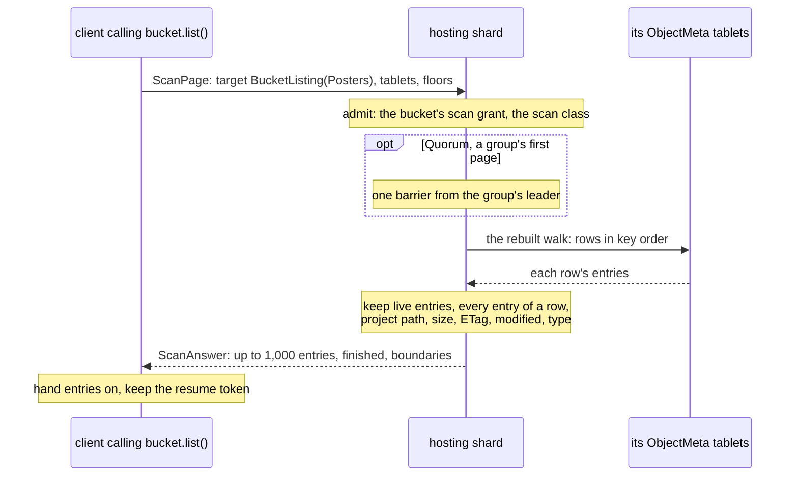
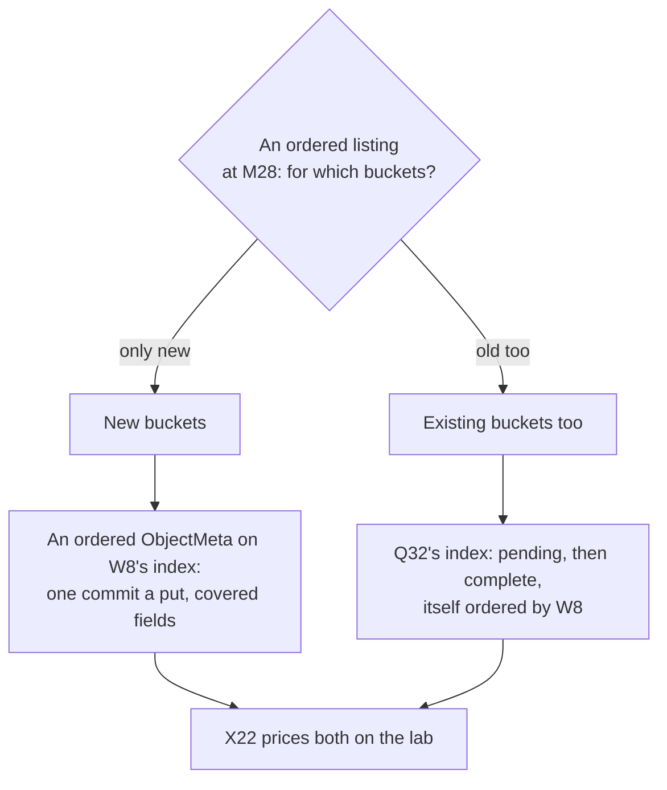

# W9. Listing a bucket's objects

## Context

The object store reaches an object by its exact path and nothing else. That was decided on
2026-10-02: "exact path only at first. An ordered listing is a later gate, and nothing may preclude
it" ([Object Storage](../../object-storage/overview.md#decisions-taken-on-2026-10-02)). A bucket's
paths are scattered over 4096 tablets by their hashes and nothing enumerates them
([S3](../../object-storage/objects.md#what-an-unsorted-table-cannot-do)). The user asked for every
object in a bucket to be listable too, and on 2026-10-25 decided the first listing gate lists every
live object, unordered, each with its path, size, ETag and modified time and none of its bytes; path
order, a prefix and a delimiter are a later gate ([R25](overview.md#what-is-being-asked-for)). A
listing is the first thing built on a scan, and this page is both: the unordered listing scheduled,
and the ordered one designed for its gate.

## What exists today

- **A bucket's metadata is a generated table.** `<Bucket>ObjectMeta`'s partition key is the path's
  hash, `path_key`, gxhash of the path's bytes under a frozen seed
  (`shoal-proto/src/shared/objects.rs:132-135`), and a row holds a list of `ObjectEntry`s: two paths
  whose keys collide are two entries of one row, told apart by the path. An entry carries the path,
  the object's id, a content version an ETag is derived from, the size, the attributes, the state
  (`live`, an object being written over it, objects retired and not yet reclaimed), the times, and the
  object's bytes themselves when it is no larger than its pool's inline threshold
  (`objects.rs:505-537`).
- **Inline bytes are part of the row.** 16 KiB by default, and a pool may set up to 16 MiB
  (`objects.rs:73`, `shoal-proto/src/shared/pools.rs:51`).
- **A client never names a generated table.** A query of one is refused `GeneratedTable` at the front
  door, whoever asks, before authorization ([F79](../../features/bucket-schema.md)).
- **The walk already reads object entries.** A walk of `ObjectMeta` reads its rows back as
  `ObjectRow`s (`walked_object`, `shoal-core/src/server/tables/walk.rs:542`), and the reclaimer walks
  a bucket's entries to find retired objects ([F92](../../features/reclamation-and-device-lifecycle.md)).
- **An object operation has a fixed head for one object**, 56 bytes for a request
  (`shoal-proto/src/shared/protocol/object.rs:60`), and a bucket's handle puts, gets, stats, deletes
  and opens ([F80](../../features/object-wire.md)).
- **What a listing would be held to was read at the source** by X14 ([Ceph and S3](../../object-storage/ceph-and-s3-sources.md#10-s3-listing)):
  S3 lists in the UTF-8 byte order of keys, at most 1,000 to a page, continued by an opaque token,
  with a prefix and a delimiter that rolls keys up into common prefixes, and promises a listing sees
  a put once it is acknowledged and stops showing an object once its delete is. RGW keeps its index in
  shards chosen by a hash of the name and merges them for an ordered listing, and writes an index entry
  pending before an object's head and completes it after
  ([§8](../../object-storage/ceph-and-s3-sources.md#8-rgw-head-tail-and-index), recorded as
  [Q32](../../object-storage/contract.md#q32-and-q14-q20-q28-in-part-ceph-and-s3-at-the-source-2026-10-05)).

## The design

### A listing is a scan with a target

**`client.bucket::<M>().list()` drives a scan of the bucket's `ObjectMeta`** with the target
`BucketListing`, through the same frames, the same driver and the same reader as any scan
([W4](cursor-and-pages.md), [W6](distribution.md), [W5](tablet-reader.md)). Naming the generated table
is still refused at the front door; a listing is the one way in, and it reaches only what a listing
answers. The shard reads each row's entries and keeps:

- **live entries only**: `state.live`, so an object deleted, or one replaced but not yet reclaimed, is
  not listed, and an object being written over a live one is listed as the live one;
- **every entry of a row**, so two paths whose keys collide are each listed;
- **a projection, never the bytes**: an entry's inline bytes are never copied into an answer.

| A listing entry holds | From |
| --- | --- |
| The path | The entry's path, as unnormalised bytes |
| The size | The entry's size |
| The ETag | Derived from the object's id and its content version, as a stat derives it ([Q32](../../object-storage/contract.md#q32-and-q14-q20-q28-in-part-ceph-and-s3-at-the-source-2026-10-05)) |
| The modified time | The entry's `modified_ms` |
| The content type | The entry's attributes |

A page holds up to 1,000 entries, S3's bound, and the listing is in hash order: every object once,
in no order a person would choose. It is granted by the bucket's `scan` privilege
([W10](api.md#grants)).

### What a listing promises

**At `Quorum`, the default, a listing lists every object whose put was acknowledged before it began,
and no object whose delete was.** One barrier a group, taken on the group's first page after the
listing began, makes every write acknowledged in that group before then visible to every page of it,
and no page reads below the group's floor ([W6](distribution.md#floors-and-barriers)). That is S3's
list-after-write and list-after-delete, for writes acknowledged before the listing began. A put or a
delete acknowledged while a listing runs may or may not be in it, and an object is listed at most once
whatever happens to it meanwhile ([W13](contract.md#the-contract)). At `One` a listing is cheaper, a
copy's committed state, and may miss a recent put.

### On the wire

A listing rides the scan frames, its target `BucketListing` with the bucket's id and fingerprint
([W4](cursor-and-pages.md#the-request-scanpage)). It is not a new kind of `ObjectOp`: that head
describes one object and has no room for tablets, cursors or floors, and a second paging scheme would
be a second set of invariants.

### What a listing reads

**A listing reads whole rows, inline bytes and all.** The bytes are never sent, but an archived row is
read whole to find its entries, so a bucket of small inline objects is listed at about the cost of
reading their bytes: up to 16 KiB an object by default, up to 16 MiB on a pool that sets it.
[X19](spikes.md#x19-the-edges) measures bytes read a listed entry against the threshold. Keeping a
listing's fields where they can be read without an object's bytes, a covering index or the inline
bytes kept apart, is a later gain that changes no listing's answer
([beside the gates](milestones.md#beside-the-gates)).

### Where it is used

`shoalctl`'s bucket view lists a bucket a page at a time; a loader's command lists a bucket for the
lab; the bench gains a `list` operation kind for object arms ([W12](performance.md)). The admin `walk`
stays the operator's check of a tablet, keys and counts, as F87 built it.

### The ordered listing, a later gate

S3's listing is ordered by the bytes of a key, takes a prefix and a delimiter, and continues from a
token. None of that is in the first gate. What it would take is designed here so the first gate
precludes none of it, and decided at [M28](milestones.md#m28-the-ordered-listing) with
[X22](spikes.md#x22-the-ordered-listing-two-ways)'s figures ([Q41](contract.md#questions-to-answer)).

| Option | How it works | What it costs | For |
| --- | --- | --- | --- |
| **An ordered `ObjectMeta`, on W8's index** | A bucket kind whose `ObjectMeta` is placed by the bucket and a spread shard and ordered by the path's bytes, the listing's fields covered in the index ([W8](declared-order.md)). A prefix is a range of the index; a delimiter skips past a common prefix by seeking beyond it | A bucket's metadata writes on N tablets, N fixed at its creation; a new layout of a generated table, for new buckets only, since `path_key` is frozen | One commit a put, strongly consistent, a listing of covered fields reading no object row |
| **Q32's listing index** | A table of its own, ordered by path, beside `ObjectMeta`. An entry is written pending before an object's commit and completed after it; a lister that meets a pending entry asks `ObjectMeta`, as RGW's does | A second commit before every put and delete, orphans to reconcile when a put never commits, and the index table itself ordered, which is W8 again | Existing buckets, whose `ObjectMeta` layout stays |
| **A merge of every tablet's path order** | Each tablet of `ObjectMeta` keeps its own entries in path order; a listing merges 4096 streams | Every page touches every tablet, each giving a fraction of an entry | No layout change at all |
| **A prefix filter on the unordered listing** | Each shard keeps only paths under a prefix; the client sorts what comes back | Every listing reads the whole bucket however narrow its prefix | Small buckets, now |

The preferred direction is the first, for new buckets: it keeps one commit a put, it is as consistent
as a stat, and it needs no reconciliation. The second is the way if buckets that exist must list in
order, and Q32 recorded it as the shape a later index would take; either way the order comes from W8.

## Alternatives rejected

**A new `ObjectOp` kind.** Above: one object's head, and a second paging scheme.

**The admin walk as the listing.** It reads one tablet, answers keys and counts in JSON, and needs an
admin; it is an operator's check, not a client's listing.

**An ordered listing first.** Decided against on 2026-10-25: the unordered listing is a scan with a
projection, while an ordered one needs W8's index and a choice between layouts that only measurement
should make.

## What it costs

A scan of the bucket's `ObjectMeta`, paced as any scan; whole rows read, inline bytes included; one
barrier a group at `Quorum`; entries of a few hundred bytes on the wire, never an object's bytes.

## What it breaks

Nothing. No row's format changes for the unordered listing, the front door's refusal of a generated
table stands, and a bucket's grant gains a privilege it did not have.

## Invariants to uphold

- **A listing hands out only live entries**, and each once.
- **A listing never carries an object's bytes.**
- **Every entry of a row is listed**, so colliding paths are each listed.
- **At `Quorum` a listing shows every put acknowledged before it began, and no object deleted before
  it began.**
- **A generated table is never named by a client**, a listing included.

## Prerequisites

Scans across a cluster, [M25](milestones.md#m25-scans-across-a-cluster).

## How it would be measured

[X19](spikes.md#x19-the-edges) measures bytes read a listed entry against the inline threshold;
[W12](performance.md)'s listing arms measure entries a second a node and the foreground beside a
listing, by the same budget as a scan.

## Acceptance tests

| Test | Gate | Proves |
| --- | --- | --- |
| `a_listing_lists_every_live_object_once` | M26 | Every live object of a bucket, each once, across every tablet |
| `a_quorum_listing_sees_every_acknowledged_put_and_no_acknowledged_delete` | M26 | S3's list-after-write and list-after-delete, for writes acknowledged before the listing began |
| `a_listing_never_carries_an_objects_bytes` | M26 | Entries of inline objects carry no bytes |
| `colliding_paths_are_each_listed` | M26 | Two paths of one row, both listed |
| `a_listing_needs_the_buckets_scan_grant` | M26 | A principal with `read` on the bucket and not `scan` is refused |
| `a_generated_table_is_still_refused_by_name` | M26 | A query or a scan naming `ObjectMeta` is refused `GeneratedTable` |

## Related

[S3](../../object-storage/objects.md#what-an-unsorted-table-cannot-do), which deferred this;
[X14](../../object-storage/ceph-and-s3-sources.md) for S3's listing and RGW's index read at source;
[W8](declared-order.md) for the order an ordered listing needs; [F92](../../features/reclamation-and-device-lifecycle.md)
for the walk of object entries that exists; [todos](../../appendix/todos.md#a-listing-index-and-an-s3-gateway)
for the listing index and gateway left out of the object store.
