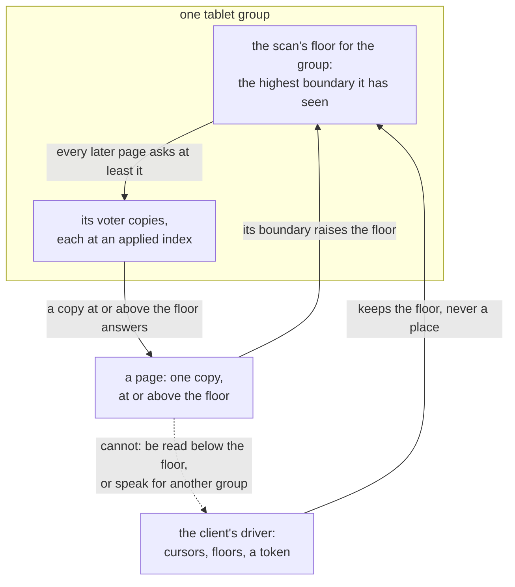

# W13. The contract and the questions

## Context

A scan reads a table while it is being written, from copies that move, fail and restart, for a
client that may itself stop and start again. What it promises has to be written down as properties a
history can be checked against, before a frame or a reader is built, as the cluster's contract was
([C13](../../distributed/protocol.md#the-contract)) and the object store's after it
([S18](../../object-storage/contract.md#the-contract)). This page states the scan's contract, how it
behaves under each failure, the questions still open with the gate each blocks, the decision record,
and the acceptance index.

## What exists today

- **A tablet group's contract, P1–P6** ([C13](../../distributed/protocol.md#the-contract)): an order of
  committed commands applied alike on every copy, read levels `One` and `Quorum`, and nothing promised
  across two tablets ([P6](../../distributed/protocol.md#the-contract)).
- **The walk's promise**, decided with the user on 2026-10-13: a walk is monotone from a floor, a page
  read from its copy's state when it begins, every partition live when the first page begins and still
  live when the walk reaches its key handed out once, in ascending key order, never older than the
  floor; nothing held between pages
  ([Q17's record](../../object-storage/contract.md#q17-in-part-what-a-driver-asks-the-tablet-walk-for-2026-10-13)).
- **The object store's contract, P7–P19**, of which P19 states what objects do not promise
  ([S18](../../object-storage/contract.md#the-contract)).

## The design

### Decisions taken and directions preferred

| Decision | Status |
| --- | --- |
| The first listing lists every live object, unordered, with stat fields and no bytes | Taken 2026-10-25 ([overview](overview.md#decisions-taken-on-2026-10-25)) |
| Ordered scans are an order declared in the schema | Taken 2026-10-25 |
| A scan needs a privilege of its own | Taken 2026-10-25 |
| Pages only move forward; no snapshot mode | Taken 2026-10-25 |
| The contract, P20–P26, as [the table below](#the-contract) has it | Agreed 2026-10-29 ([the record](#before-m22-the-contract-agreed-2026-10-29)) |
| A scan's own rate and its cost are judged at M23 | Taken 2026-10-29 ([W42](scan-speed.md)) |
| A scan's goal is its ceiling, reached cheaply; past it is X18's and Q37's | Taken 2026-10-29 ([W42](scan-speed.md)) |
| The walk, rebuilt for load, is the one per-tablet reader | Preferred ([Q33](#questions-to-answer)) |
| A tablet's records are kept together by merges written in key order | ~~Preferred~~ Taken 2026-10-30 by X37's record, built as [F121](../../features/merges-in-key-order.md); consolidated blocks still open ([Q62](#questions-to-answer)) |
| The client drives; no server holds a scan between pages | Preferred ([W6](distribution.md)) |
| Answers carry rows encoded on the shard | Preferred ([Q35](#questions-to-answer)) |
| Scan work runs on the table shards, in a class of its own, under a ceiling | Preferred ([Q37](#questions-to-answer)) |
| A declared order is kept by an index in each tablet | Preferred ([Q40](#questions-to-answer)) |
| A coordinator-driven scan | Not in these gates ([Q42](#questions-to-answer)) |
| A snapshot across groups | Excluded: no mechanism exists, and the decision of 2026-10-25 asks for none |

### The contract

`P` numbers continue [S18's](../../object-storage/contract.md#the-contract) and are never reused. P1–P6
bind scans unchanged: a page reads a tablet group's copy. P20–P26 are what scans add, each written as
a property a history can be checked against, beside the violation that breaks it.

| # | Property | Binds | The violation | Owning tests |
| --- | --- | --- | --- | --- |
| P20 | **Once.** For each group a scan reads, every partition live at the group's floor and still live when the scan reaches its key is handed out exactly once, however the scan is retried, moved between copies, carried through a failover, a move of its replica set or a node's restart, or resumed from a token by another client | [W4](cursor-and-pages.md), [W6](distribution.md) | A partition handed out twice after a page was asked again of another copy; one live throughout missed after a move | `a_scan_hands_out_every_live_partition_once` (M24), `a_scan_survives_a_copy_killed_under_a_page` (M25), `a_scan_survives_a_move_of_its_tablets` (M25), `a_scan_resumes_from_its_token_after_the_client_restarts` (M25) |
| P21 | **Pages move forward.** No page of a group is read at a state older than the scan's floor for that group, and a floor never lowers; every row a page hands out is its copy's state at or after the page's boundary | [W5](tablet-reader.md), [W6](distribution.md) | A page from a copy restarted behind the floor; a resident partition encoded after the plan and folded over the plan's older view | `a_scan_never_reads_below_its_groups_floor` (M25), `an_evicted_partition_is_read_from_its_archive_at_or_after_the_boundary` (M23), `a_swept_overlay_never_brings_a_deleted_row_back` (M23) |
| P22 | **Read levels.** At `One` a page is a whole voter copy's committed, applied state: never an entry not committed, never a copy starting, installing, quarantined or learning. At `Quorum` every write acknowledged in a group before the scan's first page of it began is visible to every page of the group. A listing at `Quorum` lists every object whose put was acknowledged before it began, and none whose delete was | [W6](distribution.md), [W9](bucket-listing.md) | A page from a copy that began an install while it read; a `Quorum` page missing an acknowledged write; a listing showing an object deleted before it began | `a_scan_at_one_never_shows_an_uncommitted_write` (M25), `an_install_under_a_page_refuses_it` (M23), `a_quorum_scan_takes_one_barrier_a_group` (M25), `a_scan_never_reads_a_learner` (M25), `a_quorum_listing_sees_every_acknowledged_put_and_no_acknowledged_delete` (M26) |
| P23 | **What is not promised.** No two groups are read at one moment; no page is more than its copy at its boundary; a partition made or removed while a scan runs may or may not be handed out; a scan's order across tablets is unspecified; a scan is not a consistent copy. This is [P6](../../distributed/protocol.md#the-contract)'s twin, and [P19](../../object-storage/contract.md#the-contract)'s | every page | An oracle, an API or a test that treats a scan as a snapshot, or its order across tablets as meaningful | The oracle's scope in `scan_oracle_promises_nothing_across_groups` (M22) |
| P24 | **Explicit and granted.** A scan runs only when asked for as a scan, for a principal holding `scan` on its table or bucket; no query becomes a scan by naming no key; a client never names a generated table | [W10](api.md), [W9](bucket-listing.md) | A get with no keys reading a table; a principal with `read` alone scanning; a scan naming `ObjectMeta` | `a_get_with_no_keys_is_still_refused` (M24), `a_scan_needs_its_grant` (M24), `a_listing_needs_the_buckets_scan_grant` (M26), `a_generated_table_is_still_refused_by_name` (M26) |
| P25 | **Positions, never places.** A scan's cursor and resume token name tablets, keys and group floors, never a node, a slot or an executor; a move, a failover, a restart or a split of a tablet leaves them valid; a change of the table's schema refuses them by name | [W2](ordering.md), [W4](cursor-and-pages.md) | A token that names a node failing after a move; a token accepted by another table or schema | `a_resume_token_resumes_and_is_refused_for_another_table` (M24), `a_position_survives_a_split_of_its_tablet` (M24) |
| P26 | **Ordered, once.** An ordered scan of a declared order hands out the partitions of its placement value between its bounds in the order of their encodings, each once, and a tablet's order index holds exactly its live partitions | [W8](declared-order.md) | A partition out of order after a spread's merge; an index entry left for a partition removed | `an_ordered_scan_hands_out_a_placement_values_partitions_in_order` (M27), `a_spread_scan_merges_its_buckets_in_order` (M27), `the_index_and_its_rows_change_in_one_apply` (M27) |

**Isolation is a budget, not a property.** What a scan may cost the queries beside it is a number,
stated on [W7](isolation.md#the-budget) and judged on the lab at every gate from M23; no history can
check it, so it is not in this table, and no gate passes without it.

### How a scan behaves when something fails

| Condition | Required behaviour |
| --- | --- |
| A copy dies under a page | The page is asked again of another copy with the same cursor and floor, and nothing is handed out twice |
| A copy is starting, installing, or behind the floor | Refused `Unavailable` by name; the driver reads another copy |
| A copy is quarantined | Refused `Quarantined`; another copy |
| A replica set moves | The old copy refused `StaleTopology`; the new one read from the cursor and the group's floor |
| A node restarts | Its copies refused until they are whole and at the floor |
| A shard's scan class is full, or its budget cannot be drawn in 250 ms | Refused `Shedding`; the driver backs off |
| A partition's archive moves under a page | Read where the map says it is now |
| An install begins under a page | The page refused, none of its rows sent |
| The client goes away | Its pages in flight cancelled; nothing held anywhere |
| The client restarts | It resumes from its token |
| The table's schema changes | The token refused by name |

### Questions to answer

`Q` numbers continue [S18's](../../object-storage/contract.md#questions-to-answer). Each names the gate
it blocks, the evidence that settles it, and the direction preferred until then.

| # | Question | Gate | Evidence | Preferred |
| --- | --- | --- | --- | --- |
| Q33 | What reads a scan's page: F87's walk rebuilt, or a reader of its own? | Before M23 | [X16](spikes.md#x16-the-walk-beside-the-foreground), [X17](spikes.md#x17-a-page-rebuilt) | The walk rebuilt, the drivers moved onto it ([W5](tablet-reader.md)). **Settled 2026-10-31** by M23's exit ([the record](#m23s-exit-measured-evidence-for-q33-q34-and-q37-and-q62-settled-2026-10-31)) |
| Q34 | What may a scan cost the foreground, and what pace holds it? | Before M23 | X16 ([measured](#x16-measured-evidence-for-q33-q34-and-q37-none-settled-2026-10-29): the walk outside the budget, the pace at its defaults never binding), X20 ([run](#x20-run-evidence-for-q33-q34-and-q37-none-settled-2026-10-29): ScyllaDB's unpaced scan doubled the tail), [X18](spikes.md#x18-table-reads-paced-by-idle-time) | `max(1.10 × alone, alone + 0.1 ms)`; idle time, a ceiling near 100 MiB/s ~~a node~~ a device, a trickle ([W7](isolation.md)); since M23's plan (2026-10-31, with the user) a share of each device's busy time, near 75 ms a second and learned from the scan's own reads, under that byte ceiling, and a device-wide bound on a scan's reads in flight ([F128](../../features/device-time-pace.md)), judged at M23's exit: the read clause held, ~~the insert clause and the share's default left to the user~~ the insert clause read as defined on rounds run again with a cell whose feed does not wrap, and the share kept at 75 ms, both decided with the user the same day ([the decisions](m23-exit.md#decided-with-the-user-2026-10-31)) ([the record](#m23s-exit-measured-evidence-for-q33-q34-and-q37-and-q62-settled-2026-10-31)) |
| Q35 | What does a scan's answer carry? | Before M24 | X17's encode figures | Rows encoded on the shard, filtered and projected there ([W4](cursor-and-pages.md#the-answer-scananswer)); since X17 (2026-10-30) with an unfiltered scan's opt-in to partitions as they lie moved forward, rows costing the shard 1.3 to 2.9 times what partitions cost a client ([the record](#x17s-second-half-measured-evidence-for-q33-and-q35-none-settled-2026-10-30)) |
| Q36 | What does a cursor hold, and what are the frames? | Before M24 | Design | [W4](cursor-and-pages.md) |
| Q37 | Does scan work stay on the table shards, or move to executors of its own so a scan can run at a device's speed? | The default before M23; asked again after M25 | X16, X18, [X20](scylladb-scan-sources.md) ([W42](scan-speed.md#past-the-ceiling)) | On the shards, under a ceiling, the cpu-heavy part written so it can move ([W7](isolation.md#cpu)) |
| Q38 | Which copies does a scan read, and how are its levels served? | Before M25 | Design | Voters only, followers first, one barrier a group ([W6](distribution.md)) |
| Q39 | Does `all` include `scan`? | At M25, with the user | — | Open: including it widens every grant of `all` made before; leaving it out makes `all` mean less than everything ([W10](api.md#grants)) |
| Q40 | How is a declared order kept? | Before M27 | [X21](spikes.md#x21-declared-order-priced) | An index in each tablet, maintained at apply ([W8](declared-order.md)) |
| Q41 | How is a bucket listed in path order? | Before M28 | [X22](spikes.md#x22-the-ordered-listing-two-ways) | An ordered `ObjectMeta` on W8's index for new buckets; Q32's index if existing ones must list in order ([W9](bucket-listing.md#the-ordered-listing-a-later-gate)) |
| Q42 | Is a scan ever coordinated by a node, for a client that is not Rust or a gateway that should not know the topology? | None set | — | Not in these gates ([W6](distribution.md#no-coordinator)) |
| Q62 | Does a table's archive keep a tablet's records together, so a scan can read them in runs, and what may that cost a merge? | Before M23 | [X37](spikes.md#x37-a-tablets-records-together-priced) | Merges written in key order, nothing rewritten; consolidated blocks only if X37 finds a tablet's stretches too short for W12's cost budget ([W42](scan-speed.md)). Settled in part 2026-10-30: the layout taken, consolidation left to M23's plan ([the record](#x37-and-x17s-reads-half-measured-evidence-for-q33-q34-and-q37-and-q62-settled-in-part-2026-10-30)). **Settled 2026-10-31** by M23's exit: no consolidation, a churned table's runs reading 10.6 partitions a device read ([the record](#m23s-exit-measured-evidence-for-q33-q34-and-q37-and-q62-settled-2026-10-31)) |

### Decision record

#### The plan drawn, and four decisions taken with the user (2026-10-25)

| Decision | Evidence |
| --- | --- |
| **The first listing gate lists every live object, unordered**, each with its path, size, ETag and modified time and none of its bytes; path order, a prefix and a delimiter are a later gate | Taken with the user. An unordered listing is a scan with a projection; an ordered one needs an order index and a choice between two layouts that measurement should make ([W9](bucket-listing.md)) |
| **Ordered scans are an order declared in the schema**: placement fields, order fields, a spread. Keys a caller steps through, a merge of every tablet and range placement stay alternatives | Taken with the user, choosing among the four on [W2](ordering.md#the-levers) |
| **A scan needs a privilege of its own** | Taken with the user. A scan reads a table whole, and a principal that may get rows by key should not thereby read everything ([W10](api.md#grants)) |
| **Pages only move forward**, per group from a floor; nothing across groups; no snapshot mode | Taken with the user: the walk's promise of 2026-10-13, made to clients ([P20–P23](#the-contract)) |

#### Before M22: the contract agreed (2026-10-29)

Recorded 2026-10-29, on the tree of the object store's squash (`4889279e`), before any scan code. The
user was shown P20–P26 as [the contract](#the-contract) has them and agreed them as written: no
property was changed, added or dropped. This settles the first of M22's three inputs
([the milestones](milestones.md#before-m22-the-contract-agreed)); the bench's scan kind and X16's
baseline are the others.

| Decision | Evidence |
| --- | --- |
| **P20–P26 are agreed**, each as [the contract](#the-contract) has it, beside the violation that breaks it and the tests that own it ([below](#the-clauses-as-agreed)) | Agreed with the user. P20–P23 are the walk's promise of 2026-10-13 made to clients, which F87 already keeps for its drivers ([Q17's record](../../object-storage/contract.md#q17-in-part-what-a-driver-asks-the-tablet-walk-for-2026-10-13)); P24 is the decision of 2026-10-25 that a scan needs a privilege of its own; P25 keeps a scan's state to positions, as F87's cursor already is; P26 is declared order's, judged at M27 |
| **The failure table is the required behaviour** ([How a scan behaves when something fails](#how-a-scan-behaves-when-something-fails)) | Each row is P20–P22 applied to one condition, so it binds every gate a client can reach, and its refusals are the walk's own codes today |
| **Isolation stays a budget, not a clause** | No history can check a latency, so [W7](isolation.md#the-budget)'s budget is judged on the lab at every gate from M23, and no gate a client can reach passes without it |

##### The clauses as agreed

Every clause, the violation that breaks it, and the tests on the owning pages, each naming its gate.
No clause has a model of its own: unlike P7–P19, which X1's model checks from durable facts
([S18](../../object-storage/contract.md#the-clauses-as-agreed)), these are judged by the fixture's scan
oracle from M22, a check for each group against its committed history.

| Clause | The violation | Owning tests |
| --- | --- | --- |
| P20 Once | A partition handed out twice after a page was asked again of another copy; one live throughout missed after a move | `a_scan_hands_out_every_live_partition_once` (M24), `a_scan_survives_a_copy_killed_under_a_page` (M25), `a_scan_survives_a_move_of_its_tablets` (M25), `a_scan_resumes_from_its_token_after_the_client_restarts` (M25) |
| P21 Pages move forward | A page from a copy restarted behind the floor; a resident partition encoded after the plan and folded over the plan's older view | `a_scan_never_reads_below_its_groups_floor` (M25), `an_evicted_partition_is_read_from_its_archive_at_or_after_the_boundary` (M23), `a_swept_overlay_never_brings_a_deleted_row_back` (M23) |
| P22 Read levels | A page from a copy that began an install while it read; a `Quorum` page missing an acknowledged write; a listing showing an object deleted before it began | `a_scan_at_one_never_shows_an_uncommitted_write` (M25), `an_install_under_a_page_refuses_it` (M23), `a_quorum_scan_takes_one_barrier_a_group` (M25), `a_scan_never_reads_a_learner` (M25), `a_quorum_listing_sees_every_acknowledged_put_and_no_acknowledged_delete` (M26) |
| P23 What is not promised | An oracle, an API or a test that treats a scan as a snapshot, or its order across tablets as meaningful | The oracle's scope in `scan_oracle_promises_nothing_across_groups` (M22) |
| P24 Explicit and granted | A get with no keys reading a table; a principal with `read` alone scanning; a scan naming `ObjectMeta` | `a_get_with_no_keys_is_still_refused` (M24), `a_scan_needs_its_grant` (M24), `a_listing_needs_the_buckets_scan_grant` (M26), `a_generated_table_is_still_refused_by_name` (M26) |
| P25 Positions, never places | A token that names a node failing after a move; a token accepted by another table or schema | `a_resume_token_resumes_and_is_refused_for_another_table` (M24), `a_position_survives_a_split_of_its_tablet` (M24) |
| P26 Ordered, once | A partition out of order after a spread's merge; an index entry left for a partition removed | `an_ordered_scan_hands_out_a_placement_values_partitions_in_order` (M27), `a_spread_scan_merges_its_buckets_in_order` (M27), `the_index_and_its_rows_change_in_one_apply` (M27) |

**What this did not do.** It added no type, frame, file format or dependency of a scan, and no
product code: what changed is this record, the milestones page and the plan's diagram. A clause agreed
here is changed only with a recorded cause, and every page that leaned on it changes with it
([the invariants](#invariants-to-uphold)).

**Not settled.** Q33–Q42 stay open, each at the gate the [questions](#questions-to-answer) name, and
no gate is set: M22 waits on the bench's scan kind and event and on X16's baseline. Until M22 joins
these tables to `shoal-bench/tests/acceptance_tables.rs`, nothing checks that a name above is unique
or that the owning tests exist. Since M22 was delivered (2026-10-30,
[F122](../../features/scan-oracle.md)) the check reads these tables too, and found one name written
on two pages.

#### X16 measured: evidence for Q33, Q34 and Q37, none settled (2026-10-29)

Recorded 2026-10-29 from [X16's record](walk-beside-the-foreground.md): the walk as it stands (F115)
and with W1's four rows (F119) beside the reference cell's shape on the lab, four rounds a side.
Nothing here is decided: each question closes at M23 with X17's and X18's figures beside these.

| Question | What X16 found | What it leaves |
| --- | --- | --- |
| Q34 | Neither side holds the budget beside a scan of a table read from its archives: the cell's read p99 1.13 and 1.12 times, its insert p99 1.60 and 1.63 times; beside a resident sorted table's three-second scan the read p99 1.18 and 1.11 times. The after side's pace never bound, a scan reading about 28 MiB a second a node. ~~The insert tail is the scan's reads beside the WAL's flushes on one device~~ The insert ratio is mostly the lab's 970 EVOs changing their own flush, 0.8 ms to 2.8, about 80 s into each arm and inside its scan; before that the scan cost the insert p99 about a tenth ([Resolved #351](../../appendix/resolved/the-cells-fall-is-the-drives.md), 2026-11-01) | X18, and sharper: which ceiling holds the insert p99 on the 970 EVO, and whether the idle check counts a commit's flush. The preferred pace stands, its numbers open |
| Q33 | A page's hold on its loop is microseconds beside an archived table and up to 6.5 ms for a resident sorted one, whose scan moves the read tail; a page reads its archived partitions one at a time, 154 ms a tablet on the Zen1 hosts | X17: the plan step and runs in disk order are both levers. The walk rebuilt stays preferred |
| Q37 | A scan's rate is its pages' latency, a few percent of what the devices give, not cores | Nothing against the default, on the shards |

#### X20 run: evidence for Q33, Q34 and Q37, none settled (2026-10-29)

Recorded 2026-10-29 from [X20's record](scylladb-scan-sources.md#what-was-run): ScyllaDB 2026.3.4 on
X16's hosts and cpus, X16's cell beside a tablet-era full scan at two requests in flight a replica
shard with `BYPASS CACHE`, four rounds carrying keys and two carrying every row. Another store's
figures, so nothing here is decided either.

| Question | What X20 found | What it leaves |
| --- | --- | --- |
| Q34 | ScyllaDB's scan, unpaced and in its foreground's scheduling group, read about 460 MiB a second a node and doubled the cell's tail while it ran: the read p99 2.34 times, the insert p99 2.15 times, the cell's rate down a quarter, for 2.15 s. Carrying every row to the client, it filled that client's 1 GbE link, and the cell's tail on it went to about 200 ms, the kernel's minimum retransmission timeout | X18 measures its pace against a scan as fast as X17's would be, not today's walk: at that rate the ceiling binds. M24's evidence names the case of one link |
| Q33 | A tablet read in its sstable's order, 13 µs a row on one of 24 requests in flight, where the walk reads its archived partitions one at a time, 210 µs each on the Zen1 hosts alone | X17's runs in disk order are the lever, with a figure beside them |
| Q37 | A scan at many times the walk's rate ran on ScyllaDB's shards, beside its foreground | Nothing against the default, on the shards |

#### W42: a scan's rate and cost judged at M23, its goal the ceiling (2026-10-29)

Recorded 2026-10-29 from [W42](scan-speed.md), with the user, after X20 measured ScyllaDB's scan 40 to
52 times as fast as the walk beside the same cell. The gap is a synced write's flushes on the scan's
device, the members' shares, one read in flight a page and the cpu a partition; past those, the
ceiling and a device's random reads.

| What moved | How |
| --- | --- |
| M23's exit | Judged on [W12](performance.md#the-budgets)'s own rate, idle, up to the ceiling, and on a new cost budget: at least ten partitions a device read, at most a fifth of X16's cpu a partition on Zen1 |
| The goal | The ceiling, reached cheaply; ScyllaDB's rate past it stays X18's ceiling and Q37's cores, priced by the foreground's tail |
| [W1](prerequisites.md#required) | Two required rows for M23's rate: one operation a record read, merges written in key order |
| Q62 | Opened, before M23, [X37](spikes.md#x37-a-tablets-records-together-priced)'s to settle |
| X17 and X18 | X17 profiles a walked partition and adds reads in flight and runs over both layouts; X18 states its ceiling in device time as well as bytes |

Nothing in P20–P26 moved: a sweep of a shard in disk order, which would have read at a device's
speed, needs a cursor naming a file and an offset, a place P25 forbids.

#### X37 and X17's reads half measured: evidence for Q33, Q34 and Q37, and Q62 settled in part (2026-10-30)

Recorded 2026-10-30 from [X17's record](page-rebuilt.md) and [X37's](tablet-records-together.md):
one spike build with a merge's order, a page's reads in flight, a run's gap and a record's operations
behind switches, `Big` loaded fresh in a hash map's order and in key order on X16's side cluster,
four rounds a layout, every scan alone under a pace lifted past the devices' and the cell beside a
scan at the product's pace.

| Question | What they found | What it leaves |
| --- | --- | --- |
| Q33 | The walk with runs in disk order over merges in key order read 1,720,000 partitions a second for the cluster unpaced, eleven and a half times one record at a time, at 5.6 µs of a Zen1 host's cpu and 11.1 partitions a device read: W12's cost budget met. Reads in flight alone gave 3.2 times and 22.3 µs; one operation a record a fifth of a partition's cost one at a time. A page's hold on its loop stayed about 0.11 ms, nothing of `Big` resident | The walk rebuilt stays preferred, its reads W5's with several runs in flight; X17's second half, the plan step and encodes on a resident table, is the rest of Q33 |
| Q34 | At the product's pace, 100 MiB a second a device, a scan in runs read 240,000 partitions a second beside the cell and moved its read p99 1.28 times and its insert p99 1.20 times; one record at a time, 1.11 and 1.30 times (the 1.30 across the 970 EVOs' change of flush, 1.13 to 1.16 before it, [Resolved #351](../../appendix/resolved/the-cells-fall-is-the-drives.md)); runs over hash order, the same bytes in eleven times the device reads, 1.57 and 1.64 times | X18, now against a walk that reads past every ceiling it tries: which ceiling and trickle hold the budget, and the device reads a ceiling stands for |
| Q37 | Unpaced, a Zen1 node's walk in runs read up to 649,000 partitions a second on its shards, its device busy all the time; at the default ceiling about 96,000 | Nothing against the default, on the shards: at a ceiling's rate a Zen1 node's walk in runs spends half a core of its five shards unpaced and about one paced, the difference a page's waits for credit ([O143](../../appendix/optimizations.md#o143-a-paced-scan-pages-waits-for-credit-double-its-cost-a-partition)) |
| Q62 | A merge's sort costs 0.45% of its time and 215 KiB at most; a freshly loaded tablet lies in stretches of 11.3 partitions and a walk in runs reads 11.1 a device read. After twenty minutes of churn, a tenth of the rows overwritten and a tenth added, the stretches halve to 5.9 and runs read 9.9 a device read across the holes (9.5 on the Zen1 hosts), at 6.0 µs a partition | **Settled in part**: merges written in key order, nothing rewritten, is the layout. Consolidated blocks are not settled: the churned table is just under W12's ten, which by the rule named before the run makes them a gate's work; M23's plan decides which, with an hour's churn measured first |

#### X17's second half measured: evidence for Q33 and Q35, none settled (2026-10-30)

Recorded 2026-10-30 from [X17's record](page-rebuilt.md#the-second-half-the-plan-step-encodes-in-steps-and-rows):
a page planned on the loop, its resident partitions encoded a partition a step from the loop's second
inbox, against today's capture, on `Keyword` resident and written into, four rounds; and rows encoded
on the shard against walked partitions, on one core of europa and of titan.

| Question | What X17 found | What it leaves |
| --- | --- | --- |
| Q33 | The plan step held a page's loop 0.0125 ms at p99 against the capture's 0.127, but the longest hold, 5.8 ms, moved into the step that encodes the largest resident partition; a step cost 13 µs and a page waited 38 µs for its steps; the cell's tails did not move beyond their ranges; every tablet of both tables was one page, so a saved position saves nothing there | The walk rebuilt stays preferred, with W5's plan step and its encodes bounded by bytes, a sorted partition in pieces; saved positions stay optional |
| Q35 | Rows encoded on the shard cost it 80 to 280 ns a row past handing a partition out, and spared a client 40 to 220 ns: 1.3 to 1.9 times a partition's client cost for `Big`'s kibibyte rows, 2.5 to 2.9 times for `Keyword`'s small ones | By the spike page's rule an unfiltered scan's opt-in to partitions as they lie moves forward; W11's price for it, a server layout on the wire, is M24's to weigh |

#### X18 measured: evidence for Q34 and Q37, none settled (2026-10-30)

Recorded 2026-10-30 from [X18's record](table-reads-paced.md): the cell beside a scan of `Big` at
eight paces on X17's walk in runs, on the SSDs and with the archives' root on each host's disk, four
rounds a layout, and a supplement of a page's runs in flight at two paces, four rounds.

| Question | What X18 found | What it leaves |
| --- | --- | --- |
| Q34 | The ceiling is the pace: the cell's tails grew with it, and the trickle never engaged beside a warm foreground. On the SSDs only 32 MiB a second a device held the insert p99 (1.07 times); no pace held the read p99, 1.14 times at 32 MiB to 1.65 at 128; two runs in flight a page against sixteen moved it 1.05 against 1.12 times at 32 MiB, the ranges overlapping. A MiB is 2.3 ms of a 970 EVO's time, 0.65 ms of the Optane's, about 125 ms of a disk's, and on a disk no byte pace bound a scan | The default ceiling drops, by the spike page's own rule, to about 32 MiB on the lab's SSDs, or the idle check sees flushes; a ceiling in device time rather than bytes; a bound on a scan's reads in flight on a device, to measure. ~~M23's plan decides the defaults with the user~~ M23's plan decided them with the user on 2026-10-31: a share of each device's busy time, 75 ms a second, under the byte ceiling, sixteen runs in flight a page, ~~four~~ sixteen scan reads in flight a device, the bound's value the plan left to its sixth step and set at its exit ([F128](../../features/device-time-pace.md), [O146](../../appendix/optimizations.md#o146-four-scan-reads-a-device-held-a-scan-alone-to-two-thirds-of-its-rate)) |
| Q37 | At 32 MiB a second a device, about 31,500 partitions a second, a scan's walk in runs costs a Zen1 node a fifth of a core at X17's unpaced cost a partition and two fifths at its paced one | Nothing against the default, on the shards |

#### M23's exit measured: evidence for Q33, Q34 and Q37, and Q62 settled (2026-10-31)

Recorded 2026-10-31 from [M23's exit](m23-exit.md): the product at the exit's commit, every scan
setting its default, eight rounds of the cell beside a whole scan of `Big` after a restart and of
`Keyword`, the churn at 10 and 40 MiB segments, and the drivers before and after.

| Question | What the exit found | What it leaves |
| --- | --- | --- |
| Q33 | The walk rebuilt read a whole `Big` beside the cell in 180 s and alone at 50,600 partitions a second; the drivers on it drained a device 11 s sooner than before and settled a device failure no slower | Settled: the walk rebuilt, the drivers on it |
| Q34 | The pace in device time held the cell's read p99 to 1.07 times beside a whole scan of `Big`; W7's insert ratio missed at 1.62 because the cell's feed wraps inside the arm, and held at 1.06 before the wrap; beside `Keyword` it rose 1.23 before the wrap, as the cell alone rose 1.16 over the same seconds. The share bought a 970 EVO 19.8 MiB a second alone, not the plan's 32 | ~~The insert clause's reading and the share's default, for the user ([the record](m23-exit.md#for-the-user-to-decide))~~ Decided with the user the same day ([the decisions](m23-exit.md#decided-with-the-user-2026-10-31)): the insert clause read as defined on the exit's rounds run again, and the share kept at 75 ms |
| Q37 | On the shards, a scan alone cost a Zen1 node 9 to 10 µs a partition above its idle cpu at today's segments and 5 to 6 at 40 MiB; its loop steps past 100 µs, one in 460, were nine in ten steps of large resident partitions, which item 347's bound does not hold, and the rest light steps on shards their own io_uring workers preempt | Nothing against the default; [item 350](../../appendix/known-issues.md#350-a-scans-steps-of-large-resident-partitions-hold-their-loop-past-100-µs) to fix, O147 to measure |
| Q62 | After an hour's churn a tablet's records still read 10.6 partitions a device read at 10 MiB segments and 23.6 at 40 MiB, over W12's nine | Settled: no consolidation. Larger segments are a lever of their own (O149) |

### The acceptance index

Every test the pages name, by the gate that owns it. These tables join
`shoal-bench/tests/acceptance_tables.rs` at [M22](milestones.md#m22-the-harness-and-the-facts), which
reads only the distributed and object storage parts today; until then nothing checks a name here is
unique, and this index is where one would collide.

| Gate | Tests | On |
| --- | --- | --- |
| M22 | `a_scan_kind_times_a_whole_scan_page_by_page`, `a_scan_event_is_cut_at_its_marks`, `an_arm_beside_a_scan_keeps_its_id`, `scan_oracle_promises_nothing_across_groups` | [W12](performance.md#acceptance-tests), this page |
| M23 | `a_planned_page_serializes_nothing_on_the_loop`, `an_evicted_partition_is_read_from_its_archive_at_or_after_the_boundary`, `a_swept_overlay_never_brings_a_deleted_row_back`, `a_compaction_under_a_page_is_read_where_it_moved`, `an_install_under_a_page_refuses_it`, `a_page_reads_its_archives_in_runs`, `nothing_a_scan_reads_becomes_resident`, `every_walk_test_passes_on_the_rebuilt_engine`, `a_scan_beside_the_reference_cell_holds_its_budget`, `a_scan_never_causes_a_resident_eviction`, `a_scans_buffers_are_drawn_from_its_budget_and_shed_past_it`, `a_scan_reads_only_in_idle_time_or_its_trickle`, `client_scans_never_shed_a_drivers_page`, `a_merge_writes_its_partitions_in_key_order`, `a_walked_record_borrows_its_archive`, `a_scan_page_keeps_its_reads_in_flight`, `a_record_in_a_run_is_verified_as_a_lone_read_is` | [W5](tablet-reader.md#acceptance-tests), [W7](isolation.md#acceptance-tests), [W42](scan-speed.md#acceptance-tests) |
| M24 | `a_scan_hands_out_each_tablets_partitions_in_ascending_key`, `a_position_survives_a_split_of_its_tablet`, `a_page_reads_its_shards_tablets_in_order_until_a_bound`, `a_short_or_empty_page_never_ends_a_scan`, `an_empty_table_is_scanned_in_one_page_a_shard`, `a_resume_token_resumes_and_is_refused_for_another_table`, `a_scan_is_refused_without_the_capability`, `a_cancelled_page_stops_at_its_next_step`, `a_scan_frame_under_ktls_is_written_in_pieces`, `a_scan_struct_carries_a_gets_filter_and_projection`, `a_scan_split_in_parts_reads_every_tablet_once`, `a_get_with_no_keys_is_still_refused`, `shql_scan_names_filters_and_refuses_a_key`, `a_scan_needs_its_grant`, `a_node_counts_its_scans`, `a_scan_hands_out_every_live_partition_once` | [W2](ordering.md#acceptance-tests), [W4](cursor-and-pages.md#acceptance-tests), [W7](isolation.md#acceptance-tests), [W10](api.md#acceptance-tests), this page |
| M25 | `a_cluster_answers_no_scan_before_its_activation`, `a_scan_reads_every_tablet_once_from_followers_spread_over_nodes`, `a_scan_survives_a_copy_killed_under_a_page`, `a_scan_survives_a_move_of_its_tablets`, `a_scan_never_reads_below_its_groups_floor`, `a_quorum_scan_takes_one_barrier_a_group`, `a_scan_never_reads_a_learner`, `a_scan_resumes_from_its_token_after_the_client_restarts`, `a_scan_at_one_never_shows_an_uncommitted_write`, `scan_is_grantable_only_after_activation` | [W4](cursor-and-pages.md#acceptance-tests), [W6](distribution.md#acceptance-tests), [W10](api.md#acceptance-tests), this page |
| M26 | `a_listing_lists_every_live_object_once`, `a_quorum_listing_sees_every_acknowledged_put_and_no_acknowledged_delete`, `a_listing_never_carries_an_objects_bytes`, `colliding_paths_are_each_listed`, `a_listing_needs_the_buckets_scan_grant`, `a_generated_table_is_still_refused_by_name`, `a_list_kind_drives_a_buckets_listing` | [W9](bucket-listing.md#acceptance-tests), [W12](performance.md#acceptance-tests) |
| M27 | `an_ordered_scan_hands_out_a_placement_values_partitions_in_order`, `every_encoding_compares_as_its_values_do`, `the_index_and_its_rows_change_in_one_apply`, `a_spread_scan_merges_its_buckets_in_order`, `a_colliding_key_is_refused_by_name`, `the_index_survives_an_install_a_move_and_a_restore`, `a_covering_page_reads_no_partition` | [W8](declared-order.md#acceptance-tests) |
| M28 | Set at its gate, from X22's choice | [W9](bucket-listing.md#the-ordered-listing-a-later-gate) |

## Alternatives rejected

**A snapshot of the whole table.** Shoal keeps no versions and has no cut across groups but the
backup's, a file a group; a scan that promised one moment would need MVCC or a global cut, a feature
much larger than scans, and the user asked for none.

**A snapshot a group, as an option.** Each group's snapshot cut held for the scan's length, as a backup
holds its cut, would make each group one moment. It would hold archives from compaction for as long
as a client paces itself, which F87 rejected for the walk for the same reason. Not planned, by the
decision of 2026-10-25.

**Isolation as a property.** A latency bound is checked by measurement, not by a history, so it is a
budget judged at gates, never a clause here.

## What it costs

Seven properties, each owned by tests, and every gate held to them.

## What it breaks

Nothing. P1–P19 bind as they did.

## Invariants to uphold

- **Every property has at least one owning test**, named before its gate starts.
- **A property that a later design contradicts is changed with a recorded cause**, and every page that
  leaned on it changes with it.

## Prerequisites

None of its own.

## How it would be measured

P20–P26 by the tests above, in the fixture where a cluster is needed; the budget beside them by
[W12](performance.md).

## Acceptance tests

| Test | Gate | Proves |
| --- | --- | --- |
| `scan_oracle_promises_nothing_across_groups` | M22 | Built with [F122](../../features/scan-oracle.md): the fixture's scan oracle checks P20–P22 per group and nothing across groups, so no test can lean on a promise P23 withholds |
| `a_scan_hands_out_every_live_partition_once` | M24 | P20 on one node, with writes and deletes running |
| `a_scan_at_one_never_shows_an_uncommitted_write` | M25 | P22's `One`: an isolated leader's uncommitted write is never handed out |

## Related

[C13](../../distributed/protocol.md) and [S18](../../object-storage/contract.md), the contracts this
extends; [F87](../../features/tablet-walk.md) and [Q17's record](../../object-storage/contract.md#q17-in-part-what-a-driver-asks-the-tablet-walk-for-2026-10-13)
for the walk's promise; [the milestones](milestones.md) for the gates.
