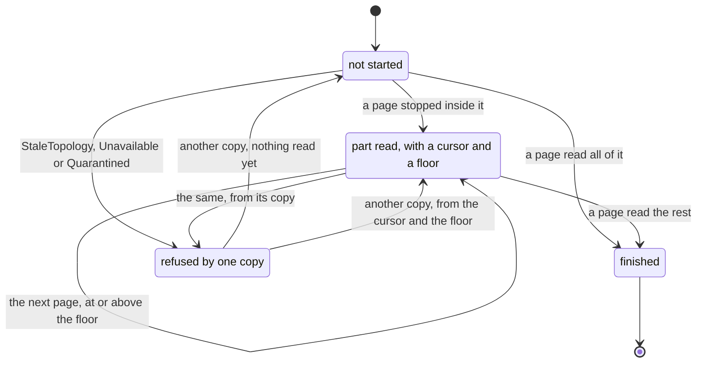
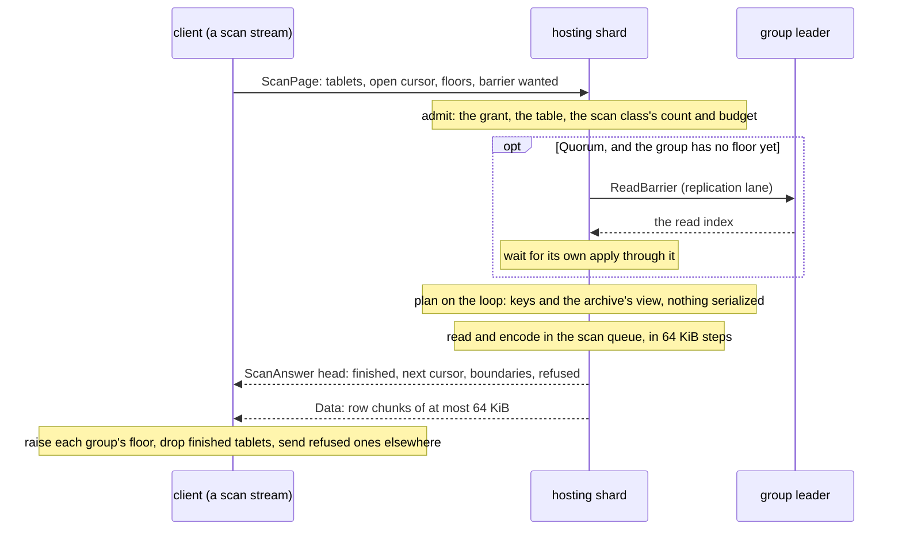

# W4. The cursor, the page and the wire

## Context

A scan is read a page at a time, and a page has to be something a client can ask for again: from
another copy, after a failure, after a restart of the client itself. This page says what one page
is, what a cursor holds so the next page starts where the last ended, and how both cross the client
wire. It leans on [W2](ordering.md) for the order a cursor is a position in and on
[W13](contract.md#the-contract) for what a page promises.

## What exists today

- **The walk's page, for drivers.** A `WalkAsk` names a table, a tablet, a range of its keys, the
  last key handed out (`after`), bounds of partitions and bytes, and `at_least`, the highest boundary
  any earlier page was read at; a `WalkPage` carries the partitions, the boundary, whether the copy
  led and the next cursor (`shoal-core/src/server/shard/walk.rs:59-200`). Bounds default to 1,000
  partitions and 1 MiB and stop at 10,000 and 64 MiB, and a page always holds one partition
  ([F87](../../features/tablet-walk.md#a-page-is-captured-on-the-loop-and-read-off-it)). A client reaches
  it only as the admin read `walk`, which answers keys and counts in JSON, never rows.
- **One query index, one response.** The client's reorder buffer is keyed by a query's index and
  overwrites on a second answer, so "anything that makes a query answer twice breaks the reorder
  buffer, not just the caller's row count" (`docs/src/api/client.md:375-386`). A page of a scan is
  the second answer of a query by construction.
- **Frames of their own, beside a bundle.** [F80](../../features/object-wire.md) put object operations
  on two message types with fixed little-endian heads, `ObjectOp` (28, a 56 byte head) and
  `ObjectAnswer` (29, 80 bytes), behind `CLIENT_CAP_OBJECTS`, bit 4 of the hello's capability byte,
  their bytes in [F73](../../features/bodies-across-frames.md)'s `Data` frames
  (`shoal-proto/src/shared/protocol.rs:381-400`, `shoal-proto/src/shared/protocol/object.rs:54-67`).
  Bits 0 to 4 are spent and 5 to 7 free, and **no reserved byte is left in a hello**: anything a hello
  cannot hold needs a new protocol version (`shoal-proto/src/shared/protocol/handshake.rs:15-30`). A
  cluster turns a new frame on with `activate N` once every member's build can read it
  ([F48](../../features/rolling-compatibility.md)); the protocol version is 16
  (`shoal-proto/src/shared/protocol.rs:183`).
- **`Cancel`** names a bundle's id on the connection that sent it and is answered once
  ([F75](../../features/client-cancel.md)).

## The design

### What one page is

**A page is one request and one answer, to one shard, over some of that shard's tablets.** The
request names the tablets of one hosting shard that are still to be read, and the cursor of the one
it stopped in last time. The shard reads them in ascending order, each from its cursor or its start,
until a bound is met, and answers with the rows and with how far it got in each. A page never crosses
shards and never forwards: a tablet the shard does not hold a copy of is refused by name, and the
client sends it elsewhere ([W6](distribution.md)).

That shape answers three things at once. An empty tablet costs nothing but a counter's read, since
the archive map counts each tablet's partitions and a table's resident index has a slot a tablet
(`shoal-core/src/server/tables/storage/fs/map.rs:879-894`, `shoal-core/src/server/tables/resident.rs:40-49`),
so a scan of an empty table is one page a hosting shard, about nine on three nodes of three slots,
not 4096. A sparse table fills a page from as many tablets as it takes, so nothing has to grow a
concurrency when pages come back thin, which is what ScyllaDB's coordinator does round by round
([W3](prior-art.md#scylladb)). And a page is one copy's, so what it promises is one copy's.

### The request: `ScanPage`

Message type 32, client to server, a fixed little-endian head and a tail. Every field below is a
proposal for [M24](milestones.md#m24-scans-on-one-node) to fix; none is on a wire yet.

| Field | Holds |
| --- | --- |
| Id | A v7 UUID a page, which `Cancel` names |
| Scan | A v7 UUID a scan, the same on every page, which a later saved reader would be keyed by ([W5](tablet-reader.md#saved-positions-optional)) |
| Target | `Table`, with the table's id and fingerprint, or `BucketListing`, with the bucket's ([W9](bucket-listing.md)) |
| Level | `One` or `Quorum` ([C6](../../distributed/reads.md)) |
| Bounds | Rows, answer bytes and work: the bytes the page may read, so a filter that matches little cannot read a whole tablet inside one page |
| Tablets | The tablets still to read on this shard, a 512 byte bitmap |
| Open cursor | The tablet the last page stopped in, the last key handed out, and a reserved suffix for a sort key, so a later change can split one huge sorted partition across pages without a new frame |
| Floors | For each group the tablets belong to, the highest boundary the scan has seen in it, and a bit asking for a barrier |
| Tail | A projection's id and a filter, in the table's own types (the shapes a get carries, [Query Execution](../../tables/query-execution.md)) |

### The answer: `ScanAnswer`

Message type 33, server to client, under the page's id.

| Field | Holds |
| --- | --- |
| Finished | The tablets this page finished, a 512 byte bitmap |
| Next cursor | The tablet left part way, if any, and its last key handed out |
| Boundaries | For each group read, the copy's applied index when its part of the page began |
| Refused | The tablets this page would not read, each with its code: `StaleTopology`, `Unavailable`, `Quarantined` |
| Why it ended | Rows, answer bytes, work, the end of its tablets, or its time on the shard |
| Figures | Partitions and rows read and handed out, bytes read, from memory and from archives |
| Body | Rows or projections in rkyv chunks of at most 64 KiB, each aligned on its own and carrying [F27](../../features/grouped-responses.md)'s row groups, so the client can hand rows on as each chunk arrives; in `Data` frames of at most 256 KiB under kTLS ([W7](isolation.md#network)) |

A request the shard refuses whole, a scan not granted, a table not committed, a bound past its most,
is answered by one `Error` frame, as an object operation is.

### Bounds, and short pages

A page ends at the first of its bounds: rows handed out (1,000 unless asked, S3's page and F87's
default), answer bytes (1 MiB), work (4 MiB of bytes read unless asked), the end of its tablets, or
a slice of the shard's time. **A short page is normal**, and so is an empty one: a filter that
matched nothing in 4 MiB of reading ends its page with no rows and a cursor that moved. **The end of a
scan is a flag, never a count**: the client stops when every tablet is finished, never when a page
is short. ScyllaDB's drivers learned that one the hard way, a driver that stopped at an empty page of
a filtered scan was a bug ([W3](prior-art.md#scylladb)).

A page always makes progress: it holds at least one partition, as the walk's does, or it moved its
cursor past what it read. A sorted partition larger than the page is still one page at first, read
whole, which is the walk's limit too; the cursor's reserved suffix is where splitting one would land.

### The cursor and the resume token

**A tablet's cursor is the last key handed out**, and its next page starts past it: F87's cursor,
F1's too. **A group's floor is the highest boundary any page of the scan was read at in that group**:
a page asked of any copy of the group says `at_least` that index, and a copy behind it refuses by
name rather than hand out an older state ([F87](../../features/tablet-walk.md#a-walk-keeps-a-cursor-and-a-floor)).
Floors are kept a group, not a tablet: a group's tablets share one log, and a group's identity
survives a move of its replica set ([C8](../../distributed/rebalancing.md)).

What a client keeps of a scan, and can write down and hand back later, is its **resume token**:

| Part | Size |
| --- | --- |
| A version, the table's or bucket's fingerprint, the level, a digest of the filter and projection | Tens of bytes |
| The tablets not finished | A 512 byte bitmap |
| Each group's floor | Eight bytes and a group's id a group the scan has read |
| Each stream's open cursor | A tablet and a key, a stream |

Under a kibibyte for any scan. A token handed to a table of another fingerprint, another schema's or
another table's, is refused by name; a token from before a move, a failover or a restart resumes,
because nothing in it names a place.

### A page on the wire

### Pull, one page in flight

A stream has one page in flight: its next page depends on where the last one ended. A client runs
several streams at once, one or two a hosting shard ([W6](distribution.md#streams)). A request is
idempotent: asked again of the same copy or another, it is answered by a page at or after its floor,
which is all [P21](contract.md#the-contract) promises, so a client that lost an answer asks again with
the same cursor and floors.

### Capability and activation

A client asks for `CLIENT_CAP_SCANS`, bit 5 of the hello's capability byte, and a server grants it
only beside `CLIENT_CAP_STREAMS`, since an answer longer than a frame streams. A cluster answers a
scan only once a wire version of its own is activated, the next free one, so no member that cannot
read the frames is asked to; a standalone node answers once it grants the bit. The `scan` privilege
lands behind the same activation ([W10](api.md#grants)).

### `Cancel`

`Cancel` names a page's id, as it names a bundle's, and a client that drops a scan cancels the page
it has in flight. A page checks the node's cancel board between its steps, so a cancelled page stops
at its next step, not at its end, which goes further than F75 does for a query already running.

## Alternatives rejected

**A `QueryKinds` query.** A scan answers more than once, which the client's reorder buffer cannot
take; it routes by tablet, not by key; and it needs admission and refusals a get does not have. F80
made the same choice for objects.

**One request, every page streamed, with credits.** A stream with a window would save a round trip a
page. It would also make a scan a session on one copy: a failover would lose every page in flight, a
retry would have to say which pages it had, and a server would hold state between pages, which this
plan does not. One page in flight a stream, several streams, recovers the overlap where it matters.
Sending the next cursor ahead of a page's rows, so the next request can leave before the rows are
read, is a later gain that needs no new frame ([optional, any time](milestones.md#optional-any-time)).

**A page for each tablet.** 4096 requests for every table, most for empty tablets. A request carries
every tablet of its shard instead.

**A cursor held by the server**, a scan session a client reconnects to. It would pin memory and a
copy for as long as a client paces itself, and a new leader or a restarted node would have to start
over. ScyllaDB keeps saved readers as a cache with a ten second life, never as the scan's state
([W3](prior-art.md#scylladb)); so would Shoal, if [X17](spikes.md#x17-a-page-rebuilt) shows one is
worth it.

**The walk's admin read for clients.** JSON, keys and counts, one tablet, an admin's grant: built
for an operator's check, and F87 says so.

## What it costs

A request and an answer a page a stream, with a head of a few hundred bytes at most; a resume token
under a kibibyte a scan; one barrier a group at `Quorum`. Nothing a server keeps between pages.

## What it breaks

Nothing that exists: two new message types, a capability bit nothing uses, and a wire version a
cluster activates when it is ready. A client that never asks for the bit sees nothing new.

## Invariants to uphold

- **A page is one shard's**: it never crosses shards and is never forwarded.
- **A cursor names positions**: tablets, keys and group floors, never a node or an executor.
- **The end of a scan is a flag.** No client stops on a short or empty page.
- **A floor never lowers**, and every page of a group is read at or above it.
- **A request is idempotent**: the same request again gets a page at or after its floor.

## Prerequisites

None of [W1](prerequisites.md)'s on the wire itself; the admission class and the budget are what the
shard checks first.

## How it would be measured

What a page costs on a shard, planned, read and encoded, is [X17](spikes.md#x17-a-page-rebuilt)'s;
what an empty table and a page of empty tablets cost is [X19](spikes.md#x19-the-edges)'s; the bytes
a page puts on the wire against the rows it hands out are counted in every run ([W12](performance.md)).

## Acceptance tests

| Test | Gate | Proves |
| --- | --- | --- |
| `a_page_reads_its_shards_tablets_in_order_until_a_bound` | M24 | A page covers several tablets, ends at its first bound and says which |
| `a_short_or_empty_page_never_ends_a_scan` | M24 | A filtered scan whose pages hold nothing still finishes every tablet |
| `an_empty_table_is_scanned_in_one_page_a_shard` | M24 | 4096 empty tablets cost one page a hosting shard |
| `a_resume_token_resumes_and_is_refused_for_another_table` | M24 | A token resumes where it stopped, and another fingerprint's is refused by name |
| `a_scan_is_refused_without_the_capability` | M24 | A client that did not ask for bit 5, or a server without streams, never sends or answers a page |
| `a_cancelled_page_stops_at_its_next_step` | M24 | `Cancel` of a page in flight is answered once and the page reads no further |
| `a_cluster_answers_no_scan_before_its_activation` | M25 | Below the activated version every page is refused by name |

## Related

[W5](tablet-reader.md) for what a shard does with a page; [W6](distribution.md) for who asks for pages;
[F87](../../features/tablet-walk.md) for the page this generalizes; [F80](../../features/object-wire.md)
for the frames this copies; [F73](../../features/bodies-across-frames.md) and
[F75](../../features/client-cancel.md) for the streams and the cancel it rides.
