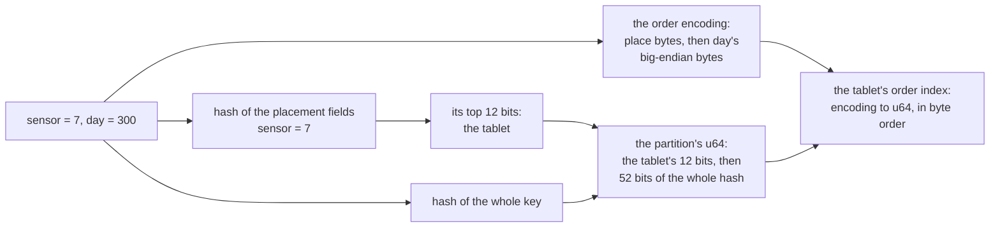
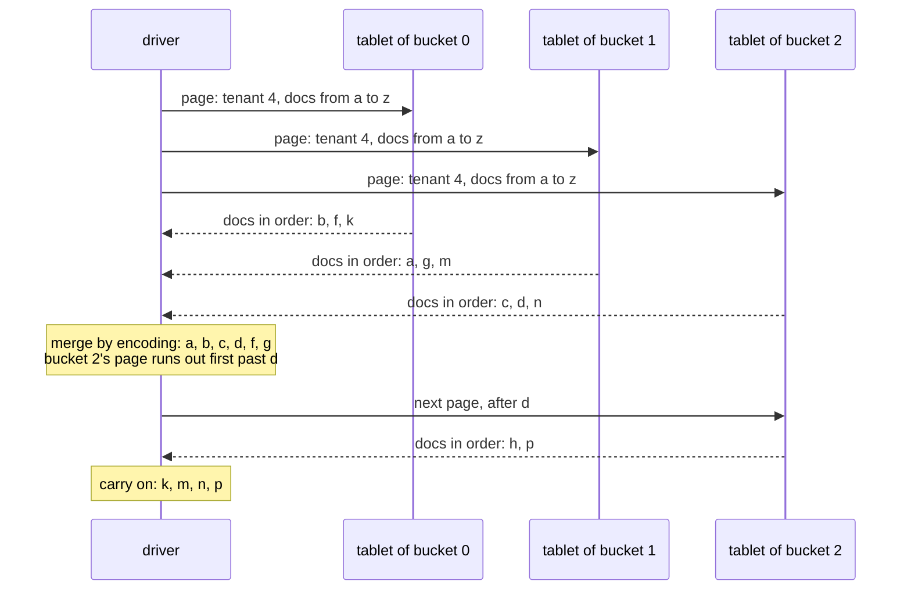

# W8. Ordered scans: placement fields, order fields and spread

## Context

[W2](ordering.md) found that a full scan needs no order from the user, and that three questions need
one: a range of keys, key order, and every partition under a prefix of a key of several fields. The
user asked whether a schema could say how a scan should step over its partitions, and on 2026-10-25
chose that as the mechanism to schedule: **an order declared in the schema** ([R22](overview.md#what-is-being-asked-for)).
This page is that declaration, the index that keeps the order, what it costs, and the mechanism it
was chosen over.

## What exists today

- **A partition's identity is a hash of its whole key**, the `u64` every map, index and archive
  record is keyed by (`shoal-derive/src/traits/partition_key.rs:75-99`), and two keys with one hash
  silently share a partition (`architecture/partitioning.md:43-46`).
- **A sorted partition orders its rows by a sort key** that must be `Ord`, its archived form too, and
  only `String` can be one today ([todos](../../appendix/todos.md)). A range of a partition's rows is
  read with a cursor, but **a cold partition is read whole** whatever the range
  ([F1](../../features/sort-key-ranges.md)).
- **A conditional write to a sorted partition never joins a fragment**: a fragment is written without
  reading its base, which a condition cannot be judged without, so the base is read and written whole
  ([F68](../../features/conditional-writes.md), [F61](../../features/fragmented-partitions.md)).
- **Eviction is a partition at a time**, the unit of residency and of the eviction order
  ([Memory and Eviction](../../tables/memory-and-eviction.md)).
- **The archive map's index is an LSM of runs keyed by the `u64`**, with a delta in memory, a page
  directory and a filter a run, and a page cache; at 23.7 million partitions a node its maps took 62 to
  63 MiB ([F76](../../features/paged-archive-map.md)).
- **A field's roles are part of the schema's fingerprint.** The fingerprint folds each field's role
  bits (`shoal-derive/src/traits/fingerprint.rs:63-75`), so a new role changes the lineage from that
  field on, and since [F93](../../features/operations-and-the-real-cluster.md) only a change that
  appends tables or buckets is rolling.

## The design

### The declaration

A table names its **placement fields** and its **order fields** among its partition fields:

```rust
/// One sensor's reading for one day, kept in day order under its sensor
#[derive(ShoalUnsortedTable, serde::Deserialize)]
#[shoal_table(db = "Telemetry")]
pub struct Reading {
    /// The sensor, whose hash places the partition, so every day of one sensor is in one tablet
    #[shoal(partition, place)]
    pub sensor: u64,
    /// The day, which orders a sensor's partitions in its tablet
    #[shoal(partition, order)]
    pub day: u32,
    /// What the sensor read that day
    pub value: f64,
}
```

The rules:

- **Placement fields lead.** They are the first partition fields in declaration order, at least one.
- **Every other partition field orders**, in declaration order, each ascending unless it says
  `order = desc`, at least one.
- **`spread = N`** on the table, a power of two, scatters one placement value's partitions over N
  tablets ([below](#spread)). Without it, N is one.
- **An order field's type implements `OrderedKey`.** The derive implements it for the integers,
  `bool`, `String`, `Uuid`, `u128` and fixed byte arrays; a schema implements it for a type of its own.

A table without a `place` field is placed by its whole key, exactly as today, and has no index.

### How a user tells Shoal how to step

The order is the bytes `OrderedKey` writes:

```rust
/// A type whose values a declared order can sort partitions by
pub trait OrderedKey {
    /// Append this value's ordered encoding: bytes that compare, byte by byte, as the values do
    ///
    /// # Arguments
    ///
    /// * `out` - The buffer to append the encoding to
    fn encode_ordered(&self, out: &mut Vec<u8>);
}
```

The derive's encodings are the ones ordered stores use ([W3](prior-art.md#other-stores)): an unsigned
integer big-endian; a signed one big-endian with its sign bit flipped; a string's bytes with each zero
byte escaped and a terminator after them, so a string sorts before every longer string it begins;
`desc` every byte inverted; the fields concatenated in order. **This is the answer to "the user could
specify how the scan should step over partitions"**: a schema that wants its partitions in some other
order, a time by its bucket then its offset, a name case-folded, a composite of its own, writes the
bytes that sort that way, and Shoal steps through them in byte order without knowing what they mean.
Every encoding is held by a property test that the bytes compare as the values do.

### Where a partition lives

- **Its tablet is the placement fields' hash.** The placement fields are hashed as a partition key is
  today, and the top twelve bits of that hash choose the tablet. Every partition of one placement
  value is in one tablet, on one group.
- **Its identity is still its whole key.** The partition's `u64` is the placement tablet's twelve bits
  above the low fifty-two bits of the whole key's hash. The client computes it with the same derived
  code as the server, so a get, an insert or a delete routes as it does today, by one key.



### The order index

**Each tablet of a table with a declared order keeps an index from a partition's encoding to its
`u64`**, optionally covering fields a schema names (`#[shoal(order, cover)]` on a field) so an ordered
page that asks for those fields only is answered from the index alone.

- **Maintained at apply, in the same group.** A command that makes a partition adds its entry, and
  one that removes the partition's last row removes it, in the same apply as the row, on every copy.
  The index is never behind its rows on any copy, because it is changed by the same entry of the same
  log ([C5](../../distributed/replication.md)).
- **Kept as the archive map is.** A delta in memory, runs on disk keyed by bytes rather than by a
  `u64`, flushed in the same compaction step that commits the archive map, so at every checkpoint the
  index and the archives agree. It reuses the paged index's runs and page cache
  ([F76](../../features/paged-archive-map.md)) with a key of bytes.
- **Carried wherever a tablet's data goes.** A snapshot's install, a backup's restore, a move and a
  rehome carry the index's runs or build them again from the rows they install; a scrub's light pass
  checks that every live partition of a tablet has one entry and every entry one partition.
- **Collisions are found.** Within a tablet the partition's identity has fifty-two bits of the whole
  key's hash, so two keys collide in one tablet near 2<sup>26</sup> partitions of it. Today a collision
  is silent. Here the index holds both encodings, so the second key's first insert finds the first
  key's `u64` under another encoding and is refused by name, `KeyCollision`, rather than overwrite a
  partition.

### An ordered scan

A scan of a declared order names a placement value, a lower and an upper bound on the order fields,
and a direction. The driver computes the placement value's tablet, or its N tablets, and asks one
stream for each ([W6](distribution.md#ordered-scans-and-spread)). The shard seeks the tablet's index to
the placement value's encoding followed by the lower bound, walks it in byte order while it is below
the upper bound, and hands each partition out in that order, resident or archived, through the same
reader as any scan ([W5](tablet-reader.md)). A covering index answers a projection of covered fields
without reading a partition. The cursor is the last encoding handed out, carried in the open cursor's
reserved suffix ([W4](cursor-and-pages.md#the-request-scanpage)); the floor is the group's, as for any
scan.

### Spread

One placement value is one group's writes and one tablet's bytes. Where that is too much, `spread = N`
scatters the value's partitions over N tablets: the tablet is chosen from the hash of the placement
fields and a bucket, the bucket being the order encoding's hash modulo N. An ordered scan of the value
asks all N and merges them:



A merge holds at most one page a stream, and its pages are asked as it consumes them. Spread is
salting under another name, with the same price everywhere it is paid: Bigtable's salted keys need N
parallel scans, and CockroachDB's hash-sharded index scans every bucket and combines them
([W3](prior-art.md#other-stores)). It is fixed at a table's creation, because changing it moves every
partition.

### What stays as it is

Every row of a table with a declared order is still its own partition, so a get, an insert, an update
and a delete by key, a conditional write ([F68](../../features/conditional-writes.md)), eviction and
fragments ([F61](../../features/fragmented-partitions.md)) are what they are today. A full scan of
such a table is still a scan in hash order, tablet by tablet, its index unread.

### The lineage

`place` and `order` are roles, so they enter the table's fingerprint and the schema's lineage from
that field on. **A table cannot gain or lose a declared order in place**: its partitions would change
tablets. A schema that wants one appends a new table, rolling as any append is since F93, and fills it
from a scan of the old.

## Alternatives rejected

**A remap onto sorted partitions.** The derive could store the table as sorted partitions keyed by
the placement fields (and a spread bucket), with the order fields leading each row's sort key, so an
ordered scan under a placement value would be one partition's sort-key range ([F1](../../features/sort-key-ranges.md)).
It needs no new persisted structure, which is its strength. It inherits a sorted partition's limits
at the size of a whole placement value: a cold partition is read whole, so a page of one day reads a
sensor's every day; a conditional write reads and rewrites its base whole, since it never joins a
fragment; eviction takes a placement value at a time, all or nothing; a sort key can only be a
`String`; and spread does not help a range read, since each spread partition is still read whole.
The order index keeps every row its own partition and pays for it with a structure of its own.

**Range placement.** Rejected on [W2](ordering.md#alternatives-rejected): ordered by nature, and a
redesign of placement, routing and moves, with sequential keys piling onto one tablet.

**Identity from the placement fields alone**, so a placement value's partitions would sit at one place
in the tablet's existing index. Every partition of one value would have one `u64`: one partition.

**An index table kept apart, in other groups**, written after each row as a listing index would be
([W9](bucket-listing.md#the-ordered-listing-a-later-gate)). An index in another group cannot commit with
its row ([P6](../../distributed/protocol.md#the-contract)), so it needs entries pending, then complete,
and a reader that checks the row for every pending one. The order index is in the row's own group and
needs none of that.

**An order inferred from the key's `Ord`.** On [W2](ordering.md#alternatives-rejected): a key type
need not have one, and an order nobody declared would put an index on every table.

## What it costs

- **A write that makes or removes a partition** adds or removes one index entry in the same apply;
  a write to an existing partition costs nothing more.
- **Memory and disk**: the index's delta in memory until a flush, and its runs on disk, an encoding and
  eight bytes a partition, plus any covered fields.
- **Compaction**: the index's runs are merged with the archive map's.
- **An ordered page reads in index order**, which is not the order archives lie in: a page that is not
  covering reads its partitions at random, unless they are resident.
- **A placement value is one group's writes**, one leader's commits; spread divides it and multiplies
  an ordered page's tablets by the same N.
- **Fewer hash bits for identity inside a tablet**, collisions found and refused rather than silent.
- **Every path that moves a tablet's data carries the index**: install, restore, move, rehome, scrub.

## What it breaks

A table's placement, for a table that declares an order: it is a new table. Tables without a
declaration are untouched, their hash, their tablets, their maps and their frozen keys alike.

## Invariants to uphold

- **The index and its rows change in one apply**, on every copy, and agree at every checkpoint.
- **A tablet's index holds an entry for exactly its live partitions**, one each.
- **A partition of a declared order lives in its placement value's tablet**, or its bucket's under a
  spread.
- **An encoding compares as its values do**, for every type the derive encodes, by property test.
- **A client and a server compute the same `u64` for a key**, from the same derived code.

## Prerequisites

Scans across a cluster, [M25](milestones.md#m25-scans-across-a-cluster), and [X21](spikes.md#x21-declared-order-priced),
which prices the index before it is built ([Q40](contract.md#questions-to-answer)).

## How it would be measured

[X21](spikes.md#x21-declared-order-priced): what an index entry costs a write at apply and at compaction,
an ordered page covering and not, and how evenly placement values drawn with skew fall over 4096
tablets with and without spread. [W12](performance.md)'s ordered arms then measure ordered scans and
gets of a declared-order table beside the same table placed by its whole key.

## Acceptance tests

| Test | Gate | Proves |
| --- | --- | --- |
| `an_ordered_scan_hands_out_a_placement_values_partitions_in_order` | M27 | One value's partitions come out in their encoding's order between bounds, resident and archived |
| `every_encoding_compares_as_its_values_do` | M27 | The property, for every type the derive encodes, ascending and descending |
| `the_index_and_its_rows_change_in_one_apply` | M27 | A crash between an apply and a flush leaves no entry without its partition and none missing |
| `a_spread_scan_merges_its_buckets_in_order` | M27 | N tablets' streams merged hand out one order, each partition once |
| `a_colliding_key_is_refused_by_name` | M27 | Two keys with one identity in one tablet: the second is refused `KeyCollision` |
| `the_index_survives_an_install_a_move_and_a_restore` | M27 | Each path that moves a tablet's data leaves an index that agrees with its rows |
| `a_covering_page_reads_no_partition` | M27 | A projection of covered fields is answered from the index alone |

## Related

[W2](ordering.md) for why an order has to be declared; [W6](distribution.md#ordered-scans-and-spread) for
the merge; [W9](bucket-listing.md) for the listing that could stand on it; [F76](../../features/paged-archive-map.md)
for the index it is modelled on; [W3](prior-art.md) for Bigtable's salting, CockroachDB's buckets and
Cosmos DB's hierarchical keys.
