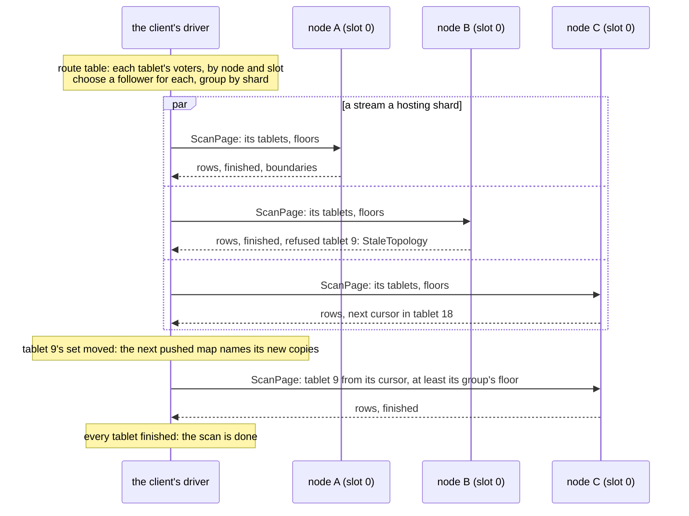
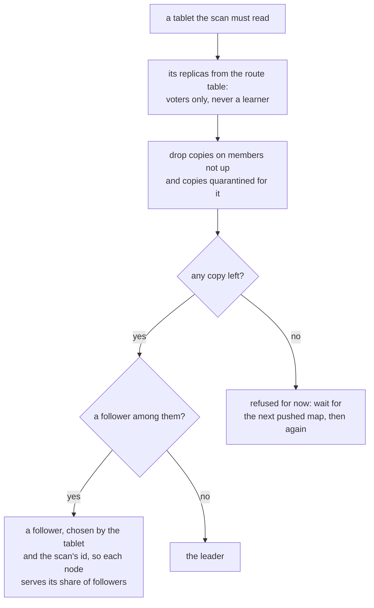

# W6. A scan across the cluster

## Context

A table's 4096 tablets are spread over every node of a cluster, each held by a replica set, each
replica on one shard of its node. A scan reads every one of them once, from one copy, in parallel,
and carries on when a copy fails, a replica set moves, a node restarts or the client itself does.
This page is who drives that, how copies are chosen, how far a page may trust a copy, and what a
refusal makes the driver do.

## What exists today

- **Placement is a rule a client can compute.** Tablet `t`'s copy `k` is on the node at
  `(t + k) % N` of the placement, on shard `(t / N) % shards` of it, the primary first
  (`rule_replicas`, `shoal-proto/src/shared/placement.rs:112-129`), and a move overrides the rule for
  its set's tablets. A group is one table on one ordered replica set, so its tablets are strided: on
  three nodes of three slots one group holds tablets 0, 9, 18 and on ([C4](../../distributed/tablet-map.md)).
  Consecutive tablets sit on different nodes.
- **A client holds the map.** Since [F74](../../features/client-routing.md) a client builds a route
  table from every pushed topology frame: each tablet's replicas as node and slot, primary first
  (`RouteTable::replicas`, `shoal-proto/src/shared/routes.rs:292`), the holders that are up and not
  quarantined (`:301`), and each table's leader for a tablet (`:341`). It sends a write and a strong
  read to the leader and a read at `One` to a holder; it never splits a query, and a get naming keys
  on several nodes goes whole to one node that gathers the rest.
- **Reads are served at two levels** ([C6](../../distributed/reads.md#two-read-levels)). `One` is a
  copy's committed, applied state, possibly stale, never an entry appended and not committed.
  `Quorum` is the same copy after a `ReadIndex` barrier from its group's leader and its own apply
  through it, so every write acknowledged before the read began is visible; a follower serves it.
- **The walk refuses a copy that is not whole by name**, `StaleTopology`, `Unavailable` or
  `Quarantined`, and admits a learner's copy (`shoal-core/src/server/shard/walk.rs:715-729`).
- **Peers do not stream.** A forward's answer between nodes is one peer frame
  ([F73](../../features/bodies-across-frames.md)).

## The design

### The client drives

**The scan is driven by the client, from its route table, and no server holds anything of it
between pages.** This is how ScyllaDB's own advice runs a full scan since tablets: read the table's
tablets, send each range to a replica shard that holds it with a routing key, and keep every replica
shard busy with at least two requests at once ([W3](prior-art.md#scylladb)). Shoal's client already
knows each tablet's copies by node and slot, which is everything a driver needs.

The driver:

1. takes the scan's tablets (all 4096, a caller's tablet range, or a placement value's under a
   declared order) and for each chooses a copy ([below](#choosing-copies));
2. groups the tablets by the hosting shard of their chosen copy, a node and a slot, and opens up to
   two **streams** a shard over disjoint halves of its tablets;
3. runs every stream as a loop: send a page with its remaining tablets, its open cursor and the
   floors of their groups; take the answer; hand its rows on; drop the finished tablets, keep the
   new cursor, raise each group's floor to the boundary it read at; send any refused tablet
   elsewhere;
4. ends when every tablet is finished, never on a short page ([W4](cursor-and-pages.md#bounds-and-short-pages)).

### Choosing copies

- **Voters only.** A learner's copy is a copy being brought current. The walk reads one for a move's
  copier, which knows it; a client's scan does not.
- **Followers first.** A group's leader carries its writes and its strong reads; a follower carries
  neither, so a scan on a follower leaves the leader's queue alone. The shard a follower is on still
  leads other groups, which is why the scan class exists on every shard ([W7](isolation.md)).
- **Spread by the tablet and the scan's id.** Rotating the follower by tablet spreads one scan's
  pages over every node holding copies; mixing the scan's id in spreads concurrent scans over
  different copies.
- **What followers first costs, measured.** X16's bench driver asked followers first, and europa,
  which leads most groups at `lead_weight: 2`, answered about a quarter of the pages with its Optane
  idle 84% of the time: a scan about 1.18 times slower than one its members shared alike
  ([W42](scan-speed.md#the-gap-factor-by-factor)). A driver that weighs a leader's spare device
  against its queue is M25's choice to make with that figure beside it.
- **Quarantined copies are skipped** by the route table's own bits, as a read at `One` skips them.

### Streams

A stream is a sequence of pages to one hosting shard, one in flight at a time, since each page
starts where the last one ended. On three nodes of three slots a scan runs nine streams, or eighteen
at two a shard, which keeps every shard's scan class at work and is ScyllaDB's two requests a replica
shard. Two is a default, not a promise: a shard admits pages by its own count and refuses the rest
`Shedding` ([W7](isolation.md#admission)), and a stream that is shed backs off. Streams ride a
client's connections set apart for long streams, one pool to each node, never the shared pool a get
waits on ([F73](../../features/bodies-across-frames.md)).

A connection lands on whichever shard accepted it, so a page's bytes cross from the shard that read
them to the one holding the connection, as a get's answer does today. Handing a scan's connection to
the executor of the slot it reads, F84's mechanism, would save that hop; [X11](../../object-storage/streamed-bodies.md)
priced a hop at 1.3 to 1.7 times the cpu a gibibyte. A client's hello has no reserved byte left, so
a connection would say which slot it is for at its first frame. It is a later gain, measured first
([beside the gates](milestones.md#beside-the-gates)).

### Floors and barriers

**A floor is kept for each group, not each tablet.** Every tablet of a group shares one log, so one
index says how far any copy of the group has applied, and a group keeps its identity through a move
of its replica set ([C8](../../distributed/rebalancing.md)). A page names the floors of its tablets'
groups, the shard refuses a copy behind one by name (`at_least`), and the driver raises each floor
to the boundary the page reports. A tablet re-read on another copy therefore never sees a state older
than one the scan already handed out.

**At `Quorum`, one barrier a group, on its first page.** The first page of a group asks the shard for
a barrier; the shard takes it from the group's leader, waits for its own apply through it, and reads
at or above it; the boundary it reports becomes the group's floor, and every later page of the group
reads at or above that floor without another barrier. So every write acknowledged in a group before
the scan reached it is visible to every page of it: a barrier on every page would add rounds and no
promise ([W13](contract.md#the-contract)). A caller's session tokens are honoured as a read honours
them: a page of a token's group waits for its index.

### When a page is refused

| A page or a tablet answered | The driver |
| --- | --- |
| `StaleTopology`: this node holds no copy of the tablet | Waits for the next pushed map, chooses again, and asks the tablet's new copy from its cursor and its group's floor |
| `Unavailable`: the copy is starting, down, installing, or behind the floor | Asks another copy of the tablet from its cursor and floor; if none is left, waits and asks again |
| `Quarantined` | Asks another copy |
| `Shedding`: the shard's scan class is full, or its budget could not be drawn in time | ~~Backs off with jitter and asks the same shard again~~ Puts the tablet back with its cursor and floors and asks another the stream holds, backing off with jitter only once it is shed again with nothing answered between: the bench's driver does so since [O139](../../appendix/optimizations.md#o139-a-scan-driver-asks-a-shed-tablet-again-where-another-tablet-would-be-answered) (2026-10-30), where asking the same shard again took some thirty sheds a page in X16 |
| The connection failed, or the answer was cut part way | Drops the part received, asks again with the same cursor and floors, on a new connection or another copy |
| `Unauthorized`, an uncommitted table, a token of another fingerprint | Ends the scan with the refusal |

### Failover, moves and restarts

- **A copy dies under a page.** The answer never comes or comes cut; the page is asked again of
  another copy with the same cursor and floor. Nothing the dead copy handed out is handed out again,
  since the cursor moved only with what arrived whole.
- **A replica set moves.** The old copy is retired, refused `StaleTopology` by the walk's own rule,
  and the moved set's group keeps its identity, so its floor still holds on the new copies.
- **A node restarts from its checkpoint, behind a floor.** Refused `Unavailable` with where it is; the
  driver reads another copy, or that one once it has caught up.
- **The client restarts.** Its resume token is everything it needs: the tablets not finished, each
  group's floor and each stream's cursor ([W4](cursor-and-pages.md#the-cursor-and-the-resume-token)).

### Ordered scans and spread

Under a declared order ([W8](declared-order.md)) a scan of one placement value is one tablet's,
answered in order by one stream. With `spread = N` it is N tablets', and the driver merges the N
ordered streams by their order fields' encoding, asking each stream for its next page only as the
merge consumes it, a cursor a stream. A merge holds at most one page a stream.

### No coordinator

No node drives a scan for a client in the first gates. A coordinator would forward pages between
nodes, which peers cannot stream; it would hold a scan's state in a node's memory; and it would put a
hop between every page and its client. The client library is the driver, and everything that scans
links it: an application, the loaders, `shoalctl`. The strongest counter is a client that is not
Rust, or a gateway that should not know the topology; that is [Q42](contract.md#questions-to-answer),
left open.

## Alternatives rejected

**A node coordinating each scan**, as ScyllaDB's coordinator splits a range scan into vnode ranges
and doubles its concurrency round by round. Above, and ScyllaDB's own tablet-era advice is to drive
from the client.

**Ranges of hashes as a scan's parts**, ScyllaDB's token sub-ranges. Shoal's tablets are already the
ranges, each with known copies; a hash range that cut a tablet would need two copies' floors for one
tablet.

**A stream a tablet.** 4096 streams for one table, most with nothing to read.

**Reading every copy and keeping one.** Three times the work for a promise one copy and a floor
already make.

**Reading learners.** A learner may be installing or catching up; the floor would refuse it most of
the time, and voters always exist.

## What it costs

Two streams a hosting shard, each a connection's worth of pages; a resume token in the client; one
barrier a group at `Quorum`; a refused tablet's page asked twice. The client's cpu decodes every
chunk, several times as much a row for a scan that asked for partitions
([W4](cursor-and-pages.md#the-body-rows-or-partitions-on-request)), and with a spread, merges. It holds
one page's answer a stream until the answer validates.

## What it breaks

Nothing. A client that never scans holds the same route table it holds today.

## Invariants to uphold

- **A page goes only to a copy the client's map names, and only to a voter.**
- **A group's floor never lowers**, and a page of a group is read at or above it, on any copy.
- **A refused tablet is asked again from its cursor and its group's floor**, never from its start.
- **One barrier a group at `Quorum`**, before the group's first page is read.
- **No server holds a scan between pages.**

## Prerequisites

[W1](prerequisites.md)'s rows on every shard a scan reaches; [F74](../../features/client-routing.md)'s
route table, which exists.

## How it would be measured

A scan's rate a node and the foreground beside it, with the scan spread over followers and with it
forced onto leaders, by [W12](performance.md)'s arms; a scan through a kill, a move and a restart of a
node by the fixture, which checks every partition is handed out once.

## Acceptance tests

| Test | Gate | Proves |
| --- | --- | --- |
| `a_scan_reads_every_tablet_once_from_followers_spread_over_nodes` | M25 | Each tablet read by one voter copy, a follower where one is up, every node serving its share |
| `a_scan_survives_a_copy_killed_under_a_page` | M25 | The page is asked again elsewhere and nothing is handed out twice or missed |
| `a_scan_survives_a_move_of_its_tablets` | M25 | `StaleTopology`, then the new copy from the cursor and floor |
| `a_scan_never_reads_below_its_groups_floor` | M25 | A copy restarted behind the floor is refused, and the scan carries on |
| `a_quorum_scan_takes_one_barrier_a_group` | M25 | One barrier before a group's first page, none after |
| `a_scan_never_reads_a_learner` | M25 | A learner's copy is never asked |
| `a_scan_resumes_from_its_token_after_the_client_restarts` | M25 | A fresh client with the token finishes the scan, nothing twice and nothing missed |

## Related

[W4](cursor-and-pages.md) for the page a stream sends; [W7](isolation.md) for what a shard admits;
[F74](../../features/client-routing.md) for the route table; [C6](../../distributed/reads.md) for the
levels; [C8](../../distributed/rebalancing.md) for moves.
