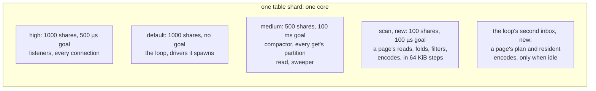
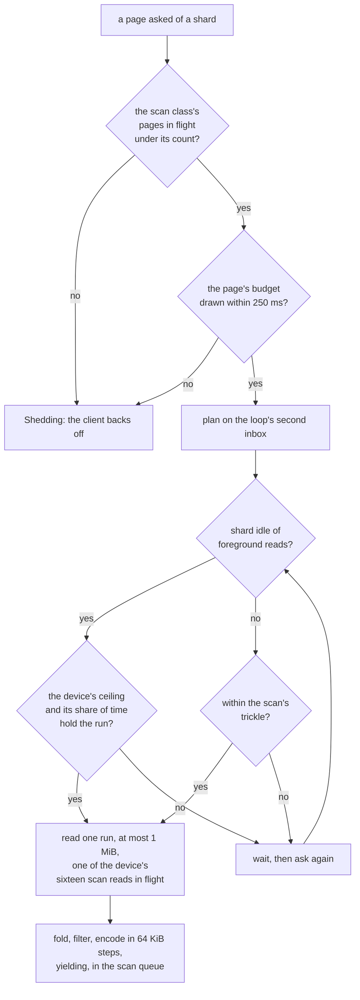

# W7. Not slowing other queries

## Context

R20 is the requirement every page answers to: a scan never slows the other queries past a budget
stated before it is built, and what a scan costs is paid by the scan. The object store met the same
requirement for its own background work, and two of its spikes are the evidence this page stands on:
[X9](../../object-storage/table-latency.md) priced work beside a table on the table's shards and on a
core of its own, and [X12](../../object-storage/recovery-scrub-rates.md) priced a background beside a
device's foreground. A scan differs from object work in one way that decides most of this page: **the
rows it reads belong to the table shards**, so it cannot simply move to cores of its own.

## What exists today

- **Two queues of a shard's own, and the loop's.** High, 1,000 shares and a 500 µs goal, for
  listeners and connections; medium, 500 shares and 100 ms, for the compactor, the loader and the
  sweeper; the loop in glommio's default queue, 1,000 shares and no goal
  (`shoal-core/src/server/shard.rs:3286-3303`). Every get's partition read and every ~~walk page's~~
  driver's walk page's reads run in the medium queue ([W1](prerequisites.md#a-scan-class-on-every-table-shard)).
  Since [F117](../../features/scan-class.md) a third, the scan queue, 100 shares at a 100 µs goal, where a
  scan's page reads in 64 KiB steps, and a second inbox on the loop, which a scan page's capture runs from.
- **Nothing in table code yields inside a computation** but a scan page's reads since F117, and a yield is real only on a queue with a
  goal: glommio gives up the core on a latency event, and its preempt timer is 100 ms while no active
  queue has a goal ([S13](../../object-storage/isolation.md#shared-executors-or-dedicated-ones)).
- **Nothing paces table I/O** but a scan's page's reads since [F119](../../features/scan-pacing.md). Compaction is unthrottled; a backup's copy runs in the default queue
  ([F49](../../features/backup-and-recovery.md#performance)); a ~~walk's~~ driver's walk's reads go as fast as their pages
  are asked for ([F87](../../features/tablet-walk.md#limitations)), since [F129](../../features/drivers-on-the-rebuilt-walk.md) in runs several in
  flight.
- **Transient buffers are charged to nothing** but a scan's page's since [F118](../../features/scan-budget.md),
  and a node past `node_memory` has every shard evict forty percent of its rows
  (`shoal-core/src/server/shard.rs`, `over_memory`, ~~`:6830-6872`~~ about `:6900-6994`).
- ~~**A shard reads two walk pages at once** and sheds the rest, its drivers' and an operator's alike
  (`shoal-core/src/server/shard/walk.rs:52`).~~ Since [F116](../../features/scan-admission.md) a shard reads two
  of its drivers' and operators' pages and `scans.pages_in_flight` of a scan's, each class shedding its own.
- **A long answer is written a data frame at a time**, four streams interleaved a connection, whole
  frames first; under kTLS one 1 MiB frame holds a Zen1 core about a millisecond
  ([F73](../../features/bodies-across-frames.md)). A client keeps connections set apart for long
  streams, since X11 found a small request's p99 several times worse on a connection carrying one.
- **The object store's isolation is built and measured.** Three queues an object executor, each at a
  100 µs goal, foreground 1,000 shares, applies 500, background 100, every loop yielding every 64 KiB
  (`shoal-core/src/server/objects/executor.rs:56`, `:643-653`); a background request that waits until
  its slice has no foreground in flight and then draws on its device's ceiling (`:451-468`); and a
  budget carved out of `node_memory`, a draw waiting 250 ms before it is shed by name
  (`shoal-core/src/server/objects/budget.rs:33`, `:119`).

## The design

### The budget

Stated before the work, and judged on the lab before any client may scan. **Beside one full scan a
node at its default ceiling, the workload grid's reference cell, `grid/unsorted/r50/1024`, keeps its
read p99 and its write p99 within `max(1.10 × alone, alone + 0.1 ms)`** at the median over rounds,
with the intervals overlapping, on titan, hyperion and europa. And:

- no eviction pass caused by memory (`Resident`) during the scan, read from F104's counters
  ([F104](../../features/memory-in-a-capture.md));
- no step of a scan on a shard's loop longer than 100 µs;
- no change in how long a small answer waits in a connection's outbox;
- the scan's own rate, MiB/s and partitions a second a node, reported beside it, so the price of the
  ceiling is a number too.

It is stricter than the bound the object store's recovery is held to,
`max(2 × its own, its own + 1 ms)` ([S13](../../object-storage/isolation.md#io-on-a-slice)), on
purpose: a rebuild restores a pool's durability and has to finish; a scan is work a client chose to
ask for. The numbers are a hypothesis until [X16](spikes.md#x16-the-walk-beside-the-foreground) and
[X18](spikes.md#x18-table-reads-paced-by-idle-time) set them, and [Q34](contract.md#questions-to-answer)
records what they set.

### CPU

**A scan's work runs in a queue of its own on every table shard**: `Shares::Static(100)`,
`Latency::Matters` of 100 µs, the object background queue's shape, and every loop in it yields every
64 KiB of work. It is never the medium queue, which carries every get's partition read. The few steps
that must touch the loop, a page's plan and its resident partitions' encoding, run from a second
inbox the loop drains only when its main one is empty, each at most 64 KiB ([W5](tablet-reader.md);
since [F126](../../features/encodes-in-steps.md) a resident partition's encode is so).

When a shard is busy, its scan queue gets about a twenty-sixth of the core; when it is idle, all of
it. X9 measured what such steps leave a table, its steps an object pool's work, units copied in,
checksummed, encoded and written: on the table shards, steps of 64 KiB under a 100 µs
goal held the reference cell under its line at 100 MiB/s and moved its p99 1.51 times at 500 MiB/s,
while the same work on a core of its own cost nothing measurable at 500
([X9](../../object-storage/table-latency.md)). So **the default ceiling is near 100 MiB/s ~~a node~~
a device**, since F119, on the shards, and a scan at a device's full speed would need cores of its
own. [X18](table-reads-paced.md) (2026-10-30) found that too high for the cell beside it on the lab's
SSDs: only 32 MiB a second a device held the cell's insert p99, no pace tried held its read p99, and
the cell's tails grew with the ceiling; ~~what the default becomes is M23's plan's to decide~~
M23's plan, with the user on 2026-10-31, bounded each device's scans by a share of its busy time, 75 ms
a second, the byte ceiling kept as its bound ([F128](../../features/device-time-pace.md), [Q34](contract.md#questions-to-answer)). At M23's exit (2026-10-31, [its record](m23-exit.md)) that pace held the
cell's read p99 to 1.07 times beside a whole scan of `Big`, where X18's 32 MiB a second moved it 1.14.
Its insert p99 held beside `Big` before the cell's own feed wrapped, 1.06 times. Beside `Keyword` it
rose 1.23 times, about as far as the cell alone rose over the same seconds of an arm with no scan,
1.16. Both arms crossed the lab's 970 EVOs' change of flush about 75 s in, which slows the cell's
inserts with or without a scan, so the rounds again warm every arm past it ([Resolved #351](../../appendix/resolved/the-cells-fall-is-the-drives.md),
2026-11-01). ~~W7's ratio over the whole arm, which the wrap lifts, is the user's to read.~~ The user
decided the same day to read it as defined, over the whole arm, on the exit's rounds run again with a
cell whose feed does not wrap and a control beside them ([the decisions](m23-exit.md#decided-with-the-user-2026-10-31)).
Those rounds ran on 2026-11-03 ([their record](m23-exit.md#the-rounds-again)). Over the whole arm the
insert p99 held, 1.04 times beside `Big` and 1.00 beside `Keyword`, and the cell alone rose as far. The
read p99 beside `Big` rose 1.14 times, past the budget: the scan's cost is what it was, but the cell
reads faster without it since `345e17dd` ([item 359](../../appendix/known-issues.md#359-a-whole-scan-of-big-lifts-the-cells-read-p99-about-07-ms-past-w7s-ten-per-cent-since-the-cell-alone-reads-faster)). [X20](scylladb-scan-sources.md) measured a scan's own work at that rate on another store:
ScyllaDB's, about 460 MiB a second a node of reads and rows on its shards, moved its cell's p99 2.34
times ([W42](scan-speed.md#past-the-ceiling)). That is the strongest
counter to running scans on the shards at all, and it is [Q37](contract.md#questions-to-answer): the
functions that fold, filter and encode take owned bytes, so they can move once a measurement says
they should ([W5](tablet-reader.md#5-fold-filter-project-and-encode-in-the-scan-queue)).

### Memory

**Every byte a scan holds is drawn from a scan budget** carved out of `node_memory` beside the
object budget and the rows': a page being read, a run of archive read in one I/O, an answer's chunks
waiting to be written. A draw is taken before the bytes are allocated and its permit travels with
them to the connection's writer, so a slow client holds budget, not unbounded memory. A draw that
waits 250 ms is shed by name, `Shedding`, and the client backs off. Nothing a scan reads is inserted
into a table, so its budget is the whole of what it costs a node's memory, and a node past
`node_memory` because of a scan is a defect, not an eviction.

### Device

**A scan reads a device in its idle time, under a ceiling, with a trickle.** A run of archive is
issued only while its shard has no foreground partition read in flight, and draws its bytes from a
token bucket each device has, shared by every shard of the node on it, as an object slice's
background draws from its device's `Ceiling`. A small trickle a scan always gets, so a shard that is
never idle cannot starve a scan for ever; X12's lesson is that a fixed rate alone is the wrong shape,
since on the 970 EVO a scrub held to 50 MiB/s doubled the foreground's read p99 while one issued only
when the slice was idle read at 385 MiB/s and left it alone
([S13](../../object-storage/isolation.md#io-on-a-slice)). A page has at most ~~two~~ sixteen runs in
flight since [F125](../../features/page-reads-in-runs.md), each at most a mebibyte, and a device at most
four of its node's scan reads since [F128](../../features/device-time-pace.md). Since [W42](scan-speed.md) (2026-10-29) it keeps several records' reads in flight
where they lie apart, and reads runs only where they lie together, across gaps of a few KiB. The
ceiling counts bytes, and at one record a read 100 MiB a second is about 100,000 reads, half a 970
EVO's; in runs of twelve records it is about 8,400.
[X18](spikes.md#x18-table-reads-paced-by-idle-time) states it in device time as well: since
2026-10-30 ([its record](table-reads-paced.md#a-scan-alone-at-the-widest-pace-by-device)), a MiB a
scan reads costs a 970 EVO 2.3 ms, europa's Optane 0.65 ms and a disk about 125 ms, so a ceiling in
bytes is a different share of each device's time, and W7's pace wants one in device time. Since
[F128](../../features/device-time-pace.md) it has one: each device's scans take their device time from a share of its busy
time a second (`scans.device_time`, 75 ms), at what their own reads have shown a byte costs, the
byte ceiling still bounding them, and at most `scans.device_reads` (~~four~~ sixteen since [O146](../../appendix/optimizations.md#o146-four-scan-reads-a-device-held-a-scan-alone-to-two-thirds-of-its-rate)) scan reads of a node are in
flight on a device at once.

Since [F119](../../features/scan-pacing.md) a scan's page reads so, ~~a record at a time~~ since
[F125](../../features/page-reads-in-runs.md) in runs several in flight, each paced before it is issued, with one change
to the rule above: **the idle check is the device's**, no shard on it with a foreground read in flight,
since shards whose archives share a device share its queue, and a scan on one would queue a get's read
on another. Every scan byte draws the ceiling, a trickled one too, and each bucket holds a tenth of a
second's worth.

A table's archives share a device with its WAL, so a scan's reads queue beside a commit's flush. The
idle check sees foreground reads, not flushes; the ceiling is what bounds the scan's share of the
device's time, and [X18](spikes.md#x18-table-reads-paced-by-idle-time) measures the write p99 beside
it as well as the read p99. ~~X18 measures~~ X18 measured it (2026-10-30): beside a warm cell the idle
check never engaged, a scan reading the same bytes a second whatever its trickle, so the ceiling
alone set the cell's tails, and a scan's reads in flight a page looked to matter at a pace, two
against sixteen moving the read p99 less in every pair's medians, the ranges overlapping
([its record](table-reads-paced.md#what-it-says-for-the-design)).

### Admission

**Client scans are admitted by a count and a budget of their own**, apart from the two pages a shard
reads for its drivers and an operator's walks. A client's export never sheds the backfill that
brings a stale copy current. A page past the count is refused `Shedding`, as a page past the drivers'
count is today, and the driver backs off with jitter. A count a principal, so one tenant's scans
cannot take every shard's class, is a later addition that changes no frame.

### Network

- **A scan rides connections set apart** for long streams, one pool to each node, never the
  connection a get is waiting on ([F73](../../features/bodies-across-frames.md)).
- **A scan's data frames are at most 256 KiB under kTLS**, so the kernel's encryption of one holds the
  core a quarter of a millisecond, not a millisecond, and the outbox interleaves a get's answer
  between them.
- **No page crosses between nodes.** A client asks each node for what it holds.
- **A scan's connection is a connection of bytes**: it keeps the kernel's minimum retransmission
  timeout, as the object lanes do since [Resolved #304](../../appendix/resolved/lone-frame-loss-probe.md),
  and inherits the hosts' window kept through an idle from [F113](../../features/slow-start-after-idle.md).
- **What the last two rules defend against, measured on another store.** [X20](scylladb-scan-sources.md#what-the-run-says)'s
  ScyllaDB scan, carrying every row to one client over 1 GbE, filled that client's link, and the
  client's own foreground went from a read p99 of 1.15 ms to about 200 ms, the kernel's minimum
  retransmission timeout, at a tenth of its rate. A foreground connection's 5 ms minimum shortens
  that wait; nothing here shares out the link itself, which
  [M24](milestones.md#m24-scans-on-one-node)'s evidence measures with the foreground on the scan's
  own client.

### Leaders and followers

The driver prefers followers ([W6](distribution.md#choosing-copies)), so a scanned group's leader keeps
its writes and its strong reads to itself. That is not isolation by itself: every shard leads some
groups and follows others, so a scan on a follower still shares a core with leaders. The scan class
is on every shard for that reason.

### Compaction, eviction and the WAL

A scan holds nothing between pages, so **compaction never waits for a scan**: an archive removed
under a page is a record that moved, read where the map says it is now. Eviction is untouched,
since a scan makes nothing resident. A scan never appends to a log. What a scan shares with the WAL
is a device, which the ceiling bounds.

### What an operator sets

| Setting | Means | Default |
| --- | --- | --- |
| `scans.enabled` | Whether this node answers clients' scans at all; its drivers' walks go on either way | On; ✅ built by [F116](../../features/scan-admission.md) |
| ~~`scans.memory`~~ `resources.scan_memory` | The scan budget, carved out of `node_memory` beside `object_memory`; in `resources` since [F118](../../features/scan-budget.md), where the rows' budget is carved | ~~Set by X16~~ Four mebibytes a shard until [X16](spikes.md#x16-the-walk-beside-the-foreground) sets it; ✅ built by F118 |
| `scans.pages_in_flight` | Client scan pages a shard reads at once | 2; ✅ built by [F116](../../features/scan-admission.md) |
| `scans.ceiling` | Bytes a second a device gives every shard's scans together | ~~Near 100 MiB/s a node, set by [X18](spikes.md#x18-table-reads-paced-by-idle-time)~~ 100 MiB a second a device ~~until X18 sets it~~ ~~until M23's plan sets it from [X18's record](table-reads-paced.md), which found about 32 MiB the pace that held the cell's insert p99 on the lab's SSDs~~, kept as the bound under `scans.device_time` by M23's plan; ✅ built by [F119](../../features/scan-pacing.md) |
| `scans.trickle` | Bytes a second a scan reads even while ~~its shard is never idle~~ any shard has a foreground read in flight on its device | ~~Set by X18~~ 2 MiB a second ~~until X18 sets it~~, which X18 found never engaged beside a warm foreground; ✅ built by F119 |
| `scans.device_time` | A device's busy time a second every shard's scans take of it together, at what their own reads have shown a byte costs | 75 ms a second, by M23's plan from [X18's record](table-reads-paced.md): about 32 MiB a second of a 970 EVO, the pace that held the cell's insert p99; ✅ built by [F128](../../features/device-time-pace.md) |
| `scans.device_reads` | Scan reads in flight on a device at once, every shard's together | ~~4~~ 16; ✅ built by F128, sixteen since O146 |

A node refuses at start a scan budget that, with the object budget and the rows', exceeds
`node_memory`, as it refuses an object budget that does.

## Alternatives rejected

**Scans in the medium queue**, as the walk's reads are. They would queue every get's partition read
behind them.

**A fixed rate.** X12 found a fixed byte rate both too slow when the device is idle and too fast when
it is not. Idle time with a ceiling and a trickle replaces it.

**Cores of their own for scans, now.** It is what the object store did, and it would cost a scan
nothing on the table's tail. It would also cost a node cores, and a scan's rows belong to the table
shards: a scan executor would need the shards' files and partitions, or their bytes hopped across.
The cpu-heavy functions are written so they could move; whether they should is [Q37](contract.md#questions-to-answer),
measured first.

**A timeout on a scan's pages instead of pacing.** A timeout bounds how long a page takes, not what it
costs the queries beside it.

**The operating system's page cache.** Shoal reads its archives directly, around the page cache, so
there is no cache to bypass and none to absorb a scan; the scan's own budget is the only buffer.

## What it costs

A scan runs slower when its shards are busy, by design, and as slowly as its trickle when they never
rest. The scan queue's cycles, the budget's bytes and a device's idle time are its price, and none of
them is another query's.

## What it breaks

Nothing. The drivers keep their own admission; compaction and backups may later draw on the same
ceiling, which is their change to make.

## Invariants to uphold

- **No scan step holds a shard's loop longer than 100 µs.**
- **Every buffer a scan holds is drawn from the scan budget** before it is allocated.
- **A scan reads a device only in ~~its shard's~~ its device's idle time, under its device's ceiling, or within its
  trickle.**
- **Client scans never take a driver's admission.**
- **Nothing a scan reads becomes resident.**

## Prerequisites

Four of [W1](prerequisites.md)'s rows: the scan class, the budget, the device pacing and the
admission class.

## How it would be measured

The budget is measured exactly as stated, with the bench's `scan` event cut into before, during and
after ([W12](performance.md)): the reference cell beside a scan of a table larger than memory after a
restart, beside a scan of a resident sorted table, and beside a listing, eight rounds or more on each
host. [X16](spikes.md#x16-the-walk-beside-the-foreground) takes the walk as it stands, the baseline;
[X18](spikes.md#x18-table-reads-paced-by-idle-time) sets the ceiling and the trickle on the 970 EVO,
the Optane and a disk.

## Acceptance tests

| Test | Gate | Proves |
| --- | --- | --- |
| `a_scan_beside_the_reference_cell_holds_its_budget` | M23 | The lab's run: the cell's p99s within the budget, by the rule above. An exit, not a unit test |
| `a_scan_never_causes_a_resident_eviction` | M23 | A scan of a table larger than memory moves no `Resident` counter |
| `a_scans_buffers_are_drawn_from_its_budget_and_shed_past_it` | M23 | A page that cannot draw within 250 ms is refused `Shedding`, and nothing is allocated past the budget |
| `a_scan_reads_only_in_idle_time_or_its_trickle` | M23 | With a foreground read always in flight, a scan reads at its trickle and no faster |
| `client_scans_never_shed_a_drivers_page` | M23 | With the scan class full, a backfill's walk pages are still read |
| `a_scan_frame_under_ktls_is_written_in_pieces` | M24 | No data frame of a scan is longer than its bound |

## Related

[S13](../../object-storage/isolation.md), whose design this copies; [X9](../../object-storage/table-latency.md)
and [X12](../../object-storage/recovery-scrub-rates.md) for the evidence; [W5](tablet-reader.md) for the
steps; [W12](performance.md) for the measurement.
