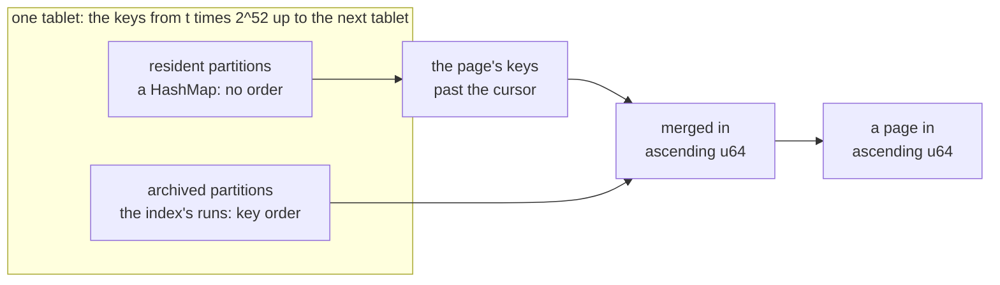
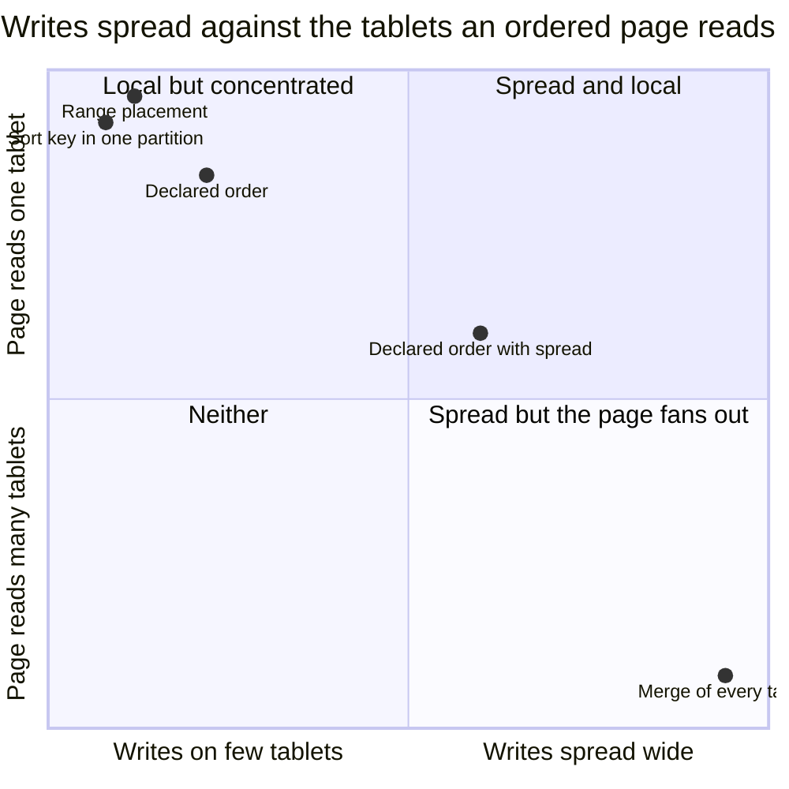
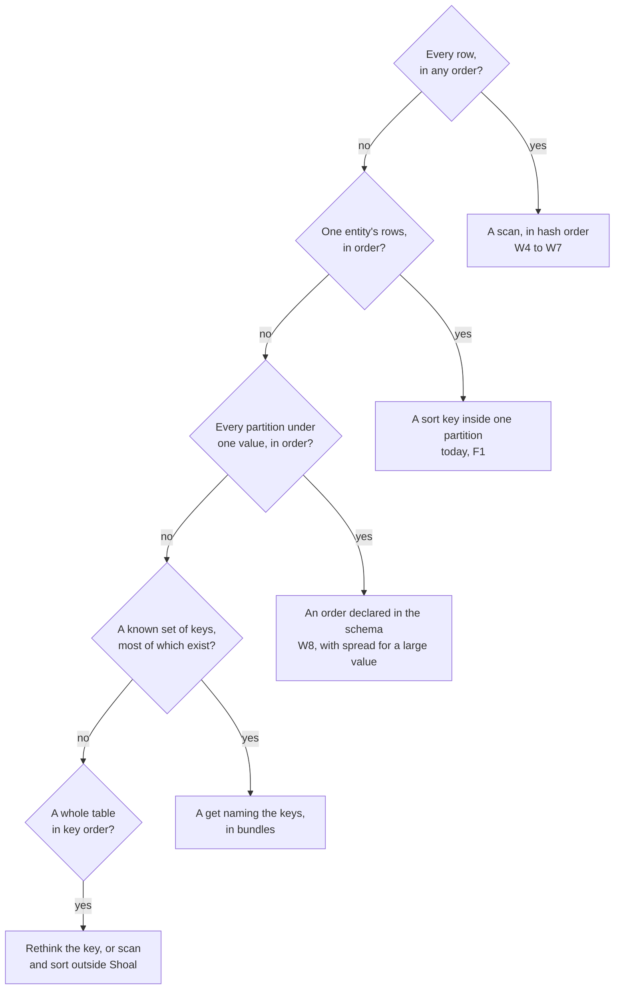

# W2. The order a scan visits partitions in

## Context

The question this plan was asked: whether a performant scan is possible in Shoal at all, "since
Shoal itself may not know how partitions should be ordered (especially partition keys with
multiple keys)", and whether a user could say how a scan should step over partitions so that it
could be made efficient. This page answers both. The short answer is on the
[overview](overview.md#the-question-this-plan-was-asked); this is the long one, with every way an
order could be kept and what each costs.

## What exists today

**A partition key is a hash, and the fields are gone once it is taken.** The derive macro hashes
every `#[shoal(partition)]` field's own `Hash`, in declaration order, into one
`GxHasher::default()`, from a row and from a key's values alike
(`shoal-derive/src/traits/partition_key.rs:75-99`). A key of several fields is a tuple of their
types, and a tuple's `Hash` is its members' in order, so both paths agree
([Resolved #92, #198](../../appendix/resolved/composite-partition-key.md)). The hash is a persistence
format: twenty-three keys of six shapes are frozen to the `u64` and the tablet they hash to, and a
build that moved them could not read an existing directory
([Partitioning](../../architecture/partitioning.md#from-field-values-to-a-partition-key)). Only the
`u64` crosses the wire: a client hashes a get's keys before it sends them
(`shoal-derive/src/traits/from_query/sorted.rs:45-61`). Two keys with one `u64` share a partition,
and nothing detects it (`architecture/partitioning.md:43-46`).

**A tablet is the top twelve bits.** `tablet_of(p) = p >> 52`, 4096 tablets for every table, and
`tablet_range` is one contiguous range of keys (`shoal-proto/src/shared/placement.rs:15-58`). The
high bits were chosen so a tablet can later split by taking one more bit, its keys staying
contiguous and no other tablet disturbed; nothing splits tablets today
([Partitioning](../../architecture/partitioning.md#why-the-id-comes-from-the-high-bits)).

**Inside a tablet, one half is ordered and one is not.** A table's resident partitions are a map a
tablet, a std `HashMap<u64, _>` with no order (`shoal-core/src/server/tables/resident.rs:31-49`).
Its archived ones are found through the archive map's index, an LSM of runs keyed by the `u64`, read
in key order (`ArchiveMap::scan_range`, `shoal-core/src/server/tables/storage/fs/map.rs:857-870`),
though the records themselves lie in the archive files in the order compaction wrote them
([W5](tablet-reader.md#what-exists-today)).

**The walk already hands a tablet out in order.** A page of [F87](../../features/tablet-walk.md)
sorts the tablet's resident keys past its cursor, merges them with the archive's view, and hands
partitions out in ascending `u64` (`shoal-core/src/server/tables/walk.rs:277-311`, `:345-425`).

**The one order a person chose is inside a partition.** A sorted table keeps a partition's rows by
their sort key, and a get can ask for a range of them with a cursor
([F1](../../features/sort-key-ranges.md)). Today a sort key can only be a `String`
([todos](../../appendix/todos.md)).

**No query reads across partitions it did not name.** SHQL's `WHERE` is mandatory and must name the
partition key; a range on it is refused at binding, and "a full scan is not expressible anyway"
([SHQL](../../api/shql.md)).

## The design

### What a scan needs of an order

| Property | Why a scan needs it | Hash order |
| --- | --- | --- |
| **Total** | Every partition has one place, or a scan can miss it or hand it out twice | Every partition is a `u64`, and two keys that share one are one partition already |
| **Stable** | A position written down has to mean the same thing later | The hash is a persistence format, frozen |
| **Splittable** | A scan's parts run in parallel, each over a range that can be named | A tablet is one contiguous range of the order, and a request can carry many |
| **Resumable** | A scan stops and starts, on another copy, after a restart | The cursor is the last key handed out; the next page starts past it |
| **Free of places** | Copies move, lead changes, nodes restart | A position names a key, never a node; a later tablet split takes one more bit and keeps every position |
| *Meaningful* | Nothing, for a scan that wants every row | It is not |

**So a full scan needs no order from the user.** Every property a scan needs, the hash order already
has, and the only one it lacks is the one a full scan does not use. This is ScyllaDB's position
too: it stores partitions in the order of its partitioner's tokens, a Murmur3 hash, and a full scan
is the token ring split into ranges ([W3](prior-art.md#scylladb)). It is also how the walk already
reads a tablet for the object store's drivers ([F87](../../features/tablet-walk.md)).

What decides whether a scan is fast is not its order. It is whether it reads archives in the order
they lie on disk, carries many tablets in one request, never makes a partition resident, runs on
every shard at once, and filters where the rows are ([W5](tablet-reader.md), [W6](distribution.md)).
The order itself costs a page one selection of its own keys, not a sort of the tablet.

### What hash order cannot answer

- **A range of keys**: "sensors 100 to 200". Their hashes are anywhere.
- **Key order**: "every user, by id". The hash keeps none.
- **A prefix of a key of several fields**: "every day of sensor 7". The tuple is hashed whole, so
  sensor 7's days are scattered over all 4096 tablets, and nothing short of reading every one finds
  them.

This is what "especially partition keys with multiple keys" comes to. A tuple has an order in
Rust, field by field, but Shoal never sees it: the client sends the hash, a server reads fields
only out of rows, and the archive map knows only keys. For any of these three, an order has to be
**declared** and **kept**, by something that computes it where the fields are still known: on the
client, to route; at apply, to index.

### The levers

Every way an order can be had, side by side. "A page" is one ordered page of answers.

| Lever | What it answers | What a write costs | What a page costs | Hot spots | Layout and lineage | Here |
| --- | --- | --- | --- | --- | --- | --- |
| **A sort key inside one partition** | One entity's rows in order, between bounds | Nothing more | One partition, though a cold one is read whole ([F1](../../features/sort-key-ranges.md)) | One entity is one group | None | Today, `String` keys only |
| **An order declared in the schema** | Every partition under one placement value, in order, between bounds | One index entry when a partition is made or removed, in the same group | One tablet, or a merge of `spread` tablets | A placement value is one group's writes; spread divides them | A persisted index; new tables only | **Scheduled**, [W8](declared-order.md), [M27](milestones.md#m27-ordered-scans-by-declared-order) |
| **Keys a caller steps through** | A known set of keys, in the caller's order | Nothing more | A get a key, pipelined over tablets; a key that does not exist costs a filter probe | None | None | An alternative, below |
| **A merge of every tablet** | Every partition of a table in key order | An index for each tablet, as declared order's | Every tablet, on every page | None | As declared order | An alternative, below |
| **Range placement** | Key ranges and key order, natively | Nothing more | One tablet | Sequential keys pile onto one tablet, so tablets must split and move by load | Placement, routing and moves redesigned | Rejected, below |

No lever reaches the far top right corner, because none can: an order a page reads from one place
is an order whose writes go to one place. Every lever is a point on that line, and declared order
with a spread is the one that lets a schema choose its own point, table by table. ScyllaDB users
make the same choice by hand, with a partition key, a clustering key and buckets; Bigtable's users
by salting a row key; CockroachDB's by a hash-sharded index's bucket count
([W3](prior-art.md#other-stores)).

### Declared order, in one paragraph

A table marks its leading partition fields as **placement fields** and the rest as **order fields**.
The placement fields' hash chooses the tablet, so every partition of one placement value is in one
tablet; the order fields are encoded so their bytes compare as the values do, and each tablet keeps
an index from that encoding to the partition. An ordered scan names a placement value and bounds,
reads one tablet's index in order, and hands the partitions out. `spread = N` scatters one placement
value over N tablets by a hash of the order fields, for a value too large for one group, and the
client merges N ordered streams. The encoding is a trait the derive writes for each field type and a
user can write for a type of their own: **this is how a user tells Shoal how to step over its
partitions.** [W8](declared-order.md) is the design.

### How a schema's author chooses

### Worked examples

- **The TMDB `Movie` table**, keyed by one `u64` id. An export, a backfill, a check against the
  csv: a scan in hash order. The loader's `walk` already does it for an operator, one tablet at a
  time through an admin read ([F87](../../features/tablet-walk.md#an-operator-walks-through-an-admin-read));
  a scan makes it a client's operation, every tablet at once.
- **Telemetry keyed by `(sensor, day)`.** Today sensor 7's days are scattered, and "days 100 to 200 of
  sensor 7" is two hundred named gets or a scan of everything. Declared with `sensor` as a placement
  field and `day` an order field, it is one tablet read in day order. Today's alternative is
  `sensor` as the partition key and the day as a zero-padded `String` sort key: one partition, read
  whole when it is cold, and every write to it a write to one partition.
- **Documents keyed by `(tenant, doc)`**, where one tenant may hold millions. Declared with `tenant`
  placing and `doc` ordering and `spread = 16`, a tenant's writes go to sixteen tablets and an
  ordered scan of the tenant merges sixteen streams.
- **A grid keyed by `(region, hour)`**: eight regions, the last 24 hours, 192 keys, most of them
  present. No scan at all: a get naming all 192 is answered in one round trip a node
  ([Reading many partitions at once](../../performance/fanout.md)).

## Alternatives rejected

**Range placement**: tablets holding ranges of keys rather than ranges of hashes, as Bigtable and
Spanner hold rows and CockroachDB its ranges. Ordered scans would be native, and everything else
would change. Sequential keys, a time or a counter, pile onto the last tablet, so tablets would have
to split and move by load as Bigtable's do; the tablet map, F74's routes, F46's planner and the
4096 fixed tablets every group is derived from would all be redesigned. Cassandra kept its ordered
partitioners "for backward compatibility only" for the same reasons ([W3](prior-art.md#other-stores)).

**A hash that keeps order.** An order-preserving hash is range placement under another name.

**An order inferred from the fields' `Ord`.** A tuple's `Ord` is one order a schema might declare,
field by field, but a key type need not implement `Ord`, nothing derives one for its archived form,
and an order nobody asked for would make every table pay for an index. An order is declared or it
does not exist.

**Keys a caller steps through, as the mechanism.** A client helper that takes an iterator of keys in
the caller's order and fetches them as pipelined gets is cheap, needs no server change and keeps any
order the caller likes. It is efficient only while most stepped keys exist, and it cannot find keys
it was not told about. It stays an alternative, not a milestone, by the decision of 2026-10-25, and
a get naming the keys in bundles already serves its best case.

**A merge of every tablet, as the mechanism.** With an ordered index in every tablet, a whole table
could be handed out in key order by merging 4096 streams. Every page would touch every tablet, a
page of a thousand partitions would ask each tablet for a fraction of one, and its latency would be
the slowest shard's. It stays an alternative, and declared order without a placement field is where
it would come from.

## What it costs

A scan in hash order costs no layout and no format: the order exists, and a page selects its own
keys from it. A declared order costs a persisted index, a write's extra entry and a placement value's
concentration, all on [W8](declared-order.md#what-it-costs).

## What it breaks

Nothing, for hash order. A declared order changes a table's placement, so a table cannot gain or
lose one in place: its partitions would change tablets ([W8](declared-order.md#what-it-breaks)).

## Invariants to uphold

- **The hash is frozen.** A scan's positions are `u64`s; a change to the hash changes every position
  and every directory with it.
- **A tablet is the top bits of its keys.** A position stays a position through a later split, which
  takes one more bit and leaves every key where it was.
- **A scan's order is ascending `u64` within a tablet**, each key once, and no order across tablets
  is promised.
- **An order is declared, never inferred.** A table without a declaration is never indexed and never
  scanned in order.

## Prerequisites

None for hash order. Declared order's are [W8](declared-order.md#prerequisites)'s.

## How it would be measured

The cost of a scan's order is a page's selection of its keys, measured with the page itself
([X17](spikes.md#x17-a-page-rebuilt)). Declared order's concentration, how evenly placement values
fall over 4096 tablets under skew and what spread does about it, is simulated by
[X21](spikes.md#x21-declared-order-priced).

## Acceptance tests

| Test | Gate | Proves |
| --- | --- | --- |
| `a_scan_hands_out_each_tablets_partitions_in_ascending_key` | M24 | Within a tablet, a scan's partitions ascend and none repeats, resident and archived alike |
| `a_position_survives_a_split_of_its_tablet` | M24 | A cursor is a key, so a tablet range taking one more bit keeps every position; a unit test on the placement rule, since nothing splits tablets yet |

A declared order's own test, that one placement value's partitions come out in order, is
[W8](declared-order.md#acceptance-tests)'s.

## Related

[The overview](overview.md#the-question-this-plan-was-asked) for the short answer;
[W8](declared-order.md) for declared order; [W3](prior-art.md) for how other stores keep an order;
[Partitioning](../../architecture/partitioning.md) for the hash and the tablets;
[F87](../../features/tablet-walk.md) for the walk's order.
