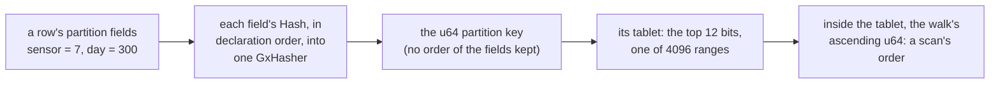
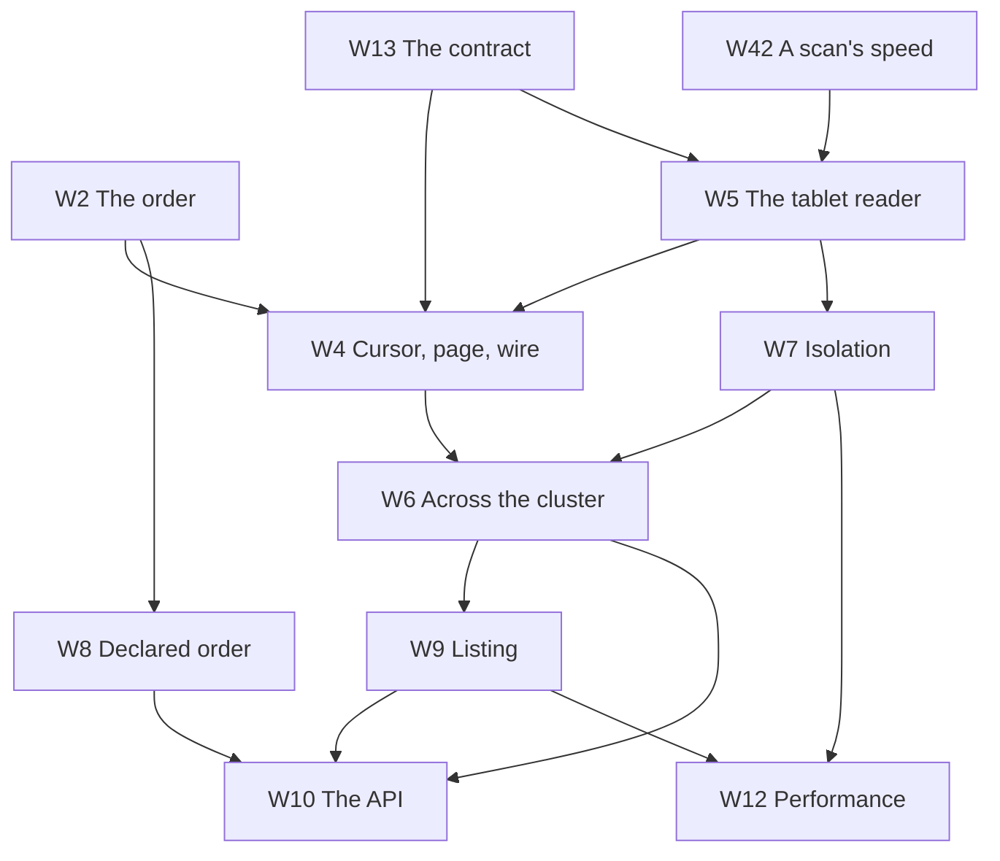

# Scans

**Nothing in this subchapter is built.** These pages plan scans for Shoal: reading a table's rows
without naming their partition keys, a page at a time, from every copy that holds them across a
cluster, without slowing the queries that run beside them. They also plan the first thing built on
a scan: listing every object in a bucket. The `W` pages are design records, in the shape the object
storage part's `S` pages took. [W1](prerequisites.md) is what has to exist first; the
[spikes](spikes.md) are what has to be measured before a gate can be trusted; the
[milestones](milestones.md) are an order of work; and [What's left to do](whats-left-todo.md)
draws all of it.

## The question this plan was asked

Whether a performant scan is possible at all, when Shoal does not know how its partitions should be
ordered, a partition key of several fields especially; and whether a user could say how a scan
should step over partitions so that it could be made efficient.

**Yes, and the order is the smaller part of it.** A scan needs an order that is total, stable,
splittable and resumable. It does not need one a person would choose. Shoal already has such an
order: a partition key is a `u64` hash of its fields, a tablet is the hash's top twelve bits, so each
of a table's 4096 tablets is one contiguous range of hashes (`shoal-proto/src/shared/placement.rs:15-58`),
and the walk of one tablet's rows already hands its partitions out in ascending hash order
([F87](../../features/tablet-walk.md)). ScyllaDB scans a table the same way, in the order of its
partitioner's tokens, which are hashes too ([W3](prior-art.md#scylladb)). What makes a scan fast is
everything else: reading archives in the order they lie on disk, carrying many tablets in one
request, never making a scanned partition resident, and keeping off the cores, the memory and the
devices the other queries need.

A key of several fields is hashed whole, each field into one hasher in declaration order
(`shoal-derive/src/traits/partition_key.rs:75-99`), so no prefix of it survives: every day of sensor
7 is scattered over all 4096 tablets. That matters only to a scan that wants partitions in an order
or in a range, and for that the order has to be kept somewhere. The user's suggestion is the answer
these pages schedule: **the schema declares it**. A table names the fields that place a partition
and the fields that order it, and Shoal keeps the order for it ([W2](ordering.md),
[W8](declared-order.md)).

## What is being asked for

| # | Requirement | Where it is met |
| --- | --- | --- |
| R19 | A table's rows can be read without naming their partition keys, a page at a time, and the read resumed where it stopped | [W4](cursor-and-pages.md), [W5](tablet-reader.md), [W6](distribution.md) |
| R20 | A scan never slows the other queries past a budget stated before it is built; what a scan costs is paid by the scan | [W7](isolation.md), [W12](performance.md) |
| R21 | A scan reads every tablet from a copy of its group across the cluster, in parallel, and carries on through a failover, a move and a restart | [W6](distribution.md) |
| R22 | A schema can declare an order for a table's partitions, and a scan reads the partitions under one placement value in that order, between bounds | [W2](ordering.md), [W8](declared-order.md) |
| R23 | Filters, a projection and a limit are applied where the rows are, so a scan moves only what it was asked for | [W5](tablet-reader.md), [W10](api.md) |
| R24 | What a scan promises at each read level is stated, and so is what it does not | [W13](contract.md) |
| R25 | Every live object in a bucket can be listed a page at a time, resumably, each with what a stat answers and none of its bytes | [W9](bucket-listing.md) |
| R26 | Scans and listings are benchmarkable with `shoaladm bench`, and judged by budgets | [W12](performance.md) |

`R` numbers continue the [object storage part's](../../object-storage/overview.md#what-is-being-asked-for)
R8–R18, and R7 is inherited whole: nothing outside the Shoal processes coordinates a scan. R20 is
the one every page answers to. Performance matters most here, and a fast scan that doubles a get's
tail is a regression.

## Decisions taken on 2026-10-25

Taken with the user while this subchapter was planned. They are the only things on these pages that
are decided rather than preferred.

| Decision | Taken | Where it lands |
| --- | --- | --- |
| Listing | The first listing gate lists every live object in a bucket, unordered, each with its path, size, ETag and modified time and none of its bytes. Path order, a prefix and a delimiter are a later gate, designed here and not scheduled first | [W9](bucket-listing.md) |
| Ordered scans | The mechanism scheduled is an order **declared in the schema**: placement fields hashed, order fields ordering, a spread over several tablets where one value is large. Keys a caller steps through, a merge over all 4096 tablets and range placement stay documented alternatives, not milestones | [W2](ordering.md), [W8](declared-order.md) |
| Grants | A scan needs a privilege of its own, `scan`, beside `read` and `write`. `read` does not imply it | [W10](api.md#grants) |
| Consistency | **Pages only move forward.** The walk's promise, made to clients: each page is one moment of its copy, a group's pages never go back in time, every partition live throughout is handed out once, and nothing is promised across groups. No snapshot mode | [W13](contract.md#the-contract) |

## Vocabulary

Chosen against the words the book already uses. `segment` is the WAL's, `watermark` the intent
log's and `token` a session's, so none of them names anything here.

| Term | Meaning |
| --- | --- |
| Scan | A read of every partition of a set of a table's tablets, without naming keys, a page at a time |
| Page | One request's answer: the rows of partitions from one or more tablets of one shard, up to bounds on rows, bytes and work |
| Short page | A page that ended before its row bound, on bytes, on work or at a tablet's end, or that held nothing. **Never the end of a scan**: the end is a flag |
| Cursor | Where a tablet's next page starts: the last key handed out, as a sort range's cursor is ([F1](../../features/sort-key-ranges.md)) and the walk's is ([F87](../../features/tablet-walk.md)) |
| Boundary, floor | F87's words. A page's boundary is its copy's applied index when the page began. A group's floor is the highest boundary a scan has seen in it, and no later page of the group is read below it |
| Resume token | What a client keeps of a scan: each group's floor, the tablets not finished, and each stream's open cursor. Under a kibibyte |
| Scan stream | A client's sequence of pages to one hosting shard, one page in flight at a time |
| Tablet range | A set of tablets a caller scans as one part of a scan split over workers |
| Scan class | What scans may use on a shard, apart from everything else: a task queue, a memory budget, an admission count and a device ceiling of their own |
| Placement fields | The leading partition fields of a table with a declared order. Their hash chooses the tablet |
| Order fields | The partition fields after the placement fields. Their encoding orders the partitions under one placement value |
| Spread | How many tablets one placement value's partitions are scattered over, by a hash of the order fields |
| Ordered scan | A scan of the partitions under one placement value, in order, between bounds |
| Listing | A scan of a bucket's `ObjectMeta` table answered as one entry for each live object |

## The constraint every page inherits

**Other queries keep their latency.** A scan's work runs in a class of its own on every shard it
touches: below the foreground in cpu, in memory drawn from a budget of its own, on a device only in
its idle time and under a ceiling. What it may cost the reference cell's tail is a number stated
before the work starts ([W7](isolation.md#the-budget)), judged on the lab the way the object store's
background was ([S13](../../object-storage/isolation.md#io-on-a-slice)).

**A scan never changes what is resident.** A get of an archived partition makes it resident and puts
it at the recent end of the eviction order (`shoal-core/src/server/tables/persistent/sorted.rs:614-626`),
and a shard past its budget evicts forty percent of its rows (`shoal-core/src/server/shard.rs:6869-6872`).
A scan that read through the get path would push a table's hot set out to make room for rows it
reads once. It reads through the walk, which makes nothing resident.

**A scan is explicit.** No query becomes a scan because it names no key. SHQL's `SELECT` keeps its
mandatory partition key ([SHQL](../../api/shql.md)), a client's `send` never scans, and a scan is
asked for by name, under its own grant. ScyllaDB's `ALLOW FILTERING` exists for the same reason
([W3](prior-art.md#scylladb)).

**A cursor names positions, never places.** A scan's progress is tablets, keys and group floors.
It never names a node or an executor, so a move, a failover, a restart or a later split of a tablet
leaves it valid, and only a change of its table's schema refuses it, by name.

**Nothing across groups, nothing held, nothing new to agree on.** A page is read from one copy at one
boundary. No server holds anything of a scan between pages, nothing is promised across tablet
groups, and no second consensus protocol or coordination service is added
([R7](../../distributed/overview.md#what-is-asked-of-it)).

**A claim is checked where it can be.** A statement about Shoal cites a file and a line read on the
day it was written. A statement about ScyllaDB or another store cites the page it was read from, and
one that was not read is marked as recalled.

## The chapter

| # | Page | Purpose |
| --- | --- | --- |
| W1 | [What has to exist first](prerequisites.md) | The gaps in Shoal today, each labelled required or optional |
| W2 | [The order a scan visits partitions in](ordering.md) | The question above, answered: hash order, what it cannot do, and every way to keep an order |
| W3 | [Lessons from ScyllaDB and other stores](prior-art.md) | What is taken from each and what is not, every fact with its source |
| W4 | [The cursor, the page and the wire](cursor-and-pages.md) | What a page is, what a cursor holds, the frames |
| W5 | [Reading a tablet on its shard](tablet-reader.md) | The walk, rebuilt for load |
| W6 | [A scan across the cluster](distribution.md) | The client's driver: copies, streams, floors, refusals, failover |
| W7 | [Not slowing other queries](isolation.md) | The budget, and the cpu, memory, device, admission and network each scan draws on |
| W8 | [Ordered scans: placement fields, order fields and spread](declared-order.md) | The declared order and the index that keeps it |
| W9 | [Listing a bucket's objects](bucket-listing.md) | The unordered listing, and the ordered one's later gate |
| W10 | [The client, SHQL, the schema and grants](api.md) | What a caller writes |
| W11 | [Tradeoffs, and when not to scan](tradeoffs.md) | What every choice cost, and what a scan costs a user |
| W12 | [Performance, and the benchmarks that judge it](performance.md) | The arms, the figures and the budgets |
| W13 | [The contract and the questions](contract.md) | P20–P26, Q33–Q42 and Q62, the decision record and the acceptance index |
| W42 | [A scan's speed beside ScyllaDB's](scan-speed.md) | Where a page's time goes, what each part of the gap buys, and what closes it |
| — | [Exploratory spikes](spikes.md) | X16–X22 and X37: what has to be measured first, and the records of [X16](walk-beside-the-foreground.md) and [X20](scylladb-scan-sources.md) |
| — | [Milestones](milestones.md) | M22–M28 |
| — | [What's left to do](whats-left-todo.md) | All of it, drawn |

## The dependency graph

An arrow points from a page to a page whose design leans on it. Hard edges only.

| Edge | Why |
| --- | --- |
| W13 → W4, W5 | What a page promises decides what a cursor holds and what a reader may defer |
| W2 → W4, W8 | Hash order is what a cursor is a position in; a declared order is the second kind of position |
| W5 → W4, W7 | What a shard can read in one step bounds a page, and decides what isolation has to hold back |
| W4, W7 → W6 | The driver sends pages and obeys the refusals the shards answer with |
| W6, W8 → W9, W10 | A listing is a scan with a target; the API is the driver's surface and the declaration's |
| W7, W9 → W12 | The budgets are measured beside a scan and beside a listing |
| W42 → W5 | Where a page's time goes decides how the reader's third step reads: several reads in flight, and runs only where a tablet's records lie together |

## How a W page is written

[W1](prerequisites.md) is a list and has its own shape. Every page after it keeps the sections the
object storage part's design pages kept ([S pages](../../object-storage/overview.md#how-an-s-page-is-written)):
**Context**, **What exists today**, **The design**, **Alternatives rejected**, **What it costs**,
**What it breaks**, **Invariants to uphold**, **Prerequisites**, **How it would be measured**,
**Acceptance tests** and **Related**. Where a question is open, *The design* gives the options,
names a preferred direction, and the question carries its gate on [W13](contract.md#questions-to-answer).

An acceptance table names tests that do not exist yet, each against a provisional gate. These
tables are not read by `shoal-bench/tests/acceptance_tables.rs`, which holds the distributed and
object storage parts' tables alone; they join it at [M22](milestones.md#m22-the-harness-and-the-facts),
as the object storage part's did at M11.

`W` identifiers are never reused and continue across every feature of [Future Work](../overview.md).
`P`, `Q`, `M`, `R` and `X` continue the book's sequences from P20, Q33, M22, R19 and X16, so a number
names one thing in this book. When work ships, an `F` page says what was built and what it cost; the
`W` page stays the design record.

## What this subchapter is not

It is not SQL: no joins, no ordering a scan by a field it was not declared with, no aggregation at
first ([beside the gates](milestones.md#beside-the-gates)). It is not a secondary index beyond the
one order index [W8](declared-order.md) declares. It is not a consistent export: a scan is a
sequence of moments, and the consistent cut is the backup's, every group's file cut at a committed
boundary of its own ([F49](../../features/backup-and-recovery.md)). It is not an S3 gateway, and the
first listing is not ordered. It is not range partitioning: tablets stay ranges of hashes. And it is
not a scan of a bucket's `StripeMeta`, whose rows the object store's own drivers walk.

## Related

[W2](ordering.md) for the question; [W1](prerequisites.md) and [W13](contract.md) first for the work.
[F87](../../features/tablet-walk.md), the walk this is built on; [C6](../../distributed/reads.md) for the
read levels a page is served at; [F74](../../features/client-routing.md) for the route table the
driver reads; [S13](../../object-storage/isolation.md) for the isolation this copies;
[D9](../../direction/prior-art.md) and [C12](../../distributed/prior-art.md) for the prior art W3 extends.
