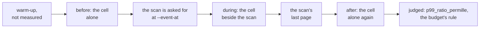

# W12. Performance, and the benchmarks that judge it

## Context

Performance is critical (R20), and scans and listings have to be benchmarkable by `shoaladm bench`
(R26). The two are one requirement: every choice on these pages is a claim about what something
costs, and a claim with no arm that would show the difference is not one this book accepts
([Optimizations](../../appendix/optimizations.md)). This page says what is compared with what, what
the driver has to gain, what a run records, which numbers are budgets, and what would make a number
wrong. The budgets are hypotheses until the spikes set them.

## What exists today

- **`shoaladm bench` runs a schema's own workload against a cluster of its own**, built from a copy of
  an inventory with every root, port and directory moved ([F66](../../features/dataset-benchmarks.md)).
  A table arm is `{mix}/b{bundle}[/{override}]/{event}`; an object arm
  `{mix}/s{size}/c{concurrency}[/{override}]/{event}` ([S15](../../object-storage/performance.md#an-arm)).
- **Events are cut into before, during and after.** A fault is cut at its marks and its recovery; a
  background operation from when it was asked for to when it was done (`cut_background`,
  `shoal-loadgen/src/events.rs:100`), and judged by `p99_ratio_permille`, the during p99 over the before
  (`:122`). The events today are none, kill, stop, rebalance, decommission, remove, repair, backup,
  device_fail, device_add, deep_scrub, device_drain and, since [F115](../../features/bench-scans.md),
  scan (`EventKind`, `shoal-loadgen/src/spec.rs`).
- **A scan arm and the `scan` event** ([F115](../../features/bench-scans.md)): whole scans of a table
  through every member's admin walk, the pages' partitions, rows, bytes and loop holds kept by member
  in each window.
- **A driver is handed kinds a schema supplies** and counts bytes both ways in every window
  ([F69](../../features/driver-operation-kinds.md)); a run keeps each host's device counters and each
  member's memory ([F71](../../features/bench-device-memory.md)), and since F104 the eviction passes by
  their cause ([F104](../../features/memory-in-a-capture.md)).
- **One table can be driven at an offered rate beside the main load** ([F72](../../features/bench-paced-stream.md)).
- **The lab's procedure** for a before and after: each side a clean worktree at its commit, built for
  `znver1`, the tmdb node stopped and the governor at `performance` for the run, rounds alternating, and
  a difference a result only when the two sides' intervals are disjoint
  ([Benchmarking](../../performance/benchmarking.md#before-and-after-on-the-lab)).

## The design

### What is compared with what

Every experiment is two arms that differ in one thing, in the manner of the workload grid's isolating
pairs.

| Experiment | Held constant | What it tells | Where |
| --- | --- | --- | --- |
| The reference cell alone, and beside a full scan | Hosts, the cell, the scanned table | **The budget**: what a scan costs a foreground | [X16](spikes.md#x16-the-walk-beside-the-foreground), every gate from M23 |
| The walk as it stands, and rebuilt | The table, the hosts | What each of W5's steps buys | [X17](spikes.md#x17-a-page-rebuilt) |
| Archive reads one at a time, and in runs | The table, larger than memory | What disk order buys a scan | X17 |
| Scan work in the medium queue, and in a scan queue | The table, the cell | Whether a get's loads wait behind a scan | X16, X17 |
| A fixed ceiling, and idle time with a ceiling and a trickle | The device | Which pace holds the foreground and how fast a scan goes | [X18](spikes.md#x18-table-reads-paced-by-idle-time) |
| A scan on followers, and on leaders | The table, the cluster | What preferring followers is worth to writes | M25 |
| Pages at `One`, and at `Quorum` | The scan | What one barrier a group costs | M25 |
| A scan unfiltered, filtered and projected | The table | What a filter and a projection save, and cost | M24 |
| A table larger than memory after a restart, and one resident | The scan | The archived path against the resident one | X16, X17 |
| A table placed by its whole key, and the same declaring an order | The workload | What an order index costs gets and writes, and buys ordered scans | [X21](spikes.md#x21-declared-order-priced), M27 |
| A listing of a bucket of inline objects, and of striped ones | The bucket's size | What inline bytes cost a listing | [X19](spikes.md#x19-the-edges), M26 |

### What the driver gains

[W1](prerequisites.md#the-benchs-scan-kind-and-scan-event) places these before the first gate:

- **A scan operation kind** ✅ ([F115](../../features/bench-scans.md)): one operation is a whole scan, timed
  page by page, its rows and bytes counted in every window, so an arm of scans alone measures a scan's
  own rate. Built as an arm of its own, `scan/{Table}[/c{n}]/none`, since a supplied kind is one query.
- **A `list` kind** for a bucket's arms, the same for a listing.
- **A `scan` event** ✅ for a table ([F115](../../features/bench-scans.md)), a listing's at M26, appended to `EventKind`: a full scan of a named table or a listing of a named
  bucket is asked for at `--event-at` beside the main load, and the run is cut at its marks by
  `cut_background`, from when it was asked for to when it finished. The arm is
  `{mix}/b{bundle}/scan`, such as `rw50/b1/scan`.

### What a run records

| Figure | Of | From |
| --- | --- | --- |
| Rows, partitions and MiB a second, a node | The scan | The driver's windows and the node's scan counters ([W10](api.md#node-counters)) |
| Time to its first page, and a page's latency | The scan | The driver |
| Read and write p99 before, during and after, and `p99_ratio_permille` | The foreground | The windows, cut by the event |
| Eviction passes by their cause | Each member | F104's counters; any `Resident` pass during a scan fails the budget |
| Pages shed, by cause, and short pages, by why they ended | Each member | The scan counters |
| The longest step a scan held a loop for | Each member | The scan counters; over 100 µs fails the budget |
| Device bytes read a byte handed out | Each host | F71's device counters against the scan's bytes |
| Cpu-seconds a GiB scanned | Each node | Samples of every thread beside the run, as the store comparison takes them |
| The scan budget's peak | Each member | The scan counters |

### The budgets

Hypotheses, each set by a spike before the gate that is judged by it:

- **The foreground**: beside one full scan a node at its default ceiling, the reference cell's read
  and write p99 within `max(1.10 × alone, alone + 0.1 ms)` at the median, intervals overlapping; no
  `Resident` eviction pass; no loop step over 100 µs ([W7](isolation.md#the-budget)). Set by X16 and
  X18; judged at M23 and at every gate after. X18 (2026-10-30, [its record](table-reads-paced.md))
  found the insert clause held on the lab's SSDs at 32 MiB a second a device and the read clause at
  no pace tried, its median held only with a page's runs in flight cut to two; ~~M23's plan sets the
  pace, or this budget, from it~~ M23's plan set the pace from it with the user on 2026-10-31, a share
  of each device's busy time at 75 ms a second ([F128](../../features/device-time-pace.md)), this budget
  loosened only if the exit misses the read clause. At M23's exit (2026-10-31, [its record](m23-exit.md))
  the read clause held at 1.07 times beside a whole scan of `Big`. The step clause missed, one step in
  460 past 100 µs, nine in ten of them a sorted table's large resident partitions'
  ([item 350](../../appendix/resolved/encode-copy-deadline.md)).
  Decided with the user the same day ([the decisions](m23-exit.md#decided-with-the-user-2026-10-31)):
  item 350 is fixed in M23, and the exit's rounds are run again with a cell whose feed does not wrap,
  a control beside them. The insert clause is read on them as defined, and the step clause on a
  step's own work, a step past 100 µs by the wall alone named as O147's, which follows M23. Item 350
  is fixed since 2026-11-01 ([Resolved #350](../../appendix/resolved/encode-copy-deadline.md)). A
  step's own cpu holds the interrupts its cpu takes on the lab's kernels, which ~~may be~~ were
  thought to be what its light steps past 100 µs are
  ([item 353](../../appendix/resolved/capture-allocations.md)). The rounds again ran on 2026-11-03
  ([their record](m23-exit.md#the-rounds-again)). The step clause missed on the remainders already
  placed after M23: europa's `Keyword` encode steps, `Big`'s long captures (O154) and steps past
  100 µs by the wall alone (O147). The read clause beside `Big` missed at 1.14 times
  ([item 359](../../appendix/known-issues.md#359-a-whole-scan-of-big-lifts-the-cells-read-p99-about-07-ms-past-w7s-ten-per-cent-since-the-cell-alone-reads-faster)). Both are the user's to decide.
  Six rounds attributed them on 2026-11-02: they are the steps' own work, the shard on the NIC's cpu
  passing no more often than the rest and passing as often once the NIC moved off it. Fixed in M23 on 2026-11-02 ([Resolved #353](../../appendix/resolved/capture-allocations.md)): timed by its parts, no part of a capture held them but the allocator inside its allocations, so every node's unit purges freed memory at 100 ms and a capture allocates each collection once; six rounds took the Zen1 hosts' long `Big` captures from 21.8 to 11.4 a 10,000, and the rest is [O154](../../appendix/optimizations.md#o154-a-captures-view-allocates-nothing-on-the-loop), optional, after M23.
- **A scan's own rate**, idle: at least half of what its devices read sequentially, up to the ceiling.
  Set by X18; judged at M23, decided 2026-10-29 ([W42](scan-speed.md)): on the lab's SSDs the ceiling,
  100,800 of X16's `Big` partitions a second a node, where the walk reads 33,900. Since
  [F128](../../features/device-time-pace.md) the ceiling is the device's share of time as well,
  which binds idle or not: on a 970 EVO about 32 MiB a second, some 32,000 of `Big`'s partitions a
  second a node, and on the Optane the byte ceiling's 100,800. The idle check cannot tell a node with
  no foreground from one whose foreground is warm, so a scan alone is held to its share too. Since X17's reads
  half (2026-10-30) the walk with reads in flight reaches it, and in runs reads 3.6 to 6.6 times it
  unpaced ([its record](page-rebuilt.md#what-it-says-for-the-design)). Judged at M23's exit (2026-10-31): a scan of `Big` alone,
  loaded once, read 50,600 partitions a second, 19.8 MiB a second of a 970 EVO, its share binding;
  the share's 75 ms buys about 20 MiB, not the 32 its choice read off X18 ([the record](m23-exit.md)).
  Decided with the user the same day: the share stays at 75 ms and M23's rate is what it buys. The
  rate is read again at the segments
  [O149](../../appendix/optimizations.md#o149-larger-wal-segments-keep-a-tablets-records-together-four-times-longer)
  sets once it is done after M23, where the same share bought 35 MiB a second.
- **A scan's cost**, alone at its rate: at least ten partitions a device read, and at most a fifth of
  X16's cpu a partition on the Zen1 hosts, about 15 µs, where X16 measured 0.99 reads and up to 73 µs.
  Set by [X17](spikes.md#x17-a-page-rebuilt) and [X37](spikes.md#x37-a-tablets-records-together-priced);
  judged at M23 ([W42](scan-speed.md)). Measured 2026-10-30: met by a walk in runs over merges in
  key order on a table loaded once, 11.1 partitions a device read and 5.6 µs a partition on the Zen1
  hosts, and by nothing over a hash map's order; after twenty minutes of churn 9.9 partitions a read
  (9.5 on the Zen1 hosts) and 6.0 µs, just under the reads' line, which M23's plan judges
  ([X37's record](tablet-records-together.md#after-churn)). Judged at M23's exit (2026-10-31): 10.5 partitions a device
  read on the Zen1 hosts loaded once and 10.6 after an hour's churn, both lines held; 22.6 µs of a
  Zen1 host's cpu a partition gross at its pace, past the 15, and 10.1 above its idle node; 12.2 gross
  at 40 MiB segments ([the record](m23-exit.md), O149). Decided with the user the same day: **the budget
  is a scan's own cpu, above its idle node**, so held at 10.1 µs. X17's figures, which set it, were
  gross at an unpaced rate, where the idle node came to under half a microsecond a partition; at a
  paced rate the gross figure is mostly the idle node's quarter core spread over the partitions the
  pace lets through.
- **An empty table**: one page a hosting shard. Set by [X19](spikes.md#x19-the-edges).
- **A listing**: entries a second a node, beside the same foreground budget. Set by X19.
- **A declared order**: what a get and an insert of a declared-order table may lose against the same
  table placed by its whole key. Set by X21 before M27.

### Where it runs

On the lab, by its procedure: titan and hyperion (Zen1, the 970 EVO), europa (the Optane), a disk on
each since 2026-10-06; every number labelled by host, cpu and governor; a side cluster of the bench's
own, never the tmdb cluster; eight rounds or more for the budget, the sides alternating.

### What would make a number wrong

- **A table smaller than memory**, or a scan run before a restart, measures the resident path alone.
  The budget's scan is of a table larger than memory, after a restart, so most partitions come from
  archives.
- **A driver on a node's cores.** On europa a loop leg's nodes and its driver share a host; the driver
  is pinned clear of every shard and object executor, as the lab's procedure says.
- **Pages shed most of the time.** A scan that was mostly refused looks gentle. Sheds are recorded,
  and a run with more shed than read pages is not a measurement of the budget.
- **A governor left at `performance`**, or the tmdb node left running: the procedure's first lines,
  and a stopped bench's leftovers checked after.
- **A comparison across datasets or inventories**, which `compare` refuses already.

### `shoal-bench`

No workload is added to `shoal-bench`'s macro layer, which is to be retired in favour of `shoaladm
bench` ([todos](../../appendix/todos.md)). A scan's figures live in `shoaladm bench` captures.

## Alternatives rejected

**A scan measured alone.** Its rate says nothing about R20; every gate is judged beside a foreground.

**Workloads in `shoal-bench`.** A second harness for something the first one is replacing.

**A synthetic benchmark of a page in process.** That is a spike's job, X17's, and its numbers decide a
design; they are never a capture.

## What it costs

A run of the budget is the cell's arms three times over, for three scans, on three hosts, eight
rounds: hours of the lab a gate.

## What it breaks

Nothing. A new kind and an appended event leave every existing arm's id and digest as they are.

## Invariants to uphold

- **Every gate's exit is a measurement beside a foreground**, labelled by host, cpu and governor.
- **An event is appended to `EventKind`, never interleaved**, so no arm's id moves.
- **A budget is stated before the work it judges.**

## Prerequisites

[W1](prerequisites.md#the-benchs-scan-kind-and-scan-event)'s bench row.

## How it would be measured

This page is how.

## Acceptance tests

| Test | Gate | Proves |
| --- | --- | --- |
| `a_scan_kind_times_a_whole_scan_page_by_page` | M22 | A scan arm's windows count its rows, pages and bytes |
| `a_scan_event_is_cut_at_its_marks` | M22 | The run is cut from the scan's asking to its last page |
| `an_arm_beside_a_scan_keeps_its_id` | M22 | `rw50/b1/scan` is a new arm and every other arm's id and digest are unchanged |
| `a_list_kind_drives_a_buckets_listing` | M26 | A bucket arm lists, counting entries |

## Related

[W7](isolation.md) for the budget's design; [S15](../../object-storage/performance.md), the page this
follows; [F66](../../features/dataset-benchmarks.md) and [F69](../../features/driver-operation-kinds.md)
for the bench; [Benchmarking](../../performance/benchmarking.md#before-and-after-on-the-lab) for the
lab's rules.
