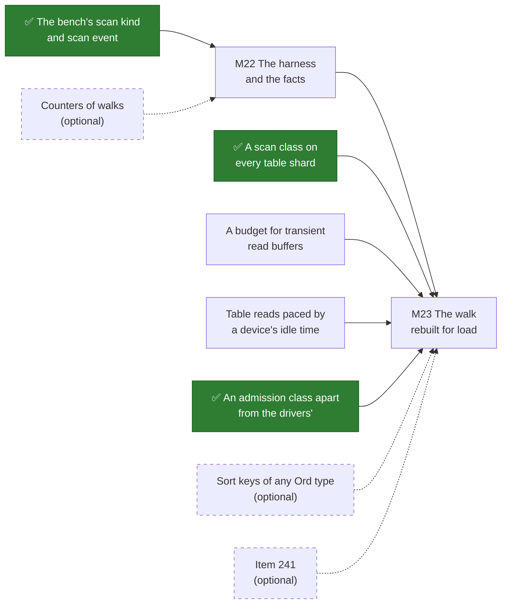

# W1. What has to exist first

~~**Nothing on this page is built.**~~ ~~**One row is built**~~ ~~**Two rows are built**~~ **Three rows are built**, the bench's ✅
([F115](../../features/bench-scans.md)), the admission class ✅ ([F116](../../features/scan-admission.md)) and the
scan class ✅ ([F117](../../features/scan-class.md)), 2026-10-29. It is the list of what Shoal has to gain before a scan can be
offered to a client, in one place, so that no page after it rediscovers a gap and no milestone starts
on top of one.

A prerequisite here is a **gap in Shoal as it is today**: work that lands in a change of its own,
before any scan code, and is worth having without scans. What a scan itself has to do is not a
prerequisite, however hard it is. The walk rebuilt for load, the frames, the client's driver and the
order index are the scan's own work, on [W5](tablet-reader.md), [W4](cursor-and-pages.md),
[W6](distribution.md) and [W8](declared-order.md), and in the [milestones](milestones.md). The line is
drawn there so this list stays something that can be finished.

## The rule the labels follow

Every row is labelled, and the label follows the rule [S1](../../object-storage/prerequisites.md#the-rule-the-labels-follow)
set for the object store:

- **Required**: built without it, the feature would be incorrect or unsafe, or would later need
  rework to a format that is persisted or a protocol that is on the wire.
- **Optional**: it can be added later without changing anything already built, or it is needed
  only under a design answer that has not been chosen.

One reading is made explicit. **"Unsafe" includes the promise R20 makes to the queries beside a
scan.** A scan that holds a shard's loop for milliseconds, or turns its own buffers into evictions of
a table's hot set, is not merely slow: it breaks the requirement every page answers to. So an item
without which a scan would do that is required, and the rule is not loosened to reach a gate sooner.

**Where it stands (~~2026-10-25~~ 2026-10-29).** ~~None of the five required rows is started.~~ ~~One~~ ~~Two~~ Three of the
five required rows are done, the bench's scan kind and `scan` event ✅ ([F115](../../features/bench-scans.md)),
the admission class ✅ ([F116](../../features/scan-admission.md)) and the scan class ✅
([F117](../../features/scan-class.md)); the other two are not. The design they serve
is a plan; each row's design is on the page named beside it, and each lands at the start of the gate
named beside it, and nothing stops it landing sooner.

## Required

### A scan class on every table shard

**✅ Done (2026-10-29)** by [F117](../../features/scan-class.md), for a scan's pages: the scan queue, steps of 64 KiB,
and the loop's second inbox, whose first use is a scan page's capture.

**What.** A third task queue on a table shard, below the foreground, for background reads: modelled
on the object executors' background queue, `Shares::Static(100)` with `Latency::Matters` of 100 µs
(`shoal-core/src/server/objects/executor.rs:56`, `:643-653`); loops in it that yield every 64 KiB of
work; and a second inbox on the shard's loop, drained only when its main inbox is empty, for the few
steps a background read has to take on the loop itself.

**Why it is required.** A table shard has two queues of its own today: a high one, 1,000 shares and a
500 µs goal, for listeners and connections, and a medium one, 500 shares and 100 ms, for the compactor,
the loader and the sweeper; the loop runs in glommio's default queue (`shoal-core/src/server/shard.rs:3286-3303`).
The walk's reads are spawned into the medium queue (`shoal-core/src/server/shard/walk.rs:619-622`),
which is where **every get's partition read** runs too ([S13](../../object-storage/isolation.md#what-exists-today)).
Nothing in table code yields inside a computation, and glommio preempts only on a queue with a goal.
So a scan built today would compete as an equal with the reads a get waits on. X9 measured what
background work on a table shard costs and what holds it: steps of 64 KiB under a 100 µs goal kept
the reference cell's p99 under its line at 100 MiB/s, and a step of a whole mebibyte moved it 2.0 to
3.8 times ([X9](../../object-storage/table-latency.md)).

**What else gains.** The walk's drivers, which read beside the foreground today: [F88](../../features/recovery-and-moves.md)'s
backfill and copier, [F89](../../features/scrub-and-repair.md)'s light scrub and
[F92](../../features/reclamation-and-device-lifecycle.md)'s reclaimer; and a backup's copy, which runs
in the default queue unthrottled ([F49](../../features/backup-and-recovery.md#performance)).

**Lands** at the start of [M23](milestones.md#m23-the-walk-rebuilt-for-load). Designed on
[W7](isolation.md#cpu).

### A budget for transient read buffers

**What.** Memory carved out of `node_memory` for the buffers background reads hold for a while: a
page being read, a run of archive read in one I/O, an answer waiting to be written. Every such buffer
is drawn from it before it is allocated, its permit travelling with it until the bytes are written,
and a draw that cannot be met in 250 ms is shed by name, as an object buffer's is
(`shoal-core/src/server/objects/budget.rs:33`, `:119`).

**Why it is required.** Today a walk page, a backup's copy and an answer in a shard's outbox are
charged to nothing: they show in the process's resident set alone. A node past `node_memory` has
every shard evict forty percent of its rows (`shoal-core/src/server/shard.rs:6830-6872`). Without a
budget, a scan's own pages would push the node past it and evict the hot set of every table on it:
item 191's failure again, with a scan as the guest
([S13](../../object-storage/isolation.md#memory)).

**What else gains.** Every walk page and every backup copy, which are unbudgeted today.

**Lands** at the start of [M23](milestones.md#m23-the-walk-rebuilt-for-load). Designed on
[W7](isolation.md#memory).

### Table reads paced by a device's idle time

**What.** A background read of a table's archives is issued only while its shard has no foreground
partition read in flight, and draws its bytes from a token bucket a device that every shard of the
node using that device shares, as an object slice's background draws from its device's `Ceiling`
(`shoal-core/src/server/objects/executor.rs:451-468`, `shoal-core/src/server/devices/mod.rs:217`). A
small trickle is always allowed, so a shard that is never idle cannot starve a scan for ever.

**Why it is required.** Table storage has no pacing at all today: compaction is unthrottled ("a large
rotation floods the medium-priority queue", [Compaction](../../storage/compaction.md)), and a walk's
reads go as fast as their pages are asked for. X12 found what a device's foreground needs from a
background beside it: on the 970 EVO a scrub held to a fixed 50 MiB/s doubled the foreground's read
p99, while one issued only in the slice's idle time read at 385 MiB/s and left it alone
([S13](../../object-storage/isolation.md#io-on-a-slice)). A table's archives share a device with its
WAL, so a scan that read at its device's speed would queue every get's read and every commit's flush
behind it.

**What else gains.** Compaction, a backup's copy and the walk's drivers, each of which could draw on
the same bucket.

**Lands** at the start of [M23](milestones.md#m23-the-walk-rebuilt-for-load). Designed on
[W7](isolation.md#device).

### An admission class apart from the internal drivers'

**✅ Done (2026-10-29)** by [F116](../../features/scan-admission.md): a page names its class, a scan's pages count by
`scans.pages_in_flight` apart from the drivers' `PAGES_IN_FLIGHT`, and the bench asks its pages as a scan's.

**What.** A shard admits client scans' pages by a count and a budget of their own, apart from the
pages its own drivers and an operator's walk ask for.

**Why it is required.** A shard reads at most two walk pages at once and refuses the rest `Shedding`
(`PAGES_IN_FLIGHT`, `shoal-core/src/server/shard/walk.rs:52`, `:590-594`). If client scans shared
that count, a client scanning a table would shed the backfill that brings a stale copy current, and
the object store's recovery would wait on someone's export. The count is part of the protocol a
driver obeys, so it is fixed once, before clients exist.

**What else gains.** The drivers, which keep their two pages whatever clients do.

**Lands** at the start of [M23](milestones.md#m23-the-walk-rebuilt-for-load). Designed on
[W7](isolation.md#admission).

### The bench's scan kind and `scan` event

**✅ Done (2026-10-29)** by [F115](../../features/bench-scans.md): scan arms of whole scans, `scan/{Table}[/c{n}]/none`,
and the `scan` event beside a table arm, both driving the admin walk until M24 gives clients a scan of their own.

**What.** `shoal-loadgen` gains a scan as an operation kind of its own, a whole scan timed page by
page, and a `scan` event, appended to `EventKind` (`shoal-loadgen/src/spec.rs:196`), that runs a full
scan of a table beside a workload and cuts the run into before, during and after, as `deep_scrub`
does for the object store.

**Why it is required.** Every gate of this plan is judged by a measurement, and R20's budget is the
foreground's tail beside a scan. Without the event no gate's exit can be taken; and without the kind
a scan's own throughput is not a figure any capture holds. It is F69's precedent: operation kinds a
schema supplies were a required prerequisite of the object store for the same reason
([F69](../../features/driver-operation-kinds.md)).

**What else gains.** The walk's drivers, whose cost to a foreground was never measured: the same event
can run a backfill or a scrub beside a workload.

**Lands** at the start of [M22](milestones.md#m22-the-harness-and-the-facts). Designed on
[W12](performance.md#what-the-driver-gains).

## Optional

| Item | Why optional | What it would add |
| --- | --- | --- |
| **Sort keys of any `Ord` type**, not only `String` ([todos](../../appendix/todos.md)) | Declared order does not use sort keys ([W8](declared-order.md#alternatives-rejected)), and a scan of a sorted table hands rows out in whatever order its sort key has | An ordered read inside one partition by an integer or a time without zero-padding, which a schema choosing a sort key over a declared order would want |
| **[Item 241](../../appendix/known-issues.md)**, a sorted partition written before it was read digested without its archived rows | A scan folds an overlay through the walk's merge, which is correct; 241 is the scrub's cut and digest | A scan-based check of two copies against each other, which would otherwise meet 241's false difference |
| **Counters of walks on a node** (F87 keeps none, [Limitations](../../features/tablet-walk.md#limitations)) | A scan's own counters are built with it ([W10](api.md#node-counters)) | Figures for [X16](spikes.md#x16-the-walk-beside-the-foreground)'s baseline without reading every page's answer |
| **YCSB workload E** in `shoal-bench` ([todos](../../appendix/todos.md)) | `shoaladm bench` judges every gate ([W12](performance.md)) | A comparison with published YCSB figures |
| **Streams between peers** | Only a scan coordinated by a node would forward pages between nodes, and none is planned ([W6](distribution.md#alternatives-rejected)) | A coordinator-driven scan for thin clients ([Q42](contract.md#questions-to-answer)) |
| **A scan connection handed to the executor of its slot** | A page's bytes can cross from the shard that read them to the one holding the connection, as an answer's do today | No hop for a page's bytes. [X11](../../object-storage/streamed-bodies.md) priced a hop at 1.3 to 1.7 times the cpu a gibibyte, and [F84](../../features/replication-lane-handoff.md) built the handoff; a client's hello has no reserved byte left, so it would be asked for at a connection's first frame |
| **A `shoaladm` command for scans** | The loader carries the lab's `walk`, and a command of the same name would clash with it ([todos](../../appendix/todos.md)) | An operator's scan and listing from the admin tool |

## What the lab needs

Nothing fitted. The lab's SSDs (titan's and hyperion's 970 EVO, europa's Optane) and disks (fitted
2026-10-06) are what X16 to X19 run on ([Spikes](../../object-storage/spikes.md#where-a-spike-runs)).
Two spikes need a table larger than a node's memory, which the tmdb dataset is not; it is made by
`shoaladm bench`'s preload of a generated dataset on a cluster of its own, never on the tmdb cluster.

## Found on the way

Read while this plan was written, on 2026-10-25, and **not reproduced**. Each is to be established by
a test before it is filed on [Known Issues](../../appendix/known-issues.md), which was not edited
while another change had it open.

- **A bundle that does not validate may end its shard.** `handle_client` reads a bundle with
  `Queries::access(&body)?` (`shoal-core/src/server/shard.rs:5088`), the loop awaits it with `?`
  (`:7124`), and a shard whose `start` returns an error is reported `Failed` (`:7650-7655`). If nothing
  upstream refuses such a bundle first, a frame from a newer client naming a query this build does not
  know would end the shard rather than be refused, which F68's page says it would be. A scan is not a
  `QueryKinds` query, so it does not meet this; a rolling upgrade's story does.
- **A get whose archive moved under it fails, where a walk looks again.** The loader classifies
  `ArchiveMissing` as fatal (`shoal-core/src/server/tables/storage/fs/loader.rs:74`), while the walk
  looks a moved record up in the map as it is now, up to three times
  (`shoal-core/src/server/tables/walk.rs:51`). The compactor repoints the map before it removes an
  archive, so a get that read the old entry first could fail on a partition that only moved.
- **The stream budget reads as a shard's, not a node's.** Every shard's network is built with the
  whole of `stream_bytes_per_sec` (`shoal-core/src/server/shard.rs:6715-6718`), while
  [F46](../../features/capacity-rebalancing.md) says every stream a node sends draws on one bucket.
- **Two pages describe an older tree.** [Wire Protocol](../../architecture/wire-protocol.md) says the
  protocol version is "currently 4", and the code says 16 (`shoal-proto/src/shared/protocol.rs:183`);
  [Partitioning](../../architecture/partitioning.md) says the client knows nothing about the tablet
  map, which it has since [F74](../../features/client-routing.md).

## The order

Each required row lands at the start of the first gate that needs it, and nothing stops it landing
sooner. An arrow points from a row to the gate that requires it; dashed is *helps*.

## Related

[S1](../../object-storage/prerequisites.md), whose rule this keeps; [W7](isolation.md) for the design of
four of the five rows; [the milestones](milestones.md) for where each lands; [What's left to
do](whats-left-todo.md) for all of it drawn.
