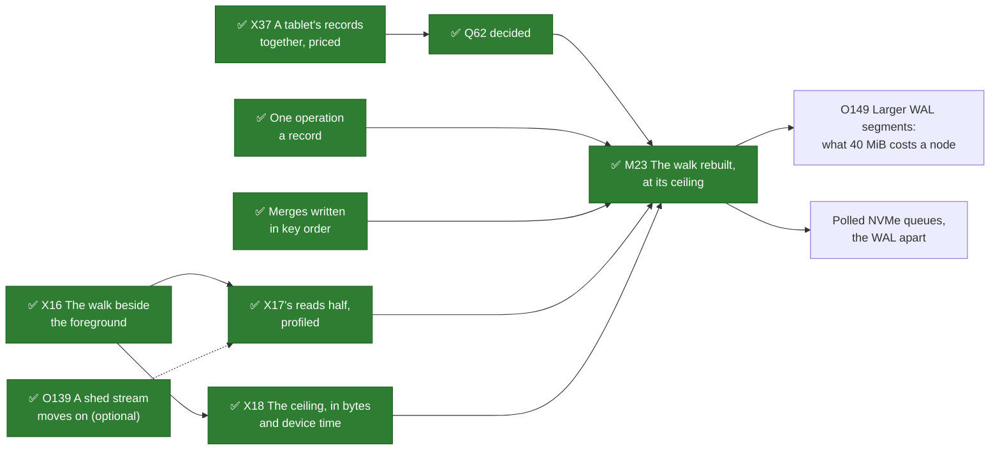

# W42. A scan's speed beside ScyllaDB's

## Context

[X20](scylladb-scan-sources.md) ran ScyllaDB 2026.3.4 on [X16](walk-beside-the-foreground.md)'s hosts
and devices. Beside the same cell, its full scan of a table of three million kibibyte rows read
1,395,000 rows a second, where Shoal's walk read 26,700 to 34,500 partitions a second: **40 to 52
times as fast**. Shoal's walk alone read 83,900 to 85,700 a second, so ScyllaDB beside the cell
against Shoal alone is about 16.5 times. ScyllaDB's figure is a lower bound: its scanner was four
Python processes sharing eight cpu threads with the cell's client.

This page says where the gap comes from, what each part of it buys Shoal, and what closes it. Two
decisions were taken with the user on 2026-10-29, after X20:

- **[M23](milestones.md#m23-the-walk-rebuilt-for-load) is judged on a scan's own rate**,
  [W12](performance.md#the-budgets)'s budget: a scan alone reads at least half of what its devices
  read sequentially, up to the ceiling. On the lab's SSDs that is the ceiling, 100 MiB a second a
  device, which is 100,800 of `Big`'s partitions a second a node: three times what the walk reads now.
- **The goal is the ceiling, reached cheaply**: few device reads and little cpu a partition. What
  ScyllaDB reads past the ceiling stays [X18](spikes.md#x18-table-reads-paced-by-idle-time)'s ceiling
  and [Q37](contract.md#questions-to-answer)'s cores of their own to decide, priced by the
  foreground's tail.

It is W42 because W numbers are shared by the future work's plans and never reused
([Future work](../overview.md#numbering)).

## What exists today

### Where a partition's time goes

Measured from X16's eight captures of `scan/Big/none`, both sides, the medians. Each host's device
and cpu counters span the arm's warmup and measured windows, so the partitions are both windows':

| A partition of `Big`, scanned alone | titan | hyperion | europa |
| --- | --- | --- | --- |
| Device reads | 0.99 | 0.99 | 0.99 |
| Device bytes | 1,592 | 1,594 | 1,595 |
| Device busy, any read in flight | 97% | 97% | 16% |
| Host cpu: user, system and interrupts, not idle or I/O wait | 75 µs | 73 µs | 42 µs, the bench's driver among it |
| Time in its page: a page's reads over its partitions | 218 µs | 213 µs | 29 µs |
| Pages in flight on the node | 7.4 | 7.0 | 0.6 |
| Partitions a second, the node | 33,900 | 32,700 | 20,700 |

[X6](../../object-storage/device-store-ssd.md#8-one-device-several-slices) measured the same devices: a
970 EVO answers a lone 4 KiB read in about 100 µs; fio reaches 215,000 random 4 KiB reads a second,
glommio about 188,000 from four executors at a total depth of 32 and 123,000 from one core, about
8 µs of cpu a read; europa's Optane answers a lone read in 17 µs. So on the Zen1 hosts a page waits
out a device's latency and then a few tens of µs of its shard's cpu for every partition, one
partition after another. The device is busy in that a read is in flight 97% of the time, but it
gives the scan about a sixth of the reads it can: the cell alone held the same devices 92% busy at
520 to 680 reads a second and the WAL's writes.

### What a page does for each partition

[F87](../../features/tablet-walk.md)'s walk, as F116 to F119 left it for a scan's page.
`PendingWalk::finish` (`shoal-core/src/server/tables/walk.rs:449-566`) takes the next entry of the
archive map's view, in key order; covers its bytes from the page's budget and its device's pace;
reads it; folds it; and takes a step. The read is three operations, each awaited:

1. **A duplicate of the archive's file handle.** `get_archive` returns the cached `DmaFile` `dup`ed,
   an `fcntl` (`shoal-core/src/server/tables/storage/fs/map.rs:1298-1305`; glommio's
   `glommio_file.rs:250-260`; [O15](../../appendix/optimizations.md#o15-one-partition-load-costs-a-dup-and-a-close)).
2. **One read**, `read_at(offset - 8, size + 8)`: the record's checksum and its payload
   (`map.rs:1330`). glommio rounds it out to the device's logical block
   (`glommio/src/io/dma_file.rs:223-224`), 512 bytes on every lab SSD, so `Big`'s 1,048 bytes become
   1,536 or 2,048 on the device.
3. **A close of the duplicate**, a second operation on the ring (`map.rs:1303`).

Then the checks: the record's gxhash64 (`verify_record`, `map.rs:1391-1415`), a full rkyv bytecheck
of the partition, its 1 KiB string's UTF-8 among it (`walk_fold`,
`shoal-core/src/server/tables/persistent/unsorted.rs:2102-2121`), and one copy into an aligned buffer
(`tables/walk.rs:744-748`). Nothing is read ahead and nothing is coalesced. A page never has two
records in flight, since the read and the close are both awaited before the loop goes on.

Two facts of the lab bear on what an operation costs. **No lab SSD has polled queues**:
`/sys/block/nvme0n1/queue/io_poll` and `nvme.poll_queues` read 0 on all three hosts on 2026-10-29, so
every read completes by an interrupt on glommio's main ring, and at a depth of one the executor
parks and wakes around each. **Each Zen1 node answered 1,500 to 1,700 sheds a second** of the bench's
scan streams, about 35 a page answered
([O139](../../appendix/optimizations.md#o139-a-scan-driver-asks-a-shed-tablet-again-where-another-tablet-would-be-answered)),
each an admin request answered in JSON.

**Inferred from the code, not profiled**: the path accounts for about 20 to 40 µs of the Zen1
hosts' 73 to 75. The ring's operations at a depth of one, with the park and wake around them, are
about 10 to 20 µs; the `dup` and the close 2 to 5; the index, the budget, the pace, the checksum,
the bytecheck and the copy 3 to 8; the sheds 3 to 8. The rest is the host's background, which no
capture measures alone, or not yet explained. So 73 µs is an upper bound on the walk's own cpu, and
a profile comes before any cpu lever is sized
([O141](../../appendix/optimizations.md#o141-a-walked-partition-costs-a-zen1-host-about-73-microseconds-of-cpu)).

### How a tablet's records lie on disk

A table's archives are its shard's: one active archive a shard, holding every tablet the shard hosts
(`shoal-core/src/server/tables/storage/fs/compactor.rs:230-235`;
[Archives and the Archive Map](../../storage/archives-and-map.md)). Two things write them:

- **A merge**, one for each sealed WAL segment and table (`shoal-core/src/server/shard/groups.rs:3131-3141`),
  10 MiB a segment by default (`shoal-core/src/server/conf/cluster.rs:569`). It writes the partitions
  it loaded in the iteration order of a `HashMap` (`compactor.rs:411`, `write_partition` `:752-773`),
  which std seeds at random, so a block holds every tablet's partitions of that segment in no order
  ([O142](../../appendix/optimizations.md#o142-a-merge-writes-its-partitions-in-a-hash-maps-order)).
  Since [F121](../../features/merges-in-key-order.md) (2026-10-30) it writes them in key order, a
  tablet's records of a block together; archives written before keep their order.
- **An archive pass** copies an archive's live records in key order, which is tablet order, but only
  an archive under half live, at most 16 MiB a pass and a pass a minute at most (`compact_archives`,
  `compactor.rs:1756`; `shoal-core/src/server/tables/storage/fs/conf.rs:182-197`). A table loaded
  once and never overwritten, as `Big` is, is never copied, and keeps its merges' order.

So on a Zen1 shard, which hosts about 819 of the 4096 tablets, `Big`'s 600 MB or so are about 61
merge blocks; a tablet is about 0.12% of the shard's records; and each block holds about 12 of a
tablet's records, about 870 KB apart, in no order. Only the archive map's index knows a tablet's
keys in order ([F76](../../features/paged-archive-map.md)), and reading them in that order reads the
file at random.

**Why O78's runs did not carry over.** A snapshot cut sorts a group's records by archive and offset
and reads them in runs: one archive, a span of at most a mebibyte, gaps of other records of at most
128 KiB (`cut_runs`, `compactor.rs:240-272`; `ArchiveMap::read_run_from`, `map.rs:1347-1382`).
Titan's cut of a Movie set went from 5.5 to 8.4 s to 0.55 s
([O78](../../appendix/optimizations.md#o78-a-snapshot-cut-read-one-record-at-a-time-in-key-order)).
A cut reads a whole group, a share of its shard dozens of times larger than one tablet's, so its
records lie close together. One tablet's do not. With gaps averaging 870 KB, a gap of 128 KiB or less
joins about 14% of a page's records, `1 − e^(−128/870)`. That spares about 100 of 732 reads while
reading about 6 MiB of other tablets' records for a page whose own are 0.8 MB. On a device with
random reads to spare it is a loss, and [W5](tablet-reader.md#3-read-archives-in-the-order-they-lie-on-disk)'s
third step, as it was written, would have taken it.

### What ScyllaDB does instead

ScyllaDB keeps a tablet's rows in its sstables sorted by token: a memtable is sorted, every flush
writes its rows in order, and compaction keeps a tablet's sstables few. After X20's load and flush
each node held one sstable a tablet ([x20-cluster.txt](../../../../shoal-spike/results/x20-cluster.txt)).
A range read opens the data file as a stream (`data_consume_rows`,
`sstables/sstable_mutation_reader.hh:122-133`) of 128 KiB buffers (`default_sstable_buffer_size`,
`sstables/sstables_manager.hh:52`) read four ahead (`sstable::data_stream`,
`sstables/sstables.cc:3214-3219`), with a history that adjusts how far ahead as reads prove useful.
All at `scylla-2026.3.4`, `daef9dad`. At 1,035 bytes a row on disk (3.1 GB for three million), a
buffer is about 126 rows: a device read for every hundred-odd rows, where Shoal's walk makes one a
partition.

### The gap, factor by factor

Like for like, both beside the cell, 40 to 52 times. The factors multiply to it:

| | Factor | Arithmetic | Size | Basis |
| --- | --- | --- | --- | --- |
| A | **A synced write's flush on the scan's device.** The cell's inserts sync their WAL on the 970 EVO the scan reads: a Zen1 page of `Big` read for 156 to 160 ms alone and 364 to 373 ms beside the cell, at the median, where europa's Optane took 21 and 25 ms. ScyllaDB's commitlog syncs every 10 s and answers a write before it does (`conf/scylla.yaml:60-61`), so its scan met no flush | 85,700 ÷ 34,500; 83,900 ÷ 26,700 | 2.5 to 3.1 | Measured; the cause is X16's |
| B | **Member shares.** The scan asks followers first and europa, at `lead_weight: 2`, leads most groups, so its Optane answers about a quarter of the pages, its devices idle 84% of the time. ScyllaDB's scanner dealt tablets over their replicas in turn | 3 × 33,300 ÷ 84,800 | 1.18 at least | Measured |
| C1 | **One read in flight a page.** A Zen1 node's shards are about half busy while every page waits on its one read | 5 cpus ÷ 73 µs = 68,500; ÷ 33,300 | 2.1 | Estimated |
| C2 | **Cpu a partition.** Up to 73 µs, against ScyllaDB's at most 10.8 µs a row: 465,000 rows a second a node on five shards | 465,000 ÷ 68,500 | 6.8 | Estimated |

B, C1 and C2 together are 16.8 times, the gap with Shoal alone; with A, 42 to 52 times, the gap
like for like. Two caps lie past these, neither binding today:

- **The ceiling**, 100 MiB a second a device, counted in record bytes (`tables/walk.rs:238-240`,
  `:507-509`): 100,800 of `Big`'s 1,040-byte partitions a second a node, three times what a Zen1 node
  reads now and 4.6 times under ScyllaDB's 465,000. Once C1 and C2 close, it is what binds.
- **The device's random reads**: at one read a partition, a 970 EVO stops near 200,000 a second
  however little cpu each costs, 2.3 times under ScyllaDB. Only a layout that keeps a tablet's
  records together passes it.

## The design

### What each choice buys, and what it costs

| Shoal's choice | What it buys | What it costs a scan | ScyllaDB's | Kind |
| --- | --- | --- | --- | --- |
| Rows resident, archives written once a merge and located by a map ([Storage](../../storage/overview.md)) | A write merged once and never rewritten while it is live; a get of an evicted partition is a probe and one read, across no other files | A tablet's records in no order on disk | Sorted flushes, and compaction rewriting them to keep a tablet's sstables few: write amplification, and a scheduling group of its own | Layout: changeable at the merge |
| A record a partition, checksummed and whole on its own ([F44](../../features/repair.md)) | A record verified, cut, installed, rehomed and scrubbed by itself | A read and a check a record, when a scan reads them one by one | Rows parsed out of a stream of buffers | Mechanism |
| The walk reads as a get does, a record at a time ([F87](../../features/tablet-walk.md)) | A get reads one partition, so one at a time is right for a get | A device's latency a partition, and three operations | A reader a range, reading ahead | Mechanism: the walk's, not a capability |
| Every write synced before it is answered ([F40](../../features/replication.md)) | An acknowledged write survives a crash of every copy | Flushes on the device the scan reads: factor A | A write answered before its commitlog syncs, every 10 s by default | Durability: kept |
| Isolation first: a ceiling, a trickle, a queue of low shares, two pages a shard ([W7](isolation.md)) | The foreground's tail beside a scan | A scan never past its ceiling, and slower beside load | Scans in the statement group beside reads, unpaced: the cell's p99 2.34 times while one ran ([X20](scylladb-scan-sources.md#what-the-run-says)) | Policy: kept |

Only the last two are kept on purpose. The first three are where the gap closes.

### What the decisions make of it

M23 judged on a scan's own rate makes the levers below M23's work, and "cheaply" needs a budget a
gate can judge. [W12](performance.md#the-budgets) gains one, provisional like its others: **a scan
alone at its rate reads at least ten partitions a device read and spends at most a fifth of X16's
cpu a partition on the Zen1 hosts**, about 15 µs, where X16 measured 0.99 reads and up to 73 µs.
X17 and X37 set it before M23.

### The levers, in the order they land

1. **Reads in flight within a page** ([W5](tablet-reader.md#3-read-archives-in-the-order-they-lie-on-disk)'s
   third step, at M23). Several records' reads are issued before the first is answered, in key order
   as today, each drawn from the budget ([F118](../../features/scan-budget.md)) and the pace
   ([F119](../../features/scan-pacing.md)) before it is issued, as a merge keeps 32 of its loads in
   flight (`compactor.rs:628-641`) and an archive pass 16. It hides the device's latency (C1), lets
   glommio submit and reap reads together, and is the one lever archives already written get.
   Estimated: a Zen1 node from 33,900 a second toward its cpu's wall, 70,000 to 100,000. ✅ **Built**
   as [F125](../../features/page-reads-in-runs.md) (2026-10-31), sixteen a page, issued in the order
   its merge needs them.
2. **One operation a record** ([W1](prerequisites.md), required for M23's rate; O15). A read borrows
   the cached handle rather than `dup`ing and closing it: two of a partition's three operations gone,
   for every get too. ✅ **Built** as [F120](../../features/one-operation-a-record-read.md) (2026-10-30), its
   figures X17's.
3. **The cpu a partition, profiled, then cut** ([O141](../../appendix/optimizations.md#o141-a-walked-partition-costs-a-zen1-host-about-73-microseconds-of-cpu)):
   the parks and wakes, the sheds' answers (O139 moves a shed stream on to another tablet), the copy,
   and whatever the profile names. Estimated, with the first two: the ceiling on SSDs, 100,800 a
   second a node, about three times today.
4. **Merges written in key order** ([W1](prerequisites.md), required for M23's rate; O142).
   `write_partition` takes `loaded`'s keys sorted, so each merge block holds a tablet's records
   together: about 12 of `Big`'s in about 12 KB a block. It is nearly free, a sort of some 9,800 keys
   a 10 MiB segment, and nothing reads a merge's order today: every reader finds a record through the
   map, and the compactor's tests order jobs, not records (`compactor.rs`, `order_tests`). ✅ **Built** as
   [F121](../../features/merges-in-key-order.md) (2026-10-30), whole records and fragments sorted together; its
   figures X37's.
5. **Runs where records lie together** (W5's third step, at M23). Over the fourth lever a page reads
   a run a merge block, about 61 reads for `Big`'s 732 records, joined only across gaps of a few KiB,
   never O78's 128 KiB, every record in a run verified as a lone read verifies it
   (~~`read_run_from`~~ `read_run_each`). ~~Two runs in flight a page~~ Sixteen reads in flight a
   page since X17, their buffers drawn from the budget. ✅ **Built** with the first lever as
   [F125](../../features/page-reads-in-runs.md) (2026-10-31).

What each step is expected to give a Zen1 node scanning `Big` alone. Every figure but today's is an
estimate, to be measured by X17 and X37:

| | Today, measured | After levers 1 to 3 | After 4 and 5 |
| --- | --- | --- | --- |
| Partitions a second | 33,900 | about 100,000, the ceiling | 100,800, the ceiling |
| Device reads a partition | 0.99 | 0.99 | about 0.08, one in twelve |
| Device bytes a partition | about 1,590 | about 1,590 | about 1,100 |
| Device reads a second, at that rate | 33,600 | about 100,000, half a 970 EVO's | about 8,400 |
| Host cpu a partition | up to 73 µs | what the profile leaves | a few µs |
| What binds past the ceiling | | the device's random reads, near 200,000 | the cpu |

After levers 1 to 3 a scan reaches its ceiling but not cheaply: half a 970 EVO's random reads, in
the queue a get's read and a commit's flush wait in. After 4 and 5 it reaches the same rate with a
twelfth of the reads, which is what the cost budget asks.

**Measured by X17 and X37** (2026-10-30, [X17's reads half](page-rebuilt.md),
[X37](tablet-records-together.md)), a scan of `Big` alone on X16's side cluster, four rounds a layout.
The estimates held in direction and were low on what the levers give: unpaced, the walk outran the
ceiling as soon as it had reads in flight, and runs read a tablet faster than the devices' default
ceilings by several times:

| | One record at a time | Sixteen reads in flight | Runs over merges in key order |
| --- | --- | --- | --- |
| Partitions a second, the cluster, unpaced | 150,000 | 484,000 | 1,720,000 |
| At the default ceiling, the cluster, round one | 166,000 | 249,000, titan at its ceiling | 250,000, titan at its ceiling |
| Device reads a partition | 1.01 | 1.01 | 0.09, 11.1 partitions a read |
| Device bytes a partition | 1,590 | 1,590 | 1,130 |
| A Zen1 host's node cpu a partition | 46.4 µs | 22.3 µs | 5.6 µs |

So the cost budget is met by levers 4 and 5 on a table loaded once, and missed by levers 1 to 3
alone, as the table above expected; the rate is the ceiling's, which the walk passes by 3.6 to 6.6
times unpaced. The order of worth is runs, then reads in flight, then one operation a record (a
fifth of a partition's cost one at a time, 8% at sixteen); O139 moved only europa's cost.

~~**Optional, any time**~~ **After M23**, planned since 2026-10-31 with the user, each with a page of its
own when it is taken up ([the milestones page](milestones.md#beside-the-gates)):

- **Consolidated merge blocks** for a table that is scanned: an archive pass that rewrites live
  archives a tablet range at a time. It lengthens a run from 12 records toward ScyllaDB's 126, and
  orders archives written before the fourth lever, at ScyllaDB's price, a write amplification.
- **Larger merge blocks**: a segment larger than 10 MiB, or several merged together, lengthens each
  block's stretch of a tablet at the cost of a merge's memory and its pause.
- **Polled NVMe queues** on a host, so glommio's poll ring takes the reads without an interrupt each.
- **The WAL on a device of its own**, the `latency_sensitive` root apart from the archives', which
  takes factor A away at a device's cost.

### Archives written before the fourth lever

They keep their order until an archive pass copies them, which it does only once they fall under
half live, so a table loaded once keeps its layout for good. The first lever is what they get;
consolidation would reorder them. M23's evidence loads its table after the levers land, and the
figures say which layout they were taken on.

### Past the ceiling

ScyllaDB read 465,000 rows a second a node, 4.6 times the ceiling, and doubled its cell's p99 doing
it on its shards. [X9](../../object-storage/table-latency.md) measured a different work at the same
rate: an object pool's units copied, checksummed, encoded and written in 64 KiB steps on the table
shards moved the cell's p99 1.51 times at 500 MiB a second, and nothing measurable on a core of its
own. Both say that work at that rate on the shards costs the foreground. Whether an idle device lets
a scan past its ceiling is X18's, which now measures against a walk fast enough to reach it, and
states the ceiling in device time as well as bytes: at one record a read, 100 MiB a second is about
100,000 reads, half a 970 EVO's; in runs of twelve records, about 8,400. Whether a scan at a device's
full speed gets cores of its own is Q37's, asked again after M25 as it was.

## Alternatives rejected

- **A sweep of a shard's archives in disk order.** It reads at a device's full speed with no layout
  change, but its cursor would name a file and an offset: a place, which
  [P25](contract.md#the-contract) forbids, and a sweep resumed across a compaction starts over, as
  O78's cuts do. A tablet at a time is what lets a page be asked again of another copy (P20). A
  backup already copies a group's archives whole ([F49](../../features/backup-and-recovery.md)); a
  scan is not that.
- **An archive a tablet group.** A tablet's records would lie together from the start, but a shard
  would hold thousands of files, every merge would write to all of them, and cuts, installs,
  rehomes and passes would be rebuilt around them. The fourth lever takes most of its gain for a
  sort.
- **ScyllaDB's model**, sorted runs kept few by compaction. It is what lets ScyllaDB read 128 KiB at a
  time, at a rewrite of every byte some times over and a scheduling group of its own. The fourth
  lever takes its flush's half for nothing; consolidation is its compaction's half, optional, where a
  table is scanned enough to pay for it.
- **O78's runs on today's layout.** A loss on a device with random reads to spare, as above.
- **More pages in flight a shard, instead of reads in flight a page.** The same reads, at the cost of
  a capture, a cursor and an admission each; F116 counts pages for the drivers' sake.
- **The ceiling's default raised to ScyllaDB's rate.** The foreground's tail pays, 2.34 times in
  X20, and the goal decided is the ceiling.
- **The bytecheck dropped after a checksum.** A checksum says the bytes are those written; the
  bytecheck says they are a partition, which a defect in a writer can break with a good checksum
  ([F4](../../features/validated-archives.md)). The profile says what it costs before anything is
  traded for it.

## What it costs

- **A deeper device queue** while a scan runs: the pace bounds a scan's bytes, not its reads in
  flight. X17 measures the foreground beside it.
- **A sort on the compactor**: some 9,800 keys a 10 MiB segment before its writes, and a vector of
  them in memory.
- **Bytes of other tablets** within a run's gaps; with gaps of a few KiB, little.
- **A gate that today's walk fails by three times**: X17 and X37 run before M23, and the levers land
  in it.
- **The budget's room.** ~~F118's default, four mebibytes a shard (`resources.scan_memory`), holds two
  pages and their reads in flight, and runs of tens of KiB, but not W5's two 1 MiB runs a page beside
  the page's own mebibyte: that would want six a shard for its two pages. The runs this page plans
  are a merge block's stretch, about 12 KB.~~ A page holds every run it read until its merge passes
  their last records, beside the partitions folded from them, about twice its byte bound, so since
  [F125](../../features/page-reads-in-runs.md) the default is eight mebibytes a shard
  ([O144](../../appendix/optimizations.md#o144-a-scan-page-holds-its-reads-beside-the-partitions-folded-from-them)).

## What it breaks

Nothing persisted and nothing on the wire. A record, its format and the archive map are unchanged:
only where a merge lays its records out moves, and no reader depends on that. A snapshot cut's runs
change shape, denser, which O78's benchmark will show.

## Invariants to uphold

- **A record read in a run is verified exactly as a lone read verifies it** (`verify_record`), and a
  run never hands on another tablet's record.
- **A merge's order moves no record's bytes and no map entry**, only the offsets they are written at.
- **Every byte a scan reads is drawn from its budget and its device's pace before it is issued**, a
  read in flight as much as a run.
- **The goal is the ceiling.** A lever that reaches a rate by passing the ceiling, the trickle or the
  scan queue's share is not this page's.
- **Measured and estimated stay apart** in every figure a gate is judged by.

## Prerequisites

[W1](prerequisites.md#required)'s two rows this page adds, one operation a record and merges written in
key order, both required at the start of M23 for its rate.

## How it would be measured

- **[X37](spikes.md#x37-a-tablets-records-together-priced)**, merges written in key order, priced:
  the merge's time and memory beside today's; a tablet's stretches on a shard, from the map, after
  `Big`'s load; runs a page; gets and cuts unchanged. Consolidation if X37 finds a tablet's stretches
  too short for the cost budget.
- **[X17](spikes.md#x17-a-page-rebuilt)**, extended: a profile of a walked partition on titan and
  europa (user, kernel, interrupts, ring operations a partition); an arm with only the background
  running; reads in flight at 1, 4 and 16; runs at gaps of 4 KiB and 128 KiB over both layouts; one
  operation a record; each against X16's baseline.
- **M23's exit**: a scan of `Big` alone at its ceiling on the lab's SSDs within W12's cost budget, and
  beside the cell within the foreground's.

## Acceptance tests

| Test | Gate | Proves |
| --- | --- | --- |
| `a_merge_writes_its_partitions_in_key_order` | M23 | A merged block's records ascend in key, and every one is where the map says; built with [F121](../../features/merges-in-key-order.md) |
| `a_walked_record_borrows_its_archive` | M23 | A record's read is one operation, with no handle duplicated or closed; built with [F120](../../features/one-operation-a-record-read.md) |
| `a_scan_page_keeps_its_reads_in_flight` | M23 | A page issues several reads before the first is answered, each drawn from its budget and pace first; built with [F125](../../features/page-reads-in-runs.md) |
| `a_record_in_a_run_is_verified_as_a_lone_read_is` | M23 | A run with one corrupt record refuses that record as a lone read would and hands on the others; built with [F125](../../features/page-reads-in-runs.md) |

`a_page_reads_its_archives_in_runs`, whose gap this page narrowed to a few KiB, is
[W5's row](tablet-reader.md#acceptance-tests) and is named there alone: since
[F122](../../features/scan-oracle.md) the acceptance check holds a test's name to one page across the
book, and this table named it a second time.

## The order

The levers and what measures them, against M23. Every box on the first level can start now.

~~Consolidated or larger merge blocks and polled NVMe queues with the WAL apart were optional, any
time.~~ Since 2026-10-31 both are planned after M23, decided with the user: M23's lab exit churns at
10 and 40 MiB segments, which says what a merge's block should be, and the host's settings are priced
on the rebuilt walk ([the milestones page](milestones.md#beside-the-gates)). The exit settled Q62 (no
consolidation), and a larger block is [O149](../../appendix/optimizations.md#o149-larger-wal-segments-keep-a-tablets-records-together-four-times-longer),
larger WAL segments, after M23 as the user decided the same day.

## Related

[X16](walk-beside-the-foreground.md) and [X20](scylladb-scan-sources.md), the two measurements this
page reads; [W5](tablet-reader.md), whose third step it amends; [W7](isolation.md) for the ceiling and
the shares; [W12](performance.md#the-budgets) for the budgets M23 is judged by;
[O78](../../appendix/optimizations.md#o78-a-snapshot-cut-read-one-record-at-a-time-in-key-order) for
runs where records are dense; [Compaction](../../storage/compaction.md) for the merge and the pass.
