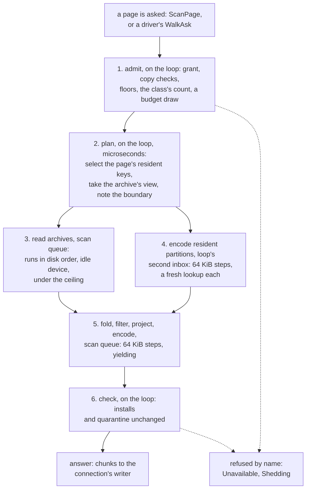

# W5. Reading a tablet on its shard

## Context

[F87](../../features/tablet-walk.md)'s walk is right about what a page of a tablet is: monotone
from a floor, each partition live at the floor handed out once, nothing held between pages, a copy
that is not whole refused. It was built for drivers that pace themselves by a device's idle time and
ask a page at a time. A client's scan asks for pages as fast as a shard answers them, from every
shard at once, and its pages are where the walk's execution shows. This page keeps the walk's
contract and rebuilds how a page runs, so that one engine serves the object store's drivers and a
client's scan alike.

## What exists today

**A page is captured on the loop, read off it, and checked on it again**
([F87](../../features/tablet-walk.md#a-page-is-captured-on-the-loop-and-read-off-it)):

1. *The capture*, synchronous on the loop: the tablet's resident keys past the cursor are filtered
   and sorted, all of them (`keys.sort_unstable()`, `shoal-core/src/server/tables/walk.rs:285-289`),
   and each is captured in order as `Whole` (its archived bytes, serialized if the partition is
   loaded, copied if it is accessible), `Overlay` (a sorted partition holding only rows written
   before its archive was read) or `Shadow` (a tombstone, or no live row), until the bounds are met
   (`:277-311`). In the same step, nothing awaited, the archive map's view of the range is taken
   (`ArchiveMap::scan_range`, `shoal-core/src/server/tables/storage/fs/map.rs:868-870`).
2. *The read*, a task in the shard's medium queue (`shoal-core/src/server/shard/walk.rs:619-622`):
   the captures and the view are merged in key order, and a partition only the archive holds is read
   through the map, one record at a time, each read awaited before the next
   (`shoal-core/src/server/tables/walk.rs:345-425`). A record whose archive was removed under the page
   is looked up again as the map is now, up to three times (`:51`, `:206-243`).
3. *The answer*, on the loop: a page whose group began an install or was quarantined while it read
   is refused (`shoal-core/src/server/shard/walk.rs:879-925`).

**What it measured.** On the lab a page stream read 31,000 to 44,000 partitions a second of an
unsorted table and 5,900 to 10,400 of an overlaid sorted one; the capture held the loop up to 4.7 ms
on a Zen1 host serializing a large resident keyword partition, nine times the high queue's 500 µs
goal; after a restart, with 79% of partitions archived, a page held the loop 2 to 12 µs and its reads
took 0.7 ms on europa and 3.3 ms on the Zen1 hosts
([F87](../../features/tablet-walk.md#walks-on-the-lab)). Its effect on a foreground's tail was never
measured.

**Archives are one file for many tablets, in the order compaction wrote them.** A table's archives
are its shard's, one active at a time, holding every tablet and group the shard hosts for it
(`shoal-core/src/server/tables/storage/fs/compactor.rs:230-235`). A merge writes the partitions it
loaded in a hash map's order; an archive pass copies live records in key order; and key order exists
only in the archive map's index ([Archives and the Archive Map](../../storage/archives-and-map.md)). So a
page that reads a tablet's archived partitions in key order reads its file in no order at all. O78
met exactly this in a snapshot's cut, which read a group's records one at a time in key order:
sorting them by archive and offset and reading runs of up to a mebibyte took titan's cut of a Movie
set from 5.5 to 8.4 s to 0.55 s (`ArchiveMap::read_run_from`,
`shoal-core/src/server/tables/storage/fs/map.rs:1303-1338`;
[O78](../../appendix/optimizations.md#o78-a-snapshot-cut-read-one-record-at-a-time-in-key-order)).

**A get makes what it reads resident.** A get of an archived partition inserts it, charges its bytes
to the shard's rows (`shoal-core/src/server/tables/persistent/sorted.rs:614-626`), and marks it
evictable at the recent end; a shard over its budget evicts forty percent of its rows
(`shoal-core/src/server/shard.rs:6869-6872`). **The walk inserts nothing**, moves nothing in the
eviction order and charges nothing.

## The design

### One engine, its contract kept

The walk's contract stays whole: the cursor, the floor and `at_least`, the boundary, the copy checks
before and after, the folds a table names for its partitions, and the rule that a moved record is
read where the map says it is now. What changes is how a page runs, in six steps. The object store's
drivers, backfill, copier, light scrub and reclaimer, move onto the rebuilt engine with it, keeping
their own admission ([W7](isolation.md#admission)), so recovery gains what scans gain and no second
reader has to keep the walk's invariants a second time.

### 1. Admit, on the loop

The grant, the table and the target are checked; the copy is held to its group as the walk holds it
today (`walk_copy`, `shoal-core/src/server/shard/walk.rs:741-814`), including `at_least` from the
page's floors; the scan class's count and a draw from its budget are taken ([W7](isolation.md)); and
at `Quorum`, for each group the request asks a barrier for, the shard takes one through the barrier
path a strong read already uses ([C6](../../distributed/reads.md#the-strong-read)). A page that cannot
be admitted is refused by name before anything is read.

### 2. Plan, on the loop, serializing nothing

For each tablet in order from the open cursor, the shard **selects** the page's resident keys past
the cursor, the smallest few that could fit its bounds, rather than sorting every resident key of
the tablet, and notes each one's size and kind from what the partition already records. It takes the
archive map's view of the range up to the page's estimated end, and notes the boundary and the
group's install count. Nothing is serialized and nothing is awaited between the keys and the view, so
the two still describe one moment. The step is microseconds: a selection over the tablet's resident
keys and a copy of the index's delta, never a partition's bytes.

### 3. Read archives in the order they lie on disk

The view's entries for the page are sorted by archive and offset and cut into runs, O78's rule: one
archive, a span of at most a mebibyte, gaps of other groups' records of at most 128 KiB. Each run is
one read through `read_run_from`, every record in it verified as a single read verifies it, at most
two runs in flight for a page, each issued only while its device is idle of foreground reads and
drawn from its ceiling ([W7](isolation.md#device)). The records are handed on in key order. A record
whose archive was removed under the page is looked up as the map is now, as today.
[X17](spikes.md#x17-a-page-rebuilt) measures what this buys a scan; O78 is why it is expected to.

### 4. Encode resident partitions in steps, on the loop

A resident partition belongs to the shard's loop and is read there. The planned resident keys are
encoded from a **second inbox** the loop drains only when its main inbox is empty, at most 64 KiB of
a partition's bytes a step, each step beginning with a fresh lookup of the key:

- **still resident**: serialized as it is now (a whole partition), or taken as it is now (an
  overlay), and folded over a **fresh** archive lookup made in the same step, never over the plan's
  view;
- **evicted since the plan**: read from its archive as the map holds it now, which is at least as new
  as its resident state was;
- **deleted since the plan**: a shadow now, and handed out as nothing.

### Why deferring is sound

A page promises each partition at or after its boundary, not every partition at one index
([F87's limitations](../../features/tablet-walk.md#limitations)). A partition encoded later than the
plan is newer, which the promise allows. Three facts make "newer" true, each owned by another part
of the engine, so each gets a test named after it:

1. **Eviction drops only a flushed generation.** A partition leaves memory only once its state is in
   an archive ([Memory and Eviction](../../tables/memory-and-eviction.md#becoming-evictable)), so a key
   evicted after the plan is found in the archive at its state or a newer one.
2. **Compaction writes before it repoints, and repoints before it removes.** A merge writes records,
   then intents, then repoints the map, then removes the log, then marks partitions evictable
   ([Compaction](../../storage/compaction.md)). A fresh lookup can only find a state at least as new as
   the one the plan saw.
3. **An overlay is folded over an archive state from the moment it was taken, or later.** Marking a
   generation evictable sweeps the flushed tombstones out of a sorted partition's overlay
   ([Compaction](../../storage/compaction.md#6-mark-evictable)). An overlay taken after that sweep and
   folded over the plan's older view would have lost the tombstone that hides a row the older archive
   still holds, and would hand a deleted row back. So an overlay is always folded over a lookup made
   when it was taken.

And one fact is not owned by any of them: **an install replaces a copy's files whatever their
generations** (`evict_tablets`, `shoal-core/src/server/tables/persistent/unsorted.rs:2111`). That is
why the check at the page's end stays: a page whose group began an install while it read is refused,
its rows never sent.

### 5. Fold, filter, project and encode in the scan queue

The resident and archived partitions are merged by key and folded by the table's own folds. Each
live row is held to the page's filter where it lies, archived (`is_filtered_archived`, the evaluator a
get's filter already uses, [Query Execution](../../tables/query-execution.md)), a projection is built
row by row as a get's is ([F2](../../features/projections.md)), and rows are encoded into rkyv chunks of
at most 64 KiB, each drawn from the scan budget before it is allocated. Every step yields; the queue
has a latency goal, so a yield is real ([S13](../../object-storage/isolation.md#shared-executors-or-dedicated-ones)).
A page's work bound counts the bytes it read, not the rows it kept, so a filter that keeps little
still ends its page in time.

**A limit is the client's.** A scan's limit across tablets is enforced by the driver, which stops
asking; a page's row bound is a bound, not a limit.

These functions take owned bytes and return owned chunks. Nothing in them reaches a table, so a later
change could run them on an executor of its own ([Q37](contract.md#questions-to-answer)).

### 6. Check and answer, on the loop

The copy is checked again, as the walk checks it: an install begun or a quarantine set while the page
read refuses it `Unavailable`, and none of its rows is sent. Otherwise its chunks go to the
connection's writer, which every shard can reach (`shoal-core/src/server/shard.rs:7056-7066`).

### Never resident

Nothing a page reads is inserted into a table, moved in the eviction order or charged to the rows'
budget. A scan of a table larger than memory leaves the table's hot set where it was. ScyllaDB's
`BYPASS CACHE` is a clause a query has to remember ([W3](prior-art.md#scylladb)); here it is how the
reader is built.

### Saved positions (optional)

ScyllaDB saves a scan's readers between pages, keyed by the query's id, for ten seconds, and measured
30% more range-scan throughput and up to 73% fewer disk operations for a read when it did
([W3](prior-art.md#scylladb)). Shoal's re-seek is different: a page selects its keys again from the
tablet's resident map and reads its range of the index again, from runs read 64 KiB at a time. Whether
that is worth saving is [X17](spikes.md#x17-a-page-rebuilt)'s to price. If it is, a saved position is
a cache, keyed by the scan's id, short-lived, drawn from the scan budget and the first thing dropped
under pressure, and never the scan's state: a page that finds nothing saved reads exactly as it would
have ([optional, any time](milestones.md#optional-any-time)).

## Alternatives rejected

**A scan through the get path.** It makes every partition it reads resident and evicts the hot set
to do it; it would also park the scan's reads among the gets'.

**Copying resident bytes at the plan, as the walk does.** A large resident sorted partition held the
loop 4.7 ms. A scan asking pages from every shard would make that routine.

**A reader of its own beside the walk.** Recovery would be untouched by it, which is its appeal. It
would also keep the overlay merge, the moved record, the install check and the folds a second time,
and two copies of those invariants is where [item 241](../../appendix/known-issues.md) came from:
the scrub's cut kept them separately, and missed one.

**A snapshot of the tablet held for the scan.** F87 rejected it for the walk: handles to old archives
and copies of resident rows held for as long as a driver paces itself, compaction's space never
reclaimed, a new leader starting over. A client paces itself even more freely.

**Reading archives on another executor.** Files and resident partitions belong to the shard; a
second executor would need the shard's descriptors and would hop the bytes anyway. The pure functions
of step 5 leave the door open to moving the cpu-heavy part, measured first.

**Ordered maps for resident partitions**, so a page would not select. Every get would pay a tree's
depth; F87 rejected it for the same reason.

## What it costs

- **On the loop**: a selection and a view a page, then encoding steps of at most 64 KiB, each only
  when the loop has nothing else to do. The budget is no step over 100 µs ([W7](isolation.md#the-budget)).
- **In the scan queue**: folding, filtering and encoding, about one decode and one encode a row; a
  projection costs more, field by field.
- **On a device**: what the page reads, in runs, in idle time, under a ceiling. More than the rows
  handed out where a filter keeps little, and where a run spans other groups' records.
- **A second lookup** for every resident partition encoded later than the plan.
- **Memory**: a page's buffers, from the scan budget.

## What it breaks

Nothing in the walk's contract. The drivers' pages change how they run and not what they promise,
so every test on F87's page has to pass unchanged; a driver that read a whole partition's captured
bytes at the capture now reads them at the encode, which nothing outside the engine can see.

## Invariants to uphold

- **The plan and the archive's view are taken with nothing awaited between them**, as the walk's
  capture and view are.
- **A resident partition encoded after the plan is looked up again**, and if it is gone, read from its
  archive as the map is now.
- **An overlay is folded over an archive state from when it was taken or later**, never over the
  plan's view.
- **A page whose group began an install while it read is refused**, its rows never sent.
- **Nothing a page reads becomes resident.**
- **Every step yields, and no step on the loop holds it longer than 100 µs.**

## Prerequisites

[W1](prerequisites.md)'s scan class (the queue, the yields and the second inbox), the budget, the
device pacing and the admission class, all at the start of [M23](milestones.md#m23-the-walk-rebuilt-for-load).

## How it would be measured

[X16](spikes.md#x16-the-walk-beside-the-foreground) measures the walk as it stands beside the
reference cell, the baseline no one has taken; [X17](spikes.md#x17-a-page-rebuilt) measures each
step of the rebuild against it, on a resident sorted table and on a table larger than memory.
[M23](milestones.md#m23-the-walk-rebuilt-for-load)'s exit is the budget, with the drivers moved.

## Acceptance tests

| Test | Gate | Proves |
| --- | --- | --- |
| `a_planned_page_serializes_nothing_on_the_loop` | M23 | The plan selects keys and takes the view, and the loop holds no step longer than its bound |
| `an_evicted_partition_is_read_from_its_archive_at_or_after_the_boundary` | M23 | A key evicted between the plan and its encode is handed out from the archive, never older than the boundary |
| `a_swept_overlay_never_brings_a_deleted_row_back` | M23 | An overlay taken after a sweep, folded over a fresh lookup, hides every row deleted before it |
| `a_compaction_under_a_page_is_read_where_it_moved` | M23 | Records moved by a merge or an archive pass between the plan and the read are found, at or after the boundary |
| `an_install_under_a_page_refuses_it` | M23 | A page whose group began an install while it read sends no row |
| `a_page_reads_its_archives_in_runs` | M23 | A page's archived records are read in disk order and handed out in key order |
| `nothing_a_scan_reads_becomes_resident` | M23 | A scan of an archived table changes no row count, no eviction order and no resident set |
| `every_walk_test_passes_on_the_rebuilt_engine` | M23 | F87's tests, unchanged, on the drivers moved onto the engine |

## Related

[F87](../../features/tablet-walk.md), whose contract this keeps; [O78](../../appendix/optimizations.md#o78-a-snapshot-cut-read-one-record-at-a-time-in-key-order)
for reads in disk order; [W7](isolation.md) for the queue, the budget and the device;
[Compaction](../../storage/compaction.md) and [Memory and Eviction](../../tables/memory-and-eviction.md)
for the three facts deferring stands on.
