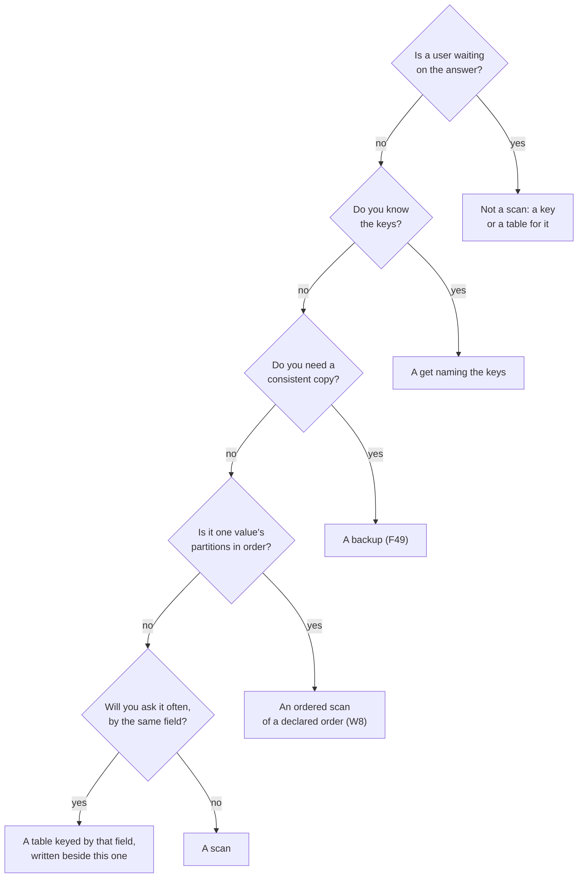

# W11. Tradeoffs, and when not to scan

## Context

Every choice on these pages bought something and cost something, and a scan itself is a tool with a
price a user pays. This page puts both in one place: what a scan costs the person who calls it and
when not to call it, and each design choice beside what it cost and what its alternative would have.
Each row points to the page that argues it.

## What exists today

No scan. A query names its partitions; a get naming many keys reads them in one round trip a node
([Reading many partitions at once](../../performance/fanout.md)); a sorted partition's rows are read in
ranges ([F1](../../features/sort-key-ranges.md)); a consistent copy of a table is a backup, cut a group at
a time at committed boundaries ([F49](../../features/backup-and-recovery.md)); and an operator walks a
tablet through an admin read ([F87](../../features/tablet-walk.md)).

## The design

### What a scan costs the person who calls it

1. **A scan costs what the table costs, not what it returns.** A filter that keeps one row in a
   million reads the million. Only an ordered scan of a declared order reads in proportion to its
   range ([W8](declared-order.md)).
2. **Filters save bytes moved, not bytes read**, and a projection saves the network, not the disk. A
   page is bounded by what it reads, so a selective filter returns short pages, often empty ones
   ([W4](cursor-and-pages.md#bounds-and-short-pages)).
3. **At `One` a row may be stale**: a copy's committed state, which a recent write may have moved past;
   never an uncommitted write. `Quorum` costs one barrier a group and sees every write acknowledged
   before the scan reached the group ([W6](distribution.md#floors-and-barriers)).
4. **There is no snapshot.** A row may be handed out in its state before a concurrent write or after
   it; a partition made or removed while a scan runs may or may not be in it; two partitions of two
   groups are never read at one moment. A scan is a sequence of moments that never go back
   ([W13](contract.md#the-contract)). A consistent copy is a backup's job.
5. **A short or empty page is normal**, and the end is a flag. A caller that counts rows to decide it
   is done will stop early.
6. **A scan is slower when the cluster is busy, on purpose.** It reads a device only in its shards'
   idle time, under a ceiling, and at its trickle on a shard that is never idle; how long a scan takes
   is not promised ([W7](isolation.md#device)).
7. **A scan's speed has a ceiling**, near 100 MiB/s ~~a node~~ a device on the table shards by
   default. Faster would cost the foreground's tail or cores of its own, and is a decision of its own
   ([Q37](contract.md#questions-to-answer)). ScyllaDB's unpaced scan read 4.6 times that a node and
   doubled its foreground's tail ([W42](scan-speed.md)).
8. **A declared order is fixed when its table is made.** Changing the placement fields, the order
   fields or the spread is a new table filled from a scan of the old ([W8](declared-order.md#the-lineage)).
9. **A placement value is one group's writes and one tablet's bytes.** A large value needs a spread,
   which divides its writes and multiplies an ordered scan's tablets by the same number.
10. **An ordered page that is not covering reads its partitions at random**, in the index's order and
    not the archives'.
11. **A listing is unordered at first, and reads whole rows**, an inline object's bytes included,
    though it never sends them ([W9](bucket-listing.md#what-a-listing-reads)).
12. **A resume token lasts until its table's schema changes**, and is refused by name after.
13. **A scan needs a grant of its own**, which an application that only reads by key should not be
    given ([W10](api.md#grants)).

### When not to scan

- **On a request's path.** A scan is a throughput tool. A user waiting on a page is waiting on idle
  time.
- **To find a few rows by a field that is not a key, often.** Every such scan reads the table; a
  table keyed by that field, written beside the first, reads one partition.
- **To read keys you already know.** A get naming them reads only them, in one round trip a node.
- **To count often.** Every count reads the table; a counter kept as rows is read in one get.
  Aggregates pushed to the shards are a later addition, and they would still read every row
  ([milestones](milestones.md#optional-any-time)).
- **To take a consistent copy.** A backup cuts every group at a committed boundary
  ([F49](../../features/backup-and-recovery.md)); a scan does not.
- **With one huge placement value and no spread.** Its scan is one stream and its writes one leader.

### When to scan

Exports and migrations; a backfill or a reindex into another table; an analytics batch; verification
and repair tools; listing a bucket for an operator or a sync; filling a table of a declared order from
the table it replaces.

### What each design choice cost

| Choice | What it buys | What it costs | The alternative, and its cost |
| --- | --- | --- | --- |
| A scan in hash order ([W2](ordering.md)) | No layout and no format; a total, stable, splittable order exists already | No order a person would choose | Range placement: hot spots on sequential keys, and placement, routing and moves redesigned |
| The client drives ([W6](distribution.md)) | No hop between nodes, no server state, recovery on any copy | Every client language needs a driver; a thin client cannot scan ([Q42](contract.md#questions-to-answer)) | A coordinator: a hop for every page, peer streams that do not exist, a scan's state in a node |
| A page carries many tablets of one shard ([W4](cursor-and-pages.md)) | An empty table in a page a shard; no concurrency to grow | A page's figures mix tablets | A page a tablet: 4096 requests a table |
| Pull, one page in flight a stream ([W4](cursor-and-pages.md#pull-one-page-in-flight)) | An idempotent request, failover by asking again | A round trip a page a stream, offset by streams in parallel | One request streaming every page: a session on one copy, failover that loses pages in flight |
| Rows re-encoded on the shard ([W4](cursor-and-pages.md#the-answer-scananswer)) | Filters and projections where the rows are; no server type on the wire | A decode and an encode a row | Partitions as they lie: the client decodes for free, but no filter, inline bytes shipped, and a server layout frozen into the wire |
| Pages only move forward, per group ([W13](contract.md#the-contract)) | Nothing held between pages; compaction never blocked | No moment across a table | A snapshot a group: archives held from compaction for as long as a client paces itself |
| Followers first ([W6](distribution.md#choosing-copies)) | A scanned group's leader keeps its writes and strong reads | Staleness at `One` | Leaders: freshest, and in the way of every write |
| One barrier a group at `Quorum` ([W6](distribution.md#floors-and-barriers)) | A barrier's cost once, not a page | Later pages see writes before the group's first page, not each page's | A barrier a page: a round each for no promise a scan needs |
| On the shard, in a scan queue ([W7](isolation.md#cpu)) | Rows read where they live; no cores given up | A cost to the tail at high rates, so a ceiling | Cores of their own: cores, and every byte hopped from the shard that owns it |
| Idle time, a ceiling and a trickle ([W7](isolation.md#device)) | Fast when the device rests, gentle when it does not | A scan slows under load | A fixed rate: too slow when idle, too fast when busy ([X12](../../object-storage/recovery-scrub-rates.md)) |
| Admission apart from the drivers' ([W7](isolation.md#admission)) | A client never sheds recovery | Two counts to set | One count: an export sheds a backfill |
| Resident partitions encoded later, in steps ([W5](tablet-reader.md#why-deferring-is-sound)) | Loop holds of microseconds | A second lookup a partition, and three invariants to keep, each with its test | Bytes copied at the capture: holds of milliseconds |
| Archives read in disk order ([W5](tablet-reader.md#3-read-archives-in-the-order-they-lie-on-disk)) | O78's tenfold on a snapshot's cut; on a scan's page only where merges lay a tablet's records together ([W42](scan-speed.md)) | A run reads through other groups' records | Key order: a read a record, at random |
| Merges written in key order ([W42](scan-speed.md)) | A tablet's records together in every merge block, so a page reads a run a block | A sort of each merge's keys | Hash order: free, and a page a read a record |
| A declared order kept by an index ([W8](declared-order.md)) | Rows stay partitions: conditions, eviction and fragments unchanged | A persisted index that every path moving a tablet's data must carry | A remap onto sorted partitions: a value read whole when cold, conditional writes rewriting its base, eviction all or nothing |
| Spread ([W8](declared-order.md#spread)) | A large value's writes divided | An ordered page reads N tablets and merges | No spread: one leader a value; salting by hand |
| A `scan` privilege ([W10](api.md#grants)) | A reader by key cannot read everything | One more privilege to grant, and an activation | `read` implies `scan`: every reader can read every row |
| An unordered listing first ([W9](bucket-listing.md)) | A listing is a scan with a projection | No S3 order yet | An ordered listing first: an index and a layout decision before any listing |
| A listing over the scan frames ([W9](bucket-listing.md#on-the-wire)) | One paging path and one isolation path | A listing entry's shape is new | An object operation: a second paging scheme in a head built for one object |

## Alternatives rejected

A page that listed costs without the alternative beside each: a cost means nothing next to nothing.

## What it costs

Nothing of its own; this page is a summary.

## What it breaks

Nothing.

## Invariants to uphold

- **Every choice above has its cost written beside it**, here and on its page; a choice whose cost is
  found later is added, not left to be rediscovered.

## Prerequisites

None.

## How it would be measured

Each cost above that is a number is measured where its page says: the foreground beside a scan by
[W12](performance.md), the reader's steps by [X17](spikes.md#x17-a-page-rebuilt), the ceiling by
[X18](spikes.md#x18-table-reads-paced-by-idle-time), a listing's bytes by [X19](spikes.md#x19-the-edges)
and a declared order by [X21](spikes.md#x21-declared-order-priced).

## Acceptance tests

None of its own; every row's test is on its page.

## Related

[W2](ordering.md) and [W7](isolation.md), where the largest of these tradeoffs are argued;
[W3](prior-art.md) for how other stores made the same choices.
