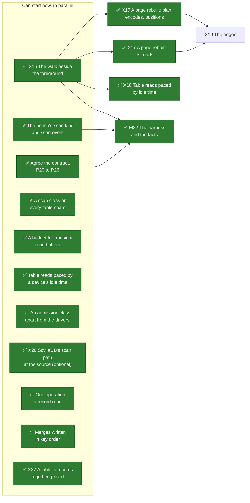
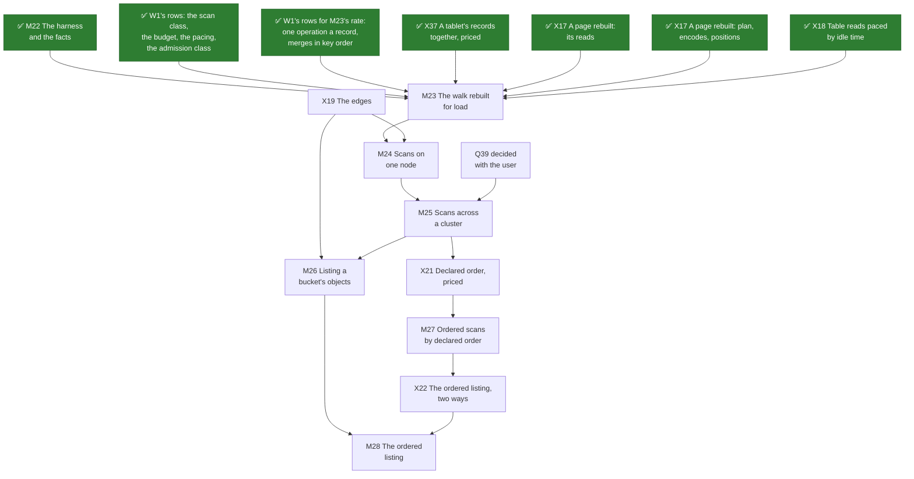
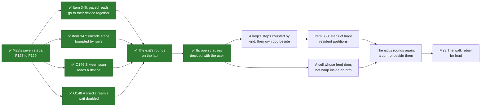
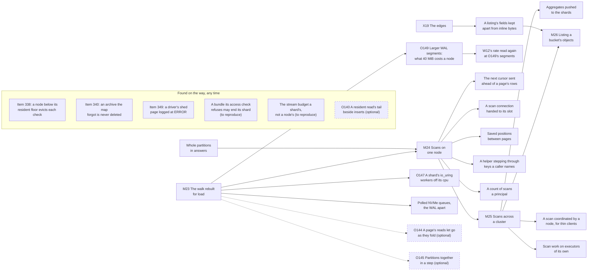

# What's left to do

**The order of the work, drawn.** The pages before this one say what has to be done and why; this one
says in what order, on two diagrams: the work up to the first gate, and the gates after it. ~~As of
2026-10-25, when this plan was drawn, nothing on either diagram is done.~~ As of 2026-10-29 the contract
is agreed ([W13's record](contract.md#before-m22-the-contract-agreed-2026-10-29)), and the bench's scan
kind and event ([F115](../../features/bench-scans.md)), the admission class
([F116](../../features/scan-admission.md)), the scan class ([F117](../../features/scan-class.md)), the
budget ([F118](../../features/scan-budget.md)) and the device pacing ([F119](../../features/scan-pacing.md))
are built, and X16 is measured ([its record](walk-beside-the-foreground.md)), so M22's three inputs are
in and X17 and X18 can start; X20, optional, is read and run ([its record](scylladb-scan-sources.md)); and
since [W42](scan-speed.md), the same day, two more W1 rows and X37 feed M23, which is now judged on a
scan's own rate and cost too. ~~Nothing else on either diagram is done.~~ Since 2026-10-30 those two rows
are built ([F120](../../features/one-operation-a-record-read.md), [F121](../../features/merges-in-key-order.md)) and
M22 is delivered ([F122](../../features/scan-oracle.md)), so the first gate is behind the plan; ~~nothing else is
done~~ and X37, both halves of X17 and X18 are measured ([X37](tablet-records-together.md),
[X17](page-rebuilt.md), [X18](table-reads-paced.md)), X17 drawn as its two halves. ~~Nothing else is done.~~
Since 2026-10-31 M23's seven steps are built (F123 to F129) and its exit is run on the lab
([its record](m23-exit.md)): its box stays open, ~~since four of its clauses are the user's to read on the
record's evidence, and its step clause waits on
[item 350](../../appendix/known-issues.md#350-a-scans-steps-of-large-resident-partitions-hold-their-loop-past-100-µs)~~
since the user decided its four open clauses the same day ([the decisions](m23-exit.md#decided-with-the-user-2026-10-31)):
item 350 is fixed and the exit's rounds are run again with a cell whose feed does not wrap, which
[Finishing M23](#finishing-m23) draws, and O147 and O149 follow M23. Nothing else is done.

**How to read them.**

- An arrow points from a piece of work to what requires it. Things on one level, with no arrow
  between them, can be done in parallel.
- A green box with a ✅ is done.
- A box titled *(optional)*, with a dashed border, can be left out without anything built having to
  change; a dashed arrow means *helps*, not *requires*. Each one's reason is on the page that lists
  it.
- A box beside a gate lands no later than the start of that gate, and nothing stops it landing
  sooner ([W1](prerequisites.md#the-order)).
- A box named for an item or an O number is a defect or an optimization found on the way, drawn
  where it belongs: before what it blocks, after what it is scheduled after, or under *Found on the
  way, any time* when no gate waits on it.

The full list of what each gate requires is on [the milestones page](milestones.md#the-gates-at-a-glance);
the diagrams draw an arrow only where no longer path already implies it.

## Before the first gate

Everything in the first box can start now. The spikes after it wait on X16's baseline, which says
which part of the walk hurts a foreground first.

The two W1 rows and X37 that [W42](scan-speed.md) added feed M23, on the second diagram. X20 feeds no
gate. It read ScyllaDB's scan path at a pinned release and ran a ScyllaDB on the lab
beside X16's foreground; [W3](prior-art.md) marks what it confirmed, and W13 records its run as
evidence for Q33, Q34 and Q37 ([the record](contract.md#x20-run-evidence-for-q33-q34-and-q37-none-settled-2026-10-29)).

## The gates

The chain is the claim [the milestones page](milestones.md#the-order-is-a-claim) argues for: the engine
before the wire, one node before a cluster, scans before a listing, the listing before ordered scans,
ordered scans before the ordered listing. Two of its places are convenience: M26 needs M25 and nothing
after it, and M27 can start beside M26 once X21 reports, which the diagram draws as the siblings they
are. ~~The rest of the optional work, a stepped-keys helper, scan work on executors of its own, the next
cursor sent ahead of a page's rows and a count of scans a principal, is on the milestones page; it
changes no box here.~~ The work that was optional, any time, is planned since 2026-10-31 and drawn
below, beside the gates it follows.

## Finishing M23

M23's box on the diagram above stays open until the work drawn here is done. Its seven steps are built,
and its exit ran on the lab on 2026-10-31. The exit's quick passes found four things, fixed before its
rounds; the rounds left four clauses to the user, decided the same day
([the decisions](m23-exit.md#decided-with-the-user-2026-10-31)). Two of those decisions leave work in
M23: item 350, attributed and then fixed, and a cell whose own feed does not wrap inside an arm. The
exit's rounds are then run again, a control beside them, and the insert and step clauses read on
those rounds. The other two clauses are read on the evidence there is: W12's cost above the idle node,
and W12's rate as the share's.

Counting a loop's steps by kind, a page's capture apart from an encode step, with each step's bytes,
rows and own cpu beside its wall time, comes first: item 350 is not yet reproduced, and its three
candidates need different fixes. The step clause is read on a step's own work, and a step past
100 µs by the wall alone is named as O147's, which follows M23. Items 348 and 349, also found by the
exit's rounds, are not M23's: each was the same before M23. Item 349 is drawn below, and item 348,
the object store's, on [its plan's diagram](../../object-storage/whats-left-todo.md#the-gates).

## The work beside the gates

None of this is needed by a gate. ~~Every piece of it is planned~~ Every piece of it but the optional
boxes and what was found on the way is planned, decided with the user on 2026-10-31: each sits after the gate whose work it builds on and where it can first be measured, or
feeds the gate that lands it ([the milestones page](milestones.md#beside-the-gates) says why each sits
where it does). The gates are the ones above, drawn left to right.

Whole partitions in answers feeds M24, since it changes what an answer carries and lands with it; a
listing's fields kept apart feeds M26 for the same reason, decided by X19 before buckets hold much.

O149 and O147 follow M23, as the user decided on 2026-10-31. A larger segment is the larger merge block
this diagram drew until then. M23's exit found that consolidation is not needed after an hour's churn
([Q62](contract.md#questions-to-answer)). It also found that 40 MiB segments keep four times a tablet's
records together a read, so what remains is what a larger segment costs a node's foreground, memory
and start. W12's rate is read again at the segments O149 sets, since a cheaper mebibyte buys the same
share more bytes than more device time would. O144 and O145 are optimizations of the rebuilt walk that
the exit did not take up: optional, after it.

The work found on the way waits on no gate. Its two defects to reproduce are recorded on
[W1's page](prerequisites.md#found-on-the-way) and are filed once a test shows them; the rest are on
[Known Issues](../../appendix/known-issues.md) and [Optimizations](../../appendix/optimizations.md).

## Keeping it current

**Whoever finishes a piece of work turns its box green in the same change**, with a ✅ at the start of
its label and `:::done` after it, as the object storage part's boxes were turned
([its page](../../object-storage/whats-left-todo.md#keeping-it-current)). A piece of work that is added,
split or dropped is added, split or dropped here too, and an optional one says *(optional)* in its
title. **Every defect and optimization found on the way is drawn here in the same change that files
it**, where it belongs, and a gate built in steps is drawn down to them, as M23 is. The conventions are
`CLAUDE.md`'s, under *Planning Docs*.

## Related

[W1](prerequisites.md) for the rows the gates begin with; [Spikes](spikes.md) for what has to report
first; [Milestones](milestones.md) for what each gate delivers; [W13](contract.md) for the questions and
the record.
