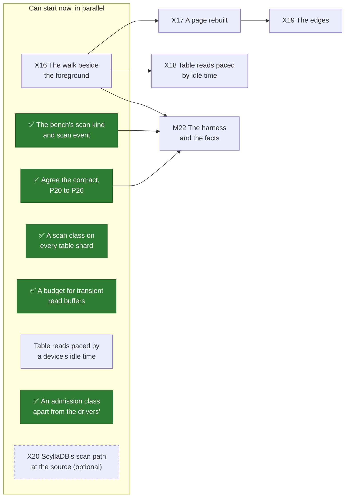
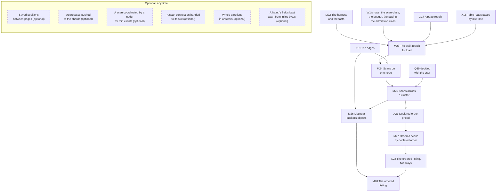

# What's left to do

**The order of the work, drawn.** The pages before this one say what has to be done and why; this one
says in what order, on two diagrams: the work up to the first gate, and the gates after it. ~~As of
2026-10-25, when this plan was drawn, nothing on either diagram is done.~~ As of 2026-10-29 the contract
is agreed ([W13's record](contract.md#before-m22-the-contract-agreed-2026-10-29)), and the bench's scan
kind and event ([F115](../../features/bench-scans.md)), the admission class
([F116](../../features/scan-admission.md)), the scan class ([F117](../../features/scan-class.md)) and the
budget ([F118](../../features/scan-budget.md)) are built; nothing else on either diagram is done.

**How to read them.**

- An arrow points from a piece of work to what requires it. Things on one level, with no arrow
  between them, can be done in parallel.
- A green box with a ✅ is done.
- A box titled *(optional)*, with a dashed border, can be left out without anything built having to
  change; a dashed arrow means *helps*, not *requires*. Each one's reason is on the page that lists
  it.
- A box beside a gate lands no later than the start of that gate, and nothing stops it landing
  sooner ([W1](prerequisites.md#the-order)).

The full list of what each gate requires is on [the milestones page](milestones.md#the-gates-at-a-glance);
the diagrams draw an arrow only where no longer path already implies it.

## Before the first gate

Everything in the first box can start now. The spikes after it wait on X16's baseline, which says
which part of the walk hurts a foreground first.

X20 feeds no gate. It reads ScyllaDB's scan path at a pinned release and, if run, a ScyllaDB on the
lab beside a foreground; [W3](prior-art.md) marks what it would confirm.

## The gates

The chain is the claim [the milestones page](milestones.md#the-order-is-a-claim) argues for: the engine
before the wire, one node before a cluster, scans before a listing, the listing before ordered scans,
ordered scans before the ordered listing. Two of its places are convenience: M26 needs M25 and nothing
after it, and M27 can start beside M26 once X21 reports, which the diagram draws as the siblings they
are. The rest of the optional work, a stepped-keys helper, scan work on executors of its own, the next
cursor sent ahead of a page's rows and a count of scans a principal, is on
[the milestones page](milestones.md#optional-any-time); it changes no box here.

## Keeping it current

**Whoever finishes a piece of work turns its box green in the same change**, with a ✅ at the start of
its label and `:::done` after it, as the object storage part's boxes were turned
([its page](../../object-storage/whats-left-todo.md#keeping-it-current)). A piece of work that is added,
split or dropped is added, split or dropped here too, and an optional one says *(optional)* in its
title. The conventions are `CLAUDE.md`'s, under *Planning Docs*.

## Related

[W1](prerequisites.md) for the rows the gates begin with; [Spikes](spikes.md) for what has to report
first; [Milestones](milestones.md) for what each gate delivers; [W13](contract.md) for the questions and
the record.
