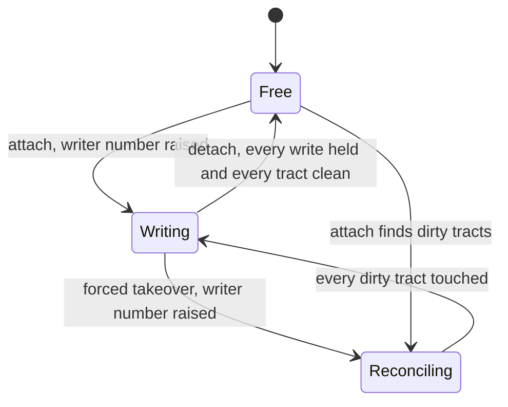
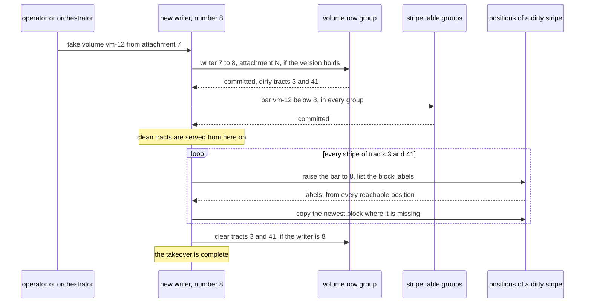

# W18. Attaching, barring and taking over

## Context

Everything [W17](writer-lane.md) promises rests on a volume having one writer at a time. A host
that dies, a host partitioned from the cluster but still running, a server restarted on the same
host, a virtual machine moved to another: each ends one writer and begins another, and R28 asks that
the one before can never write again. The question this page answers is where a superseded writer
is stopped, without a commit on every write and without a clock.

## What exists today

- **Nothing attaches.** An object has any number of writers, ordered by its stripe rows' commits
  ([S7](../../object-storage/write-path.md)).
- **RBD stops a superseded writer at every OSD** by a blocklist in the OSD map, after its exclusive
  lock is broken ([W15](prior-art.md#ceph-rbd)); Mayastor by NVMe reservations installed at its
  replicas ([W15](prior-art.md#openebs-mayastor)).
- **Shoal refuses a removed member at every door** by a tombstone the control group commits
  ([F46](../../features/capacity-rebalancing.md)), and a reclaimer's seal holds a slice's chunks
  while it reads the fact that frees them ([F92](../../features/reclamation-and-device-lifecycle.md#seals)).
  Neither is a writer's.
- **The control group is slow under load.** Proposals during a move under writes took 0.76 to 3.5 s
  at the median and up to 6.2 s ([F88](../../features/recovery-and-moves.md#on-the-lab)), and a
  saturated 1 GbE link makes members fall silent to the detector
  ([item 244](../../appendix/known-issues.md#244-a-load-that-saturates-a-1-gbe-link-delays-the-control-lanes-reports-and-members-fall-silent)).

## The design

### A volume's attachment

- **Attach** is one conditional commit of the volume row: the writer number from N to N+1 and the
  attachment named, from `Free`. With no dirty tract there is nothing to reconcile, and the writer
  writes at once.
- **Detach** drains: every write answered and held by every position or marked, every tract
  cleared, then the attachment cleared, conditioned on the writer number. The next attach finds
  nothing to do.
- **A forced takeover** is an attach that supersedes a writer that did not detach: a host that died,
  or one that is unreachable and may not have. It is asked for by an operator or an orchestrator,
  naming the attachment it supersedes (`shoaladm volume take <volume> --from <attachment>`), and
  nothing in the cluster takes a volume from a writer on its own: an attachment is explicit. Whether
  a writer is alive is held in memory at the volume row's leader, from its lanes, and shown, never
  committed.
- **A server restarted on its own host** is a new writer number: a takeover of its own last
  attachment, whose dirty tracts are its own last ones. ublk keeps the device open across the
  restart ([W22](host-device.md#a-server-that-restarts)).

### The three bars

A superseded writer is stopped where its writes and its commands would land, in three places:

| Bar | Where | Raised by | Refuses |
| --- | --- | --- | --- |
| **The volume row's writer number** | The row | Every attach and takeover, one conditional commit | Every row change a writer makes below it: a tract marked or cleared, a snapshot, a detach |
| **A group's bar for the volume** | The machine state of every tablet group of the set's stripe table, carried in its sidecar and snapshot trailer as placement state is ([F88](../../features/recovery-and-moves.md#a-placement-groups-state-in-its-tablet-group)) | A forced takeover, in every group before anything else: 18 commits on the lab | Every lane command of a lower writer: a missed mark, above all |
| **A holder's bar for the volume** | A durable record on every slice, a few bytes a volume | The first request carrying a higher writer number, which the holder verifies once by a strong read of the volume row through its node | A lower writer's reads and writes, whether or not the stripe exists there yet |

Why each is needed:

- **Without the row's**, a superseded writer could mark a clean tract dirty and write where the new
  writer, trusting the bitmap, never looks.
- **Without the groups'**, a superseded writer's late missed mark could name the new writer's
  positions stale, and a rebuild would copy the old writer's bytes over the new writer's.
- **Without the holders'**, nothing at all would stop the old writer's bytes.

A group's bar exists only for a volume ever taken over by force; a clean detach leaves no writer to
bar.

The holder's verification is what keeps a principal with a volume's `write` grant from barring its
rightful writer by sending a request with an invented number: a holder raises its bar only to a
writer number the volume row has committed.

### Taking over

1. **The row moves** to the new writer number, naming the new attachment, conditioned on its version.
   From here the old writer can mark no tract: it is confined to the tracts already dirty.
2. **Every group of the stripe table bars the volume below the new number.** From here no lane
   command of the old writer commits.
3. **Clean tracts are served at once.** The old writer could not have written into one without first
   marking it dirty, which step 1 refuses.
4. **Every stripe of a dirty tract is reconciled at its first touch**, eagerly in the background and
   on demand before a block of it is served, below.
5. **The takeover completes when every dirty tract is reconciled**, and their bits are cleared.

### First touch

Before the new writer reads or writes a block of a stripe in a dirty tract:

- **it raises the bar at every current position**, so from that moment none accepts the old writer;
- **it lists every block's label** at each reachable current position;
- **for every block it takes the newest label among current positions**, never from a position
  marked missed, which may hold a write that was never acknowledged and was superseded by one that
  was;
- **it copies that block to every current position that lacks it**;
- **it marks every unreachable position missed** through the group, whose bar now admits only it.

One rule serves every copy of a block anywhere in this subchapter, here, in a rebuild and in a
move's arrival: **take the source's block unless the destination holds that block under the current
writer number at or above the source's label.** Labels compare as pairs, writer number first, so
the new writer's own writes always win and it numbers its first write from one.

### The cut a takeover makes

What is promised ([P27](contract.md#the-contract)) is a cut a stripe at a time:

- **after the new writer first touches a stripe, no write of a lower writer is accepted at a current
  position of it**, and no lane command of a lower writer commits once the groups are barred;
- **writes the old writer had accepted at a stripe before it was touched are part of its history**,
  and the newest of them is adopted;
- **once the takeover completes, no write of the old writer is accepted anywhere in the volume**,
  since every stripe it could write, a stripe of a dirty tract, has been touched.

A superseded writer's own reads see a frozen past and never its successor's writes: a raised holder
refuses it, and a stripe never allocated was zeros when it was barred. It learns it is superseded by
its next refusal, `Barred`, and fails its host's I/O; a server push that told it sooner is optional
([W14](prerequisites.md#optional)).

### What a partition does

The hardest case [W26](model.md) holds the design to: a partition that leaves the old writer, still
running, on one side with every position of some stripe. The new writer cannot touch that stripe.
It serves every other, and the takeover waits for that one: its blocks are unavailable to the new
writer, and the old writer, which can still reach every position, may still have writes accepted
there. When the partition heals, first touch adopts the newest of them. The cut holds, since those
writes were accepted before the stripe was touched, and so does the completion's promise, since the
takeover was not complete. What the user loses is availability: a stripe no redundancy keeps on the
new writer's side cannot be served until the partition heals. If X23 finds a schedule in which this
breaks P27, the choice is between the cut as stated and a token from the majority's side on every
write, which would end "no commit a write" ([X23](spikes.md#x23-the-lanes-model)).

## Alternatives rejected

**A cluster-wide fence through the control state**, every member applying it before the new writer
starts. It is not necessary, since no live member's application is what makes the new writer safe;
it is not sufficient, since a member partitioned on the old writer's side never applies it and no
committed fact marks it stale; and it is slow, 0.76 to 3.5 s a proposal under load, waiting on a
liveness verdict that item 244 shows flapping on 1 GbE.

**A lease with an expiry**, the writer stopping at a time and the next starting after it. A clock
would decide who may write, which R7 refuses; F100 made a leader's lease an opt-in for reads alone,
beside its clock assumptions ([F100](../../features/lease-reads.md)).

**A takeover that raises every holder of the pool.** It bounds nothing a writer did: first touch
raises only the positions of dirty tracts, and every other holder is raised by the new writer's
first request to it, which carries its number.

**A takeover by a commit of every stripe.** The commit a write the lane exists to avoid.

**A block's newest label taken from every position, marked or not.** A marked position may hold a
write that was sent and never acknowledged, then superseded by one that was; the maximum over it
would bring the superseded write back.

## What it costs

- **An attach**: one row commit.
- **A forced takeover**: one row commit, a commit in every group of the stripe table (18 on the lab),
  and the first touch of every stripe of every dirty tract, a listing and perhaps a copy at each
  position. Its time grows with what the old writer had in flight, which
  [X26](spikes.md#x26-write-working-sets-and-takeover-time) measures.
- **A holder's bar**: a durable record a volume a slice, and a strong read of a row the first time a
  number is raised there.
- **A partition**: stripes unavailable to the new writer until it heals.

## What it breaks

Nothing built.

## Invariants to uphold

- **A writer number only rises**, and every change a writer makes to its row is conditioned on it.
- **A holder never accepts a lower writer after raising its bar**, and raises it only to a number the
  row has committed.
- **A group never commits a lane command below its bar.**
- **A position marked missed is never a source** at first touch, in a rebuild or in a move.
- **A takeover completes only when every dirty tract is reconciled.**
- **Nothing takes a volume from its writer unless asked**, and nothing decides by a time who may
  write.

## Prerequisites

[W14](prerequisites.md)'s client lane, whose refusals by name include `Barred`.

## How it would be measured

The model first: every schedule of a writer crashed, partitioned or racing its successor, against
P27 to P31 ([X23](spikes.md#x23-the-lanes-model)). Then a takeover's time by dirty tracts and tract
size, and how many tracts a real working set keeps dirty ([X26](spikes.md#x26-write-working-sets-and-takeover-time));
and the bench's takeover event beside a load ([W25](performance.md)).

## Acceptance tests

| Test | Gate | Proves |
| --- | --- | --- |
| `a_clean_attach_reconciles_nothing` | M30 | An attach after a clean detach writes at once and touches no stripe |
| `a_detach_waits_for_every_tract_to_clear` | M30 | A detach with writes unanswered is held until they are, and leaves no dirty tract |
| `a_barred_writers_write_is_refused_at_a_touched_stripe` | M31 | After first touch, every current position refuses the old writer by name |
| `a_barred_writers_mark_is_refused_by_every_group` | M31 | After the groups' bars, the old writer's missed mark commits nowhere |
| `a_barred_writer_cannot_dirty_a_clean_tract` | M31 | The old writer's tract mark fails the row's condition after the takeover |
| `a_holder_raises_its_bar_only_to_a_committed_number` | M31 | A request with an invented writer number is refused and raises nothing |
| `first_touch_adopts_the_newest_block_from_current_positions_only` | M31 | A marked position's newer, unacknowledged block is not adopted |
| `a_takeover_completes_only_after_every_dirty_tract` | M31 | A takeover with a stripe unreachable stays incomplete, and the rest of the volume is served |
| `a_partitioned_old_writer_is_cut_at_first_touch` | M31 | With the old writer and a stripe's positions on one side, its writes there are adopted at the heal and refused after |
| `a_restarted_server_is_a_new_writer` | M33 | A ublk server restarted on its host attaches under a new writer number and never reuses a write number |

## Related

[W17](writer-lane.md), whose promises this keeps; [W20](placement-under-a-writer.md) for the same
copying rule in rebuilds and moves; [W26](model.md) for what must be checked first; [W15](prior-art.md)
for RBD's blocklist and Mayastor's reservations.
