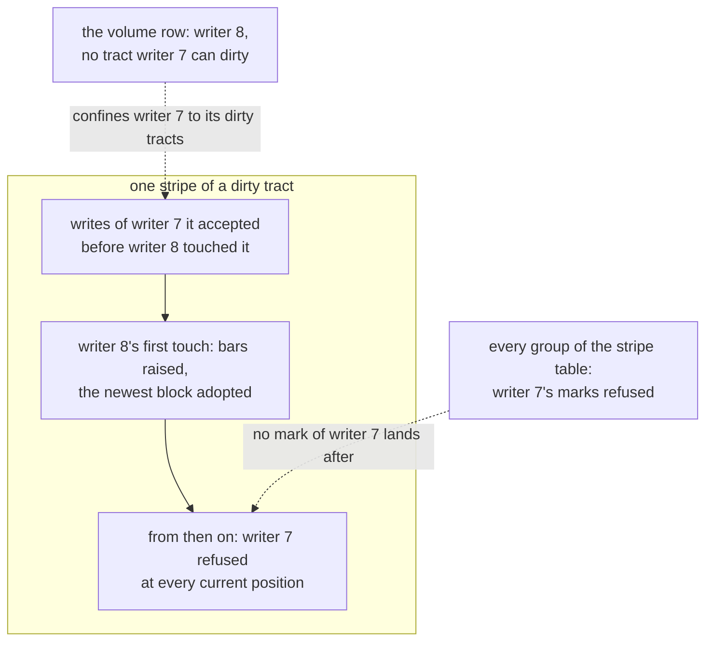

# W27. The contract and the questions

## Context

A volume is written by one host while its stripes are moved, rebuilt and scrubbed, its holders crash
and restart, and its writer may itself be superseded while it is still running. What it promises has
to be written down as properties a history can be checked against, before a frame or a chunk format
is built, as the cluster's contract was ([C13](../../distributed/protocol.md#the-contract)), the
object store's ([S18](../../object-storage/contract.md#the-contract)) and the scans'
([W13](../scans/contract.md#the-contract)). This page states the volume's contract, how it behaves
under each failure, the questions still open with the gate each blocks, the decision record, and the
acceptance index.

## What exists today

- **A tablet group's contract, P1–P6** ([C13](../../distributed/protocol.md#the-contract)): an order of
  committed commands applied alike on every copy, read levels, and nothing promised across two
  tablets. The volume row and the stripe table's groups are tablet groups and keep it.
- **The object store's contract, P7–P19** ([S18](../../object-storage/contract.md#the-contract)), whose
  write rules (P9 to P11) bind committed stripes and not lane stripes, and whose placement rules bind
  both.
- **The scans' contract, P20–P26** ([W13](../scans/contract.md#the-contract)).

## The design

### Decisions taken and directions preferred

| Decision | Status |
| --- | --- |
| A volume's writes travel the writer lane, no commit a write | Taken 2026-10-26 ([overview](overview.md#decisions-taken-on-2026-10-26)) |
| The writer runs on the host, through ublk; an NVMe-oF/TCP gateway is a later gate | Taken 2026-10-26 |
| A pool's write protocol is its policy | Taken 2026-10-26 |
| Volumes are built before the filesystem | Taken 2026-10-26 |
| A writer is barred in the row, the stripe table's groups and its holders | Preferred ([Q43](#questions-to-answer)) |
| A label a 4 KiB block; the higher label wins, from current positions only | Preferred ([Q44](#questions-to-answer)) |
| 1 MiB stripes of 4 KiB units | Preferred ([Q47](#questions-to-answer)) |
| Write-through by default; write-back a named setting | Preferred, and the rule's ([Q46](#questions-to-answer)) |
| Erasure coded volumes | Not in these gates ([Q52](#questions-to-answer)) |
| A volume written by two hosts at once | Excluded: one writer is what every property rests on |

### The contract

`P` numbers continue W13's and are never reused. P1–P6 bind the volume row and the stripe table's
groups unchanged, and S18's placement properties bind lane stripes' placement groups. P27–P35 are
what volumes add, each beside the violation that breaks it.

| # | Property | Binds | The violation | Owning tests |
| --- | --- | --- | --- | --- |
| P27 | **Barred writers, cut a stripe at a time.** After writer N+1 first touches a stripe, no write of a writer at or below N is accepted at a current position of it; no lane command of a writer below a group's bar commits; and once a takeover completes, no write of a superseded writer is accepted anywhere in the volume | [W18](attach-and-takeover.md) | A partitioned old writer's write accepted after its successor read the stripe; an old writer's mark committed after the bar | `a_barred_writers_write_is_refused_at_a_touched_stripe` (M31), `a_barred_writers_mark_is_refused_by_every_group` (M31), `a_partitioned_old_writer_is_cut_at_first_touch` (M31), `a_partitioned_old_writer_keeps_the_cut` (M29) |
| P28 | **Durable at acknowledgement.** An acknowledged write is held by every current position of its stripe, or by `k + f` in distinct failure domains with every other marked missed by a committed mark; it is durable there, or under write-back durable once a later FLUSH is acknowledged; and it survives every loss its pool's redundancy allows | [W17](writer-lane.md) | An acknowledgement with a position neither answering nor marked; a write-back position's restart unmarked | `a_lane_write_is_answered_after_every_position_journals_it` (M30), `a_silent_position_is_marked_before_a_write_goes_on_without_it` (M31), `a_restarted_position_in_write_back_is_marked_from_the_last_flush` (M31), `a_flush_syncs_every_position_written_since_the_last` (M33) |
| P29 | **One write a block, never older.** A read returns each block whole as one write left it, never older than a write its writer had acknowledged or read | [W17](writer-lane.md), [W20](placement-under-a-writer.md) | A read served by a position marked and not told; two positions left unequal by an abandoned write | `overlapping_writes_resolve_alike_at_every_position` (M30), `a_sent_write_is_never_abandoned` (M31), `a_marked_position_is_never_read` (M31), `a_told_marked_position_refuses_reads` (M31) |
| P30 | **Quiet stripes agree.** The current positions of a stripe with no write in flight, in a tract not dirty, hold the same labels | [W17](writer-lane.md), [W20](placement-under-a-writer.md) | A clean tract whose positions differ | `a_detach_waits_for_every_tract_to_clear` (M30), `a_light_scrub_compares_only_quiet_stripes` (M32) |
| P31 | **The successor sees every acknowledged write**, and only bytes some writer wrote | [W18](attach-and-takeover.md) | A dirty tract left unreconciled; an unacknowledged, superseded write brought back from a marked position | `first_touch_adopts_the_newest_block_from_current_positions_only` (M31), `a_takeover_completes_only_after_every_dirty_tract` (M31), `a_rebuild_commit_is_refused_after_a_new_mark` (M32) |
| P32 | **Writes follow their placement group.** A write acknowledged during a move is held by every arrival after the switch, or marked there | [W20](placement-under-a-writer.md) | A write stamped with a stale epoch acknowledged by old positions after the copier read them | `a_lane_write_at_a_stale_epoch_is_refused_once_installed` (M32), `a_move_under_writes_loses_no_acknowledged_write` (M32), `lane_backfill_compares_labels` (M32) |
| P33 | **Snapshots are cuts.** A complete snapshot holds, for every block, the newest write at or below its boundary and nothing above it, and never changes; an incomplete one answers no read | [W21](snapshots-and-clones.md) | A late write below the boundary missing from one position's copy | `a_snapshot_holds_every_write_below_its_boundary` (M34), `a_snapshot_never_holds_a_write_past_its_boundary` (M34), `an_incomplete_snapshot_refuses_reads` (M34) |
| P34 | **Discard and reallocation.** A discarded block reads as zeros; a stripe written after a whole discard never shows its former blocks; a clone's unwritten block reads its parent's | [W19](lane-chunks.md), [W21](snapshots-and-clones.md) | An old chunk read under a new allocation count; a trimmed clone block reading through | `a_chunk_at_a_lower_allocation_count_is_never_read` (M32), `a_trimmed_clone_block_reads_zeros` (M34), `a_volume_id_is_never_reused` (M30) |
| P35 | **What is not promised.** No order among writes in flight together; no atomicity beyond a block; nothing across stripes, across volumes, or between two volumes' snapshots; a write answered as failed may still land. This is P6's twin, and P19's | every write | An oracle, an API or a test that treats a multi-block write as atomic, or a failed write as absent | `the_volume_oracle_promises_nothing_across_stripes` (M29) |

**Isolation is a budget, not a property.** What a volume may cost the queries beside it is a number,
stated on [W23](isolation.md#the-budget) and judged on the lab at every gate from M30; no history can
check it, so it is not in this table, and no gate passes without it.

### How a volume behaves when something fails

| Condition | Required behaviour |
| --- | --- |
| A position does not answer | Past the straggler bound, marked missed through its group once `k + f` answered; otherwise the write waits, unabandoned |
| A holder crashes after journalling | Its records survive under write-through; under write-back it is marked missed from the last flush |
| A holder restarts | It reads its bars and fetches its marks before it serves |
| The writer crashes | Its attachment stays until it is taken over, and the takeover reconciles its dirty tracts |
| The writer is partitioned and still running | Its writes wait for answers they cannot get; a takeover bars it, stripe by stripe as each is touched |
| The volume row's group loses its leader | Attaches, takeovers, tract marks and snapshots wait for the next; writes into dirty tracts go on |
| A stripe table group is unavailable | A mark it would commit waits, and so does a write that needs one; writes every position answers go on |
| A placement group moves | Its epoch is installed at every position concerned before the copy; writes go to the old positions and the arrivals |
| A device fails | Its positions are marked, and its groups move ([F88](../../features/recovery-and-moves.md#a-failed-device-a-down-node)) |
| The pool is full | A write that needs new space is refused `NoSpace` by name |
| The host's server dies | ublk keeps the device; a new server attaches as a new writer number |
| A snapshot is pending when its writer dies | The takeover completes it |

### Questions to answer

`Q` numbers continue W13's. Each names the gate it blocks, the evidence that settles it, and the
direction preferred until then.

| # | Question | Gate | Evidence | Preferred |
| --- | --- | --- | --- | --- |
| Q43 | Where is a superseded writer barred? | Before M31 | [X23](spikes.md#x23-the-lanes-model) | The volume row, every group of the stripe table, and every holder ([W18](attach-and-takeover.md#the-three-bars)) |
| Q44 | What is a label's granule, and what merges two? | Before M30 | X23 | A 4 KiB block; the higher label, taken from current positions only ([W17](writer-lane.md#overlapping-writes)) |
| Q45 | How many tracts, and how are they cleared? | Before M31 | [X26](spikes.md#x26-write-working-sets-and-takeover-time) | 4,096 bits in the row, cleared lazily in batches ([W16](volumes-and-rows.md#tracts)) |
| Q46 | What is a write durable at by default, and is write-back offered? | Before M30, with the user | [X24](spikes.md#x24-one-4-kib-write-three-ways) | Write-through by default; write-back a named setting ([W17](writer-lane.md#durability)) |
| Q47 | What geometry does an attached pool cut a volume by? | Before M30 | [X25](spikes.md#x25-a-volume-pools-geometry) | 1 MiB stripes of 4 KiB units ([W16](volumes-and-rows.md#geometry)) |
| Q48 | How does a move meet a writer? | Before M32 | X23 | Epochs installed at holders before the copy ([W20](placement-under-a-writer.md#epochs-at-the-holders)) |
| Q49 | Which copy mode does the host's server use, and does the client stay tokio's? | Before M33 | [X27](spikes.md#x27-ublk-beside-nbd-on-the-tokio-client) | Zero copy where the kernel has it; tokio unless the hop costs a tenth of an Optane write ([W22](host-device.md#copies)) |
| Q50 | Is a snapshot's copy-on-write a copy or a reflink? | Before M34 | [X29](spikes.md#x29-a-snapshots-copy-on-write) | A copy, a reflink if X29 says copies break the budget ([W21](snapshots-and-clones.md)) |
| Q51 | What may a volume cost the queries beside it, and what node ceiling holds that? | Before M30 | [X28](spikes.md#x28-the-lane-beside-the-reference-cell) | [W23](isolation.md#the-budget)'s budget; a ceiling below the link |
| Q52 | Are erasure coded volumes ever offered? | None set | — | Not in these gates: parity cannot be merged by labels ([W17](writer-lane.md#erasure-coding-not-in-these-gates)) |

### Decision record

#### The plan drawn, and four decisions taken with the user (2026-10-26)

The user asked for the performance tradeoffs of the first three before choosing, and they were given
as below.

| Decision | Evidence |
| --- | --- |
| **A volume's writes travel a writer lane, no commit a write** | The object store's write in place took 10.3 to 12.8 ms at the median for 4 KiB on the lab ([F86](../../features/replicated-pools.md#performance)): two strong reads, a merge, a confirmation and a raft round on a table shard. The lane is one round trip and a journal write, and a protocol of its own to model and build, against one built and proven |
| **The writer runs on the host, through ublk; a gateway is a later gate** | Given: one hop against two, the gateway's extra hop estimated at 0.1 to 0.2 ms on the lab's 1 GbE, 5 to 10% of a 970 EVO write and up to 1.5 times on an Optane-class device; the host's link carrying every copy, about 37 MiB/s of writes at three copies, against the host's whole link; no fan-out cpu on the database's nodes against no Shoal software on hosts |
| **A pool's write protocol is its policy** | Asked after a review of the first draft found that lane stripes need other rules from committed ones in recovery, moves and scrub. Every driver dispatches on its pool, the committed path untouched; the 2026-10-02 decision bent across protocols and kept within one |
| **Volumes before the filesystem** | The filesystem's decision to write its files on the lane under a write lease ([its overview](../filesystem/overview.md#decisions-taken-on-2026-10-26)) |

#### The first draft reviewed (2026-10-26)

Not a decision of the user's: a review of the first draft, before these pages were written, made four
corrections that are now the design, each kept as an alternative rejected on its page and as an unsafe
setting of the model ([W26](model.md#the-settings)).

| Correction | Where |
| --- | --- |
| A cluster-wide fence through the control state replaced by three bars | [W18](attach-and-takeover.md#alternatives-rejected) |
| A label a unit replaced by a label a 4 KiB block | [W17](writer-lane.md#overlapping-writes) |
| Rows a stripe, and an activity record that committed on every new stripe, replaced by the tract bitmap | [W16](volumes-and-rows.md#alternatives-rejected) |
| Epochs installed at holders, and backfill by listing, where F88's rows had sufficed | [W20](placement-under-a-writer.md#epochs-at-the-holders) |

### The acceptance index

Every test the pages name, by the gate that owns it. These tables join
`shoal-bench/tests/acceptance_tables.rs` at [M29](milestones.md#m29-the-harness), which learns M29 to
M39 so a test name is unique across every part; until then nothing checks a name here is unique, and
this index is where one would collide.

| Gate | Tests | On |
| --- | --- | --- |
| M29 | `every_volume_schedule_replays_to_its_verdict`, `the_safe_lane_policy_breaks_no_property`, `every_lane_rule_is_needed`, `a_partitioned_old_writer_keeps_the_cut`, `a_block_kind_times_every_write`, `a_preconditioned_arm_writes_no_fresh_chunk`, `the_volume_oracle_promises_nothing_across_stripes` | [W26](model.md#acceptance-tests), [W25](performance.md#acceptance-tests), this page |
| M30 | `a_volume_set_binds_only_an_attached_pool`, `a_pools_write_policy_never_changes`, `a_volume_id_is_never_reused`, `a_tract_is_dirty_before_its_first_write_leaves`, `a_volume_row_stays_under_its_bound`, `a_lane_write_is_answered_after_every_position_journals_it`, `no_table_shard_runs_a_steady_state_lane_write`, `overlapping_writes_resolve_alike_at_every_position`, `a_read_of_an_unwritten_block_is_zeros_without_a_device_read`, `a_read_of_a_block_in_flight_is_served_by_the_writer`, `an_attached_pool_refuses_erasure_coding_by_name`, `a_clean_attach_reconciles_nothing`, `a_detach_waits_for_every_tract_to_clear`, `lane_chunk_format_is_frozen`, `a_lane_record_applied_twice_leaves_the_same_chunk`, `lane_records_applied_out_of_order_leave_the_same_chunk`, `a_start_classifies_every_lane_record`, `a_lane_apply_overwrites_only_written_extents`, `a_volume_beside_the_reference_cell_holds_its_budget`, `a_volume_never_causes_a_resident_eviction`, `the_lane_queue_sheds_past_its_count_by_name`, `steady_state_writes_count_no_table_query` | [W16](volumes-and-rows.md#acceptance-tests), [W17](writer-lane.md#acceptance-tests), [W18](attach-and-takeover.md#acceptance-tests), [W19](lane-chunks.md#acceptance-tests), [W23](isolation.md#acceptance-tests), [W25](performance.md#acceptance-tests) |
| M31 | `a_tract_mark_by_an_old_writer_is_refused`, `a_silent_position_is_marked_before_a_write_goes_on_without_it`, `a_sent_write_is_never_abandoned`, `a_marked_position_is_never_read`, `a_restarted_position_in_write_back_is_marked_from_the_last_flush`, `a_barred_writers_write_is_refused_at_a_touched_stripe`, `a_barred_writers_mark_is_refused_by_every_group`, `a_barred_writer_cannot_dirty_a_clean_tract`, `a_holder_raises_its_bar_only_to_a_committed_number`, `first_touch_adopts_the_newest_block_from_current_positions_only`, `a_takeover_completes_only_after_every_dirty_tract`, `a_partitioned_old_writer_is_cut_at_first_touch`, `a_holders_bar_survives_its_restart`, `a_told_marked_position_refuses_reads`, `a_restarted_slice_fetches_its_marks_first`, `a_volumes_limits_hold_at_its_holders`, `client_lane_bytes_draw_on_the_node_ceiling`, `a_volume_beside_a_cluster_holds_its_budget`, `a_takeover_event_is_cut_at_its_marks` | W16, W17, W18, W19, [W20](placement-under-a-writer.md#acceptance-tests), W23, W25 |
| M32 | `a_chunk_at_a_lower_allocation_count_is_never_read`, `a_lane_write_at_a_stale_epoch_is_refused_once_installed`, `a_move_under_writes_loses_no_acknowledged_write`, `a_copy_and_a_write_commute_at_an_arrival`, `a_rebuild_commit_is_refused_after_a_new_mark`, `lane_backfill_compares_labels`, `a_light_scrub_compares_only_quiet_stripes`, `a_deleted_volume_is_reclaimed_by_group` | W19, W20 |
| M33 | `a_flush_syncs_every_position_written_since_the_last`, `a_fua_write_is_synced_before_its_answer`, `a_restarted_server_is_a_new_writer`, `a_whole_stripe_trim_gives_its_space_back`, `a_ublk_device_reads_back_what_it_wrote`, `the_device_advertises_a_cache_only_under_write_back`, `a_server_killed_under_writes_recovers_its_device`, `no_allocation_on_a_requests_path`, `a_device_mode_arm_reads_back_what_it_wrote` | W17, W18, [W21](snapshots-and-clones.md#acceptance-tests), [W22](host-device.md#acceptance-tests), W25 |
| M34 | `a_grown_volume_merges_its_tract_bits`, `a_snapshot_holds_every_write_below_its_boundary`, `a_snapshot_never_holds_a_write_past_its_boundary`, `an_incomplete_snapshot_refuses_reads`, `a_takeover_completes_a_pending_snapshot`, `a_clones_absent_block_reads_its_parent`, `a_trimmed_clone_block_reads_zeros`, `a_protected_parent_snapshot_is_never_deleted`, `a_snapshot_attaches_read_only` | W16, W21, W22 |

## Alternatives rejected

**A volume two hosts write at once.** A shared disk needs a lock manager over every block, which is a
cluster filesystem's job above the device, and every property here rests on one writer.

**Isolation as a property.** A latency bound is checked by measurement, not by a history, so it is a
budget judged at gates.

**Promising atomicity across a multi-block write.** No disk promises it, and a stripe boundary would
make it a commit across groups.

## What it costs

Nine properties, each owned by tests, and every gate held to them.

## What it breaks

Nothing. P1–P26 bind as they did.

## Invariants to uphold

- **Every property has at least one owning test**, named before its gate starts.
- **A property that a later design contradicts is changed with a recorded cause**, and every page that
  leaned on it changes with it, the model first.

## Prerequisites

None of its own.

## How it would be measured

P27–P34 by the model's oracles first ([W26](model.md)), then by the tests above, in the fixture where a
cluster is needed; the budget beside them by [W25](performance.md).

## Acceptance tests

| Test | Gate | Proves |
| --- | --- | --- |
| `the_volume_oracle_promises_nothing_across_stripes` | M29 | The fixture's volume oracle checks P27 to P34 a stripe at a time and nothing across stripes, so no test can lean on what P35 withholds |

## Related

[C13](../../distributed/protocol.md), [S18](../../object-storage/contract.md) and
[W13](../scans/contract.md), the contracts this extends; [W26](model.md) for what checks them first;
[the milestones](milestones.md) for the gates.
