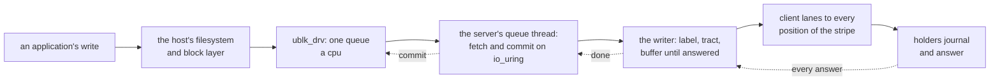

# W22. The device on a host

## Context

R28 asks for a volume a Linux host attaches as a block device. The decision of 2026-10-26 put the
writer on the host, through ublk: a server on the host links Shoal's client, the kernel hands it
every request to the device, and it writes to the holders itself, one hop
([overview](overview.md#decisions-taken-on-2026-10-26)). This page is that device and that server:
what the kernel is told, how a request reaches the lane and back, what the server must never do,
and the other front ends this plan records and does not build first.

## What exists today

- **No host device of any kind.** A client reaches a bucket through the client crate's handle
  ([api/client](../../api/client.md)).
- **A schema's own program runs every command that connects**: `shoaladm` builds the schema's admin
  program, `<package>-<Db>-adm`, and `exec`s it ([F63](../../features/shoaladm.md)), since the client
  is schema-bound by its fingerprint ([api/client](../../api/client.md)).
- **The client is tokio's**, with no blocking API and no C ABI (`shoal-client/Cargo.toml`).
- **europa's kernel carries what the front ends need**: 7.0.0-38 has `ublk_drv`, `nbd` and
  `nvme-tcp` as modules and fuse built in (`modinfo`, read on 2026-10-26). ublk arrived in 6.0, its
  user copy in 6.5, zero copy in 6.15, and automatic buffer registration with server threads
  decoupled from queues in 6.16 ([6.0](https://kernelnewbies.org/Linux_6.0),
  [6.5](https://kernelnewbies.org/Linux_6.5), [6.15](https://kernelnewbies.org/Linux_6.15),
  [6.16](https://kernelnewbies.org/Linux_6.16)).

## The design

### The device

The server creates the device over `/dev/ublk-control` with parameters it reads from the volume row
([ublk](https://docs.kernel.org/block/ublk.html)):

| Parameter | Value | Why |
| --- | --- | --- |
| Logical and physical block | 4 KiB | The lane's block ([W17](writer-lane.md)); no write is ever smaller |
| Capacity | The volume's size | Grown with the row ([W21](snapshots-and-clones.md#resize)) |
| Queues | One a host cpu | The kernel's block layer submits on the cpu that asked |
| Depth | 128 a queue unless set | Enough for a queue depth of 32 a process on a few cpus |
| Largest request | 1 MiB, a stripe | No request spans two stripes' positions, so no request waits on two groups |
| Volatile cache and FUA | Only under `durability: write_back` | A host's filesystem then writes FLUSH and FUA as for a disk with a cache ([W17](writer-lane.md#durability)) |
| Discard and write-zeroes | 4 KiB granularity, a stripe's alignment for space to come back | A TRIM is a labelled zero ([W21](snapshots-and-clones.md#discard-and-write-zeroes)) |
| Rotational | No | An attached pool is SSD-only ([W16](volumes-and-rows.md#attached-pools)) |

### The server

`shoaladm volume attach <volume>` runs the schema's program, which attaches the volume
([W18](attach-and-takeover.md)), creates the device, and serves it until a detach:

- **One thread a queue, each with its own io_uring**, fetching requests with `UBLK_U_IO_FETCH_REQ`
  and answering them with `UBLK_U_IO_COMMIT_AND_FETCH_REQ`, so each request costs one submission
  and one completion ([ublk](https://docs.kernel.org/block/ublk.html)). Since 6.16 a server thread
  need not be a queue's, which X27 measures.
- **Each request becomes lane writes or reads**: a write's blocks, numbered by the writer and sent to
  their stripe's positions; a read's blocks, from one current position or the writer's own buffer
  ([W17](writer-lane.md#reads)); a FLUSH, a sync of every position written since the last.
- **The client is tokio's at first**, its runtime beside the queues' threads. Whether an
  io_uring-native client, the queues' own rings carrying the lanes' sockets, is needed is
  [X27](spikes.md#x27-ublk-beside-nbd-on-the-tokio-client)'s to say, [Q49](contract.md#questions-to-answer):
  it becomes required if the hop between them costs more than a tenth of a 4 KiB write on the
  Optane.

### Copies

| Mode | What it copies | Since | For it | Against it |
| --- | --- | --- | --- | --- |
| Default | The request's pages into the server's buffer, and back for a read | 6.0 | Simple, any server | A buffer a request slot: depth by largest request, 128 MiB a queue at the defaults |
| User copy | The server reads and writes the request's pages itself, through the control device | 6.5 | No buffer a slot | A system call a request's bytes |
| Zero copy | The request's pages registered as io_uring buffers, sent from where they are | 6.15 | No copy; and automatic registration in 6.16 gave half again the IOPS of 6.15's in-tree zero copy ([LWN](https://lwn.net/Articles/1019141/)) | "A zero-copy server must be trusted" ([ublk](https://docs.kernel.org/block/ublk.html)), which a host's own root process is |

**Preferred: zero copy with automatic registration where the kernel has it, the default copy
otherwise**, until X27 measures all three on the lab's 7.0 kernels.

### Memory, and the writeback deadlock

A block device's server must never need memory the kernel is trying to free by writing to that same
device, or both wait for ever. So:

- **every buffer is preallocated and locked** before the device is started (`mlockall`), and none is
  allocated on a request's path;
- **the server's threads are marked as I/O flushers** (`PR_SET_IO_FLUSHER`, Linux 5.6), so an
  allocation they do make does not recurse into reclaim against this device;
- **the client's connections to every position are made before the first request**, and a lost one is
  remade from preallocated state.

This is why a ublk server is a program of its own and not a library in an application.

### A server that restarts

ublk's user recovery keeps a device and its queued requests across its server's death, for a new
server to take over ([ublk](https://docs.kernel.org/block/ublk.html)). A restarted server attaches the
volume again as a **new writer number**, a takeover of its own last attachment whose dirty tracts are
its own last ones ([W18](attach-and-takeover.md#a-volumes-attachment)), and resumes the queues. Whether
the kernel reissues a request in flight at the crash or fails it is a recovery flag of its own
(**recalled**; X27 reads it), and either is safe: a write is idempotent under its new label.

### Read-only attachments

A complete snapshot ([W21](snapshots-and-clones.md#reading-a-snapshot)) is attached as a read-only
device, which needs no writer number and bars nothing.

### The other front ends

| Front end | Where | Status | Why |
| --- | --- | --- | --- |
| **ublk** | The host, the schema's program | **First** | io_uring-native, as glommio is; one hop; recovery across a server's restart |
| NBD | The host, the same program | Optional | A host whose kernel has no ublk. About 26 µs a request ([Vitastor](https://vitastor.io/en/docs/performance/comparison1.html)), a hardware queue a connection, and before 5.19 a dead device with no timeout could not be removed without a reboot ([Vitastor](https://vitastor.io/en/docs/usage/nbd.html)) |
| NVMe-oF/TCP gateway | Shoal nodes | A later gate of its own | A host that runs no Shoal software, through the kernel's initiator. The gateway is the writer, two hops; written natively, never SPDK's polling, which would starve the database's executors ([W15](prior-art.md#openebs-mayastor)); failover by ANA multipath and reservations, as Mayastor's |
| vhost-user-blk | The host, for QEMU guests | Optional | A guest's memory shared with the server; without SPDK's polling cores ([SPDK](https://spdk.io/doc/vhost.html)) |
| iSCSI | — | Rejected | A ring through UIO for a userspace backstore ([TCMU](https://docs.kernel.org/target/tcmu-design.html)); Ceph's own iSCSI gateway has been "in maintenance as of November 2022" ([Ceph](https://docs.ceph.com/en/latest/rbd/iscsi-overview/)) |
| A kernel module | — | Rejected | Out of tree, a build a kernel, and a crash in the host's kernel where a ublk server's is its own |

An orchestrator, a CSI driver for Kubernetes say, would call the same program to attach on a node and
to take over from a node it has fenced; it is not planned here.

## Alternatives rejected

**NBD as the main path**: slower, a queue a connection, and no recovery across a server's restart.

**The gateway first**: two hops a write, and the fan-out's cpu and copies on the nodes that serve the
tables; decided against on 2026-10-26.

**A kernel client**, as `krbd` is: a module per kernel, out of tree, and a host's kernel crash where a
userspace server would only restart.

**A loop device over a file in [the filesystem](../filesystem/overview.md)**: two layers, the
filesystem's write lease and the volume's lane, for one block.

## What it costs

- A process an attachment on the host, a thread a host cpu, and its locked buffers.
- A kernel of 6.0 or later; 6.15 or later for zero copy, 6.16 for automatic registration.
- Root, or ublk's unprivileged devices, on the host.
- The schema's program built for the host's cpu, as F63 builds it for a node's.

## What it breaks

Nothing.

## Invariants to uphold

- **The server allocates nothing on a request's path** beyond its preallocated, locked buffers, and its
  threads are I/O flushers.
- **The device advertises a volatile cache only under write-back.**
- **A restarted server is a new writer number.**
- **No request spans two stripes**, so no request waits on two placement groups.
- **A block is 4 KiB**, logical and physical.

## Prerequisites

[W14](prerequisites.md)'s client lane; the host's kernel's `ublk_drv`.

## How it would be measured

ublk beside NBD and beside the client in process, each copy mode, a null holder that answers at once
and a real one, at queue depths one and thirty-two, with the host's cpu a request
([X27](spikes.md#x27-ublk-beside-nbd-on-the-tokio-client)); and every arm of [W25](performance.md)
through the device.

## Acceptance tests

| Test | Gate | Proves |
| --- | --- | --- |
| `a_ublk_device_reads_back_what_it_wrote` | M33 | Writes through `/dev/ublkbN` with `O_DIRECT` read back after a detach and an attach |
| `the_device_advertises_a_cache_only_under_write_back` | M33 | A write-through volume's device has no volatile cache, and a write-back volume's has one and FUA |
| `a_server_killed_under_writes_recovers_its_device` | M33 | A server killed with writes queued is replaced, takes over its own attachment and loses no acknowledged write |
| `no_allocation_on_a_requests_path` | M33 | Under a write arm the server's resident set does not grow past its locked buffers |
| `a_snapshot_attaches_read_only` | M34 | A complete snapshot is a read-only device that refuses writes |

## Related

[W17](writer-lane.md), what each request becomes; [W18](attach-and-takeover.md) for attach and
recovery; [W15](prior-art.md) for RBD's three ways onto a host and Longhorn's ublk front end;
[F63](../../features/shoaladm.md) for the schema's program.
