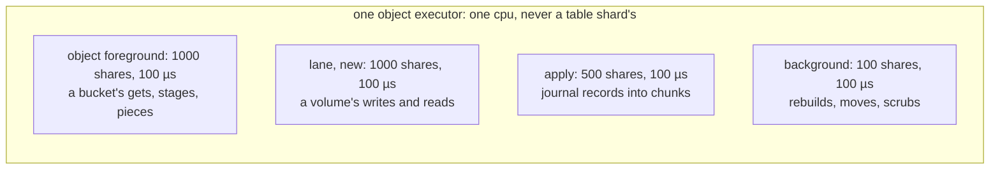
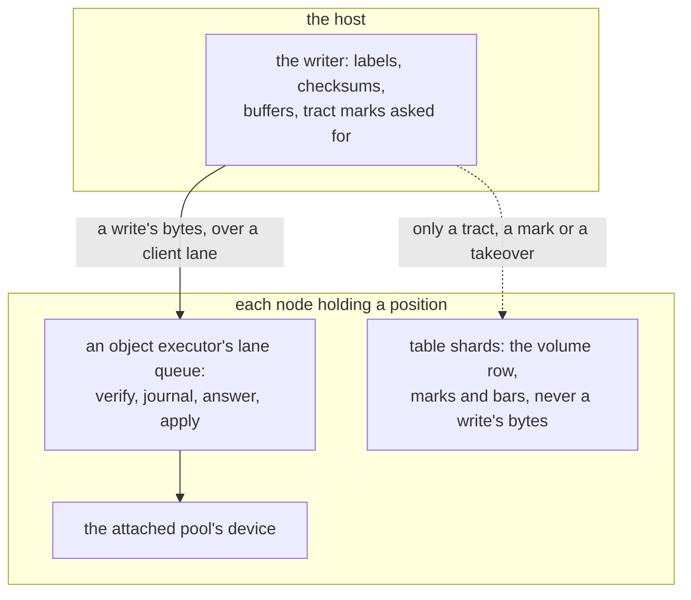

# W23. Not slowing other queries

## Context

R31 is the requirement every page answers to: a volume's I/O never slows the table queries or the
bucket traffic beside it past a budget stated before it is built. Shoal is a database first. A
block device is work of the opposite kind to a table's read: deep queues of 4 KiB writes at
thousands a second, megabytes of sequential bytes, syncs that wait on a device's cache. This page is
the budget, and where a volume's work runs, what it may hold, and what keeps it there.

## What exists today

- **Object work runs on executors of its own**, one a cpu in `resources.object_cpus`, each with a
  foreground, an apply and a background queue at a 100 µs goal, every loop yielding each 64 KiB
  (`shoal-core/src/server/objects/executor.rs:56`, `:643-655`); every buffer is drawn from an object
  budget carved out of `node_memory`, and a draw that waits 250 ms is shed by name
  (`shoal-core/src/server/objects/budget.rs:30-33`) ([S13](../../object-storage/isolation.md)).
- **X9 measured what that buys**: object work at 500 MiB/s on an executor of its own left the
  reference cell at 0.97 to 1.06 times its read p99 alone; on the table shards, steps of 1 MiB moved
  it 2.0 to 3.8 times ([X9](../../object-storage/table-latency.md)).
- **A shared device costs the tables' writes**: on the 970 EVO the tables share, F85's object load
  raised the cell's write p99 1.36 times ([F85](../../features/devices-and-pools.md)); S13's promises
  assume the tables and the pool are on different devices.
- **A saturated link silences members**
  ([item 244](../../appendix/known-issues.md#244-a-load-that-saturates-a-1-gbe-link-delays-the-control-lanes-reports-and-members-fall-silent)),
  and a table's strong reads across hosts beside link-filling gets had a 110 ms tail until the
  replication and control lanes took a minimum RTO of their own
  ([Resolved #304](../../appendix/resolved/lone-frame-loss-probe.md)).
- **The scans' budget** is the reference cell's read and write p99 within
  `max(1.10 × alone, alone + 0.1 ms)` beside a full scan ([W7](../scans/isolation.md#the-budget)).

## The design

### The budget

Stated before the work, and judged on the lab before any host may attach a volume. **Beside a volume's
load at the lane's default node ceiling, on an attached pool's own devices, the workload grid's
reference cell, `grid/unsorted/r50/1024`, keeps its read p99 and its write p99 within
`max(1.10 × alone, alone + 0.1 ms)`** at the median over rounds, with the intervals overlapping, on
titan, hyperion and europa. And:

- **a bucket's get and put arm beside it keeps its p99 within `max(1.25 × alone, alone + 1 ms)`**,
  since both run on the object executors;
- **no eviction pass caused by memory**, read from F104's counters
  ([F104](../../features/memory-in-a-capture.md));
- **no query on a table shard for a steady-state write**, counted;
- **the table writes a volume does make under their bound** ([below](#table-writes-a-volume-makes));
- **the volume's own rates and latencies reported beside it**, so the ceiling's price is a number too.

It is the scans' budget for the tables, and X9's result on executors of their own says it can hold.
The numbers are hypotheses until [X28](spikes.md#x28-the-lane-beside-the-reference-cell) sets them,
and [Q51](contract.md#questions-to-answer) records what it sets. A pool that shares the tables' devices
is measured and reported beside the budget, never judged by it, as S13's promises are stated.

### CPU

**A volume's work runs in a lane queue of its own on each object executor** ([W14](prerequisites.md#a-lane-queue-with-admission-on-object-executors)):

- **The lane and a bucket's foreground share the executor equally.** Both are work a user waits on;
  neither is background to the other.
- **A holder's work for a write is small**: verify the block's checksum, which the writer computed on
  the host, journal it, answer. The bytes' checksum, the labels and the buffering are the host's cpu,
  not the node's.
- **Admission is the lane queue's own**: a count of requests in flight and of bytes drawn an
  executor, and past either a request is refused `Busy` by name and the writer waits and sends it
  again. A volume's queue depth of 128 never sits in front of a bucket's get.

### Memory

Every byte a lane request holds on a node is drawn from the object budget before it is allocated,
and a draw that cannot be met in 250 ms is shed by name, as an object's is. Nothing a volume does
inserts a row, so a volume never evicts a table's partition; the read cache of verified units
([F102](../../features/read-unit-cache.md)) is shared with buckets and gives its units back before any
shard evicts a row ([F107](../../features/cache-default-share.md)). The host's memory is the server's,
preallocated and locked ([W22](host-device.md#memory-and-the-writeback-deadlock)).

### Devices

An attached pool on devices of its own costs a table's device nothing. On the tables' own device it
costs what F85's object load cost: the journal's syncs beside the WAL's flushes, the 970 EVO's
flush at 3 ms after synced writes. **The budget is stated for devices apart**; a shared device's
figures are reported with it, and `shoaladm` says at a deploy when an attached pool's device holds a
node's WAL. A rebuild, a move and a scrub stay in the device's idle time under its ceiling
([W20](placement-under-a-writer.md#budgets)).

### Network

- **A node ceiling on client-lane bytes** ([W14](prerequisites.md#a-node-ceiling-on-client-lane-bytes)),
  below the link's capacity, so the control and replication lanes keep room and no member falls
  silent under a volume's load.
- **A client lane may be bound to an interface of its own**, which a deployment with a storage
  network names.
- **A client lane keeps the kernel's RTO**, as the lanes of bytes do, and is kept alive past an idle
  by F113's setting ([F113](../../features/slow-start-after-idle.md)).
- **The host sends a copy to every position**, `r` times its writes on its own link, unless large
  writes are forwarded ([W17](writer-lane.md#forwarding-large-writes-optional)).

### Per-volume limits

A volume row may name IOPS and MiB/s, for reads and for writes ([W16](volumes-and-rows.md#the-volume-row)).
**The writer paces itself to them, and every holder keeps them too**, a token bucket a volume on each
slice, so a writer that ignores its own limits is held anyway. A volume that names none shares the
lane queue's admission with every other.

### Table writes a volume makes

In the steady state a volume writes no row. Outside it:

| Commit | When | Bound |
| --- | --- | --- |
| A tract marked dirty | The first write into a clean tract | At most a setting's tracts a second a volume, several in one commit |
| Tracts cleared | Lazily, in batches | One commit for many tracts |
| A missed mark | A position that does not answer within the straggler bound | One a position an outage, batched across groups |
| A takeover | An operator's or an orchestrator's | One row commit and one a group of the stripe table |
| A snapshot | Taken and completed | Two row commits |
| A volume deleted | Its stripes reclaimed | One seal a placement group |

Each is counted in a node's figures, and the budget's run includes a random-write working set that
keeps marking tracts ([X26](spikes.md#x26-write-working-sets-and-takeover-time)).

### Where each byte runs

### What an operator sets

The lane queue's count and bytes in flight; the node ceiling and a client-lane interface; a volume's
limits; the straggler bound; a volume's durability.

## Alternatives rejected

**Lane work on the table shards**, where the rows are: X9 moved the cell's p99 2.0 to 3.8 times with
1 MiB steps there.

**One queue for a bucket's foreground and a volume's**: a volume's queue depth in front of every get.

**No admission of its own**: the same, and no name for the writer to back off on.

**A node ceiling at the link's capacity, or none**: item 244's silence.

**Limits kept only by the writer**: a writer that does not keep them is held by nothing.

## What it costs

A fourth queue an executor; a count and a ceiling to set; a token bucket a volume a slice for a volume
with limits; a second interface for a deployment that wants one; the cores the object executors
already took.

## What it breaks

Nothing. A bucket's foreground keeps its queue and shares its executor with a second one of equal
shares.

## Invariants to uphold

- **No byte of a volume's write runs on a table shard.**
- **Every byte a lane request holds on a node is drawn from the object budget**, and a volume never
  inserts a row.
- **The lane queue admits by its own count and bytes**, and refuses by name.
- **Client-lane bytes draw on the node's ceiling.**
- **A volume's limits are kept at its holders**, not only at its writer.
- **Every table write a volume makes is counted.**

## Prerequisites

[W14](prerequisites.md)'s lane queue with admission and its node ceiling.

## How it would be measured

X9's method with a volume in place of the object load: the reference cell alone, then beside a
volume's arms at rising rates and depths, with and without the lane queue, on the attached pool's own
devices and then on the tables', and a bucket arm beside both; every member's silence counted from the
detector's log ([X28](spikes.md#x28-the-lane-beside-the-reference-cell)).

## Acceptance tests

| Test | Gate | Proves |
| --- | --- | --- |
| `a_volume_beside_the_reference_cell_holds_its_budget` | M30 | The cell's read and write p99 beside a volume's arms stay within the budget on a standalone node |
| `a_volume_never_causes_a_resident_eviction` | M30 | Under a volume's load past its budget, no shard evicts a row for memory |
| `the_lane_queue_sheds_past_its_count_by_name` | M30 | Requests past the lane's count are refused `Busy` and the writer's retries are answered |
| `a_volumes_limits_hold_at_its_holders` | M31 | A writer that ignores its limits is held to them by every holder |
| `client_lane_bytes_draw_on_the_node_ceiling` | M31 | A volume written at the host's line rate leaves the control lane's reports on time |
| `a_volume_beside_a_cluster_holds_its_budget` | M31 | The budget on the lab's three nodes, with a bucket arm beside it within its own |

## Related

[S13](../../object-storage/isolation.md), whose model this extends; [W7](../scans/isolation.md), whose
budget this takes; [X9](../../object-storage/table-latency.md) for the figures it rests on;
[W25](performance.md) for how it is judged.
