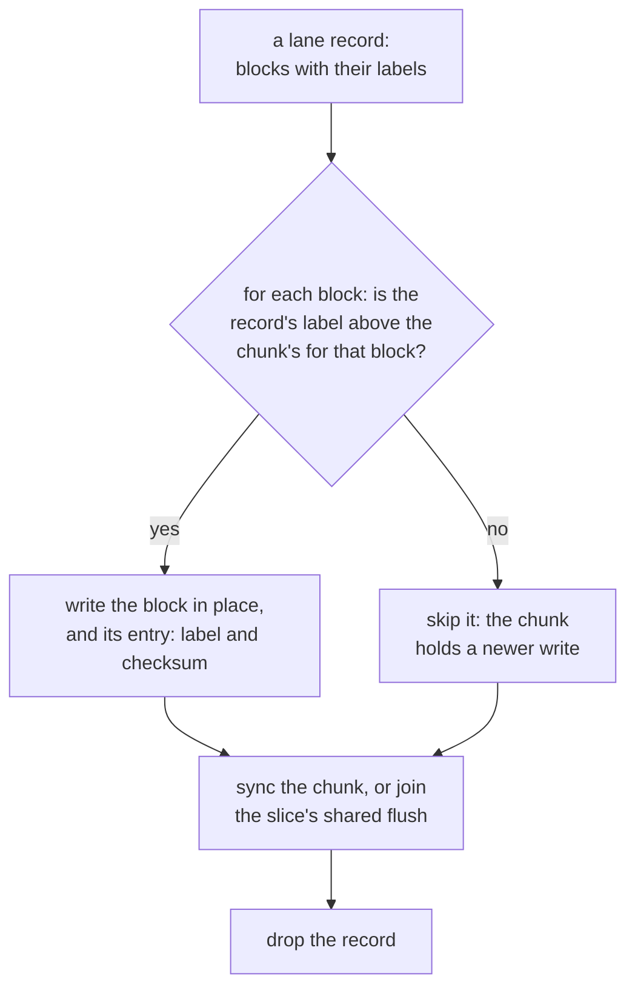

# W19. A lane chunk on a slice

## Context

A committed stripe's chunk carries one label, the write its row names, because a row orders its
writes and a holder applies only what the row committed. A lane stripe has no row a write: a holder
learns what is current from the writes themselves, by their block labels, and has to keep a label
for every block beside it, durably, through its journal, its applies and its restarts. This page is
the lane chunk's format, the journal record that carries a write, what an apply does, what a start
finds, and the allocation count that keeps a discarded stripe from coming back.

## What exists today

- **A chunk is one file**: a 4 KiB header block, then its units at aligned offsets. The header holds
  its magic and format, its identity (consumer, object, stripe and position), its unit and their
  number, **the label of the write it holds**, how many of its bytes hold data, its own CRC and every
  unit's ([F85](../../features/devices-and-pools.md#the-chunk), `shoal-core/src/server/objects/store/chunk.rs:84-90`).
  A pool's chunk is at most 480 units so their checksums fit the block.
- **Every format is frozen once written**: "a changed byte is a chunk no slice reads", and
  `chunk_format_is_frozen` holds the encoding to known bytes (`chunk.rs:18-19`).
- **A journal is four segments of 64 MiB** used as a free list, its record blocks checking
  themselves under the slice's id and the segment's generation, found at a start by a scan of every
  block. A record is part of a chunk (new values, never a patch) or a whole chunk; one `fdatasync`
  covers every record written before it began ([F85](../../features/devices-and-pools.md#the-journal)).
- **A partial stage expects a label** and is refused `CannotMake` when the slice cannot make it; an
  apply verifies every unit of its record, writes them and the header in place, and syncs the chunk
  or joins a shared flush ([F85](../../features/devices-and-pools.md#stage-apply-read-and-discard)).
- **A start classifies every record** as applied, torn, staged or inert from its record, the chunk's
  header and whether its units verify ([F85](../../features/devices-and-pools.md#what-a-start-finds)).
- **A chunk file is overwritten only within written extents**, which is what lets one flush of the
  slice's `flush` file stand for many applies under `apply_sync: shared`
  ([F85](../../features/devices-and-pools.md#the-shared-flush)), and since [F96](../../features/chunk-file-classes.md)
  a fresh file is written whole and synced by itself before it is named.

## The design

### The format

A **lane chunk** is a format of its own, named by its header's format byte and frozen as every chunk
format is, written only to a slice of an attached pool:

| Part | Holds |
| --- | --- |
| Header block | Magic and the lane format; the identity: consumer, volume, stripe, position and **allocation count**; the unit and their number; the highest label it holds, a summary for listings; its own CRC |
| Entry blocks | For every block of the stripe: its **label**, `(writer number, write number)` in 16 bytes, `(0, 0)` for a block never written, and its unit's checksum. 24 bytes a block, so 256 blocks take two entry blocks |
| Units | The stripe's blocks at aligned offsets, a unit a block at the preferred geometry |

At the preferred 1 MiB stripes of 4 KiB units ([W16](volumes-and-rows.md#geometry)) a lane chunk is
three blocks of header and 1 MiB of units, 1.2% beside the data. **A block never written is absent,
which is not the same as zeros**: it reads as zeros, but a clone reads its parent's block where its
own is absent ([W21](snapshots-and-clones.md#clones)), and a TRIM writes a labelled block of zeros, so
a trimmed block of a clone does not read through.

A disk's chunk is at least 4 MiB, 1,024 blocks, whose entries would take six entry blocks; an
attached pool is SSD-only in these gates rather than carry two header shapes
([W16](volumes-and-rows.md#attached-pools)).

### The lane record

A third kind of journal record beside the two that exist: **a write**, its record block naming the
slice's identity, the stripe and its allocation count, the writer number, and for each block it
carries the block's index and label; then the blocks' new values. It expects nothing: it is blind,
and merged by label when it is applied. Like a partial stage it holds new values and never a patch,
so writing it twice writes the same bytes, and the committer's one sync covers every lane record
whose write completed before it began.

### Apply

- **A block is laid over only by a higher label**, compared as a pair, writer number first. So
  records applied twice, or in either order, leave the same chunk; that is what lets a slice apply
  its journal in batches, and what [W17](writer-lane.md#overlapping-writes) leans on for overlapping
  writes.
- **At 4 KiB units a block is a unit**, so an apply reads nothing before it writes: the block's new
  checksum is computed from its new bytes. At 64 KiB units, the alternative geometry, an apply would
  read the rest of the unit to checksum it, which [X25](spikes.md#x25-a-volume-pools-geometry) prices.
- **Applies of one chunk are batched**, so a run of writes into one stripe shares the entry block it
  rewrites.
- **The shared flush's condition holds**: a lane chunk's file is made whole at its stripe's first
  write, allocated, written with zeros and its header and synced by itself before it is named, as
  F96 makes a fresh file, so an apply only ever overwrites written extents.

### Reads at a holder

A read of a block takes the highest label among the chunk's entry and every lane record of it not
yet applied, as a read today overlays the records that chain to a chunk, and verifies the unit it
answers. A read names the allocation count it expects, and a holder at another answers it absent or
refuses it by name ([below](#the-allocation-count)).

### What a start finds

| Outcome | When | What a start does |
| --- | --- | --- |
| **Applied** | Every block the record carries holds its label or a higher one in the chunk, and its unit verifies | Drops the record |
| **Pending** | Some block holds a lower label than the record's | Applies the record |
| **Torn** | A block holds the record's label and its unit fails | Applies the record again |
| **Superseded** | The record's allocation count is below the chunk's, or the volume is barred below the record's writer number on this slice | Drops the record and reports it |

There is no inert outcome: a lane record expects nothing, so it can always be laid over or not by its
labels alone.

### The allocation count

A stripe discarded whole, by a TRIM of every block of it or by a volume shrunk past it, is removed
from its holders and its space given back. The next write to it carries **the stripe's allocation
count plus one**, and a holder that still has a chunk of a lower count, because it missed the
discard, removes that chunk before it takes the write. A read names the count it expects; a holder
at a lower one answers the stripe absent, and at a higher one refuses the read by name, since the
reader has fallen behind. A chunk of a lower count is never read, rebuilt from or merged. The count
lives in the chunk's identity, so two chunks of one stripe at two counts are never the same file.
A writer learns a stripe's count from its positions, the highest among current ones, at first touch
or at its first request to the stripe.

### A holder's bars

Each slice keeps its bars ([W18](attach-and-takeover.md#the-three-bars)) in a small file of its own,
a volume and the highest writer number it has admitted, synced before a raise is answered and read
at a start before any lane request is served.

## Alternatives rejected

**The committed chunk's format, one label a chunk.** A chunk labelled by its newest write loses an
older write into another block of it whenever two arrive out of order.

**A label a unit at 64 KiB units.** The same loss, at a unit's grain ([W17](writer-lane.md#overlapping-writes)).

**Labels only in the journal.** Records are dropped at apply, so a block's label would be lost with
its record and a later write could not be judged against it.

**A file a block.** 256 files a stripe, and a directory sync for each.

**F96's classes for lane chunks.** A class grows only by restaging the chunk whole
([F96](../../features/chunk-file-classes.md)), which a stream of small writes into a fresh stripe would
do again and again. A lane chunk is its stripe's size from its first write.

## What it costs

- **Three header blocks a 1 MiB chunk**, 1.2% of the space.
- **A stripe's first write makes its 1 MiB file at every position**, written and synced by itself as
  F96's fresh files are, so a 4 KiB write into a fresh stripe costs a mebibyte of space at each.
- **About four device writes of 4 KiB for a 4 KiB write**: its record and its block in the journal,
  then the block and its entry block at apply, less where applies of a chunk are batched. X24 and X25
  measure device bytes a byte written.

## What it breaks

Nothing: the committed formats and records are untouched, and a lane chunk is never written to a
committed pool's slice.

## Invariants to uphold

- **A lane chunk's format is frozen once written**, and held to known bytes by a test of its own.
- **A block's label in a chunk only rises**, at one allocation count.
- **A lane record is new values with their labels**, so applying it twice or out of order leaves the
  same chunk.
- **A chunk of a lower allocation count is never read, rebuilt from or merged.**
- **A lane chunk is overwritten only within written extents.**
- **A slice's bars are durable before a raise is answered**, and read before any lane request is
  served after a start.

## Prerequisites

None of W14's rows; the format, the record and the bars are the volume's own work.

## How it would be measured

Device bytes a byte written and a write's latency at queue depths one and thirty-two, at each
geometry ([X25](spikes.md#x25-a-volume-pools-geometry)); a stripe's first write against a later one
([X24](spikes.md#x24-one-4-kib-write-three-ways)); and the shared flush's evidence,
`dm-log-writes` replayed to every state a crash could leave, extended to lane records
([F85](../../features/devices-and-pools.md#the-shared-flushs-evidence)).

## Acceptance tests

| Test | Gate | Proves |
| --- | --- | --- |
| `lane_chunk_format_is_frozen` | M30 | The lane chunk's header and entry blocks encode to known bytes |
| `a_lane_record_applied_twice_leaves_the_same_chunk` | M30 | Applying a record again changes nothing |
| `lane_records_applied_out_of_order_leave_the_same_chunk` | M30 | Two records of one block applied in either order leave the higher label |
| `a_start_classifies_every_lane_record` | M30 | Each of the four outcomes is reached and handled after a crash at every point of an apply |
| `a_lane_apply_overwrites_only_written_extents` | M30 | The shared flush covers every completed lane apply, by `dm-log-writes` on XFS and ext4 |
| `a_holders_bar_survives_its_restart` | M31 | A slice restarted after a raise refuses the lower writer before it serves anything |
| `a_chunk_at_a_lower_allocation_count_is_never_read` | M32 | A holder that missed a discard answers the stripe absent and never returns its old chunk |

## Related

[F85](../../features/devices-and-pools.md), whose store this extends; [F96](../../features/chunk-file-classes.md)
for fresh files; [W17](writer-lane.md) for what a record carries; [W20](placement-under-a-writer.md)
for what a rebuild and a scrub read from it.
