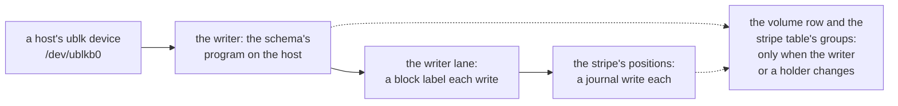
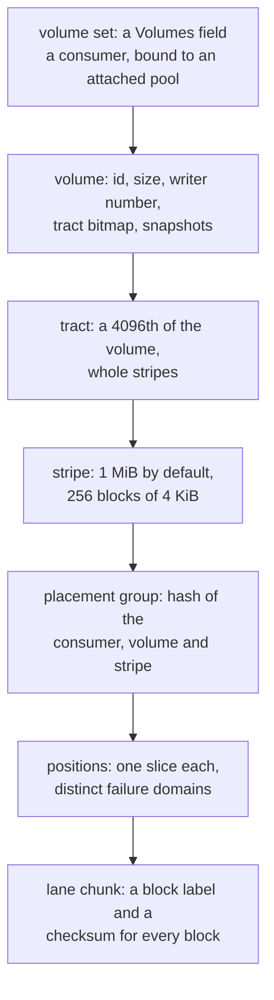
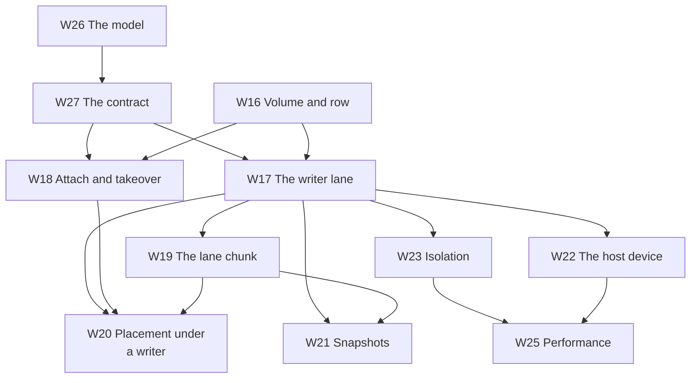

# Block volumes

**Nothing in this subchapter is built.** These pages plan block volumes for Shoal: a named,
fixed-size run of bytes that a Linux host attaches as a block device and writes at queue depth one
in about one network round trip, as RBD, LINSTOR and OpenEBS offer, without slowing the queries
that run beside it. The `W` pages are design records, in the shape the object storage part's `S`
pages took and the [Scans](../scans/overview.md) plan kept. [W14](prerequisites.md) is what has to
exist first; the [spikes](spikes.md) are what has to be measured before a gate can be trusted; the
[milestones](milestones.md) are an order of work; and [What's left to do](whats-left-todo.md) draws
all of it. [A network filesystem](../filesystem/overview.md) is planned beside this one and stands on
its writer lane, so this plan comes first.

## The question this plan was asked

Whether Shoal can offer a block store, in the manner of Ceph's RBD, LINSTOR or OpenEBS, where
performance is critical and the database's other queries keep their latency; with Ceph and
SeaweedFS for inspiration and every tradeoff written down.

**Yes, but not through the object store's write path.** A 4 KiB write in place into an object took
10.3 to 12.8 ms at the median on the lab, three copies on the 970 EVO behind 1 GbE
([F86](../../features/replicated-pools.md#performance)), because a write in place is two strong
reads, a read of the old 64 KiB unit, a confirmation and a conditional commit through the stripe
row's tablet group, coordinated on the table shard the client reached
(`shoal-core/src/server/shard/objects/write.rs:112-917`, `shoal-core/src/server/shard/objects/mod.rs:7-8`).
RBD's is about 0.42 ms on NVMe and 100 GbE, and DRBD's 52 to 91 µs ([W15](prior-art.md)). A
block device has what an object does not: **exactly one writer**. So a volume's writes need no
commit each. The host that attached the volume numbers its own writes and sends each straight to
the holders of its stripe; consensus is taken only when the writer changes or a holder does. That
is the writer lane, and the rest of this subchapter is what it takes to make it safe.

## What is being asked for

| # | Requirement | Where it is met |
| --- | --- | --- |
| R27 | A volume set is declared in the `#[shoal::db]` struct, as a bucket is, and bound to a storage pool in configuration; its volumes are created, resized, snapshotted and deleted by name while the cluster runs, and take space only where written | [W16](volumes-and-rows.md) |
| R28 | A host attaches a volume as a Linux block device; one attachment writes it at a time, and a takeover bars the one before it from writing again | [W18](attach-and-takeover.md), [W22](host-device.md) |
| R29 | In the steady state a 4 KiB write is acknowledged after one network round trip to its stripe's positions and their journal writes: no consensus round and no table shard on its path | [W17](writer-lane.md), [W25](performance.md) |
| R30 | Every acknowledged write survives what its pool's redundancy allows; a writer's or a holder's crash is mended by reconciling only what may differ | [W17](writer-lane.md), [W18](attach-and-takeover.md), [W20](placement-under-a-writer.md) |
| R31 | Volume I/O never slows table queries or bucket traffic past a budget stated before it is built | [W23](isolation.md), [W25](performance.md) |
| R32 | Snapshots and clones by copy-on-write; discard and write-zeroes; FLUSH and FUA mean what a disk's do | [W17](writer-lane.md), [W21](snapshots-and-clones.md) |
| R33 | Volumes are benchmarkable with `shoaladm bench`, judged by budgets, and compared where the lab can with RBD and DRBD | [W25](performance.md) |

`R` numbers continue the [Scans](../scans/overview.md#what-is-being-asked-for) plan's R19–R26, and
R7 is inherited whole: nothing outside the Shoal processes coordinates a volume, and no clock
decides anything safety rests on ([R7](../../distributed/overview.md#what-is-asked-of-it)). R31 is
the one every page answers to.

## Decisions taken on 2026-10-26

Taken with the user while this subchapter and the filesystem's were planned. The user asked for the
performance tradeoffs of each before choosing, and they are recorded beside each on
[W27](contract.md#decision-record) and [W24](tradeoffs.md).

| Decision | Taken | Where it lands |
| --- | --- | --- |
| How a volume's writes are replicated | **A writer lane, no commit per write.** The attached writer numbers its writes and sends each to every position of its stripe; consensus is taken only when the writer or a holder changes. The protocol is modelled in `shoal-model` before it is built, as X1 modelled the stripe protocol | [W17](writer-lane.md), [W26](model.md) |
| Where the writer runs | **On the host, through ublk**: a ublk server on the host links Shoal's client and writes to the holders directly, one hop. Large writes forwarded by one holder, to spare the host's link, are optional and set by a spike. An NVMe-oF/TCP gateway on the nodes is a later gate of its own | [W22](host-device.md), [W17](writer-lane.md#forwarding-large-writes-optional) |
| Whether a volume shares a pool with buckets | **A pool's write protocol is its policy**: `writes: committed` for buckets, `writes: attached` for volumes and a filesystem's files. Every driver below a binding dispatches on the pool, never on a consumer's kind. A bucket and a volume use two pools, which may share devices and space | [W16](volumes-and-rows.md#attached-pools), [W20](placement-under-a-writer.md) |
| Which is built first | **Volumes**, since the filesystem writes its files' bytes on the same lane under a write lease ([its overview](../filesystem/overview.md#decisions-taken-on-2026-10-26)) | [Milestones](milestones.md) |

The third decision bends one taken on 2026-10-02, that one storage pool serves consumers of mixed
kinds ([object storage](../../object-storage/overview.md#decisions-taken-on-2026-10-02)). It still
does, within a write protocol: a volume set and a filesystem's files share an attached pool, and
buckets share a committed one. Across the two protocols a pool is not shared, because recovery,
moves and scrub tell what is current in different ways, and the reservation that nothing below a
binding asks what kind of consumer it serves
([S4](../../object-storage/pools-and-devices.md#pools-and-bindings-are-policy)) is kept by asking
the pool instead.

## Vocabulary

Chosen against the words the book already uses. `fence` is a truncate's, `seal` a reclaimer's,
`claim` a node's of its devices, `lease` a leader's ([F100](../../features/lease-reads.md)), and
`epoch`, `era`, `generation`, `pin`, `target` and `floor` the pool map's and the placement groups',
so none of them names anything here. Where a page describes RBD or DRBD it uses their words, and
says so.

| Term | Meaning |
| --- | --- |
| Volume set | A field of the `#[shoal::db]` struct, `disks: Volumes<Disks>`: a consumer bound to an attached pool, holding any number of volumes, as a bucket holds objects |
| Volume | A named, fixed-size run of bytes in a volume set, with an id minted once and never reused, that one attachment writes at a time |
| Block | A volume's 4 KiB at a 4 KiB boundary: what a host writes, and what the lane labels. Never a header block or a journal block, which keep their own words |
| Attachment | A host's right to write a volume, recorded in the volume row with its writer number. Made by an attach and ended by a detach or a takeover |
| Writer | The process that holds a volume's attachment: on a host, the ublk server inside the schema's program |
| Writer number | A volume's count of attachments, raised by every attach and takeover and never reused |
| Write number | A writer's count of its own writes, from one, restarting at every writer number |
| Block label | `(writer number, write number)`: what says which write a block holds. The lane's form of a [label](../../object-storage/overview.md#vocabulary), which a committed stripe's chunk carries |
| Writer lane | The protocol by which a writer's numbered writes reach its stripes' positions with no commit each, carried on client lanes |
| Client lane | A client's connection to the object executor that owns a slice, handed to it as an object lane is today |
| Attached pool, committed pool | A storage pool whose policy is `writes: attached` (the writer lane) or `writes: committed` (the object store's stripe commits) |
| Tract | A fixed run of a volume's stripes, a 4,096th of it rounded to whole stripes: the granule the volume row's tract bitmap marks dirty |
| Dirty tract | A tract the writer may have writes in flight in. Marked in the volume row before its first write, cleared once every write in it is held everywhere or marked |
| Bar | A record that refuses a volume's writers below a writer number: in the volume row, in every group of the stripe table, and on every holder. "To bar a writer" |
| First touch | A new writer's first read or write of a stripe in a dirty tract, which reconciles the stripe's positions before anything else |
| Missed mark | A committed record that a position missed a volume's writes in a placement group from a block label on |
| Allocation count | A count in a lane chunk's identity, moved when a whole stripe is discarded, so a chunk not yet reclaimed is never read as the stripe written after |
| Lane queue | The task queue on an object executor where the writer lane's work runs, apart from a bucket's object work |

## The constraint every page inherits

**Other queries keep their latency.** A volume's writes and reads run on object executors, which X9
measured costing a table nothing: object work at 500 MiB/s on an executor of its own left the
workload grid's reference cell at 0.97 to 1.06 times its read p99 alone, where steps of 1 MiB on
the table shards moved it 2.0 to 3.8 times ([X9](../../object-storage/table-latency.md),
[S13](../../object-storage/isolation.md#who-owns-a-slice)). So **no table shard is on a volume
write's path in the steady state**; the table writes a volume does make, a tract marked dirty, a
missed mark, a takeover, are bounded and counted, and what volume I/O may cost the queries beside it
is a number stated before it is built ([W23](isolation.md#the-budget)).

**One writer, and a bar for every other.** Every promise these pages make rests on a volume having
exactly one writer at a time, and every place a write can land refusing a writer that has been
superseded ([W18](attach-and-takeover.md)). A faster path that weakens that is not offered.

**Safety by committed facts, never by a clock.** A timer may prompt a commit, a straggler marked
missed or a takeover an operator asks for, but no write is accepted or refused because of a time
([R7](../../distributed/overview.md#what-is-asked-of-it)).

**A faster path with a weaker promise is a named setting, never the default.** The rule the object
store set ([object storage](../../object-storage/overview.md#what-is-being-asked-for)) holds here:
a write is durable on every position that acknowledged it when the host is told, and a volatile
write cache honouring FLUSH is a setting a volume names ([W17](writer-lane.md#durability)).

**A claim is checked where it can be.** A statement about Shoal cites a file and a line read on
2026-10-26. A statement about another system cites the page or source it was read from, and one
that was not read is marked as **recalled**.

## The hierarchy

## The chapter

| # | Page | Purpose |
| --- | --- | --- |
| W14 | [What has to exist first](prerequisites.md) | The gaps in Shoal today, each labelled required or optional |
| W15 | [Lessons from RBD, DRBD, Mayastor and others](prior-art.md) | What is taken from each and what is not, every fact with its source |
| W16 | [A volume in the schema, and its row](volumes-and-rows.md) | The declaration, attached pools, the volume row and its tracts, geometry |
| W17 | [The writer lane](writer-lane.md) | Writes, acknowledgements, missed marks, durability, FLUSH and FUA, reads |
| W18 | [Attaching, barring and taking over](attach-and-takeover.md) | The three bars, first touch, the cut a takeover makes |
| W19 | [A lane chunk on a slice](lane-chunks.md) | The chunk format, the journal's lane record, apply and what a start finds |
| W20 | [Placement under a writer](placement-under-a-writer.md) | Moves, rebuilds, backfill, scrub and reclamation meeting the lane |
| W21 | [Snapshots, clones, resize and discard](snapshots-and-clones.md) | A snapshot's boundary, copy-on-write, clones, TRIM |
| W22 | [The device on a host](host-device.md) | ublk first; NBD, vhost-user-blk and an NVMe-oF gateway after |
| W23 | [Not slowing other queries](isolation.md) | The budget, and the cpu, memory, device and network a volume draws on |
| W24 | [Tradeoffs, and when not to use a volume](tradeoffs.md) | What every choice cost, and what a volume costs a user |
| W25 | [Performance, and the benchmarks that judge it](performance.md) | The arms, the figures and the budgets |
| W26 | [The lane's model](model.md) | What `shoal-model` must check before the lane is built |
| W27 | [The contract and the questions](contract.md) | P27–P35, Q43–Q52, the decision record and the acceptance index |
| — | [Exploratory spikes](spikes.md) | X23–X30: what has to be measured first |
| — | [Milestones](milestones.md) | M29–M34 |
| — | [What's left to do](whats-left-todo.md) | All of it, drawn |

## The dependency graph

An arrow points from a page to a page whose design leans on it. Hard edges only.

| Edge | Why |
| --- | --- |
| W26 → W27 | What the model checks is what the contract may promise |
| W27 → W17, W18 | A write's acknowledgement and a takeover's cut are written to the contract's properties |
| W16 → W17, W18 | The volume row holds the writer number and the tracts both lean on |
| W17, W18, W19 → W20 | Recovery and moves meet the lane's labels, its bars and its chunk format |
| W17, W19 → W21 | A snapshot is a boundary in the lane's numbers and a copy of a lane chunk |
| W17 → W22, W23 | The host device and the isolation budget are the lane's front and its cost |
| W22, W23 → W25 | The benchmarks drive the device and judge the budget |

## How a W page is written

[W14](prerequisites.md) is a list and has its own shape. Every page after it keeps the sections the
object storage part's design pages kept and the [Scans](../scans/overview.md#how-a-w-page-is-written)
pages kept: **Context**, **What exists today**, **The design**, **Alternatives rejected**, **What it
costs**, **What it breaks**, **Invariants to uphold**, **Prerequisites**, **How it would be
measured**, **Acceptance tests** and **Related**. Where a question is open, *The design* gives the
options, names a preferred direction, and the question carries its gate on
[W27](contract.md#questions-to-answer).

An acceptance table names tests that do not exist yet, each against a provisional gate. These
tables are not read by `shoal-bench/tests/acceptance_tables.rs`; they join it at
[M29](milestones.md#m29-the-harness), as the object storage part's did at M11.

## What this subchapter is not

It is not a shared disk: two hosts never write one volume at once, so a cluster filesystem such as
OCFS2 or GFS2 on top is not offered, and a host that wants files shared with others mounts
[the filesystem](../filesystem/overview.md). It is not erasure coded at first: parity cannot be
merged block by block as copies can ([W17](writer-lane.md#erasure-coding-not-in-these-gates)). It
is not a kernel module: the host runs a userspace server, the schema's own program. It is not
mirroring between clusters, encryption at rest or a write-back cache on the host's own SSD, which
RBD offers; each is recorded where it would go and none is scheduled. And it is not the object
store under another name: a volume's stripes are placed, rebuilt, moved, scrubbed and reclaimed by
the same machinery, but their writes are never committed one by one.

## Related

[W14](prerequisites.md) and [W27](contract.md) first for the work; [W17](writer-lane.md) for the
idea. [F86](../../features/replicated-pools.md) and [S7](../../object-storage/write-path.md) for
the committed path this departs from; [F88](../../features/recovery-and-moves.md) for the
placement machinery the lane joins; [the todo that reserved this work](../../appendix/todos.md#storage-pools-for-a-file-system-and-block-volumes);
[A network filesystem](../filesystem/overview.md), which writes its files on this lane.
