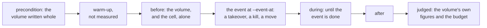

# W25. Performance, and the benchmarks that judge it

## Context

Performance was the first thing asked of this plan, so every gate is judged by measurement before it
is passed, and every number is labelled by host, cpu, governor, device and filesystem
([R33](overview.md#what-is-being-asked-for)). This page is what is compared with what, what the
bench gains to compare it, what a run records, the budgets the gates are held to, and what would make
a number wrong.

## What exists today

- **`shoaladm bench`** runs a schema's workloads on a cluster of its own, with object arms (`put100`,
  `get100`, `rw50`, `patch100`), events cut into before, during and after, and captures that keep each
  host's device counters, each member's memory and every round's figures
  ([F66](../../features/dataset-benchmarks.md), [F71](../../features/bench-device-memory.md),
  [F104](../../features/memory-in-a-capture.md)).
- **The store comparison's method**: every side built at its commit in a clean worktree, captured in an
  order that alternates (before, after, after, before), a difference counted only when the intervals
  are disjoint, and each thread's cpu sampled beside a run
  ([store comparison](../../object-storage/store-comparison.md)).
- **The reference cell**, `grid/unsorted/r50/1024`, is what every isolation budget is judged on
  ([X9](../../object-storage/table-latency.md)).
- **No block arm exists**, and no fio run is part of any capture.

## The design

### What is compared with what

Every experiment is two arms that differ in one thing.

| Experiment | Held constant | What it tells | Where |
| --- | --- | --- | --- |
| A 4 KiB write on the lane, and the object store's write in place | The devices, the hosts, the copies | What the lane buys | [X24](spikes.md#x24-one-4-kib-write-three-ways), M30 |
| Write-through, and write-back | The volume | What a sync a write costs, on each device | X24, M33 |
| Fanned out from the host, and forwarded by a holder, at 64 KiB to 1 MiB | The link | The forwarding threshold | X24 |
| 1 MiB stripes of 4 KiB units, and 4 MiB of 64 KiB | The workload | What a read before a write costs | [X25](spikes.md#x25-a-volume-pools-geometry) |
| ublk, NBD, and the client in process | The lane | What the host device costs | [X27](spikes.md#x27-ublk-beside-nbd-on-the-tokio-client), M33 |
| The reference cell alone, and beside a volume | The cell | **The budget** | [X28](spikes.md#x28-the-lane-beside-the-reference-cell), every gate from M30 |
| A bucket's arm alone, and beside a volume | The bucket | The lane queue's share | X28 |
| A volume alone, and through a takeover, a killed holder, a move, a snapshot | The volume | What each event costs | M31 to M34 |
| A first write after a snapshot, copied and reflinked | The stripe | What copy-on-write costs | [X29](spikes.md#x29-a-snapshots-copy-on-write) |
| Shoal's volume, and RBD on the same devices *(optional)* | The lab | Where Shoal stands | [X30](spikes.md#x30-rbd-drbd-and-mayastor-read-at-the-source) |

### What the driver gains

[W14](prerequisites.md#the-benchs-block-kinds-and-volume-events) places these before the first gate:

- **Block kinds**: random and sequential writes and reads, and a mixture of 70 to 30, at 4 KiB to
  1 MiB and at queue depths 1 to 32, with a FLUSH every N writes or none. An arm is named
  `blk/{kind}/s{size}/d{depth}`, such as `blk/randwrite/s4k/d1`.
- **Two modes**: through the client's attachment in process, which measures the lane; and through the
  host's device with `O_DIRECT`, which measures everything.
- **Preconditioning**: a volume is written whole before it is measured, as an SSD is before its
  benchmarks, so no arm measures a stripe's first write unless it means to.
- **Events**, appended to `EventKind` (`shoal-loadgen/src/spec.rs:196`): `writer_kill`, `holder_kill`,
  `takeover`, `snapshot`, beside the existing `device_fail`, `device_add` and `device_drain`, which move
  placement groups under a volume's writes.

### What a run records

| Figure | Of | From |
| --- | --- | --- |
| IOPS and MiB/s; latency at p50, p99 and p99.9, a window a second | The volume | The driver |
| Cpu a thousand IOPS on the host and on the nodes | The server; the object executors | Samples of every thread beside the run, as the store comparison takes them |
| Device bytes a byte written | Each host | F71's device counters |
| Table-shard queries a second | Each member | A node's figures; zero for steady-state writes |
| Table commits a volume made, by kind | Each member | Tract marks, missed marks, bars ([W23](isolation.md#table-writes-a-volume-makes)) |
| The reference cell's read and write p99, before, during and after | The foreground | Its windows, cut by the event |
| A takeover's time, and the stripes and blocks it touched | The volume | The writer's figures |
| Members called silent | The control leader | The detector's log, item 244's signal |

### The budgets

Hypotheses, each set by a spike before the gate that is judged by it:

- **A 4 KiB write at depth one, write-through**, within 1.5 times the floor X24 measures: one round
  trip and a synced journal write at the slowest position, on each device.
- **Against the object store's write in place**, at least twice as fast on the 970 EVO. If it is not,
  the lane's case rests on fast devices alone and goes back to the user before M30 (X24's trigger).
- **The foreground**: [W23](isolation.md#the-budget)'s.
- **A takeover**: its time a function of the dirty tracts, stated from X26 before M31.
- **A move under writes**: no acknowledged write lost, and the volume's p99 within
  `max(2 × its own, its own + 1 ms)` during it, the bound the object store's recovery is held to
  ([S13](../../object-storage/isolation.md#io-on-a-slice)).

### Where it runs

On the lab, by its procedure: titan and hyperion (Zen1, the 970 EVO), europa (the Optane), 1 GbE; a
side cluster of the bench's own, never the tmdb cluster; the writer on europa, where the bench's driver
runs; eight rounds or more for a budget, the sides alternating; every number labelled by host, cpu,
governor, device and filesystem ([Spikes](../../object-storage/spikes.md#where-a-spike-runs)).

### What would make a number wrong

- **europa's link.** The writer sends every copy from europa, whose 1 GbE bound both sides of the store
  comparison's gets; a write arm's throughput is reported beside the link's use, and a bound by it is
  named as one.
- **The 970 EVO's two flushes**, 0.9 ms rested and about 3 ms after synced writes: a figure that
  involves a sync depends on what ran before it, so arms alternate and X6's order check applies.
- **The page cache.** Device arms are `O_DIRECT` only.
- **The server's cpu beside the driver's** on europa: both are sampled.
- **First writes.** An arm that does not precondition measures fresh chunk files, not writes.

### `fio`

`fio` is the industry's driver and the way a reader compares Shoal with a published figure. It runs
beside an arm as a cross-check on the device mode, never in place of the bench, whose captures alone
cut events, keep device counters and join the store comparison's tables.

## Alternatives rejected

**`fio` as the driver**: no events, no device counters, no capture to compare. A cross-check only.

**Vendors' charts as the comparison** ([W15](prior-art.md#published-comparisons)): RBD and DRBD are
measured on the lab, if at all, by X30.

**A budget for the lane against DRBD's figures**: another host's devices and network. The floor X24
measures on the lab's own is what the lane is held to.

## What it costs

Block kinds and four events in `shoal-loadgen`; a host device on europa for the device mode; the lab's
hours, eight rounds a budget.

## What it breaks

Nothing.

## Invariants to uphold

- **Every number is labelled** by host, cpu, governor, device and filesystem, and taken at a commit.
- **A difference is a result only when the intervals are disjoint.**
- **No benchmark runs on the tmdb cluster** or its devices.

## Prerequisites

[W14](prerequisites.md)'s block kinds and volume events.

## How it would be measured

This page is how.

## Acceptance tests

| Test | Gate | Proves |
| --- | --- | --- |
| `a_block_kind_times_every_write` | M29 | An arm's windows hold every write's latency and the arm's IOPS |
| `a_device_mode_arm_reads_back_what_it_wrote` | M33 | An arm through `/dev/ublkbN` checks its reads against its writes |
| `a_takeover_event_is_cut_at_its_marks` | M31 | A run with a takeover is cut into before, during and after at the takeover's start and completion |
| `a_preconditioned_arm_writes_no_fresh_chunk` | M29 | An arm after preconditioning makes no chunk file |
| `steady_state_writes_count_no_table_query` | M30 | A capture's table-shard queries during a write arm into dirty tracts are zero |

## Related

[W12](../scans/performance.md), whose shape this keeps; [F66](../../features/dataset-benchmarks.md) for
the bench; [the store comparison](../../object-storage/store-comparison.md) for the method;
[W23](isolation.md) for the budget.
