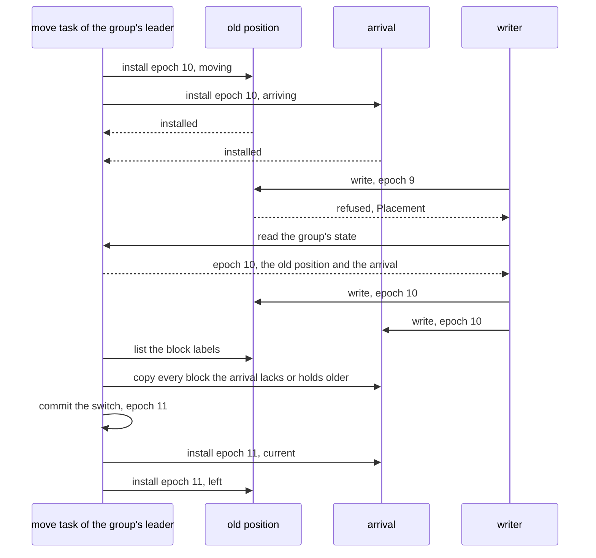

# W20. Placement under a writer

## Context

A volume's stripes are placed, rebuilt, moved, scrubbed and reclaimed by the machinery the object
store built for its own, [F88](../../features/recovery-and-moves.md) to [F92](../../features/reclamation-and-device-lifecycle.md).
That machinery was built where a stripe row says which write is current and every write commits
through the group that owns the stripe's placement state. A lane stripe has no such row, and its
writes never pass the group. So everything the rows taught the drivers, the holders have to be told,
and everything the drivers read from a row they read from the holders' labels instead. This page is
where each driver meets the lane, and the rules that keep R30's promise through a move, a rebuild and
a scrub.

## What exists today

- **A placement group's state is its tablet group's**: an epoch, its generation and positions, a move
  in flight, and the missed record, derived at apply from committed rows alone
  ([F88](../../features/recovery-and-moves.md#a-placement-groups-state-in-its-tablet-group),
  `shoal-proto/src/shared/placement_state.rs:1-33`).
- **Every stripe commit claims the epoch it was staged under** and is refused `Placement` at any other;
  holders know no epoch at all ([F88](../../features/recovery-and-moves.md#every-stripe-commit-claims-an-epoch)).
- **A writer learns a group's state** by a linearizable read through `ReplicateKind::Placement`, which
  only a node's shards make ([F88](../../features/recovery-and-moves.md#how-a-writer-learns-its-groups-state)).
- **While a group moves**, a write goes to the old holders and each arrival, and a moving position
  counts as holding a label only when both its slices hold it; reads stay on the old generation until
  the switch ([F88](../../features/recovery-and-moves.md#how-a-writer-learns-its-groups-state)).
- **A rebuild reads the row at `Quorum`**, confirms what the stale holder has, copies what it missed at
  the row's label, and commits it current conditioned on the row's sequence
  ([F88](../../features/recovery-and-moves.md#rebuilding-a-stale-position)).
- **Backfill trusts rowless stripes**: "a stripe no row names is current on every holder that was
  away" ([S10](../../object-storage/recovery.md#how-a-slice-learns-what-it-missed)).
- **A scrub compares a slice with the rows**, and never makes a position current: it marks, and the
  rebuild mends ([F89](../../features/scrub-and-repair.md)).
- **Reclamation removes what nothing names** under seals a placement group at a time, asking the
  consumer one question, whether an owner id is still named
  ([F92](../../features/reclamation-and-device-lifecycle.md#seals), [S10](../../object-storage/recovery.md#reclamation)).

## The design

### The pool's policy chooses the rules

Every driver below reads its pool's `writes` ([W16](volumes-and-rows.md#attached-pools)): for a
committed pool nothing on this page applies and nothing changes; for an attached pool each uses the
rules below. No driver asks what kind of consumer a stripe belongs to.

### Epochs at the holders

The F88 move protocol, admission, begin, copy and switch, is kept, with one step added before the
copy and one after the switch:

- **The group's leader installs every epoch at every holder it concerns**: a move's begin at every
  old position and every arrival, its switch and its abort the same, durably and before the copier
  reads any source.
- **A holder refuses a lane write stamped with another epoch**, by name, `Placement`. Every lane
  command, a missed mark above all, claims the epoch too, and the group refuses it at another, as it
  refuses a stripe commit.
- **A refusal sends the writer to read the group's state again**, through the client lane
  ([W14](prerequisites.md#a-client-lane-to-object-executors)), and it sends the write again to the
  set the state names.

Why both are needed: once one old position has installed epoch E, no write stamped E−1 can be
acknowledged there, nor without it, since a mark that would excuse it is refused. Without installed
epochs, a writer holding a stale state writes only to the old holders and is answered, and if the
copier had already read them the arrival never has the write: an acknowledged write lost at the
switch, which is F88's rejected `both_counts_the_old_holder_alone`
([F88](../../features/recovery-and-moves.md#alternatives-rejected)).

### Moves

- **The stripe set while moving is F88's**: the old positions and each arrival, and the writer's
  acknowledgement counts a moving position only when both its slices hold the write.
- **The copier lists, it does not walk rows**: it reads every stripe's block labels from an old
  position and copies by the one rule, take the source's block unless the destination holds it under
  the current writer at or above the source's label ([W18](attach-and-takeover.md#first-touch)). The
  writer's writes and the copy then commute: whichever lands second at a block, the higher label
  stays.
- **Reads stay on the old positions until the switch**, as F88's do.
- **A left slice is released under a seal past its grace** ([F92](../../features/reclamation-and-device-lifecycle.md#what-a-move-leaves)),
  and refuses lane writes from the switch's install on.

### Rebuilding a marked position

A position marked missed ([W17](writer-lane.md#a-position-that-does-not-answer)) is rebuilt by its
group's leader's recovery task, as a stale position is today, with the row's part done by listings:

1. it lists the marked position's labels and a current position's, stripe by stripe through the
   group;
2. it copies every block the marked position lacks or holds older, by the one rule, while the writer
   goes on sending the position its new writes;
3. it commits the position current, **conditioned on the mark's version**, so a mark that landed
   between the copy and the commit, a later outage, refuses the commit and the next poll begins again.

A source is a current position, never a marked one, and its blocks are read at the allocation count
the stripe is at ([W19](lane-chunks.md#the-allocation-count)).

### Backfill by listing

A position whose record overflowed is not walked against rows, since a lane stripe has none and S10's
"a stripe no row names is current" is false for it. **Lane backfill lists both slices of each stripe of
the group and compares labels**, copying by the one rule; a stripe it cannot reach leaves the position
overflowed for the next pass.

### Reads while a position is stale

A row told every reader which positions were current; the lane must tell the holders:

- **A mark takes effect for reads once the holder has been told, or is unreachable.** The writer, which
  committed it, tells the position; a holder told it is marked in a group refuses reads of that group's
  stripes by name until it is rebuilt current.
- **A restarted slice fetches its marks from its groups' tablet groups** before it serves a lane read,
  as it reads its bars ([W19](lane-chunks.md#a-holders-bars)).
- **A reader other than the writer**, a snapshot's, reads only positions its group's state calls
  current ([W21](snapshots-and-clones.md)).

### Scrub

- **A light scrub compares only quiet stripes**: stripes of tracts the volume row does not mark dirty
  ([W16](volumes-and-rows.md#tracts)). It lists every current position's labels and checksums; in a
  quiet stripe they agree, so a difference breaks [P30](contract.md#the-contract), is reported with its
  evidence as a defect, and the position behind is marked missed for the rebuild to mend by the one
  rule. A scrub still never makes a position current ([F89](../../features/scrub-and-repair.md)).
- **A deep scrub verifies every unit's checksum** at every position in its slice's idle time under the
  device's ceiling, as today; a unit that fails sets its chunk aside in the slice's quarantine and marks
  the position, which a rebuild mends from a position that verifies.

### Reclamation

- **A deleted volume** is `deleting` in its row and then gone; its owner id is no longer named, so its
  stripes are reclaimed under seals a placement group at a time, F92's `Object` scope: 4,096 seals a
  volume at the default, never one a stripe.
- **A discarded stripe** is removed and its allocation count moved ([W19](lane-chunks.md#the-allocation-count)).
- **The consumer gets a second question.** Beside "is this owner id still named?", a reclaimer and a
  scrub ask "may a writer have writes in flight on this stripe?", which a volume answers from its tract
  bitmap, and a file tree from whether the file has a writer with that region dirty
  ([the filesystem's W34](../filesystem/file-data.md)).

### Budgets

Every request a rebuild, a move, a backfill or a scrub makes of a slice is background: it waits until
the slice has no foreground request in flight, the lane queue's counting as foreground, and no apply,
then draws its bytes from the device's recovery ceiling, 256 MiB/s on an SSD
(`shoal-proto/src/shared/devices.rs:338-346`), as F88's do ([F88](../../features/recovery-and-moves.md#budgets)).
A slice a writer never lets rest rebuilds nothing, and its marked positions show as stale positions
that do not fall, as a bucket's do.

## Alternatives rejected

**A row a write**, so the drivers stay as they are: the commit a write the lane exists to avoid.

**Backfill that trusts rowless stripes**: false for every lane stripe, which has no row.

**A writer's epoch with nothing installed at the holders**: an acknowledged write lost at a switch,
F88's rejected `both_counts_the_old_holder_alone`.

**A mark that takes effect at commit, for reads too**: a reader asking a holder not yet told would be
served stale blocks as current.

**A scrub that mends a disagreement where it finds it**: a quiet stripe's positions should never
differ, so a difference is a defect to report with its evidence, and its mending is the rebuild's.

**Seals a stripe for a deleted volume**: a TiB of 1 MiB stripes is a million seals.

## What it costs

An install at every position concerned for every move's begin, switch and abort; a listing where a row
was read, for rebuilds, backfills, moves and light scrubs; a mark an outage; a refusal and a reread of a
group's state for a writer that held a stale one.

## What it breaks

Nothing for a committed pool, whose drivers dispatch to the rules they have.

## Invariants to uphold

- **Every driver dispatches on its pool's `writes`**, never on a consumer's kind.
- **An epoch is installed at every holder it concerns before a copier reads a source**, and a holder
  refuses a lane write stamped with another.
- **Every lane command claims its group's epoch** and is refused at another.
- **A moving position counts toward an acknowledgement only when both its slices hold the write.**
- **A marked position is never a source**, and is committed current only conditioned on its mark's
  version.
- **A holder told it is marked refuses reads of its group** until it is rebuilt current, and a
  restarted slice fetches its marks before serving.
- **A light scrub compares only quiet stripes**, and never makes a position current.

## Prerequisites

[W14](prerequisites.md)'s client lane, through which a writer reads a group's state.

## How it would be measured

The model first, every schedule of a move, a rebuild and a mark interleaved with writes and crashes
([X23](spikes.md#x23-the-lanes-model)); then F88's events beside block writes on the lab, a device
failed, a device added and a device drained under a volume's load, with the foreground's p99 and every
acknowledged write read back ([W25](performance.md)).

## Acceptance tests

| Test | Gate | Proves |
| --- | --- | --- |
| `a_lane_write_at_a_stale_epoch_is_refused_once_installed` | M32 | A write stamped with the epoch before a move's begin is refused at an old position that installed it |
| `a_move_under_writes_loses_no_acknowledged_write` | M32 | Every write acknowledged during a move reads back from the arrivals after the switch |
| `a_copy_and_a_write_commute_at_an_arrival` | M32 | A block written and copied in either order leaves the higher label |
| `a_rebuild_commit_is_refused_after_a_new_mark` | M32 | A mark landing between a rebuild's copy and its commit refuses the commit |
| `lane_backfill_compares_labels` | M32 | An overflowed position is rebuilt by listing, and no rowless stripe is taken as current |
| `a_told_marked_position_refuses_reads` | M31 | A holder told it is marked answers no read of its group until rebuilt |
| `a_restarted_slice_fetches_its_marks_first` | M31 | A slice restarted after a mark refuses the group's reads before it serves any |
| `a_light_scrub_compares_only_quiet_stripes` | M32 | A stripe of a dirty tract is passed over, and a difference in a quiet one is reported and its position marked |
| `a_deleted_volume_is_reclaimed_by_group` | M32 | A deleted volume's stripes are removed under one seal a placement group, and none remains |

## Related

[F88](../../features/recovery-and-moves.md), [F89](../../features/scrub-and-repair.md) and
[F92](../../features/reclamation-and-device-lifecycle.md), whose drivers this extends; [W17](writer-lane.md)
for the marks; [W18](attach-and-takeover.md) for the one rule; [W19](lane-chunks.md) for listings and
allocation counts.
