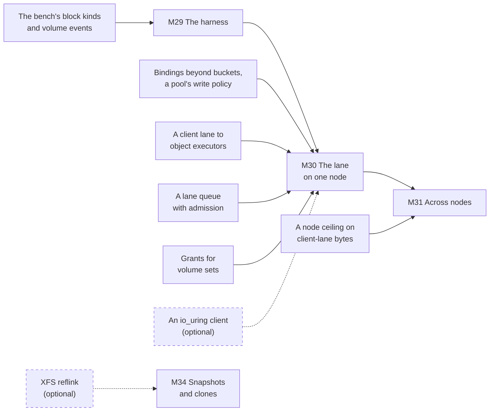

# W14. What has to exist first

**Nothing on this page is built.** It is the list of what Shoal has to gain before a volume can be
attached to a host, in one place, so that no page after it rediscovers a gap and no milestone starts
on top of one.

A prerequisite here is a **gap in Shoal as it is today**: work that lands in a change of its own,
before any volume code, and is worth having without volumes. What a volume itself has to do is not
a prerequisite, however hard it is. The lane chunk's format, the bars, the epochs a holder learns,
the missed marks, the tract bitmap and a FLUSH are the volume's own work, on
[W17](writer-lane.md) to [W21](snapshots-and-clones.md) and in the [milestones](milestones.md).
The line is drawn there so this list stays something that can be finished.

## The rule the labels follow

Every row is labelled, and the label follows the rule [S1](../../object-storage/prerequisites.md#the-rule-the-labels-follow)
set for the object store and [W1](../scans/prerequisites.md#the-rule-the-labels-follow) kept for
scans:

- **Required**: built without it, the feature would be incorrect or unsafe, or would later need
  rework to a format that is persisted or a protocol that is on the wire.
- **Optional**: it can be added later without changing anything already built, or it is needed
  only under a design answer that has not been chosen.

One reading is made explicit, as W1 made it. **"Unsafe" includes the promise R31 makes to the
queries beside a volume.** A lane whose bytes queue every table's replication behind them, or whose
work runs where a table's does, is not merely slow: it breaks the requirement every page answers
to. So an item without which a volume would do that is required.

**Where it stands (2026-10-26).** None of the six required rows is started. Each row's design is
on the page named beside it, and each lands at the start of the gate named beside it; nothing stops
it landing sooner.

## Required

### Bindings for consumers other than buckets, and a pool's write policy

**What.** A binding that names a volume set, and later a file tree, beside a bucket; and a pool
policy `writes: committed | attached`, committed with the pool, that every driver below a binding
reads ([W16](volumes-and-rows.md#attached-pools)). A pool that names none is `committed`, which
every pool committed before is.

**Why it is required.** Bindings are keyed by bucket today: the committed `ObjectPolicy` finds "the
bucket a consumer is bound as" (`shoal-proto/src/shared/pools.rs:947-957`), and a `Binding` holds a
pool and a consumer id with no kind beside them (`:840-846`). The policy is committed control
state, read back by every member, so a binding of another kind added later would be a persisted
format changed under a running cluster. And the decision of 2026-10-26 puts the write protocol in
the pool ([overview](overview.md#decisions-taken-on-2026-10-26)): without the policy, recovery,
moves and scrub would have to ask a consumer what it is, the reservation
[S4](../../object-storage/pools-and-devices.md#pools-and-bindings-are-policy) kept.

**What else gains.** [The filesystem](../filesystem/prerequisites.md), whose file trees bind the same
way; any later consumer.

**Lands** at the start of [M30](milestones.md#m30-the-lane-on-one-node). Designed on
[W16](volumes-and-rows.md).

### A client lane to object executors

**What.** A client's connection to the object executor that owns a slice, made the way a peer's
object lane is: accepted by a node, its hello naming the slice, handed whole to the executor before
any request is read off it (`shoal-core/src/server/peer/listener.rs:29-33`, `:330`,
`hand_to_objects` at `:427`). Unlike a peer's, it authenticates as a client does, by SCRAM
([F12](../../features/authentication.md)), and every request on it is checked against the
principal's grants on the executor. Its refusals are by name: `Barred`, `Placement`, `Busy`,
`Unauthorized`. With it, a client reads the pool map and a placement group's state, which only a
node's shards read today, through `ReplicateKind::Placement`
([F88](../../features/recovery-and-moves.md#how-a-writer-learns-its-groups-state)).

**Why it is required.** It is how the writer reaches its holders in one hop, the decision of
2026-10-26 ([W22](host-device.md)). It is a wire protocol, so it is fixed before the first client
speaks it. Without placement states a writer could not follow a move, and a move under a writer
that does not follow it loses acknowledged writes ([W20](placement-under-a-writer.md#moves)).

**What else gains.** A bucket's reads, which could read a stripe's chunks straight from its holders
instead of through the coordinating shard: [O128](../../appendix/optimizations.md)'s copies on the
coordinator would go with it. And [the filesystem](../filesystem/overview.md), whose files are
written on this lane.

**Lands** at the start of [M30](milestones.md#m30-the-lane-on-one-node). Designed on
[W17](writer-lane.md) and [W22](host-device.md).

### A lane queue with admission on object executors

**What.** A fourth task queue on each object executor for the writer lane's requests, beside the
foreground, apply and background queues at a 100 µs goal
(`shoal-core/src/server/objects/executor.rs:56`, `:643-655`), with its own count of requests in
flight and bytes drawn, shed by name past either.

**Why it is required.** A bucket's gets and puts and a volume's writes would otherwise share one
queue and one count, and a volume's queue depth of 128 would sit in front of every object get on
the executor. X9 found what holds a table's tail is where the work runs and in what steps
([X9](../../object-storage/table-latency.md)); the same holds between a bucket and a volume. The
count is part of what a writer obeys, so it is fixed before writers exist.

**What else gains.** [F108](../../features/object-work-in-flight.md)'s figures, which gain a class
to count.

**Lands** at the start of [M30](milestones.md#m30-the-lane-on-one-node). Designed on
[W23](isolation.md#cpu).

### A node ceiling on client-lane bytes

**What.** A token bucket every client lane a node serves draws its bytes from, below the link's
capacity, so the control and replication lanes keep room, and a setting to name a separate
interface for client lanes.

**Why it is required.** A load that saturates a 1 GbE link delays the control lane's reports, and
members fall silent to the leader's detector
([item 244](../../appendix/known-issues.md#244-a-load-that-saturates-a-1-gbe-link-delays-the-control-lanes-reports-and-members-fall-silent)).
A volume written at the host's line rate, three copies of it fanned out, is exactly that load, and
a member called down under it would have its positions marked missed and its groups moved: the
lane's own load would break the lane. Under R31 that is unsafe.

**What else gains.** Bucket traffic, which can saturate the same link today.

**Lands** at the start of [M31](milestones.md#m31-across-nodes). Designed on
[W23](isolation.md#network).

### The bench's block kinds and volume events

**What.** `shoal-loadgen` gains a volume's operations as kinds of their own: reads and writes of 4 KiB
to 1 MiB at queue depths 1 to 32, a FLUSH every N writes or none, through the client in process and
through the host's device. And events appended to `EventKind` (`shoal-loadgen/src/spec.rs:196`): a
writer killed, a holder killed under writes, a takeover, a move under writes, a snapshot.

**Why it is required.** Every gate of this plan is judged by a measurement, and R31's budget is the
foreground's tail beside a volume's load. It is [F69](../../features/driver-operation-kinds.md)'s
precedent, as the scans' kind was for scans
([W1](../scans/prerequisites.md#the-benchs-scan-kind-and-scan-event)).

**What else gains.** The object store's arms, which gain the same events beside them.

**Lands** at the start of [M29](milestones.md#m29-the-harness). Designed on
[W25](performance.md#what-the-driver-gains).

### Grants for volume sets

**What.** A `volumes:` entry beside `tables:` and `buckets:` in a principal's grants, by a volume
set's marker or `*`: `read` to attach a volume or a snapshot read-only, `write` to attach one to
write, create, resize and delete it. No privilege is added.

**Why it is required.** Grants are committed and read back by name, and an unknown key is refused
(`shoal-proto/src/shared/grants.rs:414-428`, `deny_unknown_fields`). A grant naming volumes would
fail to read on a member built before it, so the entry exists, and is grantable only past the
volumes' wire version, before any principal is given one, as the scans' `scan` is
([W10](../scans/api.md#grants)).

**What else gains.** Nothing else; it is small.

**Lands** at the start of [M30](milestones.md#m30-the-lane-on-one-node). Designed on
[W16](volumes-and-rows.md#grants).

## Optional

| Item | Why optional | What it would add |
| --- | --- | --- |
| **Client registrations**, a mount or a process the cluster knows by name ([the filesystem's W28](../filesystem/prerequisites.md)) | An attachment is its volume row; a writer is barred by number, not by name ([W18](attach-and-takeover.md)) | A dead attachment found without an operator; the filesystem needs them anyway |
| **Server pushes beyond topology** ([the filesystem's W28](../filesystem/prerequisites.md)) | A barred writer learns by its next refusal | A barred writer told at once, so its host fails its I/O sooner |
| **A command of several writes in one tablet** ([the filesystem's W30](../filesystem/atomic-commands.md)) | A volume's row is one row ([W16](volumes-and-rows.md)) | A volume row split across rows if a volume's snapshots outgrow one, which [X26](spikes.md#x26-write-working-sets-and-takeover-time) would show |
| **An io_uring-native client**, not tokio | The tokio client may be fast enough under the host's queues ([X27](spikes.md#x27-ublk-beside-nbd-on-the-tokio-client)) | Fewer copies and wakeups a request, if X27 says the hop costs more than a tenth of a write on the Optane |
| **XFS reflink** (`FICLONERANGE`) for a chunk's copy-on-write | A whole chunk can be copied ([W21](snapshots-and-clones.md)) | A snapshot's first write without a copy of a mebibyte, if [X29](spikes.md#x29-a-snapshots-copy-on-write) says copies break the budget |
| **NBD and vhost-user-blk front ends** | ublk is the host device chosen ([W22](host-device.md)) | Hosts whose kernel has no ublk; QEMU guests without a host device |
| **An NVMe-oF/TCP gateway on the nodes** | A gate of its own, later, by the decision of 2026-10-26 | Hosts that run no Shoal software, through the kernel's initiator |
| **[O105](../../appendix/optimizations.md)**, a write in place cut and checksummed off the table shard | No volume write runs on a table shard | A bucket's writes, beside volumes that do not need it |

## What the lab needs

Nothing fitted. The lab's SSDs (titan's and hyperion's 970 EVO, europa's Optane) and its 1 GbE are
what X24 to X29 run on ([Spikes](../../object-storage/spikes.md#where-a-spike-runs)). Every lab
kernel must carry `ublk_drv`: europa's 7.0.0-38 does (`modinfo ublk_drv` on 2026-10-26, beside
`nbd` and `nvme-tcp`), and titan's and hyperion's 7.0.0-34 are checked at X27. Disks are not used:
an attached pool is SSD-only at first, since a disk's chunk is at least 4 MiB
(`shoal-proto/src/shared/pools.rs:776-785`) and a lane chunk's header would outgrow its block
([W19](lane-chunks.md#the-format)). RBD and DRBD on the lab, as references, are optional and follow
X14's method of recording every host change ([X30](spikes.md#x30-rbd-drbd-and-mayastor-read-at-the-source)).

## Found on the way

Read while this plan was written, on 2026-10-26, and **not reproduced**. Each is to be established
by a test before it is filed on [Known Issues](../../appendix/known-issues.md), which was not edited
while another session's change had it open.

- **An append retried after an unknown outcome may claim a second region.** An append claims its
  region by an entry commit under a fresh internal identity (`shoal-core/src/server/shard/objects/mod.rs:24-31`),
  and object operations are not deduplicated by their id, so a client that retries an append whose
  first try's outcome it never learned could claim and write a second region. A volume does not
  append; [the filesystem](../filesystem/file-data.md) takes O_APPEND under a write lease instead.
- **A write in place moves neither `content_version` nor `modified_ms`.** A striped write that does
  not grow its object commits no entry change, so the fields move only at
  `shoal-core/src/server/shard/objects/write.rs:180`, `:265`, `:299` and `:451`, against the field's
  own comment, "moved by every change to the object's content" (`shoal-proto/src/shared/objects.rs:510`).
  An ETag derived from it ([S3](../../object-storage/objects.md)) would not change with the object.
- **A todo still says one RADOS pool serves RGW, CephFS and RBD.** X14 corrected the claim
  ([X14](../../object-storage/ceph-and-s3-sources.md#9-how-osds-are-deployed-whom-a-pool-serves-and-crimson));
  [the todo](../../appendix/todos.md#storage-pools-for-a-file-system-and-block-volumes) kept it, and
  is struck through with the correction in the change that writes this page.

## The order

Each required row lands at the start of the first gate that needs it, and nothing stops it landing
sooner. An arrow points from a row to the gate that requires it; dashed is *helps*.

## Related

[S1](../../object-storage/prerequisites.md) and [W1](../scans/prerequisites.md), whose rule this
keeps; [W23](isolation.md) for the design of two of the six rows; [the milestones](milestones.md)
for where each lands; [What's left to do](whats-left-todo.md) for all of it drawn;
[the filesystem's W28](../filesystem/prerequisites.md), which shares four of these rows.
