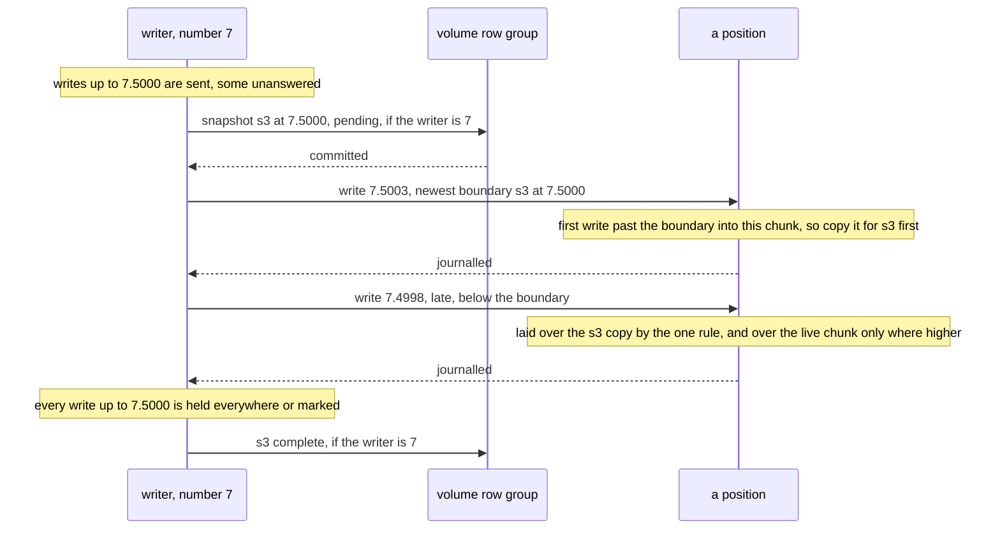

# W21. Snapshots, clones, resize and discard

## Context

R32 asks for snapshots and clones by copy-on-write, discard and write-zeroes, and a volume that can
grow. RBD has all of them over RADOS's self-managed snapshots and its layering
([W15](prior-art.md#ceph-rbd)); Shoal keeps no old version of anything today. A volume makes the
problem smaller than an object's would be: one writer numbers every write, so a snapshot can be a
place in that numbering rather than a moment every holder has to agree on.

## What exists today

- **No version is kept.** "No old version of an object is kept, and nothing here designs keeping
  one" ([todos](../../appendix/todos.md#a-listing-index-and-an-s3-gateway)).
- **A slice keeps a chunk's previous state until its next apply**, at most 30 s and never persisted,
  so a reader one write behind is served the label it asked for
  (`shoal-core/src/server/objects/store/slice.rs:95`, [F86](../../features/replicated-pools.md)). It is
  not a snapshot and is not used as one.
- **X6 measured cloning a range** (`FICLONERANGE`) for partial writes and the fragmentation after it,
  and the store journals partial writes instead ([X6](../../object-storage/device-store-ssd.md)).

## The design

### A snapshot is a boundary

**A snapshot is a block label `(N, B)`**: every write the writer numbered at or below `B` under its
writer number `N` is in it, and none after. The writer takes one by committing it to the volume row
as pending ([W16](volumes-and-rows.md#the-volume-row)); every write it sends after carries the newest
boundary, and a holder learns of the snapshot from the first such write it receives.

- **A chunk is copied at the first write past a boundary it has not crossed**: the holder keeps the
  chunk as it was for the snapshot, then lays the write over the live one. A chunk never written after
  the boundary has no copy, and a read of the snapshot reads its live chunk.
- **A late write at or below the boundary**, in flight when the snapshot was taken, is laid over the
  snapshot's copy by the one rule ([W18](attach-and-takeover.md#first-touch)) as well as over the
  live chunk, where its label is higher.
- **A snapshot is complete only once the writer knows every write at or below its boundary is held by
  every position or marked**, which it commits to the row. A read of an incomplete snapshot is refused
  by name.
- **A takeover completes a pending snapshot**: first touch reconciles a dirty stripe's snapshot
  copies as it reconciles its live chunk ([W18](attach-and-takeover.md#first-touch)).
- **A rebuild copies a position's snapshot copies too** ([W20](placement-under-a-writer.md#rebuilding-a-marked-position)),
  so a snapshot keeps its redundancy.

RADOS does the same with a snapshot context a write carries, and clones an object at its first write
after a snapshot (**recalled**); the boundary is that context written in the lane's numbers.

### Reading a snapshot

A read-only attachment of a complete snapshot reads, for each block, the newest label at or below
its boundary: from the chunk's copy for the snapshot, or from the live chunk where none was made.
Like any reader other than the writer it reads only positions the group's state calls current
([W20](placement-under-a-writer.md#reads-while-a-position-is-stale)), and it may read while the
volume is written, since nothing it reads changes.

### Deleting a snapshot

A deleted snapshot's copies are removed in the background, a placement group at a time under seals
as a deleted volume's stripes are ([W20](placement-under-a-writer.md#reclamation)). A copy two
snapshots share, because nothing was written between them, is kept until both are gone. A snapshot a
clone stands on cannot be deleted, as RBD's protected parent cannot ([W15](prior-art.md#ceph-rbd)).

### Clones

**A clone is a volume whose row names a parent and a snapshot of it.** Its blocks are absent until it
writes them; a read of an absent block reads the parent's snapshot, from the parent's positions.

- **No copy-up is needed.** A host writes whole 4 KiB blocks ([W22](host-device.md#the-device)), so a
  clone's write never has to read a parent's block to fill the rest of one.
- **Absent is not zeros.** A TRIM of a clone's block writes a labelled zero
  ([below](#discard-and-write-zeroes)), so it does not read through to the parent again
  ([W19](lane-chunks.md#the-format)).
- **Flattening**, copying every block the clone still lacks from its parent so the parent's snapshot
  can go, is a background task in the recovery ceiling, optional.

### Resize

**Growing** is one commit of the row's size, which may double the tract
([W16](volumes-and-rows.md#tracts)), and a host is told its device's new capacity. **Shrinking** is
refused while a writer is attached; detached, it commits the size and discards every stripe past it,
moving their allocation counts ([W19](lane-chunks.md#the-allocation-count)).

### Discard and write-zeroes

- **A TRIM or a write-zeroes of a block is a lane write of no bytes**: a labelled zero, ordered with
  every other write to the block, recorded in the chunk's entry and never written to its unit. A read
  returns zeros.
- **A TRIM of a whole stripe removes its chunk** at every position and moves its allocation count,
  so its space goes back to the pool.
- **The host is told a discard's granularity is 4 KiB** and its alignment a stripe for space to come
  back ([W22](host-device.md#the-device)).

## Alternatives rejected

**A snapshot by quiescing the volume** and copying it whole: the host's I/O stopped for as long as a
copy takes.

**A snapshot every holder agrees on a moment for**: a round to every position of the pool, where one
writer's numbering already says what is before and after.

**Copy-up of a parent's block on a clone's first write**: a read for nothing, since every write is a
whole block.

**Reflink as the only copy**: X6 found clones fragment a file; [X29](spikes.md#x29-a-snapshots-copy-on-write)
measures whether a whole chunk's reflink is still worth having over a copy, and it stays optional.

## What it costs

- **The first write past a boundary into each stripe copies it**, a mebibyte at every position, or
  reflinks it if X29 says so.
- **Snapshot copies take space** until they are deleted, a stripe's worth for every stripe written
  after the boundary.
- **A clone's read of an absent block** goes to its parent's positions, another placement group.
- **A snapshot's completion waits** for every write before it to be held everywhere.

## What it breaks

Nothing.

## Invariants to uphold

- **A complete snapshot never changes**, and holds for every block the newest write at or below its
  boundary and nothing above.
- **A read of an incomplete snapshot is refused.**
- **A chunk's snapshot copy is made before the first write past its boundary is laid over the
  chunk.**
- **A snapshot a clone stands on is never deleted.**
- **A clone's absent block reads its parent's; a trimmed one reads zeros.**

## Prerequisites

None of W14's required rows beyond the lane's; XFS reflink is optional, and needed only if X29 says a
copy breaks the budget.

## How it would be measured

The first write after a snapshot against a later one, copy and reflink, at queue depths one and
thirty-two, and the foreground's p99 beside a stream of snapshots ([X29](spikes.md#x29-a-snapshots-copy-on-write));
the bench's snapshot event beside a load ([W25](performance.md)).

## Acceptance tests

| Test | Gate | Proves |
| --- | --- | --- |
| `a_snapshot_holds_every_write_below_its_boundary` | M34 | A complete snapshot reads every block's newest write at or below the boundary, with late writes and a holder's crash |
| `a_snapshot_never_holds_a_write_past_its_boundary` | M34 | No write above the boundary is read from the snapshot |
| `an_incomplete_snapshot_refuses_reads` | M34 | A snapshot not yet complete answers no read |
| `a_takeover_completes_a_pending_snapshot` | M34 | A writer killed while a snapshot is pending leaves it complete after the takeover |
| `a_clones_absent_block_reads_its_parent` | M34 | A clone reads its parent's snapshot where it has not written, and its own block once it has |
| `a_trimmed_clone_block_reads_zeros` | M34 | A TRIM of a clone's block does not read through to the parent |
| `a_whole_stripe_trim_gives_its_space_back` | M33 | A stripe trimmed whole is removed at every position and its count moved |
| `a_protected_parent_snapshot_is_never_deleted` | M34 | Deleting a snapshot a clone stands on is refused by name |

## Related

[W15](prior-art.md#ceph-rbd) for RBD's snapshots and layering; [W17](writer-lane.md) for the numbering
a boundary is a place in; [W19](lane-chunks.md) for absent blocks and allocation counts;
[W20](placement-under-a-writer.md) for what deletes copies.
