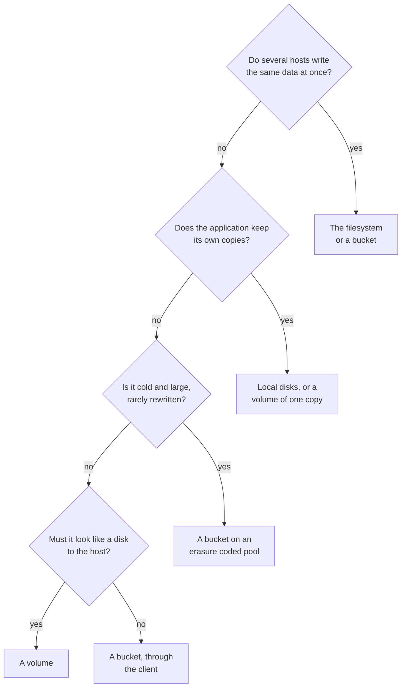

# W24. Tradeoffs, and when not to use a volume

## Context

Every choice on these pages bought something and cost something, and a volume is itself a tool with
a price its user pays. This page puts both in one place: what a volume costs the person who attaches
it and when not to attach one, and each design choice beside what it cost and what its alternative
would have. Each row points to the page that argues it. Four of the choices were the user's on
2026-10-26, made after the performance tradeoffs below were laid out ([W27](contract.md#decision-record)).

## What exists today

No volume. A bucket's object can be written in place, appended and truncated
([F86](../../features/replicated-pools.md)), at 10.3 to 12.8 ms a 4 KiB write on the lab, with any
number of writers ordered by commits.

## The design

### What a volume costs the person who attaches it

1. **One writer at a time.** A volume is attached by one host; two hosts never write it at once, so a
   cluster filesystem on a shared disk is not offered ([W18](attach-and-takeover.md)). Files shared
   between hosts are [the filesystem's](../filesystem/overview.md).
2. **The host's link carries every copy.** Three copies of a write leave the host three times, about
   37 MiB/s of writes on 1 GbE, unless large writes are forwarded by a holder
   ([W17](writer-lane.md#forwarding-large-writes-optional)).
3. **Write-through pays a sync every write on every position.** On the lab's 970 EVO a journalled
   4 KiB write is 2.0 ms rested and 6.1 ms loaded; on a device with power-loss protection it is
   little. **Write-back is a setting**, and with it what a disk's cache loses can be lost: writes
   acknowledged and not yet flushed, if every position holding them loses power at once
   ([W17](writer-lane.md#durability)).
4. **A takeover is asked for, never automatic**, and takes as long as the old writer's dirty tracts
   take to reconcile; a stripe whose every position is cut off with the old writer waits for the
   partition to heal ([W18](attach-and-takeover.md#what-a-partition-does)).
5. **The first write into a clean tract waits a commit**, 5.3 ms on the lab; a write pattern that keeps
   reaching new tracts pays it often ([W16](volumes-and-rows.md#tracts)).
6. **Thin volumes can overcommit their pool**; a full pool refuses a write, which the host's
   filesystem sees as an I/O error ([W16](volumes-and-rows.md#thin-provisioning-and-space)).
7. **No erasure coding**: three copies cost three times the bytes, where a bucket's cold objects can
   take 4+2 ([W17](writer-lane.md#erasure-coding-not-in-these-gates)).
8. **4 KiB blocks only**: a host or a guest that needs a device of 512-byte logical blocks cannot use
   one ([W16](volumes-and-rows.md#alternatives-rejected)).
9. **A snapshot's first write into each stripe copies a mebibyte** at every position
   ([W21](snapshots-and-clones.md)).
10. **The schema's program runs on the host**, built for its cpu, with its buffers locked
    ([W22](host-device.md)).

### When not to use a volume

- **When many hosts need the same bytes.** Use [the filesystem](../filesystem/overview.md), or a bucket.
- **For data that replicates itself.** A database or a log that keeps its own copies on three hosts
  pays three copies of three copies on volumes; give it local disks, or one copy a volume.
- **For cold, large, rarely rewritten data.** A bucket on an erasure coded pool keeps it at a
  fraction of the bytes.
- **When the host's link is thin and the writes are bulk.** Three copies from the host fill it first;
  forward large writes, or write from a host on the cluster's own network.
- **Beside latency-critical tables on one shared link.** The budget holds a volume to a node's
  ceiling, and the ceiling is what a bulk writer then gets; give storage traffic a link of its own.
- **For a device that must be 512-byte sectored.**

### When to use a volume

A virtual machine's disk; a container's persistent volume; a database that wants a block device and
leaves replication to its storage; a filesystem one host formats and mounts; anything that wants a
disk that outlives its host and moves with it.

### The four decisions, and the tradeoffs they were made on

These were laid out to the user on 2026-10-26 before each was chosen.

| Decision | Chosen | What it buys | What it costs | The alternative, and its cost |
| --- | --- | --- | --- | --- |
| How writes are replicated | The writer lane | One round trip and a journal write a write; no table shard on its path | A protocol of its own to model, build and prove; labels on every block | The object store's commits: built and proven, 10.3 to 12.8 ms a 4 KiB write on the lab, a raft round on a table shard every write |
| Where the writer runs | On the host, through ublk | One hop: a round trip plus the slowest position's journal write; no fan-out on the database's nodes | The host's link carries every copy, about 37 MiB/s at three copies on 1 GbE; Shoal's program on every host; a client lane to object executors | A gateway on the nodes: one more hop, 0.1 to 0.2 ms on the lab by estimate, 5 to 10% of a 970 EVO write and up to 1.5 times on an Optane-class device; the fan-out's cpu and copies on nodes that serve tables; no Shoal software on hosts |
| Whether a volume shares a pool with buckets | A pool's write protocol is its policy | Every driver dispatches on its pool; the committed path untouched | Two pools where a deployment has both kinds, sharing devices | Mixed pools: drivers asking each stripe's kind, and one geometry for both |
| Which is built first | Volumes | The lane the filesystem's files are written on, proven on its simplest consumer | The filesystem waits | The filesystem first, on committed stripes: about 10 ms a small write in place, and the lane built later anyway |

### What each design choice cost

| Choice | What it buys | What it costs | The alternative, and its cost |
| --- | --- | --- | --- |
| A block label `(writer, write)` a 4 KiB block ([W17](writer-lane.md#overlapping-writes)) | Overlapping writes resolve alike everywhere | 16 bytes a block, two entry blocks a 1 MiB chunk | A label a chunk or a unit: a lost write whenever two arrive out of order |
| Acknowledge at every position, or `k + f` and a committed mark ([W17](writer-lane.md#the-acknowledgement)) | A write survives the pool's redundancy, and a silent position never serves as current | The slowest position sets a write's latency; a commit an outage | `k + f` with no mark: a position silently behind |
| A mark a placement group and position, not a stripe ([W17](writer-lane.md#a-position-that-does-not-answer)) | One commit an outage | A rebuild lists every stripe of the group | A mark a stripe: a commit nearly every write while a holder is down |
| Three bars ([W18](attach-and-takeover.md#the-three-bars)) | A superseded writer stopped where its writes and commands land, with no clock and no cluster-wide wait | A row commit, a commit a group, a record a slice | A cluster-wide fence: neither necessary nor sufficient, 0.76 to 3.5 s a proposal under load |
| Tracts in the row ([W16](volumes-and-rows.md#tracts)) | A takeover reconciles only what was in flight; no row a stripe | A commit on the first write into a clean tract | A row a stripe: a million rows a TiB; no record: a takeover that reads every stripe |
| First touch, eager and on demand ([W18](attach-and-takeover.md#first-touch)) | Clean tracts served at once; a complete cut once every dirty tract is touched | A takeover is incomplete while a dirty stripe is unreachable | Reconcile everything first: a host waits for a whole volume |
| Epochs installed at holders ([W20](placement-under-a-writer.md#epochs-at-the-holders)) | No acknowledged write lost at a move's switch | An install at every position concerned, every move | The writer's epoch alone: F88's rejected `both_counts_the_old_holder_alone` |
| 1 MiB stripes of 4 KiB units ([W16](volumes-and-rows.md#geometry)) | No read before a write | Four times the stripes of 4 MiB | 64 KiB units: a read to checksum every small write |
| Write-through by default ([W17](writer-lane.md#durability)) | Every acknowledged write durable where acknowledged | A sync a write; slow on consumer SSDs | Write-back by default: a weaker promise under the default's name |
| The lane queue apart ([W23](isolation.md#cpu)) | A volume's depth never in front of a bucket's get | A fourth queue and a count to set | One queue: a get behind 128 writes |
| No erasure coding in these gates ([W17](writer-lane.md#erasure-coding-not-in-these-gates)) | No parity to merge, so labels suffice | Three times the bytes | Erasure coded volumes: a delta a write applied exactly once, which no model has checked |

## Alternatives rejected

A page that listed costs without the alternative beside each: a cost means nothing next to nothing.

## What it costs

Nothing of its own; this page is a summary.

## What it breaks

Nothing.

## Invariants to uphold

- **Every choice above has its cost written beside it**, here and on its page; a choice whose cost is
  found later is added, not left to be rediscovered.

## Prerequisites

None.

## How it would be measured

Each cost above that is a number is measured where its page says: a write's latency and its link by
[X24](spikes.md#x24-one-4-kib-write-three-ways), the geometry by [X25](spikes.md#x25-a-volume-pools-geometry),
tracts and takeovers by [X26](spikes.md#x26-write-working-sets-and-takeover-time), the device by
[X27](spikes.md#x27-ublk-beside-nbd-on-the-tokio-client), the budget by
[X28](spikes.md#x28-the-lane-beside-the-reference-cell) and snapshots by
[X29](spikes.md#x29-a-snapshots-copy-on-write).

## Acceptance tests

None of its own; every row's test is on its page.

## Related

[W17](writer-lane.md) and [W18](attach-and-takeover.md), where the largest of these are argued;
[W15](prior-art.md) for how RBD, DRBD and Mayastor made the same choices;
[the filesystem's W38](../filesystem/tradeoffs.md) for a file tree's.
