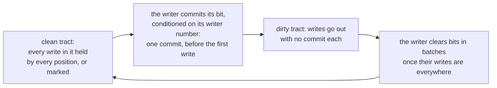

# W16. A volume in the schema, and its row

## Context

R27 asks for volumes declared the way a bucket is and created by name while the cluster runs. A
volume is a consumer's bytes on a storage pool, as an object is, and almost everything below its
binding already exists: placement, the device store, recovery, scrub, reclamation. What is new is
above the binding: what a volume set declares, what one row per volume holds, and how a pool says
which write protocol its stripes follow. This page is that, and the geometry an attached pool cuts
a volume by.

## What exists today

- **A bucket is a schema field.** `pub posters: Bucket<Posters>` generates two persistent unsorted
  tables, `PostersObjectMeta` keyed by a hash of an object's path and `PostersStripeMeta` keyed by
  `(consumer, object, stripe)`, both refused to any client at the front door
  ([F79](../../features/bucket-schema.md)).
- **A binding is a bucket's.** The committed `ObjectPolicy` holds pools and bindings, and finds "the
  bucket a consumer is bound as" (`shoal-proto/src/shared/pools.rs:947-957`); a `Binding` is a pool
  and a consumer id minted once (`:840-846`). Configuration names them under `storage.buckets`
  ([S4](../../object-storage/pools-and-devices.md#pools-and-bindings-are-policy)).
- **Geometry is a pool's, fixed for an object's life.** A pool names its `stripe` and `unit`
  (`shoal-proto/src/shared/pools.rs:384-389`), 4 MiB and 64 KiB unless it does (`:53-81`), and a
  chunk of more than 480 units is refused, the checksums one header block holds (`:765-773`); a
  rotational pool's chunks are 4 MiB or more (`:776-785`). An object's geometry is its pool's when it
  is created (`:645-646`).
- **A stripe's key names its consumer.** `hash(consumer, object, stripe)`
  (`shoal-proto/src/shared/objects.rs:152-160`); its placement group is the key's twelve tablet bits
  and as many more as the pool's groups a tablet need, 4,096 a consumer by default
  (`shoal-proto/src/shared/pool_placement.rs:52-65`).
- **A row's commit costs what its size does.** X10 measured a tablet group at about 4,900 small rows a
  second, and 196 a second for a row of 4 KiB ([S18](../../object-storage/contract.md)).

## The design

### The declaration

A volume set is a field, as a bucket is, with a unit marker type:

```rust
/// The marker for the cluster's virtual machine disks
pub struct VmDisks;

#[shoal::db]
pub struct Lab {
    /// The movies table
    pub movies: PersistentUnsortedTable<Movie, FileSystem>,
    /// The posters bucket
    pub posters: Bucket<Posters>,
    /// The virtual machine disks
    pub disks: Volumes<VmDisks>,
}
```

`#[shoal::db]` recognizes `Volumes` in the first segment of the type's name, as it recognizes
`Bucket` ([derive macros](../../api/derive-macros.md)), and generates two persistent unsorted tables,
both refused to every client at the front door as a bucket's are:

| Table | Key | Holds |
| --- | --- | --- |
| `VmDisksVolumes` | A hash of the volume's name, its entries a list so two names that collide are both kept, as `ObjectMeta`'s are ([S3](../../object-storage/objects.md)) | One row a volume, below |
| `VmDisksStripeMeta` | `(consumer, volume, stripe)` | **No row a write.** Its tablet groups are where the volume set's placement groups keep their state, the bars and the missed marks ([W17](writer-lane.md), [W18](attach-and-takeover.md)), as a bucket's stripe table's groups keep theirs ([F88](../../features/recovery-and-moves.md#a-placement-groups-state-in-its-tablet-group)) |

A volume is created at run time, by name, as an object is put: the schema declares the set and the
deployment binds it, and nothing about one volume is in either.

### Attached pools

The decision of 2026-10-26 puts a stripe's write protocol in its pool:

```yaml
storage:
  pools:
    fast:                           # a bucket's: every write a conditional commit (S7)
      class: ssd
      redundancy: {replicas: 3}
    blocks:                         # a volume set's: the writer lane
      class: ssd
      writes: attached
      redundancy: {replicas: 3}
      stripe: 1MiB                  # 256 blocks of 4 KiB, the default for an attached pool
      unit: 4KiB
  buckets:
    Posters: {pool: fast}
  volumes:
    VmDisks: {pool: blocks}
```

- **`writes`** is `committed`, every pool's until now and the default, or `attached`. It is policy,
  committed at bootstrap with the pool and never changed after, since a stripe's history is its
  protocol's.
- **A volume set binds only an attached pool**, and a bucket only a committed one; a start that
  binds otherwise is refused by name. A file tree's files bind an attached pool too
  ([the filesystem](../filesystem/overview.md)).
- **Every driver below a binding dispatches on the pool's policy**: placement, the device store's
  records, rebuilds, moves, backfill, scrub and reclamation ([W20](placement-under-a-writer.md)).
  None asks what kind of consumer a stripe is, which is
  [S4](../../object-storage/pools-and-devices.md#pools-and-bindings-are-policy)'s reservation kept by
  another route.
- **Two pools may share devices and space.** Several pools selecting one class share its devices
  ([S4](../../object-storage/pools-and-devices.md)), so `fast` and `blocks` above can be the same
  SSDs. What they do not share is a stripe's protocol.
- **An attached pool is replicated and on SSDs, in these gates.** Erasure coding is refused for it
  by name ([W17](writer-lane.md#erasure-coding-not-in-these-gates)), and so is a rotational class,
  since a disk's chunk is at least 4 MiB and a lane chunk's labels would not fit its header
  ([W19](lane-chunks.md#the-format)).

### Geometry

**Preferred: 1 MiB stripes of 4 KiB units**, a pool's `stripe` and `unit`, legal today: 256 units, under
the 480 a header block holds the checksums of. A 4 KiB write then replaces one whole unit and its
checksum, and no holder reads before it writes. Two other answers are open until
[X25](spikes.md#x25-a-volume-pools-geometry) prices them, [Q47](contract.md#questions-to-answer):

| Geometry | For it | Against it |
| --- | --- | --- |
| **1 MiB stripes, 4 KiB units** (preferred) | No read before a write; a block is a unit; checksums as they are | Four times the stripes of a 4 MiB stripe: more chunk files, more listing entries, and a snapshot's first write copies less |
| 4 MiB stripes, 64 KiB units, a block label each 4 KiB | One geometry with buckets' default | A 4 KiB write into a 64 KiB unit reads the unit to checksum it, or keeps a checksum a block, which is the first row's format by another route |
| 4 MiB stripes, 4 KiB units, a header of more than one block | The fewest stripes | A new header shape for every chunk of the pool, 1,024 checksums and labels a chunk |

A volume's geometry is its pool's when it is created and fixed for its life, as an object's is.

### The volume row

| Field | Holds |
| --- | --- |
| `name`, `id` | The name a host attaches by; an id minted at create and never reused, in every stripe's key |
| `size`, `block` | Bytes, a whole number of stripes' blocks; the block, 4 KiB |
| `geometry` | The pool's stripe and unit at create |
| `state` | `live` or `deleting` |
| `writer` | The writer number: raised by every attach and takeover, never reused, never lowered ([W18](attach-and-takeover.md)) |
| `attachment` | Who holds it: the principal, the host and the process, or none |
| `tract`, `dirty` | The tract's size, and the tract bitmap: 4,096 bits in 512 bytes |
| `durability` | `write_through`, the default, or `write_back` ([W17](writer-lane.md#durability)) |
| `snapshots` | Each snapshot's id, its boundary label and whether it is complete, a few inline ([W21](snapshots-and-clones.md)) |
| `parent` | For a clone, the parent's volume and snapshot |
| `limits` | IOPS and MiB/s, read and write, for the writer and the holders to keep ([W23](isolation.md#per-volume-limits)) |

**The row stays near a kibibyte.** Its commit is what every attach, takeover, tract mark and snapshot
waits on, and X10's figures fall with a row's size. So the bitmap is 512 bytes and snapshots inline
are few; a volume past them would need [the filesystem's](../filesystem/atomic-commands.md) command
of several writes in one tablet to keep a second row beside it, optional until
[X26](spikes.md#x26-write-working-sets-and-takeover-time) shows a need.

**Every change to the row is one conditional commit** on its version, F68's idiom
([F68](../../features/conditional-writes.md)), and every change a writer makes is conditioned on its
writer number too. That is what bars an old writer from its own row: once a takeover has moved the
number, an old writer's tract mark is refused.

### Tracts

A **tract** is a 4,096th of a volume, rounded up to whole stripes and at least one: 256 MiB of a TiB
volume, one stripe of a 4 GiB one. Its bit in the row is **dirty** while the writer may have writes
in flight in it:



- **The first write into a clean tract waits one commit**: 5.3 ms at the median for one row on the
  lab's SSD leg ([the group commit delay](../../object-storage/store-optimizations/group-commit-delay.md)),
  0.64 ms on europa's Optane over loopback
  ([F98](../../features/commit-delay-bounded-by-the-sync.md#performance)).
  Every later write in a dirty tract waits for none.
- **A takeover reconciles only the dirty tracts** ([W18](attach-and-takeover.md#first-touch)), so how
  long it takes grows with what was in flight, not with the volume's size.
- **Bits are cleared lazily, in batches**, by the writer, and only once every write in the tract is
  held by every position or marked missed ([W17](writer-lane.md#a-position-that-does-not-answer)).
- **A volume that grows past 4,096 tracts doubles its tract** in the same commit as its size, each
  new bit the OR of the two it replaces.

DRBD's activity log is the ancestor: hot extents of 4 MiB, a metadata write to activate one, and a
crash's resync confined to them ([W15](prior-art.md#drbd-and-linstor)).

### Thin provisioning and space

A stripe takes space at its first write, and a block never written reads as zeros without a device
read. The pool's space is shared by every volume and bucket on its devices, so a volume can be
created larger than what is free, as RBD's can, and a write that finds its pool full is refused
`NoSpace` by name, which the host sees as an I/O error ([W22](host-device.md)). A volume that
reserves its space at create is not planned ([W24](tradeoffs.md)).

### Placement

A volume's stripe is placed as an object's: its key is `hash(consumer, volume, stripe)`, its
placement group the key's tablet bits and more, its positions the group's. A volume's stripes spread
over every placement group of its set, so one volume's writes spread over every device of the pool.

### Grants

`volumes:` beside `tables:` and `buckets:` ([W14](prerequisites.md#grants-for-volume-sets)): `read`
attaches a volume's snapshot read-only, `write` attaches one to write and creates, resizes and
deletes. A client lane checks the principal's grant at the executor on every request
([W17](writer-lane.md)).

### The client's handle

`client.volumes::<VmDisks>()` creates, resizes, snapshots, clones and deletes by name, and attaches:
an attachment is the handle a writer writes through, and the ublk server holds one
([W22](host-device.md)). Listing a set's volumes is a scan of its volume table, which waits on the
Scans plan's [M25](../scans/milestones.md#m25-scans-across-a-cluster); until then an attachment names
its volume, and `shoaladm` keeps no list of its own.

## Alternatives rejected

**A volume as a bucket's object.** It works today and costs 10.3 to 12.8 ms a 4 KiB write on the lab
([F86](../../features/replicated-pools.md#performance)), a raft round on a table shard for every one.
Rejected by the decision of 2026-10-26.

**A row a stripe.** Allocation, the writer number a stripe was opened under, a snapshot's mark, each
in a row of its own: a TiB of 1 MiB stripes is 1,048,576 rows, about 280 MiB a copy at the archived
size of a stripe row ([F88](../../features/recovery-and-moves.md#in-the-fixture)), and a commit on every
stripe's first write. The tract bitmap is a 512-byte summary of the same fact, and the holders'
listings say which stripes exist.

**A table a volume.** Tables are fixed in the schema; volumes are made while the cluster runs.

**One pool for buckets and volumes.** Decided against on 2026-10-26: recovery, moves and scrub would
learn two ways to tell what is current and choose by a stripe's kind, and both kinds would share one
geometry.

**512-byte blocks.** Eight times the labels and checksums of 4 KiB, for hosts that cannot use a
device of 4 KiB logical blocks. Recorded in [W24](tradeoffs.md), not offered.

## What it costs

A generated table pair and a second kind of binding; a policy field on every pool; about a kibibyte a
volume; a commit on the first write into each clean tract; a second pool where a deployment has
buckets and volumes on the same devices.

## What it breaks

Nothing built. The 2026-10-02 decision that one pool serves consumers of mixed kinds holds within a
write protocol and not across them, and the [overview](overview.md#decisions-taken-on-2026-10-26) and
[the todo](../../appendix/todos.md#storage-pools-for-a-file-system-and-block-volumes) say so.

## Invariants to uphold

- **A volume id is never reused**, and a volume's geometry never changes after it is created.
- **Nothing below a binding asks a consumer's kind**, only its pool's policy, and a pool's policy never
  changes.
- **A volume set binds only an attached pool**, and a start that binds otherwise is refused.
- **Every change to a volume row is conditioned on its version**, and every change a writer makes on
  its writer number too.
- **A tract is dirty before any write into it leaves the writer**, and cleared only once every such
  write is held by every position or marked.

## Prerequisites

[W14](prerequisites.md)'s bindings beyond buckets and a pool's write policy, and its grants for volume
sets.

## How it would be measured

The volume row's commit rate at its real size, X10's method, against the tract marks a working set
asks for ([X26](spikes.md#x26-write-working-sets-and-takeover-time)); a geometry's cost to a write, a
read and a snapshot by [X25](spikes.md#x25-a-volume-pools-geometry).

## Acceptance tests

| Test | Gate | Proves |
| --- | --- | --- |
| `a_volume_set_binds_only_an_attached_pool` | M30 | A volume set bound to a committed pool, or a bucket to an attached one, refuses the start by name |
| `a_pools_write_policy_never_changes` | M30 | A configuration that changes a committed pool's `writes` is refused, and the committed one kept |
| `a_volume_id_is_never_reused` | M30 | A volume deleted and created again under its name takes a new id, and no chunk of the old is read |
| `a_tract_is_dirty_before_its_first_write_leaves` | M30 | No holder receives a write into a tract the row does not mark dirty |
| `a_tract_mark_by_an_old_writer_is_refused` | M31 | After a takeover, the old writer's mark of a clean tract fails its condition |
| `a_volume_row_stays_under_its_bound` | M30 | A volume at its most snapshots inline keeps its row under its bound, and one past it is refused by name |
| `a_grown_volume_merges_its_tract_bits` | M34 | A volume grown past 4,096 tracts doubles its tract and keeps every dirty region dirty |

## Related

[F79](../../features/bucket-schema.md), whose shape this repeats; [S4](../../object-storage/pools-and-devices.md)
for pools and bindings; [W17](writer-lane.md) and [W18](attach-and-takeover.md), which lean on the
row; [W20](placement-under-a-writer.md) for what the pool's policy dispatches.
