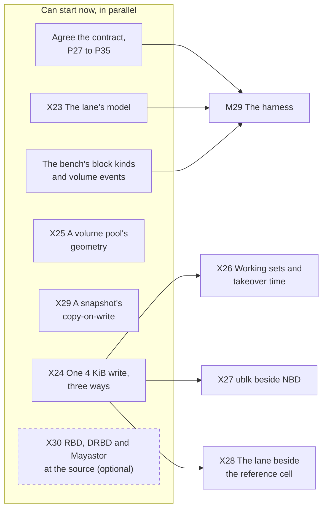
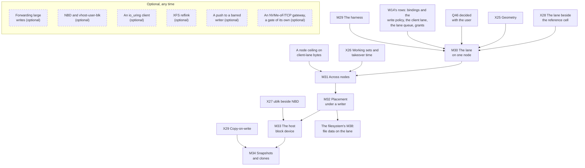

# What's left to do

**The order of the work, drawn.** The pages before this one say what has to be done and why; this one
says in what order, on two diagrams: the work up to the first gate, and the gates after it. As of
2026-10-26, when this plan was drawn, nothing on either diagram is done.

**How to read them.**

- An arrow points from a piece of work to what requires it. Things on one level, with no arrow between
  them, can be done in parallel.
- A green box with a ✅ is done.
- A box titled *(optional)*, with a dashed border, can be left out without anything built having to
  change; a dashed arrow means *helps*, not *requires*. Each one's reason is on the page that lists it.
- A box beside a gate lands no later than the start of that gate, and nothing stops it landing sooner
  ([W14](prerequisites.md#the-order)).

The full list of what each gate requires is on [the milestones page](milestones.md#the-gates-at-a-glance);
the diagrams draw an arrow only where no longer path already implies it.

## Before the first gate

Everything in the first box can start now. Three spikes wait on the spike build X24 makes, a holder
and a writer of the lane's shape, which they reuse.

X30 feeds no gate. It reads RBD's, DRBD's and Mayastor's write and fencing paths at pinned releases
and, if run, measures RBD and DRBD on the lab beside the lane; [W15](prior-art.md) marks what it would
confirm.

## The gates

The chain is the claim [the milestones page](milestones.md#the-order-is-a-claim) argues for: the model
before any code, one node before a cluster, placement under a writer before a host can attach, the
lane before the device, snapshots last. One of its places is convenience: M33 needs M31 and could
start beside M32. The filesystem's M38 needs M32 and nothing after it. The rest of the optional work,
flattening a clone and write-back as a deployment's default for devices with power-loss protection, is
on [the milestones page](milestones.md#optional-any-time); it changes no box here.

## Keeping it current

**Whoever finishes a piece of work turns its box green in the same change**, with a ✅ at the start of
its label and `:::done` after it, as the object storage part's boxes were turned
([its page](../../object-storage/whats-left-todo.md#keeping-it-current)). A piece of work that is added,
split or dropped is added, split or dropped here too, and an optional one says *(optional)* in its
title. The conventions are `CLAUDE.md`'s, under *Planning Docs*.

## Related

[W14](prerequisites.md) for the rows the gates begin with; [Spikes](spikes.md) for what has to report
first; [Milestones](milestones.md) for what each gate delivers; [W27](contract.md) for the questions and
the record; [the filesystem's What's left to do](../filesystem/whats-left-todo.md) for the plan that
follows.
