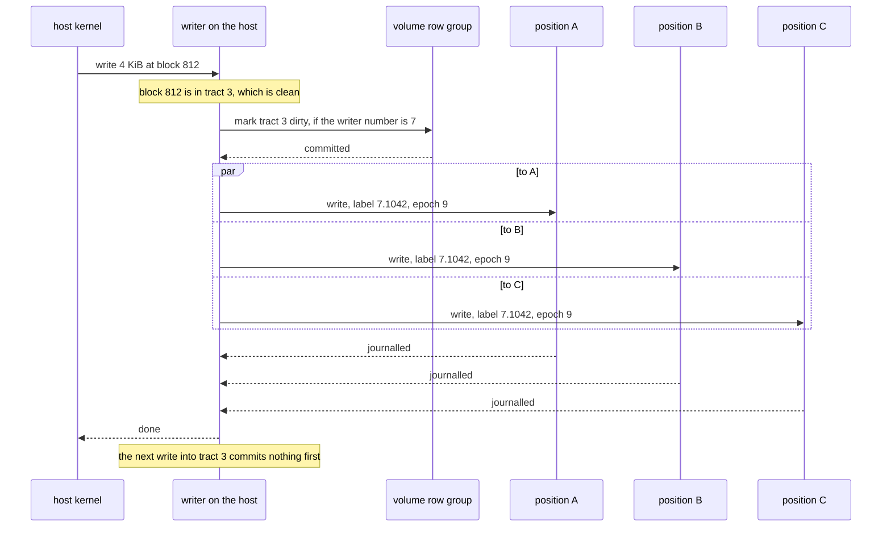
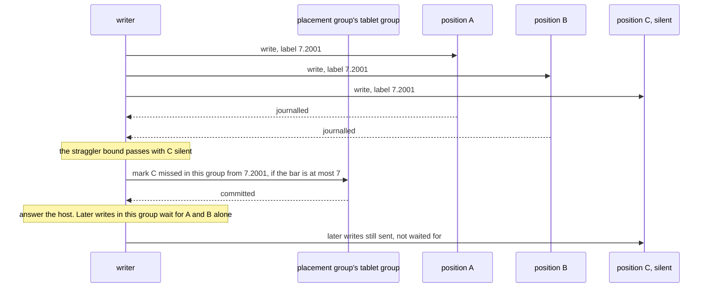
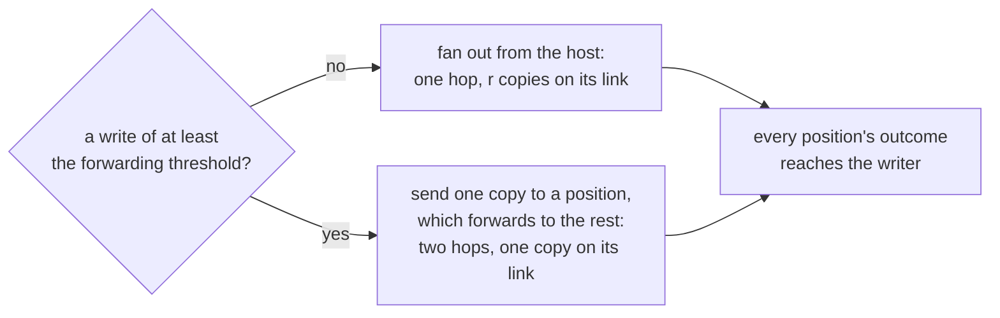

# W17. The writer lane

## Context

R29 asks that a 4 KiB write be acknowledged after one network round trip and its holders' journal
writes, with no consensus round and no table shard on its path; R30 that every acknowledged write
survive what the pool's redundancy allows. The object store cannot do the first, because a stripe
of an object has any number of writers and only a commit through the stripe row's group orders
them. A volume has one. This page is how its writes travel when the writer is the only one who
orders them: what a write carries, when it is acknowledged, what happens when a position does not
answer, what durable means, and where a read is served from.

## What exists today

- **A committed write is staged, committed and applied.** A write in place reads its entry and its
  stripe row at `Quorum`, reads the old unit it merges into, confirms or stages at every holder,
  and commits conditionally on the row's sequence and the group's placement epoch
  (`shoal-core/src/server/shard/objects/write.rs:112-917`, [S7](../../object-storage/write-path.md)).
  It is acknowledged on a durable majority of the commit and the word of `k + f` holders in distinct
  failure domains ([S7](../../object-storage/write-path.md#the-acknowledgement-rule)). On the lab
  that was 10.3 to 12.8 ms at the median for 4 KiB ([F86](../../features/replicated-pools.md#performance)).
- **A chunk is labelled, not numbered**, because two stagers can race on one row and "both produce
  'sequence plus one' with different bytes" ([S7](../../object-storage/write-path.md#labels-not-numbers)).
- **A slice journals and groups its syncs.** A partial stage is a journal record of new values,
  never a patch, so writing it twice writes the same bytes; one `fdatasync` covers every record
  whose write completed before it began ([F85](../../features/devices-and-pools.md#the-device-store)).
  A journalled 4 KiB write took 2.0 ms rested and 6.1 ms loaded on the 970 EVO and 81 µs on the
  Optane ([X6](../../object-storage/small-writes.md)).
- **A stripe's straggler is waited for 200 ms** once `k + f` holders hold it, "before they are named
  missed" in its row (`straggler_wait`, `shoal-core/src/server/conf.rs:1192-1195`, `:1323-1325`).
- **No operation flushes.** Every acknowledged write is durable already; none of the seven
  `ObjectOpKind`s is a barrier (`shoal-proto/src/shared/protocol/object.rs:81-96`).

## The design

### A write, end to end

1. **The writer numbers the write.** Write numbers count from one under each writer number, so the
   write's block label is `(writer number, write number)`, 7.1042 above.
2. **Its tract is dirty, or made so** by one commit to the volume row, conditioned on the writer
   number ([W16](volumes-and-rows.md#tracts)). Most writes find it dirty already and commit
   nothing.
3. **It goes to every position of its stripe's placement group at once**, over the client lanes to
   their executors ([W14](prerequisites.md#a-client-lane-to-object-executors)), carrying the
   volume, the stripe, its blocks, its label, the writer number the holder checks against its bar
   ([W18](attach-and-takeover.md#the-three-bars)) and the placement epoch the writer last read
   ([W20](placement-under-a-writer.md#epochs-at-the-holders)).
4. **Each holder journals it**, a lane record in the slice's journal ([W19](lane-chunks.md)), and
   answers once the record is durable, or written under write-back ([durability](#durability)).
5. **The writer answers the host** once every position has, or once it has made the rule below
   hold without one.

The holder applies the record into its chunk later, as a partial stage is applied today, and nothing
the writer waits on runs on a table shard.

### Why numbers are enough

S7 labels a chunk by a sequence and a tag because two stagers can produce the same sequence with
different bytes. A volume has one writer at a time, and every place a write lands refuses one that
has been superseded ([W18](attach-and-takeover.md)). So a writer's write number names exactly one
set of bytes, on two conditions this page keeps as invariants: **a writer never sends two payloads
under one write number**, keeping a write's bytes until it is answered and sending them again byte
for byte; and **a writer that restarts is a new writer number**, never resuming the old count.

### Overlapping writes

A host may have two writes to one block in flight at once; the block layer promises nothing about
their order. The lane makes the outcome the same everywhere: **within one writer number the higher
write number wins**, at every position, whatever order its writes arrived in, because a holder
keeps a block's label beside it and lays a write over a block only if its label is higher
([W19](lane-chunks.md#apply)). Across writer numbers the higher writer number wins, but only for a
writer that is not barred, which is what [W18](attach-and-takeover.md)'s first touch arranges.

**A label is a block's, never a unit's or a chunk's.** Two 4 KiB writes into one 64 KiB unit carry
different labels; a label a unit, kept by the maximum, would drop the lower one at any holder that
received them in the other order. So every block has its own, 16 bytes beside its 4 KiB
([W19](lane-chunks.md#the-format)), whatever unit the pool checksums in.

### The acknowledgement

**A write is acknowledged when every current position of its stripe holds it, or when `k + f`
positions in distinct failure domains hold it and every other current position is marked missed by a
committed mark.** For a pool of three copies, `k + f` is two.

The first is the steady state, DRBD's protocol C ([W15](prior-art.md#drbd-and-linstor)). The
second is how a write goes on past a position that does not answer, and it costs one commit an
outage, not one a write.

### A position that does not answer

- **The mark is a group's, not a stripe's**: `(placement group, position, since-label)`. Under random
  4 KiB writes a mark a stripe would be a commit nearly every write while a holder is down; a mark a
  group is one an outage, batched when several groups lose the same position at once.
- **It is committed through the group's tablet group**, the one that keeps the group's placement
  state ([F88](../../features/recovery-and-moves.md#a-placement-groups-state-in-its-tablet-group)),
  conditioned on the group's bar for the volume, so a superseded writer's mark is refused
  ([W18](attach-and-takeover.md#the-three-bars)). The placement state's own rule is kept: the record
  is derived from what a commit says and nothing else (`shoal-proto/src/shared/placement_state.rs:31-33`).
- **The straggler bound is a timer that causes a commit**, which R7 allows. Its default is the put's,
  200 ms, until [X28](spikes.md#x28-the-lane-beside-the-reference-cell) says otherwise.
- **A position stays marked until it is rebuilt current** ([W20](placement-under-a-writer.md#rebuilding-a-marked-position)),
  and is never read, never a source, and never counted toward an acknowledgement meanwhile. The
  writer goes on sending it writes once it serves again, so a rebuild converges instead of chasing.
- **Fewer than `k + f` answering is not an acknowledgement.** The write waits.

**A sent write is never abandoned.** The writer keeps every write until every current position holds
it or is marked, whatever the host has been told. A write given up after it reached one position
would leave that position newer than the rest with nothing to say so, and a block read from
different positions would flip between two states.

### Durability

**Write-through is the default**: a holder answers once its record is synced, through the slice's
committer, so every acknowledged write is durable on every position that acknowledged it. The
object store's rule is kept: a faster path with a weaker promise is a named setting, never the
default ([object storage](../../object-storage/overview.md#what-is-being-asked-for)).

**Write-back is a volume's named setting**, `durability: write_back`, decided with the user from
[X24](spikes.md#x24-one-4-kib-write-three-ways)'s figures ([Q46](contract.md#questions-to-answer)).
A holder then answers once its record is written, in the device's cache, and the device is
advertised to the host as having a volatile write cache, which is what a host's filesystem already
writes FLUSH and FUA for:

- **FLUSH** is sent to every position that answered a write since the last flush; each syncs its
  journal through its committer, and the FLUSH completes once all have. Every write acknowledged
  before the FLUSH was issued is then durable everywhere it was acknowledged.
- **FUA** marks one write to be synced before its answer, which is write-through for that write.
- **What can be lost** is what a disk's cache loses: writes acknowledged and not yet flushed, if every
  position holding them loses power first. A position that restarts between flushes may have lost
  some, so it is marked missed from the label of the last completed flush, and rebuilt.

On the 970 EVO a flush costs 0.9 ms rested and about 3 ms after synced writes, and a journalled 4 KiB
write 2.0 to 6.1 ms; on the Optane 81 µs. Write-back is worth what that flush costs a write, which is
much on the lab's SSDs and little on a device with power-loss protection.

### Reads

- **From one current position.** A host's local position first, where its host is a node of the
  cluster; otherwise the position with the fewest of this writer's reads outstanding, the rule
  [F97](../../features/disk-reads-by-queue.md) uses for disks.
- **A block whose last write is in flight is read from the writer's own buffer.** The writer holds the
  write anyway, and no position is asked for a state some positions may not have yet.
- **A marked position is never read**, and a position told it is marked refuses reads of the group
  ([W20](placement-under-a-writer.md#reads-while-a-position-is-stale)).
- **An unwritten block is zeros**, answered without a device read.
- **Verified units may be answered from the holder's cache** ([F102](../../features/read-unit-cache.md)),
  which drops a unit at every change to it.

### Forwarding large writes (optional)

The writer sends a copy to every position, so its host's link carries `r` times what it writes:
about 37 MiB/s of writes at three copies on the lab's 1 GbE. **A large write may go to one position
instead, which writes it and forwards it to the rest**, over the object lanes between nodes,
checking the bar and the epoch as each would, and answering the writer with every position's
outcome; only the writer marks a position missed. Two hops for the large write, one for the small:
the threshold is [X24](spikes.md#x24-one-4-kib-write-three-ways)'s to set, and the whole mode is
optional, since nothing else depends on it.

### Erasure coding, not in these gates

An attached pool is replicated ([W16](volumes-and-rows.md#attached-pools)). Parity cannot be laid
over by the maximum of a label: two writes' deltas into one unit row commute only if each is applied
exactly once, and a parity holder that saw one of two overlapping writes would hold a parity of
neither. The object store left an erasure coded small write staged and never in its commit for the
same want of a model ([S7](../../object-storage/write-path.md#small-writes)). Erasure coded volumes
are recorded on [W27](contract.md#questions-to-answer) as Q52 with no gate set.

### Where the lane's work runs

A lane request runs in the lane queue of the object executor that owns its slice
([W23](isolation.md#cpu)), its buffers drawn from the object budget. A table shard sees a volume's
writes only as the commits named on this page and [W18](attach-and-takeover.md): a tract marked, a
position marked missed, a takeover. Each is counted, and [W23](isolation.md#table-writes-a-volume-makes)
bounds them.

## Alternatives rejected

**Every write a conditional commit**, the object store's path: two strong reads, a merge, a
confirmation and a raft round on a table shard, 10.3 to 12.8 ms at the median for 4 KiB on the lab.
Rejected by the decision of 2026-10-26.

**The bytes inside a commit**, X8's inline path: one raft round, 5.1 ms on the lab at 4 KiB, and
every byte through a table shard's WAL and replication lane, which [X3](../../object-storage/bytes-through-groups.md)
found moved a small table's read p99 126 to 165 times.

**A primary that forwards every write**, RBD's shape: two hops for every write, where the writer
already orders them. Kept only for large writes, and optional.

**Acknowledging at `k + f` with no mark.** A third position silently behind, and a later read served
from it as current.

**Giving up a write refused for want of `k + f`.** One position newer than the others with nothing to
say so, and reads that flip.

**A label a unit or a chunk.** Two block writes into one unit lose one of them at some holder.

**Labels with tags, as S7's.** They exist for several stagers of one row; one writer needs numbers.

**Write-back as the default.** Faster on the lab's SSDs, and a weaker promise; the rule makes it a
setting.

## What it costs

- A copy a position on the host's link, `r` times the writes, unless large writes are forwarded.
- A journal write and a later apply on every position: two device writes a byte, as a partial stage
  costs today.
- 16 bytes of label a 4 KiB block, 0.4% of the space.
- The writer's memory: every write until answered, bounded by its queues' depth and size.
- A commit for every tract made dirty, and one for every outage of a position, never one a write.

## What it breaks

Nothing built: the committed path is untouched, since attached and committed stripes never share a
pool ([W16](volumes-and-rows.md#attached-pools)).

## Invariants to uphold

- **A writer never sends two payloads under one write number**, and a writer that restarts is a new
  writer number.
- **A write is acknowledged only when every current position holds it, or `k + f` in distinct failure
  domains do and every other is marked missed by a committed mark.**
- **A sent write is never abandoned** while a current position may lack it.
- **A marked position is never read, never a source, and never counted toward an acknowledgement**
  until it is rebuilt current.
- **Within one writer number the higher write number wins at every position**, and a label is a
  block's.
- **Write-through is the default.** Write-back is named by the volume and advertised to the host as a
  volatile cache.
- **No steady-state write runs on a table shard.**

## Prerequisites

[W14](prerequisites.md)'s client lane and lane queue; its node ceiling before any write crosses a
link shared with peer lanes.

## How it would be measured

A 4 KiB write's latency at queue depths one and thirty-two, write-through and write-back, against the
object store's write in place on the same devices ([X24](spikes.md#x24-one-4-kib-write-three-ways));
fan-out against forwarding at 1 MiB on the lab's 1 GbE (X24); a straggler's cost and the marks an
outage commits ([X28](spikes.md#x28-the-lane-beside-the-reference-cell)); the counts of table-shard
queries during a write arm ([W25](performance.md)).

## Acceptance tests

| Test | Gate | Proves |
| --- | --- | --- |
| `a_lane_write_is_answered_after_every_position_journals_it` | M30 | In the steady state no write is acknowledged before every position's record is durable |
| `no_table_shard_runs_a_steady_state_lane_write` | M30 | A write arm into dirty tracts sends no query to any table shard |
| `overlapping_writes_resolve_alike_at_every_position` | M30 | Two writes to one block, delivered in opposite orders to two positions, leave both with the higher label |
| `a_read_of_an_unwritten_block_is_zeros_without_a_device_read` | M30 | An absent block reads as zeros and touches no device |
| `a_read_of_a_block_in_flight_is_served_by_the_writer` | M30 | A read of a block whose last write is unanswered is answered from the writer's buffer |
| `an_attached_pool_refuses_erasure_coding_by_name` | M30 | An attached pool named with `erasure` refuses the start |
| `a_silent_position_is_marked_before_a_write_goes_on_without_it` | M31 | A write answered by `k + f` waits for a committed mark of the rest |
| `a_sent_write_is_never_abandoned` | M31 | A write refused for want of `k + f` is kept and sent again, and no position is left newer than the rest unmarked |
| `a_marked_position_is_never_read` | M31 | No read is served by a position marked missed until it is rebuilt current |
| `a_restarted_position_in_write_back_is_marked_from_the_last_flush` | M31 | A holder restarted between flushes is marked missed from the last flush's label |
| `a_flush_syncs_every_position_written_since_the_last` | M33 | A FLUSH completes only once every position that answered a write since the last has synced |
| `a_fua_write_is_synced_before_its_answer` | M33 | A write marked FUA is durable at every position before the host is told |

## Related

[S7](../../object-storage/write-path.md), the committed path this departs from;
[W18](attach-and-takeover.md) for the bars the lane rests on; [W19](lane-chunks.md) for what a holder
writes; [W20](placement-under-a-writer.md) for marked positions and moves; [W15](prior-art.md) for
protocol C and the activity log.
