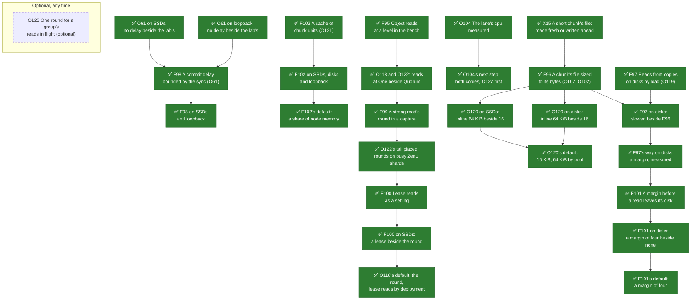
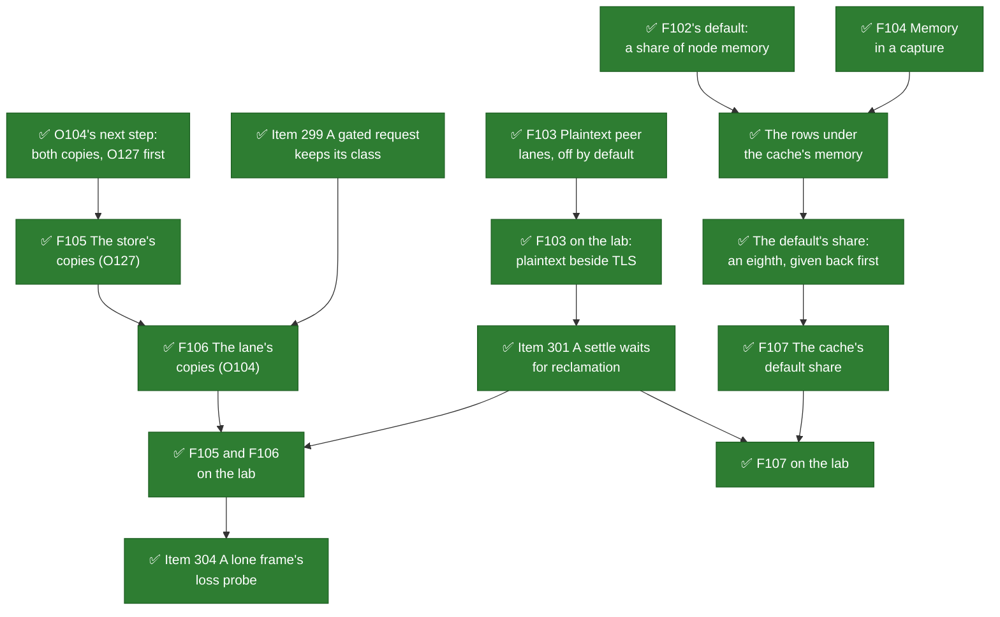
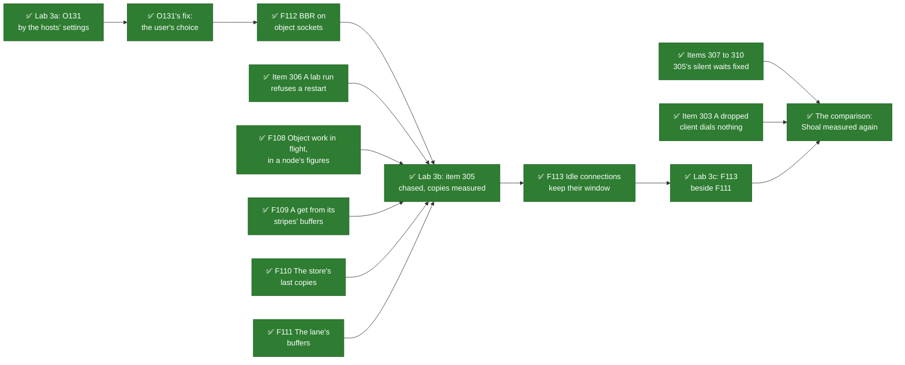

# Optimizations the comparison points to

What [Shoal beside Ceph, MinIO, RustFS and SeaweedFS](store-comparison.md) found that Shoal could do
faster, one page each. Every page says:
- what the comparison measured;
- why the change should help;
- which benchmark would show whether it worked, and what must not get worse;
- what it could cost.

Each page names its entry in [Optimizations](../appendix/optimizations.md), where every performance
finding is numbered. Some entries were filed before the comparison and are linked from here; the
rest were filed from it.

## In order

Ordered by three things, the first counting most:
1. how large a gap it would close, and on how many legs and arms;
2. how well its cause is established: device counters beat a reading of the source, which beats a
   correlation;
3. what it costs to build.

| | Optimization | Entry | Where the comparison shows it | Judged by | Cause | Cost |
| --- | --- | --- | --- | --- | --- | --- |
| ~~1~~ | ~~[A short stripe writes a whole chunk](store-optimizations/short-stripes.md)~~ | [O107](../appendix/optimizations.md#o107-a-stripe-shorter-than-its-chunk-costs-its-device-the-whole-chunk) | ~~Puts of 64 KiB and 1 MiB, every leg and group: behind every store at 64 KiB, by at least 2.6 to 7.6 times beside Ceph, MinIO and SeaweedFS on SSDs and 2.2 to 15.7 times beside Ceph and SeaweedFS on disks; at 1 MiB on one host, by at least 2.6 to 4.1 times beside Ceph, MinIO and SeaweedFS at sixteen in flight~~ **Built by [F96](../features/chunk-file-classes.md#on-the-lab)** (2026-10-20 and 21): on every leg and group a 64 KiB put writes 3.1 to 5.6 device bytes a byte, where it wrote 64 to 203, and runs 2.5 to 8.0 times as fast at sixteen in flight; 1 MiB 1.13 to 2.7 times. **Measured again in the comparison** (2026-10-25 and 26, [Shoal measured again](store-comparison.md#shoal-measured-again)): 64 KiB puts are behind every store but RustFS on SSDs, by at least 22% to 3.0 times, and behind Ceph and SeaweedFS on disks by at least 33% to 9.9 times; 1 MiB puts are within a few per cent on SSDs, ahead of MinIO and RustFS on disks at sixteen in flight, and behind Ceph and MinIO on one host by at least 6.1% to 40% | `put100` at 64 KiB and 1 MiB, device bytes a byte put | Measured: 196 device bytes a byte at 64 KiB with three copies, every device 96 to 99% busy | M |
| 2 | [A 64 KiB object could be a row](store-optimizations/inline-threshold.md) | [O120](../appendix/optimizations.md#o120-a-pools-inline-threshold-was-set-by-the-row-path-alone-and-a-64-kib-object-pays-a-whole-chunk) | The same puts at 64 KiB, beside 4 KiB puts, which are rows and ahead of every store on disks. Measured again after F96 (2026-10-25 and 26), still behind every store but RustFS on SSDs, by at least 22% to 3.0 times, and behind Ceph and SeaweedFS on disks, by at least 33% to 9.9 times | `put100`, `get100`, `rw50` at 64 KiB, at `inline: 16KiB` and `64KiB` | ~~Measured on the row side (M13, X10), not yet at this size in this harness~~ Measured on SSDs since 2026-10-20: at `inline: 64KiB` 64 KiB puts ran 2.7 to 3.1 times as fast, for about 1.5 GiB more memory a node and 45% more device bytes a byte put; on disks 10 to 11 times, as rows on the nodes' SSDs. The default stays 16 KiB (2026-10-21), and 64 KiB is a pool's choice | S |
| 3 | [Reads from a pool of copies follow leadership](store-optimizations/read-placement.md) | [O119](../appendix/optimizations.md#o119-a-get-from-a-pool-of-copies-reads-its-coordinators-own-copy-so-each-disk-serves-the-gets-its-node-leads) | ~~Gets of 64 KiB at sixteen in flight on disks with three copies: behind Ceph and SeaweedFS by at least 3.4 and 3.7 times~~ Measured again (2026-10-25 and 26), with [F107](../features/cache-default-share.md)'s cache answering the working set and the disks all but idle: ahead of Ceph and SeaweedFS by at least 37% and 28%, and at 16 MiB, which the cache does not hold, by at least 52% and 36%. O119 no longer shows in the comparison's arms | `get100` at 64 KiB and 1 MiB on disks, each disk's busy share | Measured: europa's disk 95% busy, the others 53 to 54%; at 2+1, where placement picks the holder, more than twice as many | S |
| 4 | [Every get and stat is a strong read](store-optimizations/strong-reads.md) | [O118](../appendix/optimizations.md#o118-a-striped-get-pays-two-strong-reads-its-entrys-and-its-stripes-rows), [O49](../appendix/optimizations.md#o49-one-barrier-per-group-per-bundle-rather-than-per-read) | ~~4 KiB gets and stats across hosts: behind Ceph by at least 3.2% to 21%, SeaweedFS's stats by at least 2.2 times; 64 KiB gets at one in flight behind Ceph by at least 49% on SSDs. On one host Shoal's small reads lead every store but SeaweedFS's stats, by at least 31%~~ Measured again (2026-10-25 and 26), every read still strong: 4 KiB gets and stats across hosts are ahead of Ceph at sixteen in flight by at least 10% to 60%, behind its stats at one in flight by at least 2.8% to 6.6%, and behind SeaweedFS's stats by at least 25% to 2.1 times; 64 KiB gets at one in flight are behind Ceph by at least 13% to 35%. On one host Shoal's small reads lead every store, by at least 21% | `get100` and `stat100` at `One` beside `Quorum`, then before and after | Read in the source; consistent with loopback, where the round costs little. Measured since F95: at `One` small reads ran 4 to 7 times as fast, much of it the link; the round is about 0.3 ms of a small read. With F100's lease reads on, small reads ran 1.9 to 4.1 times as fast | M to L |
| ~~5~~ | ~~[A get reads the device every time](store-optimizations/read-cache.md)~~ | [O121](../appendix/optimizations.md#o121-every-get-reads-its-bytes-off-the-device-however-often-the-object-is-read) | ~~Gets of 64 KiB and up at one in flight: behind every store by at least 0.9% to 49% on SSDs, and 4.7 to 9.0 times at 64 KiB on disks; 1 MiB gets on one host, by at least 22% to 2.1 times~~ **Built by [F102](../features/read-unit-cache.md#performance)** (2026-10-22), ~~off unless a node names a size~~ an eighth of node memory unless a node names one since [F107](../features/cache-default-share.md): with 2 GiB a node, gets at one in flight run 1.25 to 3.1 times as fast on every leg and group, the devices reading 0.00 to 0.05 bytes a byte served where they read 1.00 to 1.07; at sixteen in flight across hosts the bench driver's link holds both sides back, and on one host 1 MiB gets run 1.33 to 1.98 times as fast. Beside the comparison's captures, as a guide, 64 KiB gets at one in flight are still behind Ceph and SeaweedFS, by at least 20% to 36%. **Measured again in the comparison** (2026-10-25 and 26), with the default eighth: 64 KiB gets at one in flight are behind every store by at least 8.5% to 28% on SSDs and 12% to 35% on disks, 1 MiB gets ahead of Ceph and SeaweedFS with three copies, and on one host 1 MiB gets with three copies ahead of both by at least 10% to 2.1 times | `get100` at 64 KiB and 1 MiB, device bytes read a byte served | Measured: the others read 2 to 16% of what they served off their devices, Shoal 107 to 184% | M |
| ~~6~~ | ~~[A whole chunk is written twice](store-optimizations/whole-chunk-twice.md)~~ | [O102](../appendix/optimizations.md#o102-a-whole-chunk-costs-its-device-twice-its-bytes) | ~~Puts of 16 MiB on disks: behind Ceph and SeaweedFS with three copies by at least 10% to 28%; at 2+1 behind every store at one in flight, by at least 4.7% to 9.9%~~ **Built by [F96](../features/chunk-file-classes.md#on-the-lab)** (2026-10-20 and 21): a 16 MiB put writes what its redundancy needs, 3.0 to 3.1 device bytes a byte with three copies and 1.5 to 1.6 at 2+1, where it wrote 5.5 to 6.1 and 2.7 to 3.0; on disks it runs 1.58 and 1.14 times as fast at sixteen in flight, there within or ahead of every store beside the comparison's captures, though still behind Ceph by at least 14% with three copies at one in flight. **Measured again in the comparison** (2026-10-25 and 26): within every store or ahead on disks, but Ceph with three copies at one in flight, by at least 6.2% | `put100` at 16 MiB on disks, device bytes a byte put | Measured: 5.8 to 6.1 device bytes a byte with three copies, Ceph's 3.0 | M, and these arms need a reclaimed chunk's file recycled too |
| 7 | [Small reads have a tail across hosts](store-optimizations/small-read-tail.md) | [O122](../appendix/optimizations.md#o122-a-small-reads-p99-across-hosts-is-six-times-its-mean-and-nobody-knows-why) | p99 of 4 KiB gets and stats at sixteen in flight: 5.8 to 7.9 ms across hosts against a mean near 1.1 ms; 0.8 ms on loopback. Measured again (2026-10-25 and 26), still strong reads: 2.2 to 3.6 ms on SSDs against a mean near 0.7 ms, and 0.52 to 0.65 ms on loopback; what halved it was not separated | `get100` and `stat100` at 4 KiB, p99 at `One` and `Quorum` | ~~Not known~~ The strong read's: it goes at `One` (F95). ~~Which part of the round is not known~~ Since F99: a round's work on busy shards of the Zen1 hosts, hyperion's most; not the link, and not a queue of one group's rounds. It goes with F100's lease reads: a p99 of 0.69 to 0.89 ms at sixteen in flight | not known |
| ~~8~~ | ~~[The lab's group commit delay](store-optimizations/group-commit-delay.md)~~ | [O61](../appendix/optimizations.md#o61-a-fast-device-syncs-the-wal-in-batches-too-small-to-fill-a-page) | ~~4 KiB puts on one host: behind Ceph by at least 42% to 2.0 times in both groups, a p50 of 2.4 ms against 1.0, at the least cpu of any store~~ **Built by [F98](../features/commit-delay-bounded-by-the-sync.md#performance)** (2026-10-22): on europa's loopback 4 KiB puts and the mixture run 2.2 to 3.2 times as fast as with the lab's delay, within 7% of none, a put's p50 0.64 ms at one in flight; beside the comparison's captures they lead Ceph by at least 29% to 63%. Half the device bytes the delay saved are kept at sixteen in flight; on the SSDs no rate moved. **Measured again in the comparison** (2026-10-25 and 26): on one host 4 KiB puts lead Ceph by at least 38% to 56% and SeaweedFS by 20% at one in flight, a p50 of 0.58 to 0.68 ms | `put100` and `rw50` at 4 KiB with the delay at 0 and at the lab's | ~~Not measured: a setting the comparison ran with~~ Measured on SSDs since 2026-10-20: with no delay small puts ran no faster, and each NVMe flushed 8 to 18% more an operation. ~~Loopback, where the gap is, not yet~~ On europa's loopback (2026-10-21) no delay ran small puts 2.2 to 3.4 times as fast, for 17 to 44% more device bytes | S, a setting |
| ~~9~~ | ~~[A 2+1 get crosses the object lane](store-optimizations/object-lane.md)~~ | [O104](../appendix/optimizations.md#o104-an-object-lane-copies-a-reads-bytes-twice-and-a-stages-once-more) | ~~1 MiB gets at 2+1 on one host: behind Ceph and MinIO by at least 40% and 41%, its devices half busy and europa's cpus four fifths idle~~ **Built by [F105](../features/store-reads-in-place.md#performance) and [F106](../features/lane-copies.md#performance)** (2026-10-23), with [O127](../appendix/optimizations.md#o127-a-holder-copies-every-byte-it-reads-twice-before-it-leaves-the-store): on europa's loopback the 2+1 gets run 1.05 to 1.26 times as fast, every range apart, their object executors spending 0.75 to 0.95 of the cpu a GiB, and the gets with three copies 1.07 to 1.34. Beside the comparison's captures, as a guide, the 1 MiB gets at 2+1 and sixteen in flight are behind Ceph and MinIO by at least 23% and 24%. **Measured again in the comparison** (2026-10-25 and 26), with F109 to F111 and the cache: within both. Across hosts the nodes spend 0.81 to 0.91 of the cpu a GiB on every arm, and the gets at sixteen in flight are europa's link's either way ([before and after](store-optimizations/object-lane.md#before-and-after)) | `get100/s1m/c16` at 2+1 on loopback, each thread's cpu | ~~Not known: O104's two copies a mebibyte on one object executor a node is a candidate~~ Measured (2026-10-22): the object executor is a node's busiest thread, 77 to 85% of a cpu, about half of it the lane. The lane's TCP over loopback and its kTLS, which no other store paid, are a third of the executor's time, and O104's copies about 8% | S to M |

Rows 1 and 2 overlap. Both move the 64 KiB puts, and either would close most of that gap; only row 1
reaches 1 MiB and the rest of a stripe's sizes.

## The order of work

What is being built, and what waits on what (2026-10-20). An arrow points from a piece of work to
what requires it. The requirements are on each optimization's page.

- **Wave one** is F95, X15, F96, F97, F98 and O120's measurement, in that order: every row the
  comparison measured by its device counters, and the measurement the strong reads need.
- **O121 and O104** can start at any time and are taken after wave one's figures, by choice
  rather than by requirement.
- **O104's diagnosis** (2026-10-22) found a node's object executor the busiest thread of a 2+1 get
  on one host, 77 to 85% of a cpu, about half of it the lane
  ([Each thread's cpu](store-optimizations/object-lane.md#each-threads-cpu)). O104's two copies are
  about 8% of the executor's time. The lane's TCP and its kTLS are a third, and the store's own copies
  of every read another 12% ([O127](../appendix/optimizations.md#o127-a-holder-copies-every-byte-it-reads-twice-before-it-leaves-the-store)). The comparison's other
  stores did not encrypt between their nodes. ~~Which change follows is the user's choice.~~ The
  user chose both copy fixes, the store's own first (2026-10-22), and asked for a setting that
  lets a deployment's peer lanes run plaintext, off by default ([The rest of wave two](#the-rest-of-wave-two)).
- **F102's before and after** (2026-10-22) ran gets at one in flight 1.25 to
  3.1 times as fast with 2 GiB a node, on every leg and group. At sixteen in flight across hosts
  the bench driver's 1 GbE link held both sides back. A cache of 4 MiB a node, holding almost
  nothing, cost at most 2% of a get's rate
  ([F102's figures](../features/read-unit-cache.md#performance)). ~~Whether a node keeps one by
  default is the user's choice, with these figures.~~ The user chose a share of node memory as its
  default, once a lab run shows what that memory costs the table rows (2026-10-22).
- **F97 was slower on the disk leg once F96 was in**
  ([before and after](store-optimizations/read-placement.md#before-and-after)): by 28% and 11%
  at sixteen in flight. The reads it moved filled europa's link, and F96 had already taken away
  most of the queue it was for. ~~Whether it stays a disk pool's way is the user's choice, with
  those figures.~~ The user chose a margin, measured (2026-10-21):
  [F101](../features/disk-read-margin.md) reads the local copy first unless a node sets one, and the
  disk leg measured a margin of four beside none: it moved one or two reads in a hundred and lost
  nothing, and the sides differed by each deployment's draw of leaders. Measured again with eight
  captures a side, it changed no rate and shortened the tail of large reads at depth, and the user
  made a margin of four the default. Measured a third time once every read was counted from its
  choice (2026-10-27), it still changed no rate and now moved europa's reads at depth.
- **F98 is designed on the loop leg's figures.** On the SSDs no delay ran no faster than the
  lab's and cost 8 to 18% more flushes an operation
  ([On the SSDs](store-optimizations/group-commit-delay.md#on-the-ssds)), so a delay taken only
  while appends are queued has nothing to win there. The comparison's gap was on europa's
  loopback, which the loop leg measures after the disk leg. It did on 2026-10-21
  ([On europa's loopback](store-optimizations/group-commit-delay.md#on-europas-loopback)): there no
  delay ran small puts 2.2 to 3.4 times as fast, for 17 to 44% more device bytes. A delay taken
  only while appends are queued would keep the loss at sixteen in flight, where they always are.
  ~~F98's design is the user's choice with both legs' figures.~~ The user chose a delay bounded by
  the sync: [F98](../features/commit-delay-bounded-by-the-sync.md) waits no longer than the last
  batch took, ~~and both legs measure it~~ and both legs measured it on 2026-10-22. On the loopback
  small puts ran 2.2 to 3.2 times as fast as with the lab's delay, within 7% of none, keeping half
  the device bytes it saved at sixteen in flight. On the SSDs no rate moved
  ([F98's figures](../features/commit-delay-bounded-by-the-sync.md#performance)).
- **O120's default** is the user's choice, made with both legs' figures. The SSD leg's are in
  ([On the SSDs, three copies](store-optimizations/inline-threshold.md#on-the-ssds-three-copies)):
  a trade of memory and device bytes for 64 KiB puts. ~~The disk leg's run is the first of the
  disk chain.~~ The disk leg's are in too
  ([On the disks, three copies](store-optimizations/inline-threshold.md#on-the-disks-three-copies)): ten times the
  puts, by moving the pool's small objects off its disks onto the nodes' SSDs. The user kept the
  default at 16 KiB on 2026-10-21, and a pool may set `inline: 64KiB` with these figures
  ([configuration](../getting-started/configuration.md#pools-and-buckets)).
- **O118's change** is chosen by the user once reads at `One` beside `Quorum` say how much of the
  gap the rounds are. They did on 2026-10-20
  ([One beside Quorum](store-optimizations/strong-reads.md#one-beside-quorum)), and the user chose
  the order the diagram draws:
  - the tail is placed first, by F99's counts of a round's parts;
  - O125, one round shared by a group's reads in flight, is built if the round's queue is the
    cause;
  - a lease is a decision of its own, taken on O125's figures.

  One round instead of a striped get's two was not taken: it wins nothing for a small read.

  F99 placed the tail on 2026-10-20
  ([A round by its parts](store-optimizations/small-read-tail.md#a-round-by-its-parts)): a round's
  work on busy shards of the Zen1 hosts, not a queue of one group's rounds. So O125 is not built
  and stays filed, optional. A lease, or `One` by the caller, is the user's choice now, on F99's
  figures. The user chose a lease, measured first (2026-10-21):
  [F100](../features/lease-reads.md) builds it as a setting, off by default, and the default is decided
  on its figures. Its figures are in (2026-10-21, [F100's figures](../features/lease-reads.md#performance)):
  with lease reads on, small reads ran 1.9 to 4.1 times as fast, and their tail went. The user
  kept the round as the default, lease reads a deployment's choice, since they rest on its clocks.

### The rest of wave two

What the user chose on 2026-10-22, drawn from the two decisions it continues. ~~Every box but the
decisions is a piece of work not yet done~~ Every box is done since lab 2 (2026-10-23), item 304
with it; the plan's requirements are on each page.

- **Item 299** was found reading the path O104 changes: the object executors' gate handed back a
  rebuild's, a move's and a scrub's request without its class, so recovery's reads used F102's
  cache and a scrub's listing ignored its device's ceiling. It is fixed before the lane's served
  answers are rebuilt.
- **F105 before F106.** The lane's served answer is written from the span F105 reads a range into,
  so the store's copies come first, as the user chose.
- **F103** makes the engine's plaintext lanes, which a node without `cluster.tls` already runs, a
  deployment's choice in its inventory. shoaladm renders TLS unless it is named. Beside TLS at 2+1
  (2026-10-23) they ran europa's loopback 1.09 to 1.24 times as fast and left the SSD leg's gets to
  its link ([F103's figures](../features/plaintext-peer-lanes.md#performance)).
- **F104** counts what the rows' run needs: each shard's evictions by what triggered them, the
  cache's figures in a capture, and a preload for each file of a dataset.
- **The default's share** is the user's to choose with the rows' figures: an eighth, another share,
  or none. On a node with room an eighth cost the rows nothing; on one whose rows nearly filled its
  memory the cache's fill evicted about half of them once, and gets ran 1.71 times as fast
  ([the table rows beside it](../features/read-unit-cache.md#the-table-rows-beside-it), 2026-10-23).
  The user chose an eighth, the caches giving units back before any row is evicted (2026-10-23):
  [F107](../features/cache-default-share.md).
- **Item 301** was found by lab 1: Shoal's settle between arms slept ten seconds, and reclaiming a
  put arm's objects ran on into the next arm. Since its fix the settle waits until every device's
  chunk bytes hold steady, 16 to 54 seconds after a put arm in lab 2
  ([Resolved #301](../appendix/resolved/a-settle-waits-for-reclamation.md)).
- **F105 and F106 on the lab** (2026-10-23):
  - On europa's loopback the 2+1 gets ran 1.05 to 1.26 times as fast as on the build before both,
    every range apart, and their object executors spent 0.75 to 0.95 of the cpu a GiB.
  - Three copies' 1 MiB gets at sixteen in flight ran 1.07 times as fast, not slower
    ([before and after](store-optimizations/object-lane.md#before-and-after)).
  - Across hosts the nodes spent 0.81 to 0.91 of the cpu a GiB on every arm. The gets at sixteen
    in flight were europa's link's either way.
  - On the table path the reads' mean was 5% less, and the rate was within
    ([F106's table path](../features/lane-copies.md#the-table-path)).
- **F107 on the lab** (2026-10-23):
  - On the loopback, where the rows nearly fill each node, no row was evicted: the caches gave
    units back instead. The gets ran 1.27 times as fast as with none.
  - On the SSDs nothing was evicted or given back
    ([F107's figures](../features/cache-default-share.md#performance)).
- **Item 304** was found by lab 2: since the glommio fork's vectored write, which F106 brought, a
  table's strong reads across hosts beside gets that fill a link have a tail of about 110 ms, where
  it was about 17. A bisect of the builds put it on the vectored write alone. ~~What in it waits is
  not yet known.~~ A frame became one segment, and the kernel probes a lone segment's loss only
  after its 200 ms minimum RTO. Fixed the same day: a node's replication and control lanes set a
  minimum of 5 ms, and a client's connection holds it until it carries an object. The table reads'
  p99.9 was 14.1 ms where it was 111, and no arm of the comparison moved. A floor on every
  connection had cost the gets at one in flight 11 to 39%
  ([Resolved #304](../appendix/resolved/lone-frame-loss-probe.md)).

### Wave three

What the user asked for on 2026-10-24:
- the findings wave two left open: items 303 and 305, and O128 to O131;
- then the comparison brought up to date.

The comparison measures Shoal again alone, first and last in each group, beside the other stores'
captures of 2026-10-18 and 19. Only Shoal changed, and the hosts did not, but for Ubuntu's package
updates and europa's kernel, which booted into 7.0.0-38 on 2026-10-25, where every capture
before ran 7.0.0-34 ([Shoal measured again](store-comparison.md#shoal-measured-again)). An arrow
points from a piece of work to what requires it.

- **O131 is diagnosed before anything is built for it.** Lab 3a runs item 304's build under the
  hosts' own TCP settings, side by side, with every bench connection's kernel state sampled
  beside each run (`stores-sample.sh`, `stores-ab-sockets.py`). ~~Whether a fix is built, and which,
  is the user's choice with those figures.~~ It is each connection's window restarting after an
  idle, and the user chose BBR on Shoal's object sockets, which ~~F112 builds~~
  [F112](../features/object-congestion.md) built. Lab 3b measured it gaining the puts and slowing the
  gets across hosts, which resent 15 to 29 times the segments where they met at one link, so the
  user chose the host setting lab 3a's side e measured, which [F113](../features/slow-start-after-idle.md)
  built, BBR a deployment's choice. ~~lab 3c measures it before the comparison~~ Lab 3c measured it
  before the comparison (2026-10-25): the 64 KiB and 1 MiB puts at one in flight ran 1.11 and 1.07
  times as fast with p99s of 30.4 and 48.9 ms where they were 62.7 and 80.2, every other arm within
  1% and the retransmissions F111's
  ([O131](../appendix/optimizations.md#o131-a-puts-tail-at-one-in-flight-across-hosts-is-twice-as-long-under-tls)).
  Its follow-up was lost to a restart of its unit by an unattended upgrade, which also discarded
  two hosts' store volumes under the cluster it left. The script was fixed before the follow-up was
  taken again ([Resolved #306](../appendix/resolved/lab-run-restarted-over-its-cluster.md)).
- **Item 305 is chased from both ends.** Reading the put path found places where a put or a read
  waits with no bound and no log; each is proven by a test, filed and fixed. Lab 3b then runs the
  build the stall was seen on, with a node's work in flight readable and the sampler beside it.
- **O128 to O130 are the copies F105 and F106 left,** each measured by each thread's cpu a GiB on
  the loop leg. [F109](../features/reads-from-stripe-buffers.md) built O128: a get's range is
  answered as the parts its stripes were read in, which took three copies off a 2+1 get on its
  table shard. [F110](../features/store-checks-in-place.md) built O129: a local read hands its shard
  the buffer it filled, and the store's checks read where the device put the bytes.
  [F111](../features/lane-buffers.md) built O130: a served lane writes its ready answers in one call,
  a cache hit as slices, a piece from the buffer it was read into, and its bodies from an arena.
  Lab 3b measured them on loopback (2026-10-25). Together they ran the 1 MiB gets 1.13 to 1.39 times
  as fast, for 0.69 to 0.74 of the nodes' cpu a GiB at sixteen in flight, and changed no 64 KiB arm.
  - F109 did most of it, `memmove` going from 23% of the table shards' samples to 2%.
  - F110 moved nothing ([O136](../appendix/optimizations.md#o136-a-local-read-into-a-heap-buffer-forgoes-the-rings-registered-buffers)).
  - F111 ran the 2+1 gets at sixteen in flight 1.11 times as fast again.
  - The checksum left on the shards is 4.5% of their samples, too little for O132's wire change.
  - On the SSD leg the 1 MiB puts at sixteen in flight had a p99 8% longer at the same rate, which
    lab 3c repeated ([O137](../appendix/optimizations.md#o137-a-1-mib-puts-p99-at-sixteen-in-flight-across-hosts-is-8-longer-with-f109-to-f111)).
- **Item 305 was not reproduced on its own build**: six captures of it in lab 3b, its work in flight
  readable and the sampler beside it, held nothing and lost nothing, and nor did the 35 captures of
  labs 3b and 3c after them.
- **The comparison measured Shoal again** at `257592b3` (2026-10-25 and 26), twelve captures on the
  three legs ([Shoal measured again](store-comparison.md#shoal-measured-again)). Every capture read
  its objects back whole. Of its 1,056 runs, two failed: one get each on the SSD and disk legs, both
  in 2+1's 1 MiB gets at one in flight
  ([item 316](../appendix/known-issues.md#316-a-gets-request-on-an-object-lane-went-unanswered-and-its-coordinator-waited-with-no-bound)).
  - **Its puts of 64 KiB** ran 2.6 to 4.7 times as fast as the first run's at sixteen in flight, and
    are still behind every store but RustFS on SSDs.
  - **Its 4 KiB puts on one host** ran 3.4 times as fast at one in flight, ahead of every store.
  - **Its gets and stats of 4 KiB** ran 1.4 to 1.8 times as fast at sixteen in flight on every leg,
    still strong reads, and lead Ceph there.
  - **Its gets from 64 KiB** are answered from F107's cache: on disks 4.4 to 5.5 times as many
    64 KiB gets at one in flight, ahead of every store at sixteen.

## Adding one

A finding gets a page here when the comparison shows a gap whose cause is in Shoal. It also gets
an entry in [Optimizations](../appendix/optimizations.md) if it has none. Its row goes into the
table by the order above. An optimization that is built keeps its page: the page records the
benchmark's figures before and after, and its row is struck through, as
[Optimizations](../appendix/optimizations.md) does with its own entries. The before and after is
`stores-lab.sh ab`: Shoal alone at the commit before the change and at the change, four captures in
the order before, after, after, before on the leg's devices made fresh, read by
`results/stores-ab-report.py`. [F96's page](../features/chunk-file-classes.md#on-the-lab) was the
first.
