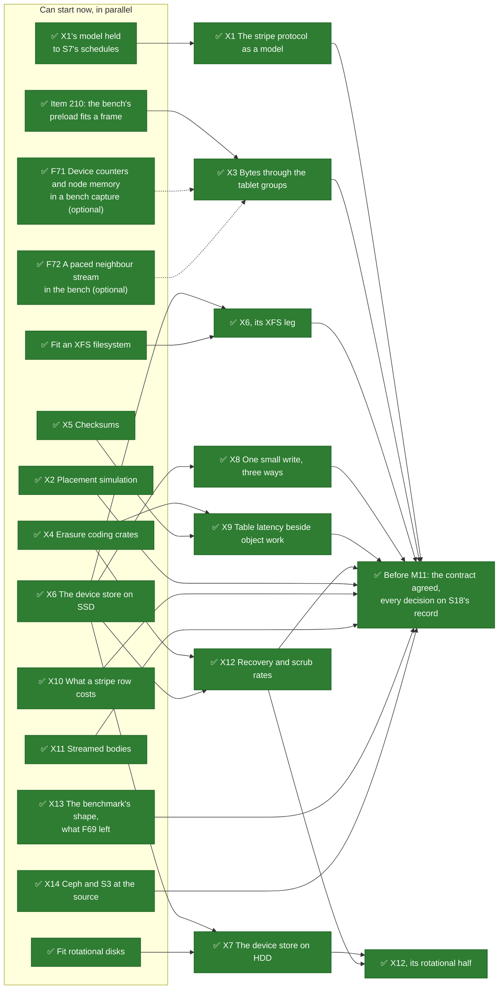
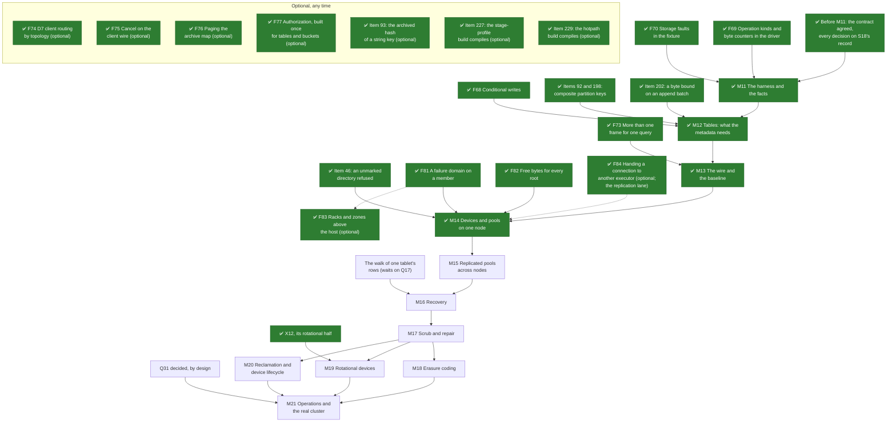

# What's left to do

**The order of the work, drawn.** The pages before this one say what has to be done and why;
this one says in what order, on two diagrams: the work up to the first gate, and the gates
after it. As of 2026-10-12, when [F85](../features/devices-and-pools.md) delivered
[M14](milestones.md#m14-devices-and-pools-on-one-node), devices and pools on one node, and turned
its box green; the same day before it, when [F84](../features/replication-lane-handoff.md) handed a
replication lane to the executor hosting its slot and turned the optional box for handing a
connection to another executor green; the same day before it, when
[F83](../features/rack-and-zone-domains.md) put a zone and a rack
above the host and turned the optional box beside a member's failure domain green; the same day
before it, when [F82](../features/root-capacity.md) delivered every root's free
bytes and turned the last box M14 waits on before it green; the same day before it, when
[F81](../features/failure-domains.md) delivered a member's failure domain and turned its box green;
as of 2026-10-11 before it, when [Resolved #229](../appendix/resolved/hotpath-build.md) made the
`hotpath` build compile again and turned the seventh optional box green; the same day before it,
when [F80](../features/object-wire.md) delivered
[M13](milestones.md#m13-the-wire-and-the-baseline), the wire, pool policy, inline objects and the
baseline, and turned its box green; the same day before it, when
[Resolved #227](../appendix/resolved/stage-profile-build.md) made
the `stage-profile` build compile again and turned the sixth optional box green; the same day
before it, when [F79](../features/bucket-schema.md) delivered
[M12](milestones.md#m12-tables-what-the-metadata-needs), buckets in the schema and the tables they
generate, and turned its box green; the same day before it, when [F78](../features/object-harness.md) delivered
[M11](milestones.md#m11-step-0-the-harness-and-the-facts), the first gate, and turned its box
green, and [Resolved #93](../appendix/resolved/archived-partition-hash.md) before it
deleted the archived partition hash and turned the fifth optional box green; as of 2026-10-10
before it, when [F77](../features/authorization.md) held a principal to its
grants and turned the fourth, [F76](../features/paged-archive-map.md) before
it paged the archive map and turned the third, and [F75](../features/client-cancel.md) before it wired
`Cancel` on the client wire and turned the second; as of 2026-10-09 before it, when the gate
before M11 passed, the contract agreed once X1's model
had checked the small write in its commit ([the record](contract.md#before-m11-the-contract-agreed-and-q27s-path-modelled-2026-10-09)); and the same day before it, when X12 measured a rebuild and a deep scrub at four paces on every
lab device, recorded Q28 and Q29, and was the last spike to report, and X9 before it measured a
table beside object work on its shards and on a core of its own and recorded Q24; as of 2026-10-08 before it, when X8 ran one small write three
ways and recorded Q27; and as of 2026-10-07 before that, when X3 measured stripes as rows through today's tablet groups; and
as of 2026-10-06 before it, when rotational disks were fitted and X7 measured the device store on
them, and X1 modelled the stripe protocol and found it safe once ten rules were repaired; and as
of 2026-10-05 before it, when X11 reported and F73 delivered the frames it set, X13 reported
what F69 had left of the benchmark's shape, and X14 read Ceph and S3 at the source; X6 and X10 had
reported the day before, and X2, X4 and X5 the day before that.

**How to read them.**

- An arrow points from a piece of work to what requires it. Things on one level, with no arrow
  between them, can be done in parallel.
- A green box with a ✅ is done.
- A box titled *(optional)*, with a dashed border, can be left out without anything built
  having to change; a dashed arrow means *helps*, not *requires*. Each one's reason is on the
  page that lists it.
- A box beside a gate lands no later than the start of that gate, and nothing stops it landing
  sooner ([S1](prerequisites.md#the-order)).

## Before the first gate

Everything here can be worked on now except what an arrow ~~points into~~ from an unfinished
box points into: ~~X9's arrows now come only from green ones, so it can start~~ ~~X8's and X9's
arrows now come only from green ones, so both can start. With X3 green, they and X12 are the
spikes the gate still waits on.~~ ~~X9's arrows come only from green ones, so it can start. With X8
green, X9 and X12 are the spikes the gate still waits on.~~ ~~With X9 green, X12 is the one spike
the gate still waits on.~~ ~~With X12 green every spike has reported, and the gate waits on nothing
here: what is left of it is the contract agreed, P7 to P19, which no spike decides.~~ With X12
green every spike had reported, and ✅ the gate passed on 2026-10-09: X1's model was extended to
the small write in its commit that X8 had added after it, and P7 to P19 were agreed
([the record](contract.md#before-m11-the-contract-agreed-and-q27s-path-modelled-2026-10-09)). Nothing on this diagram is left. The spikes are on
[their page](spikes.md), and what each needed first on
[What a spike needs first](spikes.md#what-a-spike-needs-first).

~~An optional box, "a kind a schema supplies, for X10's cold commit", stood beside X10.~~ It is
gone: X10 drove its commits with a driver of its own, which aimed each one at a group's leader
and timed a read before it, and no operation kind the bench drives could have done that
([X10](stripe-row-costs.md#the-harness)). ~~Buckets still supply their kinds at M12.~~ Buckets
exist since M12 ([F79](../features/bucket-schema.md)) and ~~supply their kinds at M13, with the
operations those kinds drive~~ since M13 the bench drives their objects as `put`, `get` and `stat`,
supplied kinds of [F69](../features/driver-operation-kinds.md)'s, from a described dataset
([F80](../features/object-wire.md)).

The failure domain and free bytes for every root waited on Q19, which said what placement reads.
X2 decided that part of it: a device's id and its member's host, and ~~each device's size,
placement weight and free bytes~~ each device's placement weight beside its capacity
([Q19, in part](contract.md#q19-in-part-placement-2026-10-03)). A device's free bytes are what
[S4](pools-and-devices.md#capacity-and-weight)'s reserve check reads, which the record does not
name.
~~Both can start now, though they land no later than M14.~~ ✅ A member's failure domain was
delivered on 2026-10-12 by [F81](../features/failure-domains.md): a member's host, committed on its
record. ~~Free bytes for every root can start now, and lands no later than M14.~~ ✅ Free bytes
for every root was delivered the same day by [F82](../features/root-capacity.md): every root's
size, free bytes, device and uses in each status report, and the reserve judged on every root a
move writes.

The gate waits on every spike because the [milestones](milestones.md) stop being provisional
only once every decision is on the record
([spikes](spikes.md#what-has-to-be-on-the-record-before-the-milestones-are-real)), and a spike
that needs nothing is run before the plan is drawn. Each question also has a gate of its own,
the last moment it can be answered; those are on the
[milestones page's table](milestones.md#the-gates-at-a-glance). ~~The rotational half of X12 and
X7 are the exception: if the disks come late, only M19 waits for them.~~ The disks came on
2026-10-06 and X7 ran on them that day ([X7](device-store-hdd.md)); ~~the rotational half of X12
waits on X12 alone, and only M19 waits on it~~ X12 ran on them with its other half on 2026-10-09
([X12](recovery-scrub-rates.md)).

## The gates

✅ M11 was delivered on 2026-10-11 by [F78](../features/object-harness.md): the byte ledger,
the emptied device and the flipped bit in the fixture, and the check on this part's acceptance
tables, beside X1's model, F69's driver and F70's faults, which landed ahead of it. ~~Every box M12
waits on is green, so M12 can start.~~ ✅ M12 was delivered the same day by
[F79](../features/bucket-schema.md): a bucket declared in a schema, its two generated tables and
their groups, its identity, its grants, and a client refused at the front door; Q25's rest was
decided with it. ~~M13 waits on nothing but M12, so it can start.~~ ✅ M13 was delivered the same
day by [F80](../features/object-wire.md): object frames behind a capability bit, pools and bindings
committed at bootstrap, objects held in their rows, the client's bucket handle, the checksum and
the bench's object arms. M14 waits on M13 and on the two prerequisites S1 places at its start, a
member's failure domain and every root's free bytes~~, which can start now~~. ✅ The first was
delivered on 2026-10-12 by [F81](../features/failure-domains.md); ~~the second can start now~~ ✅ the
second the same day by [F82](../features/root-capacity.md). Every box M14 waits on is green, so
M14 can start. ✅ The optional box a member's failure domain helps, a failure domain above the
host, was delivered the same day too by [F83](../features/rack-and-zone-domains.md), as a zone and a
rack, so a pool M14 places can name either. ✅ M14 was delivered the same day by
[F85](../features/devices-and-pools.md): devices and their slices claimed and reported, the pool
map committed with its eras, seats, fitted weights and exceptions, placement by weighted rendezvous
on a frozen table, readiness by pool, the device store with its journal, its pool of files written
ahead and its shared flush, and object executors of their own with a memory budget. ~~M15 waits on
M14~~ M15 waits on nothing else, so it can start.

~~A clone call in the glommio fork (optional, if X6 picks a clone)~~ fed M14 until 2026-10-04,
and is dropped: [X6](device-store-ssd.md#3-a-partial-write) rejected the clone, so nothing waits
on it.

More than one frame for one query waited on Q26 until 2026-10-05, when
[X11](streamed-bodies.md) answered the part it needed: object bytes travel on connections of
their own, in frames of 1 MiB. [F73](../features/bodies-across-frames.md) delivered it the same
day. The box handing a connection to another executor stays optional,
since adding it later changes no format, and X11 is what ~~makes it worth building at M14~~ made it
worth building: a connection under kTLS can be handed over at no cost, while its bytes hopping
between executors cost 1.3 to 1.7 times the cpu a gibibyte
([X11](streamed-bodies.md#4-a-connection-handed-over-and-bytes-that-hop)). ✅ It was delivered on
2026-10-12 by [F84](../features/replication-lane-handoff.md), for the replication lane, the one the
user chose: a follower reads every append on the core that applies it. M15's object lane hands its
connections the same way, so its arrow to M14 stays dashed.

The chain is the claim [the milestones page](milestones.md#the-order-is-a-claim) argues for:
the wire before the devices, the device store before distribution, replication before erasure
coding, recovery before scrub. Two of its places are convenience and not dependency, and the
diagram draws them as the dependencies they are: M19 needs M14 to M17 and not M18, and M20
waits on nothing after M17 and could move forward if devices fill in testing.

## Keeping it current

**Whoever finishes a piece of work turns its box green in the same change**, with a ✅ at the
start of its label and `:::done` after it, as the ✅ rows on S1 and the struck-through rows on
the milestones page record the same thing. A piece of work that is added, split or dropped is
added, split or dropped here too, and an optional one says *(optional)* in its title. The
conventions are written down in `CLAUDE.md`, under *Planning docs*, for every plan after this
one.

## Related

[S1](prerequisites.md) for the rows the gates begin with; [Spikes](spikes.md) for what has to
report first; [Milestones](milestones.md) for what each gate delivers; [S18](contract.md) for
the questions and the record.
