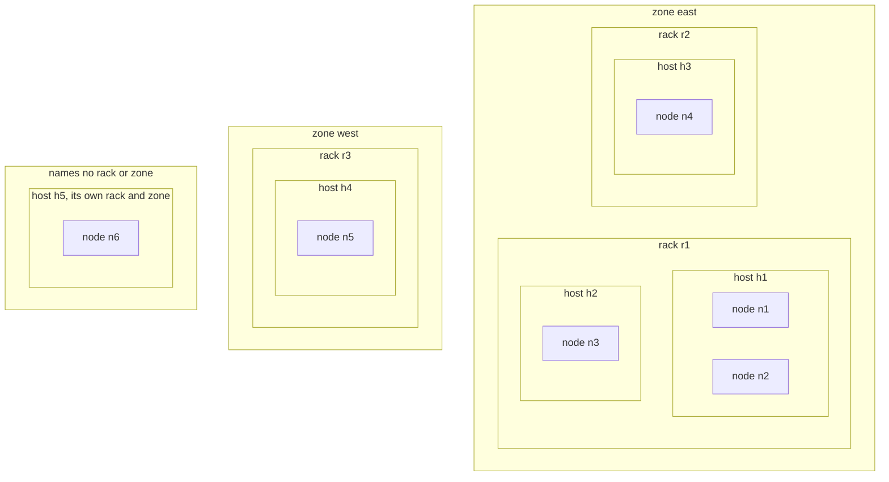
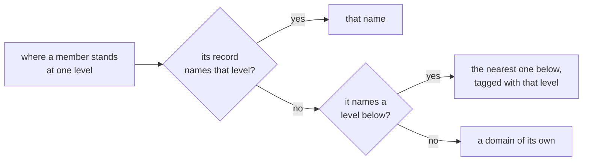
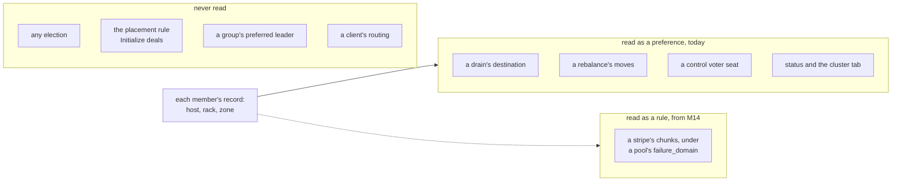
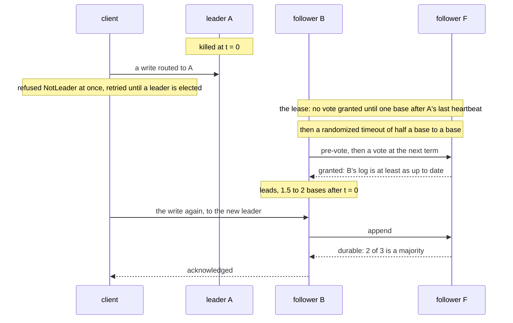
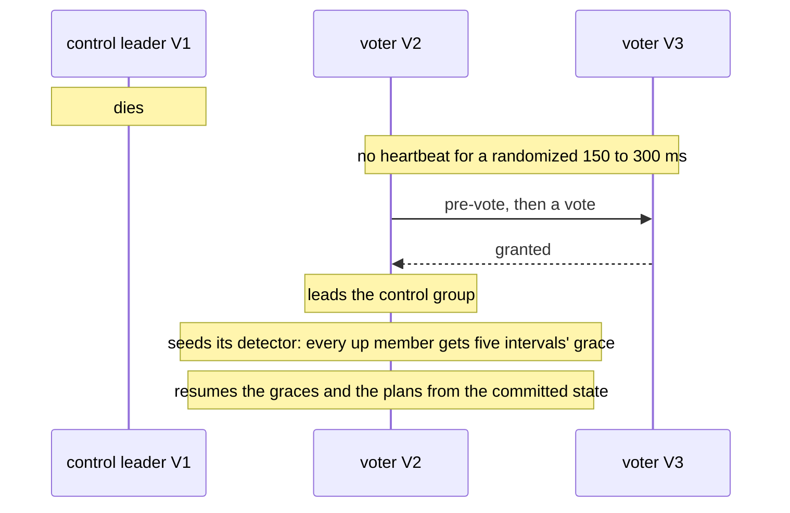
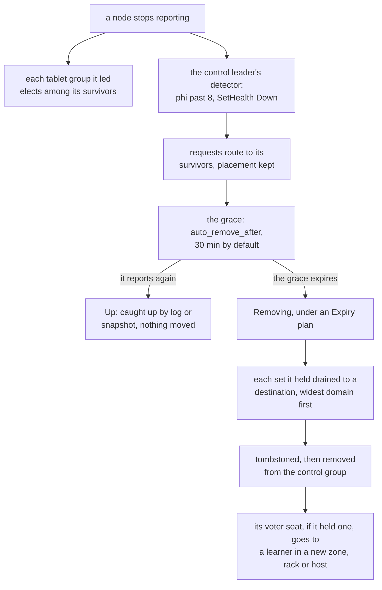
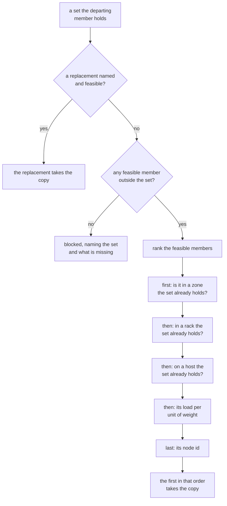
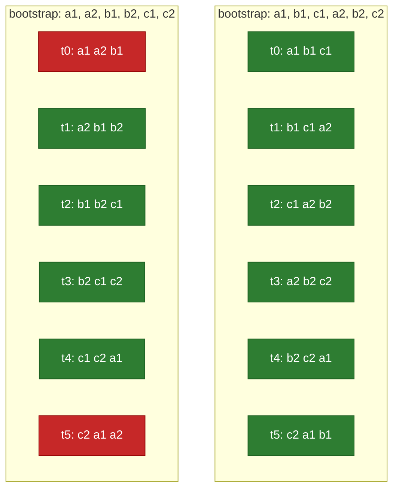

# Failure domains and failover

A **failure domain** is a set of nodes that can fail together: the processes on one machine, the
machines in one rack behind one switch and one power feed, the racks in one room or one cloud
availability zone. This page explains:
- the three levels Shoal records and what each one changes;
- how a cluster fails over and elects when nodes in those domains die;
- what a layout survives;
- what it costs;
- what the domains do not do yet.

The mechanisms themselves are described where they live:
- [C3](../distributed/membership.md): membership, the detector and the grace;
- [C7](../distributed/failover.md): elections, the lease and snapshots;
- [C8](../distributed/rebalancing.md): plans and moves;
- [F81](../features/failure-domains.md): the host;
- [F83](../features/rack-and-zone-domains.md): the rack and the zone.

A zone here means a zone inside one site or one cloud region. Shoal promises no multi-region
availability ([what the distributed chapter is not](../distributed/overview.md#what-this-part-is-not)).

## The three levels

A node stands on a **host**, the host stands in a **rack**, and the rack stands in a **zone**.



| Level | Means | When a node names none |
| --- | --- | --- |
| `host` | The machine the node runs on. Two nodes on one machine share it | The name the operating system gives the machine. Every node has a host |
| `rack` | The rack its host stands in | The node's host stands in for its rack |
| `zone` | The zone its rack stands in | Its rack stands in for its zone, or its host when it names no rack |

Two rules decide where a member stands at each level. The first is one function,
`shoal::shared::domains::domain_at`, which the planner, voter promotion and `status` all read; the
second is how they compare what it returns.

**A level left out is the nearest one below it.** The name a level falls back to keeps the level
it came from, so a host called `r1` standing in as its own rack never equals a rack called `r1`.
A record that names nothing at all, from before F81 or a test's literal record, stands in a
domain of its own.



Read that way, node n6 above is in host h5, rack h5 and zone h5. So a cluster that names no rack
and no zone spreads by host alone, exactly as it did before racks existed.

**A name belongs to the whole cluster at its level, not to the level above it.** Two zones that
each name a rack `r12` hold one rack as far as the planner can tell, and two nodes naming one host
are on one machine whatever racks they name. A mistake in the hierarchy can therefore only make
domains look more shared than they are, never more spread. `shoaladm`'s `validate` refuses the
mistakes before anything starts: one machine in two racks or zones, and one rack in two zones.

### Naming them

In a node's own `shoal.yml`:

```yaml
cluster:
  failure_domains:
    host: titan       # absent: the machine's own name
    rack: shelf-1     # absent: the host is its own rack
    zone: hall-a      # absent: the rack, or the host, is its own zone
```

In an inventory, per group or per node, field by field. A node's own value wins over its group's:

```yaml
groups:
  shelf-1:
    failure_domains: {rack: shelf-1, zone: hall-a}
nodes:
  - {name: blade-a, group: shelf-1}
  - {name: blade-b, group: shelf-1, failure_domains: {rack: shelf-2}}   # its own rack, the group's zone
```

How they reach the cluster:
- **They are read once, at start**, and committed on the member's record when it observes itself.
  A change is a restart: `shoaladm reconfigure` rewrites the files and restarts the nodes whose
  file changed.
- **Once some member names a rack or a zone**, `status` and the `shoalctl` cluster tab show a
  column for it and count the domains in the header, `hosts 3  racks 2  zones 1`.
- **A node on a build before F83 refuses a file that names a rack or a zone.** Run `upgrade` on
  every node before reconfiguring with an inventory that names one.

## What reads them, and what never does



**Elections never read them.** Every group, control or tablet, elects by Raft's rule: a majority of
its voters. What the domains decide is *who the voters are*. A drain and a voter seat prefer new
domains, so over time a cluster's voters spread out. A group survives the loss of a domain if a
majority of its voters stand outside that domain, and for no other reason.

## How a cluster fails over

A cluster runs two kinds of Raft group. Every node runs a member of the **control group** on its
control core, and every shard runs one **tablet group** for each table and replica set it holds.
Each group elects its own leader from its own votes, and none of them waits on another.

| | The control group | A tablet group |
| --- | --- | --- |
| Holds | The membership, health and phase, placement, plans, policy | One table's rows for the tablets of one replica set |
| Voters | `control_voters` of the members (3 by default), the rest learners | The replica set's members, `replication_factor` of them (3 by default) |
| Election timeout | openraft's defaults: 150 to 300 ms, with a 50 ms heartbeat | Half a base to a base, after a lease of one base, from `primary_failover_after` (5 s); the heartbeat is a tenth of the base |
| Pre-vote | On | On |
| Its leader | Runs the failure detector, the graces, the planner, voter promotion and every admin mutation | Orders and commits the group's writes, and answers strong reads' barriers |
| Losing its majority stops | Every metadata change: no `Down`, no plan, no promotion, no admin mutation. Tablet groups with a majority keep serving | Its writes and its strong reads. Reads at `One` keep answering from a survivor, possibly stale. Nothing acknowledged is lost |

### A tablet group's leader dies



At the default base of 5 s, a killed leader's groups refuse writes for 7.5 to 10 s
([F62](../features/failover-window.md)). Elections do not wait for the node to be called `Down`:
`Down` is routing information and the start of a grace, never a prerequisite. A node whose shard
stalls while its control thread lives still has that shard's groups fail over. A leader cut off from its followers stops
accepting writes once its lease lapses, so an isolated old leader refuses rather than leaving a
write's outcome unknown ([C7](../distributed/failover.md#the-lease)).

A **planned stop** skips all of this. A node stopped by its supervisor refuses new writes
retriably, hands every group it leads to the follower whose log matches furthest, and waits up to
three seconds for the leads to move before it stops. That is how a rolling upgrade moves
leadership without waiting out a lease
([Resolved #139](../appendix/resolved/leadership-handoff-on-stop.md)).

### The control group's leader dies



A new control leader starts from the committed state:
- **The detector is reseeded.** Every up member is given five report intervals before it can be
  suspected, so an election is never taken as evidence that a member is down.
- **A grace keeps counting.** It loses at most one increment of its count and is never restarted
  or skipped ([C3](../distributed/membership.md#what-follows-from-down-and-when)).
- **Plans pick up where they were.** Their records are committed, and the planner derives the next
  steps again from the committed state.
- **No tablet group pauses.** While the control group elects, every tablet group goes on serving.

### A node that stays down



**The phi-accrual detector** runs on the control leader. Each member reports every 500 ms, and the
leader keeps its last hundred intervals. It commits a member `Down` once the suspicion that the
next report is this late, phi, passes 8 (C3).
- **A node that comes back inside the grace** keeps every copy it held and catches up from the
  retained log, or from a snapshot per group once it is past it. It leads again only when an
  election or the leadership handback gives it a group back.
- **`Maintenance { node, suspend: true }`** holds a member's grace, so a member down for planned
  work is not rebuilt. It holds only a grace already open, so send it once the member is `Down`
  ([runbook 5](runbooks.md#5-automatic-removal-and-maintenance)).
- **A grace that expires** starts a plan that rebuilds every set the member held on other members.
  This is where the domains decide something.

## How the domains steer a choice

A plan's drain, whether `Decommission`, `Remove` or an expiry, moves each set the departing member
holds to one other member:



**Feasible** means up, a plain member, not already in the set, with free bytes for the move on
every storage root it writes, and under the per-node move cap. The three domain questions come
before load. So a member in a new zone wins over a less loaded one in a new rack, and that one
wins over a less loaded one on a new host. When every feasible member doubles a domain, the least
loaded is taken anyway: a domain never blocks a drain.

The other two choices follow the same order:
- **A rebalance** moves a set from the member most over its weighted target to the member under
  its target that gains the most, and skips any move that would leave a set in fewer zones, fewer
  racks or fewer hosts than it stands in now.
- **A control voter seat** goes, whenever the group has fewer voters than `control_voters`, to the
  placeable learner ranked first by: in a zone no voter stands in, then a rack no voter stands
  in, then on a host no voter stands on, then node order.

## What survives the loss of a domain

A group keeps serving through the loss of a domain when a majority of its voters stand outside it.

| Where a group's three voters stand | One host lost | One rack lost | One zone lost |
| --- | --- | --- | --- |
| Three hosts in one rack | Survives | Majority lost | Majority lost |
| Three racks in one zone | Survives | Survives | Majority lost |
| Three zones | Survives | Survives | Survives |
| Two zones, two voters and one | Survives | Survives if the racks differ | Survives the loss of the zone with one, not the one with two |

That applies to the control group and to every tablet group alike:
- **Two zones cannot survive the loss of either one.** With an odd number of voters - and
  `control_voters` is 1, 3 or 5 - one zone holds a majority, and losing it loses the group. With
  an even split neither holds a majority, and losing either loses it.
- **Five voters over three zones, two, two and one**, survive the loss of any one zone, with three
  of five left.

**The placement rule does not read the domains, so the order you initialize in does.** A tablet's
copies are a window of `replication_factor` consecutive nodes in the order `Initialize` was given
([C4](../distributed/tablet-map.md#the-placement-rule)), which `shoaladm` takes from the
inventory's `bootstrap:` list, or from its node order when there is none. Here are six nodes in
racks A, B and C at a factor of three, with rack A lost (red: majority lost, green: still serving):



The same six nodes behave very differently depending on the order:
- **Interleaved by rack**, every window holds all three racks, and losing rack A costs every set
  one copy and no set its majority.
- **Listed rack by rack**, every window doubles a rack. Losing rack A takes the majority of two
  windows in six, so a third of every table's tablets refuse writes until A returns.

Voter promotion is greedy too, and `shoaladm` starts the joiners in that same order without
waiting between them. So an interleaved `bootstrap:` list usually spreads the first control voters
over the domains as well.

**A lost majority is unavailable, not lost.**
- **For a tablet group:** its writes are refused or left unknown, never acknowledged by a
  minority, and its strong reads are refused. Reads at `One` go on answering from a survivor, as
  of what it had applied.
- **For the control group:** every metadata change is frozen, while every tablet group with its own
  majority goes on serving.

Both recover by themselves when the domain comes back. If it never comes back,
[runbook 9](runbooks.md#9-permanent-quorum-loss) recovers by hand, from one survivor, with
`force_recover`.

## Laying out a cluster

- **Name the widest level you want to survive.** A cluster that should survive a rack needs racks
  named, and a cluster that should survive a zone needs zones.
- **Use at least three domains at that level for every group.** That means `control_voters` and
  `replication_factor` both spread over three or more racks or zones. Two will not do, by the
  table above.
- **Interleave `bootstrap:` across the domains**, as in the diagram, so the placement rule's
  windows and the first voter seats are spread from the start. Nothing spreads them afterwards on
  its own.
- **Keep spare capacity in a domain the sets do not stand in.** After a rack is lost for good, a
  drain wants a destination outside the racks each set still holds. With three racks and a factor
  of three there is none, and each rebuilt set doubles one of the surviving racks. A fourth rack,
  or spares spread over the three, keeps the rebuild spread.
- **Hold the grace for planned work.** `Maintenance` on each member of a rack down for an hour,
  sent once they are `Down`, stops their graces from expiring, so nothing is rebuilt that is about
  to come back. An outage shorter than `auto_remove_after` (30 min) needs no hold at all.

## Performance tradeoffs

Nothing about domains is on a query's path. A start resolves the names once, the planner compares
three levels for each candidate on the control leader every `plan_interval` (5 s), and promotion
runs when the membership changes. What does cost something is where the copies end up, and that
cost is the price of the spread:

- **A write commits on a majority, so spreading copies puts the distance between domains on every
  write.**
  - At a factor of three a leader needs one other copy to have it durable, so a write waits for
    the nearer of its two followers.
  - Copies spread over three zones leave no follower in the leader's zone. Every commit then waits
    for a round trip to another zone, plus that copy's fsync.
  - Racks in one site share a network: the lab's hosts are 0.12 ms apart, against a cache flush
    of 0.9 to 3 ms on its Zen1 hosts' SSDs ([cluster testing](../cluster-testing/overview.md)).
    So spreading over racks costs little, and spreading over zones costs what the link between
    them costs.
- **A strong read pays the same distance.** A `Quorum` read's barrier is a heartbeat round from
  the group's leader to a majority. A read at `One` is answered by the local copy or by the
  tablet's preferred holder, which is not chosen by zone, so it can cross a zone too.
- **Elections are timed for a LAN.**
  - A tablet group's base is `primary_failover_after`: raising it rides out a slow link at the cost
    of a longer failover, 1.5 to 2 times the base.
  - The control group runs openraft's defaults, 150 to 300 ms with a 50 ms heartbeat. Those are not
    configurable, and across a link whose round trip approaches the heartbeat the control group
    would elect needlessly. Pre-vote stops a member that was merely cut off from unseating a
    healthy leader, but not a link too slow for the timers. Neither has been run between zones.
- **A domain lost is many elections at once.** Every tablet group a lost node led elects together,
  and the survivors take on those leads. When the domain returns, the handback moves leads back at
  most one group a shard every five seconds
  ([F58](../features/weighted-leadership.md)), so leadership stays lopsided for a while.
- **A rebuild crosses domains by design.** An expiry streams every set a lost member held from a
  survivor. Each node's streams are bounded:
  - `stream_bytes_per_sec` (64 MiB/s) a node;
  - `concurrent_streams` (2) installs a shard;
  - `moves_per_node` (1) moves a member at a time, as source and as destination.

  The domain preference sends those streams to members in other racks or zones on purpose, so
  everything a lost rack held crosses the links between racks. Losing one of three zones that each
  hold a copy of every set rebuilds one copy of every set, a third of what the cluster stores.
- **The preference is paid for in balance.** A drain takes a member in a new domain over a less
  loaded one, and a rebalance refuses a move that would lower a set's spread. So a cluster with
  unequal domains holds its bytes less evenly than one placed by load alone.

None of these costs has been measured with real racks or zones. The lab is three hosts on one
switch. Its failover windows are [F62's](../features/failover-window.md), and its domains were only
named to show they are carried ([F83](../features/rack-and-zone-domains.md#the-tmdb-cluster)).

## Limitations

- **Elections, the placement rule, a group's preferred leader and a client's routing read no
  domain.** A group's survival depends on where its voters happen to stand. Initialize in an
  interleaved order, as above.
- **Nothing moves a set or a voter for its spread alone.** A set doubled in a rack stays doubled
  until a drain or a rebalance moves it, and a voter on a doubled domain keeps its seat
  ([todos](../appendix/todos.md#distribution)).
- **Promotion is greedy.** A seat goes to whoever is up when it frees, and is not handed to a
  better placed learner that arrives later.
- **A domain is a preference, never a block.** After a domain is lost for good, rebuilt sets may
  double a surviving domain, and they stay doubled once it returns.
- **A failure of a whole domain is many independent failures.** Each member is called `Down`, given
  a grace and expired on its own. Their plans compete for destinations under the move caps, and one
  that finds no room blocks naming why.
- **The control group's timers are openraft's defaults and cannot be set.** They have never been
  run across a link slower than a LAN.
- **The engine does not check that the levels nest.** Only `shoaladm`'s `validate` does. A file
  written by hand can put one machine in two racks. The host level still keeps that machine's nodes
  together, but the rack level reads two racks.
- **A cluster that names a rack on some members and not others** reads each unnamed member's host
  as its rack. A drain may then prefer an unnamed member that in fact stands in a named rack.
- **A domain changes only at a restart.** A node on a build before F83 refuses a rack or a zone.
- **A pool's `failure_domain` is read by nothing until M14.** From then, a stripe's chunks are
  placed by it as a rule ([S5](../object-storage/placement.md#failure-domains)). Whether a pool
  under a level no member names is refused, or placed by the fallback, is M14's to decide.

## Related

- [F81](../features/failure-domains.md) and [F83](../features/rack-and-zone-domains.md), which built
  the domains.
- [C3](../distributed/membership.md) for the control group and the detector,
  [C7](../distributed/failover.md) for elections and recovery, [C8](../distributed/rebalancing.md)
  for plans and moves, and [C4](../distributed/tablet-map.md) for the placement rule.
- [F62](../features/failover-window.md) for the failover window and [F58](../features/weighted-leadership.md)
  for where leads go.
- [shoaladm](shoaladm.md#where-each-node-stands) for naming domains in an inventory, and
  [Runbooks](runbooks.md) for a rolling upgrade (7) and a permanent quorum loss (9).
